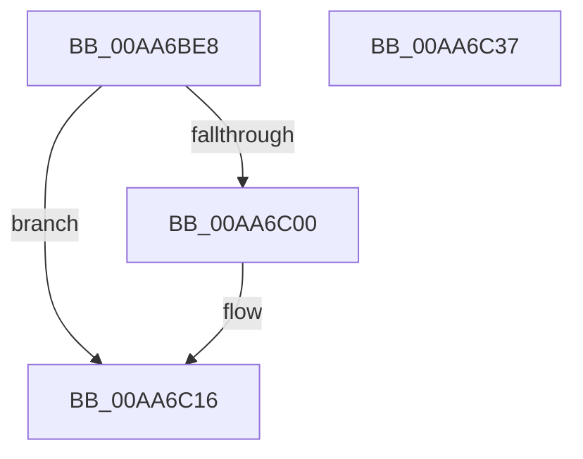

# MiReturnSystemImageCommitment

- RVA: `0x00AA6BE8`–`0x00AA6C38` (길이 `80` bytes)
- VA: `0x0000000140AA6BE8`
- 실행 섹션: `PAGE`
- PDB 이름 있음: `예`; PDB Function 태그: `아니요`
- unwind 정보 RVA: `0x0005C788`
- 디코드: `20`개 명령, `80/80` bytes 표시
- 미해석 바이트: `0` (있으면 어셈블리에 `.byte`로 보존)

> 이 문서는 커널 이미지의 기계어와 PDB 기호를 분석해 생성했습니다. 4번과 5번은 함수 원형과 자료형을 바이너리 사용 방식에서 추정한 C 해석이며 원본 소스 복구 결과는 아닙니다.

## 1. Dependencies

- 직접 호출 지점: **3**; 고유 호출 대상: **3**
- 직접 호출자로 확인된 함수: **1**
- RIP 상대 이미지 참조: **2**

### Outgoing calls
- `0x00AA6BEF` → [MiGetBaseLoaderPortion](../../text/4D/MiGetBaseLoaderPortion_function_004D9D34.md) (function, `0x004D9D34`)
- `0x00AA6C04` → [MiSectionControlArea](../../text/29/MiSectionControlArea_function_00294CB0.md) (function, `0x00294CB0`)
- `0x00AA6C2D` → [MiUnmapReturnCharges](MiUnmapReturnCharges_function_00AA6C40.md) (function, `0x00AA6C40`)

### Direct callers
- [MiUnloadSystemImage](MiUnloadSystemImage_function_00AA2FD4.md) at `0x00AA331F`

### Static image references
- `0x00AA6C1C` → RVA `0x00E376F0` (`.data`; read/write)
- `0x00AA6C26` → RVA `0x00E38D00` (`.data`; read)

## 2. Other-region calls and transfers

- 다른 실행 섹션으로 향하는 call: **2**
  - `0x00AA6BEF` → [MiGetBaseLoaderPortion](../../text/4D/MiGetBaseLoaderPortion_function_004D9D34.md) (`PAGE` → `.text`)
  - `0x00AA6C04` → [MiSectionControlArea](../../text/29/MiSectionControlArea_function_00294CB0.md) (`PAGE` → `.text`)
- 별도 외부 분기/꼬리 이동을 확인하지 못했습니다.

## 3. Assembly (complete function range)

```asm
00AA6BE8  48 83 EC 28                     sub rsp, 0x28
00AA6BEC  4C 8B D2                        mov r10, rdx
00AA6BEF  E8 40 31 A3 FF                  call 0x1404d9d34
00AA6BF4  F7 80 B8 00 00 00 00 04 00 00   test dword ptr [rax + 0xb8], 0x400
00AA6BFE  75 16                           jne 0x140aa6c16
00AA6C00  48 8B 49 70                     mov rcx, qword ptr [rcx + 0x70]
00AA6C04  E8 A7 E0 7E FF                  call 0x140294cb0
00AA6C09  48 8B 08                        mov rcx, qword ptr [rax]
00AA6C0C  8B 41 08                        mov eax, dword ptr [rcx + 8]
00AA6C0F  49 89 42 18                     mov qword ptr [r10 + 0x18], rax
00AA6C13  49 89 02                        mov qword ptr [r10], rax
00AA6C16  41 8B 42 18                     mov eax, dword ptr [r10 + 0x18]
00AA6C1A  F7 D8                           neg eax
00AA6C1C  F0 01 05 CD 0A 39 00            lock add dword ptr [rip + 0x390acd], eax
00AA6C23  49 8B D2                        mov rdx, r10
00AA6C26  48 8D 0D D3 20 39 00            lea rcx, [rip + 0x3920d3]
00AA6C2D  E8 0E 00 00 00                  call 0x140aa6c40
00AA6C32  48 83 C4 28                     add rsp, 0x28
00AA6C36  C3                              ret
00AA6C37  CC                              int3
```

## 4. C-style interpretation (structured pseudocode)

```c
__int64 __fastcall MiReturnSystemImageCommitment(__int64 a1, __int64 a2)
{
    __int64 result;
    __int64 v_rsp;

    v_rsp = (v_rsp) - (40);
    result = MiGetBaseLoaderPortion(a1, a2, a3, a4);
    if (((*(unsigned int *)(result + 184)) & (0x400ULL)) == 0) {
        a1 = *(unsigned __int64 *)(a1 + 112);
        result = MiSectionControlArea(a1, a2, a3, a4);
        a1 = *(unsigned __int64 *)(result);
        result = *(unsigned int *)(a1 + 8);
        *(unsigned __int64 *)(a2 + 24) = result;
        *(unsigned __int64 *)(a2) = result;
    }
    result = (unsigned int)(-((unsigned int)(*(unsigned int *)(a2 + 24))));
    result = MiUnmapReturnCharges(v_rip + 3743955, a2, a3, a4);
    v_rsp = (v_rsp) + (40);
    return result;
}
```

## 5. (Beta) C Style

```c
int64_t MiReturnSystemImageCommitment(int64_t Arg1, int64_t Arg2)
{
    int64_t result;
    int64_t local_rsp;

    local_rsp = (local_rsp) - (40);
    result = MiGetBaseLoaderPortion(Arg1, Arg2, a3, a4);
    if (((*(uint32_t *)(result + 0xB8)) & (0x400ULL)) == 0) {
        Arg1 = *(uint64_t *)(Arg1 + 0x70);
        result = MiSectionControlArea(Arg1, Arg2, a3, a4);
        Arg1 = *(uint64_t *)(result);
        result = *(uint32_t *)(Arg1 + 0x8);
        *(uint64_t *)(Arg2 + 0x18) = result;
        *(uint64_t *)(Arg2) = result;
    }
    result = (uint32_t)(-((uint32_t)(*(uint32_t *)(Arg2 + 0x18))));
    result = MiUnmapReturnCharges(v_rip + 3743955, Arg2, a3, a4);
    local_rsp = (local_rsp) + (40);
    return result;
}
```

## 6. Execution-region graph

[열기: 2D/3D 그래프와 함수 탐색 컨트롤 패널](../../../control-panel.html?section=page&rva=0x00AA6BE8&view=graph)

- 2D 그래프는 위에서 아래로 흐르고, 3D 그래프는 빈 공간을 드래그해 회전합니다. Shift+드래그는 이동, 휠은 확대·축소, 함수 노드 선택은 대상 보고서 이동입니다.

### Static fallback


