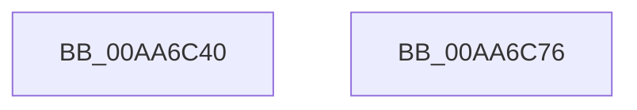

# MiUnmapReturnCharges

- RVA: `0x00AA6C40`–`0x00AA6C77` (길이 `55` bytes)
- VA: `0x0000000140AA6C40`
- 실행 섹션: `PAGE`
- PDB 이름 있음: `예`; PDB Function 태그: `아니요`
- unwind 정보 RVA: `0x0005CAAC`
- 디코드: `17`개 명령, `55/55` bytes 표시
- 미해석 바이트: `0` (있으면 어셈블리에 `.byte`로 보존)

> 이 문서는 커널 이미지의 기계어와 PDB 기호를 분석해 생성했습니다. 4번과 5번은 함수 원형과 자료형을 바이너리 사용 방식에서 추정한 C 해석이며 원본 소스 복구 결과는 아닙니다.

## 1. Dependencies

- 직접 호출 지점: **2**; 고유 호출 대상: **2**
- 직접 호출자로 확인된 함수: **4**
- RIP 상대 이미지 참조: **0**

### Outgoing calls
- `0x00AA6C53` → [MiReturnResident](../../text/28/MiReturnResident_function_00286890.md) (function, `0x00286890`)
- `0x00AA6C66` → [MiReturnCommit](../../text/24/MiReturnCommit_function_00248410.md) (function, `0x00248410`)

### Direct callers
- [MiDeleteBootRange](../../text/66/MiDeleteBootRange_function_0066E450.md) at `0x0066E6AA`
- [MiFreeInitializationCode](../7F/MiFreeInitializationCode_function_007F88A0.md) at `0x007F8B3E`
- [MiReturnSystemImageCommitment](MiReturnSystemImageCommitment_function_00AA6BE8.md) at `0x00AA6C2D`
- [MiFreeBootDriverPages](../../init/C7/MiFreeBootDriverPages_function_00C7695C.md) at `0x00C76C10`

### Static image references
- 디코드된 RIP-relative 메모리 참조가 없습니다.

## 2. Other-region calls and transfers

- 다른 실행 섹션으로 향하는 call: **2**
  - `0x00AA6C53` → [MiReturnResident](../../text/28/MiReturnResident_function_00286890.md) (`PAGE` → `.text`)
  - `0x00AA6C66` → [MiReturnCommit](../../text/24/MiReturnCommit_function_00248410.md) (`PAGE` → `.text`)
- 별도 외부 분기/꼬리 이동을 확인하지 못했습니다.

## 3. Assembly (complete function range)

```asm
00AA6C40  48 89 5C 24 08                  mov qword ptr [rsp + 8], rbx
00AA6C45  57                              push rdi
00AA6C46  48 83 EC 20                     sub rsp, 0x20
00AA6C4A  48 8B DA                        mov rbx, rdx
00AA6C4D  48 8B F9                        mov rdi, rcx
00AA6C50  48 8B 12                        mov rdx, qword ptr [rdx]
00AA6C53  E8 38 FC 7D FF                  call 0x140286890
00AA6C58  48 8B 53 18                     mov rdx, qword ptr [rbx + 0x18]
00AA6C5C  45 33 C0                        xor r8d, r8d
00AA6C5F  48 2B 53 08                     sub rdx, qword ptr [rbx + 8]
00AA6C63  48 8B CF                        mov rcx, rdi
00AA6C66  E8 A5 17 7A FF                  call 0x140248410
00AA6C6B  48 8B 5C 24 30                  mov rbx, qword ptr [rsp + 0x30]
00AA6C70  48 83 C4 20                     add rsp, 0x20
00AA6C74  5F                              pop rdi
00AA6C75  C3                              ret
00AA6C76  CC                              int3
```

## 4. C-style interpretation (structured pseudocode)

```c
__int64 __fastcall MiUnmapReturnCharges(__int64 a1, __int64 a2, int a3)
{
    __int64 result;
    __int64 v_rsp;
    unsigned __int64 v_stack_p8;

    v_stack_p8 = v_rbx;
    v_rsp = (v_rsp) - (32);
    result = MiReturnResident(a1, *(unsigned __int64 *)(a2), a3, a4);
    a3 = 0;
    a2 = (*(unsigned __int64 *)(a2 + 24)) - (*(unsigned __int64 *)(a2 + 8));
    result = MiReturnCommit(a1, a2, a3, a4);
    v_rsp = (v_rsp) + (32);
    return result;
}
```

## 5. (Beta) C Style

```c
int64_t MiUnmapReturnCharges(int64_t Arg1, void *Arg2, int32_t Arg3)
{
    uint8_t *arg2 = (uint8_t *)Arg2;

    int64_t result;
    int64_t local_rsp;
    uint64_t v_stack_p8;

    v_stack_p8 = local_rbx;
    local_rsp = (local_rsp) - (32);
    result = MiReturnResident(Arg1, *(uint64_t *)(arg2), Arg3, a4);
    Arg3 = 0;
    Arg2 = (*(uint64_t *)(arg2 + 0x18)) - (*(uint64_t *)(arg2 + 0x8));
    result = MiReturnCommit(Arg1, Arg2, Arg3, a4);
    local_rsp = (local_rsp) + (32);
    return result;
}
```

### 관측된 메모리 오프셋

구조체 형식이 확인되지 않은 접근은 인자 기준의 오프셋으로만 기록했습니다.

| 기준 인자 | 오프셋 표현 | 폭 (bit) | 접근 |
|---|---:|---:|---|
| `Arg2` | `+ 0x0` | `64` | `R` |
| `Arg2` | `+ 0x8` | `64` | `R` |
| `Arg2` | `+ 0x18` | `64` | `R` |

## 6. Execution-region graph

[열기: 2D/3D 그래프와 함수 탐색 컨트롤 패널](../../../control-panel.html?section=page&rva=0x00AA6C40&view=graph)

- 2D 그래프는 위에서 아래로 흐르고, 3D 그래프는 빈 공간을 드래그해 회전합니다. Shift+드래그는 이동, 휠은 확대·축소, 함수 노드 선택은 대상 보고서 이동입니다.

### Static fallback


