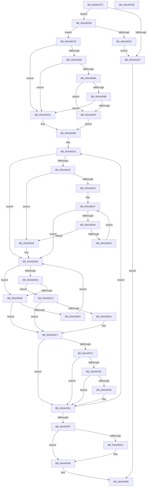

# MmAllocateIndependentPagesEx

- RVA: `0x00AA0CFC`–`0x00AA0FAF` (길이 `691` bytes)
- VA: `0x0000000140AA0CFC`
- 실행 섹션: `PAGE`
- PDB 이름 있음: `예`; PDB Function 태그: `아니요`
- unwind 정보 RVA: `0x000BABF4`
- 디코드: `181`개 명령, `691/691` bytes 표시
- 미해석 바이트: `0` (있으면 어셈블리에 `.byte`로 보존)

> 이 문서는 커널 이미지의 기계어와 PDB 기호를 분석해 생성했습니다. 4번과 5번은 함수 원형과 자료형을 바이너리 사용 방식에서 추정한 C 해석이며 원본 소스 복구 결과는 아닙니다.

## 1. Dependencies

- 직접 호출 지점: **14**; 고유 호출 대상: **14**
- 직접 호출자로 확인된 함수: **9**
- RIP 상대 이미지 참조: **4**

### Outgoing calls
- `0x00AA0D42` → [MiReservePtes](../../text/31/MiReservePtes_function_00318D20.md) (function, `0x00318D20`)
- `0x00AA0D5E` → [MiObtainPoolCharges](../../text/46/MiObtainPoolCharges_function_00460AD8.md) (function, `0x00460AD8`)
- `0x00AA0D74` → [MiReleasePtes](../../text/24/MiReleasePtes_function_00247240.md) (function, `0x00247240`)
- `0x00AA0DE0` → [MiMakeValidPte](../../text/2C/MiMakeValidPte_function_002C5590.md) (function, `0x002C5590`)
- `0x00AA0E06` → [MiInitializePageColorBase](../../text/32/MiInitializePageColorBase_function_00320410.md) (function, `0x00320410`)
- `0x00AA0E1B` → [MiGetNextPageColor](../../text/44/MiGetNextPageColor_function_00442D64.md) (function, `0x00442D64`)
- `0x00AA0E88` → [MiGetSlabPage](../../text/37/MiGetSlabPage_function_00376FBC.md) (function, `0x00376FBC`)
- `0x00AA0EA5` → [MiGetPage](../../text/28/MiGetPage_function_002884C0.md) (function, `0x002884C0`)
- `0x00AA0EBC` → [MiWaitForFreePage](../../text/2A/MiWaitForFreePage_function_002A3324.md) (function, `0x002A3324`)
- `0x00AA0EDB` → [MiIsPfnFromChargedSlabAllocation](../../text/2A/MiIsPfnFromChargedSlabAllocation_function_002A2968.md) (function, `0x002A2968`)
- `0x00AA0F27` → [MiInitializePfn](../../text/33/MiInitializePfn_function_00331E60.md) (function, `0x00331E60`)
- `0x00AA0F46` → [MiGetPteAddress](../../text/43/MiGetPteAddress_function_0043E130.md) (function, `0x0043E130`)
- `0x00AA0F5C` → [MiCheckLinearProtectedPteAccessedBit](../../text/29/MiCheckLinearProtectedPteAccessedBit_function_00292D80.md) (function, `0x00292D80`)
- `0x00AA0F94` → [MiReturnExcessPoolCharges](../../text/36/MiReturnExcessPoolCharges_function_00367C8C.md) (function, `0x00367C8C`)

### Direct callers
- [KiAllocateProcessorStacks](../../text/5B/KiAllocateProcessorStacks_function_005B6D74.md) at `0x005B6E6E`
- [HvlInitializeProcessor](../71/HvlInitializeProcessor_function_0071804C.md) at `0x007181E4`
- [HvlAllocateHibernateResources](../71/HvlAllocateHibernateResources_function_007186D4.md) at `0x00718714`
- [ExCreatePoolTagTable](../7C/ExCreatePoolTagTable_function_007C76FC.md) at `0x007C7736`
- [MmAllocateIsrStack](../80/MmAllocateIsrStack_function_00807ECC.md) at `0x00807F08`
- [HvpAllocateNonPagedBin](../9B/HvpAllocateNonPagedBin_function_009B7904.md) at `0x009B7942`
- [MmAllocateIndependentPages](MmAllocateIndependentPages_function_00AA0CE0.md) at `0x00AA0CEA`
- [KeStartAllProcessors](../../init/C3/KeStartAllProcessors_function_00C36F78.md) at `0x00C371E3`
- [PspIumInitialize](../../init/C4/PspIumInitialize_function_00C467A8.md) at `0x00C46808`

### Static image references
- `0x00AA0D34` → RVA `0x00E37668` (`.data`; read)
- `0x00AA0D80` → RVA `0x00E38D04` (`.data`; read)
- `0x00AA0D8A` → RVA `0x00FC6A88` (`ALMOSTRO`; read)
- `0x00AA0E61` → RVA `0x00E38D00` (`.data`; read)

## 2. Other-region calls and transfers

- 다른 실행 섹션으로 향하는 call: **14**
  - `0x00AA0D42` → [MiReservePtes](../../text/31/MiReservePtes_function_00318D20.md) (`PAGE` → `.text`)
  - `0x00AA0D5E` → [MiObtainPoolCharges](../../text/46/MiObtainPoolCharges_function_00460AD8.md) (`PAGE` → `.text`)
  - `0x00AA0D74` → [MiReleasePtes](../../text/24/MiReleasePtes_function_00247240.md) (`PAGE` → `.text`)
  - `0x00AA0DE0` → [MiMakeValidPte](../../text/2C/MiMakeValidPte_function_002C5590.md) (`PAGE` → `.text`)
  - `0x00AA0E06` → [MiInitializePageColorBase](../../text/32/MiInitializePageColorBase_function_00320410.md) (`PAGE` → `.text`)
  - `0x00AA0E1B` → [MiGetNextPageColor](../../text/44/MiGetNextPageColor_function_00442D64.md) (`PAGE` → `.text`)
  - `0x00AA0E88` → [MiGetSlabPage](../../text/37/MiGetSlabPage_function_00376FBC.md) (`PAGE` → `.text`)
  - `0x00AA0EA5` → [MiGetPage](../../text/28/MiGetPage_function_002884C0.md) (`PAGE` → `.text`)
  - `0x00AA0EBC` → [MiWaitForFreePage](../../text/2A/MiWaitForFreePage_function_002A3324.md) (`PAGE` → `.text`)
  - `0x00AA0EDB` → [MiIsPfnFromChargedSlabAllocation](../../text/2A/MiIsPfnFromChargedSlabAllocation_function_002A2968.md) (`PAGE` → `.text`)
  - `0x00AA0F27` → [MiInitializePfn](../../text/33/MiInitializePfn_function_00331E60.md) (`PAGE` → `.text`)
  - `0x00AA0F46` → [MiGetPteAddress](../../text/43/MiGetPteAddress_function_0043E130.md) (`PAGE` → `.text`)
  - `0x00AA0F5C` → [MiCheckLinearProtectedPteAccessedBit](../../text/29/MiCheckLinearProtectedPteAccessedBit_function_00292D80.md) (`PAGE` → `.text`)
  - `0x00AA0F94` → [MiReturnExcessPoolCharges](../../text/36/MiReturnExcessPoolCharges_function_00367C8C.md) (`PAGE` → `.text`)
- 별도 외부 분기/꼬리 이동을 확인하지 못했습니다.

## 3. Assembly (complete function range)

```asm
00AA0CFC  44 89 4C 24 20                  mov dword ptr [rsp + 0x20], r9d
00AA0D01  4C 89 44 24 18                  mov qword ptr [rsp + 0x18], r8
00AA0D06  53                              push rbx
00AA0D07  55                              push rbp
00AA0D08  57                              push rdi
00AA0D09  41 54                           push r12
00AA0D0B  41 55                           push r13
00AA0D0D  41 56                           push r14
00AA0D0F  41 57                           push r15
00AA0D11  48 83 EC 60                     sub rsp, 0x60
00AA0D15  48 F7 C1 FF 0F 00 00            test rcx, 0xfff
00AA0D1C  BD 00 00 00 00                  mov ebp, 0
00AA0D21  8B FA                           mov edi, edx
00AA0D23  0F 57 C0                        xorps xmm0, xmm0
00AA0D26  40 0F 95 C5                     setne bpl
00AA0D2A  4D 8B E8                        mov r13, r8
00AA0D2D  48 C1 E9 0C                     shr rcx, 0xc
00AA0D31  48 03 E9                        add rbp, rcx
00AA0D34  48 8D 0D 2D 69 39 00            lea rcx, [rip + 0x39692d]
00AA0D3B  8B D5                           mov edx, ebp
00AA0D3D  0F 11 44 24 48                  movups xmmword ptr [rsp + 0x48], xmm0
00AA0D42  E8 D9 7F 87 FF                  call 0x140318d20
00AA0D47  4C 8B F0                        mov r14, rax
00AA0D4A  48 85 C0                        test rax, rax
00AA0D4D  75 07                           jne 0x140aa0d56
00AA0D4F  33 C0                           xor eax, eax
00AA0D51  E9 48 02 00 00                  jmp 0x140aa0f9e
00AA0D56  BA 01 00 00 00                  mov edx, 1
00AA0D5B  48 8B CD                        mov rcx, rbp
00AA0D5E  E8 75 FD 9B FF                  call 0x140460ad8
00AA0D63  85 C0                           test eax, eax
00AA0D65  75 14                           jne 0x140aa0d7b
00AA0D67  44 8B C5                        mov r8d, ebp
00AA0D6A  48 8D 0D F7 68 39 00            lea rcx, [rip + 0x3968f7]
00AA0D71  49 8B D6                        mov rdx, r14
00AA0D74  E8 C7 64 7A FF                  call 0x140247240
00AA0D79  EB D4                           jmp 0x140aa0d4f
00AA0D7B  4D 85 ED                        test r13, r13
00AA0D7E  74 2C                           je 0x140aa0dac
00AA0D80  8B 05 7E 7F 39 00               mov eax, dword ptr [rip + 0x397f7e]
00AA0D86  A8 08                           test al, 8
00AA0D88  74 22                           je 0x140aa0dac
00AA0D8A  48 8B 05 F7 5C 52 00            mov rax, qword ptr [rip + 0x525cf7]
00AA0D91  48 0F BA E0 20                  bt rax, 0x20
00AA0D96  73 07                           jae 0x140aa0d9f
00AA0D98  48 0F BA E0 21                  bt rax, 0x21
00AA0D9D  73 0D                           jae 0x140aa0dac
00AA0D9F  C7 84 24 A0 00 00 00 01 00 00 00  mov dword ptr [rsp + 0xa0], 1
00AA0DAA  EB 08                           jmp 0x140aa0db4
00AA0DAC  83 A4 24 A0 00 00 00 00         and dword ptr [rsp + 0xa0], 0
00AA0DB4  49 8B CE                        mov rcx, r14
00AA0DB7  48 C1 E1 19                     shl rcx, 0x19
00AA0DBB  48 B8 00 00 00 00 80 F6 FF FF   movabs rax, 0xfffff68000000000
00AA0DC5  48 C1 E0 19                     shl rax, 0x19
00AA0DC9  33 D2                           xor edx, edx
00AA0DCB  48 2B C8                        sub rcx, rax
00AA0DCE  41 B8 04 00 00 A0               mov r8d, 0xa0000004
00AA0DD4  48 C1 F9 10                     sar rcx, 0x10
00AA0DD8  48 89 4C 24 40                  mov qword ptr [rsp + 0x40], rcx
00AA0DDD  49 8B CE                        mov rcx, r14
00AA0DE0  E8 AB 47 82 FF                  call 0x1402c5590
00AA0DE5  33 C9                           xor ecx, ecx
00AA0DE7  4C 8D 4C 24 48                  lea r9, [rsp + 0x48]
00AA0DEC  48 8B D8                        mov rbx, rax
00AA0DEF  83 FF FF                        cmp edi, -1
00AA0DF2  8D 47 01                        lea eax, [rdi + 1]
00AA0DF5  BA 03 00 00 00                  mov edx, 3
00AA0DFA  0F 45 C8                        cmovne ecx, eax
00AA0DFD  89 4C 24 30                     mov dword ptr [rsp + 0x30], ecx
00AA0E01  44 8B C1                        mov r8d, ecx
00AA0E04  33 C9                           xor ecx, ecx
00AA0E06  E8 05 F6 87 FF                  call 0x140320410
00AA0E0B  45 33 FF                        xor r15d, r15d
00AA0E0E  45 33 DB                        xor r11d, r11d
00AA0E11  4C 89 5C 24 38                  mov qword ptr [rsp + 0x38], r11
00AA0E16  48 8D 4C 24 48                  lea rcx, [rsp + 0x48]
00AA0E1B  E8 44 1F 9A FF                  call 0x140442d64
00AA0E20  45 33 E4                        xor r12d, r12d
00AA0E23  8B F8                           mov edi, eax
00AA0E25  44 39 A4 24 A0 00 00 00         cmp dword ptr [rsp + 0xa0], r12d
00AA0E2D  74 29                           je 0x140aa0e58
00AA0E2F  49 83 FD FF                     cmp r13, -1
00AA0E33  74 1D                           je 0x140aa0e52
00AA0E35  33 D2                           xor edx, edx
00AA0E37  3B 94 24 B8 00 00 00            cmp edx, dword ptr [rsp + 0xb8]
00AA0E3E  73 18                           jae 0x140aa0e58
00AA0E40  49 8B 4C D5 00                  mov rcx, qword ptr [r13 + rdx*8]
00AA0E45  48 C1 E9 0C                     shr rcx, 0xc
00AA0E49  4C 3B D9                        cmp r11, rcx
00AA0E4C  74 04                           je 0x140aa0e52
00AA0E4E  FF C2                           inc edx
00AA0E50  EB E5                           jmp 0x140aa0e37
00AA0E52  41 BC 01 00 00 00               mov r12d, 1
00AA0E58  45 85 E4                        test r12d, r12d
00AA0E5B  74 39                           je 0x140aa0e96
00AA0E5D  8B 44 24 30                     mov eax, dword ptr [rsp + 0x30]
00AA0E61  48 8D 0D 98 7E 39 00            lea rcx, [rip + 0x397e98]
00AA0E68  F7 D8                           neg eax
00AA0E6A  44 8B C7                        mov r8d, edi
00AA0E6D  BA 01 00 00 00                  mov edx, 1
00AA0E72  45 1B C9                        sbb r9d, r9d
00AA0E75  83 64 24 28 00                  and dword ptr [rsp + 0x28], 0
00AA0E7A  48 83 4C 24 20 FF               or qword ptr [rsp + 0x20], 0xffffffffffffffff
00AA0E80  41 83 E1 FE                     and r9d, 0xfffffffe
00AA0E84  41 83 C1 06                     add r9d, 6
00AA0E88  E8 2F 61 8D FF                  call 0x140376fbc
00AA0E8D  4C 8B C8                        mov r9, rax
00AA0E90  48 83 F8 FF                     cmp rax, -1
00AA0E94  75 2D                           jne 0x140aa0ec3
00AA0E96  41 B8 80 00 00 00               mov r8d, 0x80
00AA0E9C  48 8D 0D 5D 7E 39 00            lea rcx, [rip + 0x397e5d]
00AA0EA3  8B D7                           mov edx, edi
00AA0EA5  E8 16 76 7E FF                  call 0x1402884c0
00AA0EAA  4C 8B C8                        mov r9, rax
00AA0EAD  48 83 F8 FF                     cmp rax, -1
00AA0EB1  75 34                           jne 0x140aa0ee7
00AA0EB3  33 D2                           xor edx, edx
00AA0EB5  48 8D 0D 44 7E 39 00            lea rcx, [rip + 0x397e44]
00AA0EBC  E8 63 24 80 FF                  call 0x1402a3324
00AA0EC1  EB 95                           jmp 0x140aa0e58
00AA0EC3  48 8D 0C 40                     lea rcx, [rax + rax*2]
00AA0EC7  48 B8 00 00 00 00 00 DE FF FF   movabs rax, 0xffffde0000000000
00AA0ED1  48 C1 E1 04                     shl rcx, 4
00AA0ED5  48 8B C0                        mov rax, rax
00AA0ED8  48 03 C8                        add rcx, rax
00AA0EDB  E8 88 1A 80 FF                  call 0x1402a2968
00AA0EE0  85 C0                           test eax, eax
00AA0EE2  74 03                           je 0x140aa0ee7
00AA0EE4  49 FF C7                        inc r15
00AA0EE7  49 8B C9                        mov rcx, r9
00AA0EEA  48 B8 00 00 00 00 00 DE FF FF   movabs rax, 0xffffde0000000000
00AA0EF4  48 C1 E1 0C                     shl rcx, 0xc
00AA0EF8  48 BA FF 0F 00 00 00 00 F0 FF   movabs rdx, 0xfff0000000000fff
00AA0F02  48 33 D9                        xor rbx, rcx
00AA0F05  48 23 DA                        and rbx, rdx
00AA0F08  48 33 D9                        xor rbx, rcx
00AA0F0B  4B 8D 0C 49                     lea rcx, [r9 + r9*2]
00AA0F0F  48 C1 E1 04                     shl rcx, 4
00AA0F13  48 8B C0                        mov rax, rax
00AA0F16  48 03 C8                        add rcx, rax
00AA0F19  49 8B D6                        mov rdx, r14
00AA0F1C  B8 04 00 00 00                  mov eax, 4
00AA0F21  44 8B C8                        mov r9d, eax
00AA0F24  44 8B C0                        mov r8d, eax
00AA0F27  E8 34 0F 89 FF                  call 0x140331e60
00AA0F2C  48 0F BA 25 53 5B 52 00 24      bt qword ptr [rip + 0x525b53], 0x24
00AA0F35  73 2A                           jae 0x140aa0f61
00AA0F37  F6 C3 20                        test bl, 0x20
00AA0F3A  75 25                           jne 0x140aa0f61
00AA0F3C  48 B9 00 00 00 00 00 80 FF FF   movabs rcx, 0xffff800000000000
00AA0F46  E8 E5 D1 99 FF                  call 0x14043e130
00AA0F4B  4C 3B F0                        cmp r14, rax
00AA0F4E  72 11                           jb 0x140aa0f61
00AA0F50  41 B8 80 00 00 00               mov r8d, 0x80
00AA0F56  48 8B D3                        mov rdx, rbx
00AA0F59  49 8B CE                        mov rcx, r14
00AA0F5C  E8 1F 1E 7F FF                  call 0x140292d80
00AA0F61  4C 8B 5C 24 38                  mov r11, qword ptr [rsp + 0x38]
00AA0F66  4C 8B AC 24 B0 00 00 00         mov r13, qword ptr [rsp + 0xb0]
00AA0F6E  49 FF C3                        inc r11
00AA0F71  49 89 1E                        mov qword ptr [r14], rbx
00AA0F74  49 83 C6 08                     add r14, 8
00AA0F78  4C 89 5C 24 38                  mov qword ptr [rsp + 0x38], r11
00AA0F7D  48 83 ED 01                     sub rbp, 1
00AA0F81  0F 85 8F FE FF FF               jne 0x140aa0e16
00AA0F87  4D 85 FF                        test r15, r15
00AA0F8A  74 0D                           je 0x140aa0f99
00AA0F8C  BA 01 00 00 00                  mov edx, 1
00AA0F91  49 8B CF                        mov rcx, r15
00AA0F94  E8 F3 6C 8C FF                  call 0x140367c8c
00AA0F99  48 8B 44 24 40                  mov rax, qword ptr [rsp + 0x40]
00AA0F9E  48 83 C4 60                     add rsp, 0x60
00AA0FA2  41 5F                           pop r15
00AA0FA4  41 5E                           pop r14
00AA0FA6  41 5D                           pop r13
00AA0FA8  41 5C                           pop r12
00AA0FAA  5F                              pop rdi
00AA0FAB  5D                              pop rbp
00AA0FAC  5B                              pop rbx
00AA0FAD  C3                              ret
00AA0FAE  CC                              int3
```

## 4. C-style interpretation (structured pseudocode)

```c
__int64 __fastcall MmAllocateIndependentPagesEx(__int64 a1, int a2, __int64 a3, int a4)
{
    __int64 result;
    __int64 v_r11;
    __int64 v_r12;
    __int64 v_r14;
    __int64 v_r15;
    __int64 v_rbp;
    __int64 v_rbx;
    __int64 v_rsp;
    unsigned __int64 v_stack_m50;
    unsigned __int64 v_stack_m58;
    unsigned __int64 v_stack_m60;
    unsigned int v_stack_m68;
    unsigned int v_stack_m70;
    unsigned __int64 v_stack_m78;
    unsigned __int64 v_stack_p18;
    unsigned int v_stack_p20;
    unsigned int v_stack_p8;

    v_stack_p20 = a4;
    v_stack_p18 = a3;
    v_rsp = (v_rsp) - (96);
    v_rbp = (((a1) & (0xFFFULL)) != 0) ? 1 : 0;
    a1 = (a1) >> (12);
    v_rbp = (v_rbp) + (a1);
    v_stack_m50 = v_xmm0;
    result = MiReservePtes(v_rip + 3762477, (unsigned int)((unsigned int)(v_rbp)), a3, a4);
    if (result != 0) goto loc_00AA0D56;
loc_00AA0D4F:
    result = 0;
    goto loc_00AA0F9E;
loc_00AA0D56:
    result = MiObtainPoolCharges(v_rbp, 1, a3, a4);
    if ((unsigned int)(result) != 0) goto loc_00AA0D7B;
    result = MiReleasePtes(v_rip + 3762423, result, (unsigned int)((unsigned int)(v_rbp)), a4);
    goto loc_00AA0D4F;
loc_00AA0D7B:
    if (a3 == 0) goto loc_00AA0DAC;
    if ((((unsigned __int8)((unsigned int)(*(unsigned int *)(v_rip + 3768190)))) & (8)) == 0) goto loc_00AA0DAC;
    if (condition_is_above_or_equal) goto loc_00AA0D9F;
    if (condition_is_above_or_equal) goto loc_00AA0DAC;
loc_00AA0D9F:
    v_stack_p8 = 1;
    goto loc_00AA0DB4;
loc_00AA0DAC:
loc_00AA0DB4:
    a1 = (result) << (25);
    result = (*(unsigned __int64 *)(v_rip + 5397751)) << (25);
    a2 = 0;
    a1 = (a1) - (result);
    a1 = (a1) >> (16);
    v_stack_m58 = a1;
    result = MiMakeValidPte(result, a2, (unsigned int)(0xA0000004ULL), a4);
    a1 = 0;
    if (((unsigned int)((unsigned int)(a2))) != -1) { a1 = (unsigned int)((unsigned int)(a2) + 1); }
    v_stack_m68 = (unsigned int)(a1);
    a1 = 0;
    result = MiInitializePageColorBase(a1, 3, (unsigned int)((unsigned int)(a1)), v_stack_m50);
    v_r15 = 0;
    v_r11 = 0;
    v_stack_m60 = 0;
loc_00AA0E16:
    result = MiGetNextPageColor(v_stack_m50, 3, (unsigned int)((unsigned int)(a1)), v_stack_m50);
    v_r12 = 0;
    if (v_stack_p8 == 0) goto loc_00AA0E58;
    if (a3 == -1) goto loc_00AA0E52;
    a2 = 0;
loc_00AA0E37:
    if (0 >= v_stack_p20) goto loc_00AA0E58;
    a1 = (*(unsigned __int64 *)(a3 + a2 * 8)) >> (12);
    if (0 == a1) goto loc_00AA0E52;
    a2 = (unsigned int)((a2) + 1);
    goto loc_00AA0E37;
loc_00AA0E52:
loc_00AA0E58:
    if (1 == 0) goto loc_00AA0E96;
    result = (unsigned int)(-((unsigned int)(v_stack_m68)));
    a4 = (unsigned int)((v_stack_m50) & (0xFFFFFFFEULL));
    a4 = (unsigned int)((a4) + (6));
    result = MiGetSlabPage(v_rip + 3767960, 1, (unsigned int)((unsigned int)((unsigned int)((unsigned int)(result)))), a4);
    if (result != -1) goto loc_00AA0EC3;
loc_00AA0E96:
    result = MiGetPage(v_rip + 3767901, (unsigned int)((unsigned int)((unsigned int)((unsigned int)(result)))), 128, result);
    if (result != -1) goto loc_00AA0EE7;
    a2 = 0;
    result = MiWaitForFreePage(v_rip + 3767876, a2, 128, result);
    goto loc_00AA0E58;
loc_00AA0EC3:
    a1 = (result + result * 2) << (4);
    a1 = (a1) + (result);
    result = MiIsPfnFromChargedSlabAllocation(a1, a2, 128, result);
    if ((unsigned int)(result) != 0) {
        v_r15 = (v_r15) + 1;
    }
    a1 = (result) << (12);
    v_rbx = (result) ^ (a1);
    v_rbx = (v_rbx) & (0);
    v_rbx = (v_rbx) ^ (a1);
    a1 = (result + result * 2) << (4);
    a1 = (a1) + (result);
    result = MiInitializePfn(a1, result, 4, 4);
    if (condition_is_above_or_equal) goto loc_00AA0F61;
    if ((((unsigned __int8)(v_rbx)) & (32)) != 0) goto loc_00AA0F61;
    result = MiGetPteAddress(a1, result, 4, 4);
    if (result >= result) {
        a3 = 128;
        a2 = v_rbx;
        a1 = result;
        result = MiCheckLinearProtectedPteAccessedBit(a1, a2, a3, 4);
    }
    v_r11 = (v_stack_m60) + 1;
    *(unsigned __int64 *)(result) = v_rbx;
    v_r14 = (result) + (8);
    v_stack_m60 = v_r11;
    v_rbp = (v_rbp) - (1);
    if (condition_is_not_equal) goto loc_00AA0E16;
    if (v_r15 != 0) {
        a2 = 1;
        a1 = v_r15;
        result = MiReturnExcessPoolCharges(a1, a2, a3, 4);
    }
loc_00AA0F9E:
    v_rsp = (v_rsp) + (96);
    return v_stack_m58;
}
```

## 5. (Beta) C Style

```c
int64_t MmAllocateIndependentPagesEx(int64_t Arg1, int32_t Arg2, int64_t Arg3, int32_t Arg4)
{
    int64_t result;
    int64_t local_r11;
    int64_t local_r12;
    int64_t local_r14;
    int64_t local_r15;
    int64_t local_rbp;
    int64_t local_rbx;
    int64_t local_rsp;
    uint64_t v_stack_m50;
    uint64_t v_stack_m58;
    uint64_t v_stack_m60;
    uint32_t v_stack_m68;
    uint32_t v_stack_m70;
    uint64_t v_stack_m78;
    uint64_t v_stack_p18;
    uint32_t v_stack_p20;
    uint32_t v_stack_p8;

    v_stack_p20 = Arg4;
    v_stack_p18 = Arg3;
    local_rsp = (local_rsp) - (96);
    local_rbp = (((Arg1) & (0xFFFULL)) != 0) ? 1 : 0;
    Arg1 = (Arg1) >> (12);
    local_rbp = (local_rbp) + (Arg1);
    v_stack_m50 = v_xmm0;
    result = MiReservePtes(v_rip + 3762477, (uint32_t)((uint32_t)(local_rbp)), Arg3, Arg4);
    if (result != 0) goto loc_00AA0D56;
loc_00AA0D4F:
    result = 0;
    goto loc_00AA0F9E;
loc_00AA0D56:
    result = MiObtainPoolCharges(local_rbp, 1, Arg3, Arg4);
    if ((uint32_t)(result) != 0) goto loc_00AA0D7B;
    result = MiReleasePtes(v_rip + 3762423, result, (uint32_t)((uint32_t)(local_rbp)), Arg4);
    goto loc_00AA0D4F;
loc_00AA0D7B:
    if (Arg3 == 0) goto loc_00AA0DAC;
    if ((((uint8_t)((uint32_t)(*(uint32_t *)(v_rip + 0x397F7E)))) & (8)) == 0) goto loc_00AA0DAC;
    if (condition_is_above_or_equal) goto loc_00AA0D9F;
    if (condition_is_above_or_equal) goto loc_00AA0DAC;
loc_00AA0D9F:
    v_stack_p8 = 1;
    goto loc_00AA0DB4;
loc_00AA0DAC:
loc_00AA0DB4:
    Arg1 = (result) << (25);
    result = (*(uint64_t *)(v_rip + 0x525CF7)) << (25);
    Arg2 = 0;
    Arg1 = (Arg1) - (result);
    Arg1 = (Arg1) >> (16);
    v_stack_m58 = Arg1;
    result = MiMakeValidPte(result, Arg2, (uint32_t)(0xA0000004ULL), Arg4);
    Arg1 = 0;
    if (((uint32_t)((uint32_t)(Arg2))) != -1) { Arg1 = (uint32_t)((uint32_t)(Arg2) + 1); }
    v_stack_m68 = (uint32_t)(Arg1);
    Arg1 = 0;
    result = MiInitializePageColorBase(Arg1, 3, (uint32_t)((uint32_t)(Arg1)), v_stack_m50);
    local_r15 = 0;
    local_r11 = 0;
    v_stack_m60 = 0;
loc_00AA0E16:
    result = MiGetNextPageColor(v_stack_m50, 3, (uint32_t)((uint32_t)(Arg1)), v_stack_m50);
    local_r12 = 0;
    if (v_stack_p8 == 0) goto loc_00AA0E58;
    if (Arg3 == -1) goto loc_00AA0E52;
    Arg2 = 0;
loc_00AA0E37:
    if (0 >= v_stack_p20) goto loc_00AA0E58;
    Arg1 = (*(uint64_t *)(Arg3 + Arg2 * 8)) >> (12);
    if (0 == Arg1) goto loc_00AA0E52;
    Arg2 = (uint32_t)((Arg2) + 1);
    goto loc_00AA0E37;
loc_00AA0E52:
loc_00AA0E58:
    if (1 == 0) goto loc_00AA0E96;
    result = (uint32_t)(-((uint32_t)(v_stack_m68)));
    Arg4 = (uint32_t)((v_stack_m50) & (0xFFFFFFFEULL));
    Arg4 = (uint32_t)((Arg4) + (6));
    result = MiGetSlabPage(v_rip + 3767960, 1, (uint32_t)((uint32_t)((uint32_t)((uint32_t)(result)))), Arg4);
    if (result != -1) goto loc_00AA0EC3;
loc_00AA0E96:
    result = MiGetPage(v_rip + 3767901, (uint32_t)((uint32_t)((uint32_t)((uint32_t)(result)))), 128, result);
    if (result != -1) goto loc_00AA0EE7;
    Arg2 = 0;
    result = MiWaitForFreePage(v_rip + 3767876, Arg2, 128, result);
    goto loc_00AA0E58;
loc_00AA0EC3:
    Arg1 = (result + result * 2) << (4);
    Arg1 = (Arg1) + (result);
    result = MiIsPfnFromChargedSlabAllocation(Arg1, Arg2, 128, result);
    if ((uint32_t)(result) != 0) {
        local_r15 = (local_r15) + 1;
    }
    Arg1 = (result) << (12);
    local_rbx = (result) ^ (Arg1);
    local_rbx = (local_rbx) & (0);
    local_rbx = (local_rbx) ^ (Arg1);
    Arg1 = (result + result * 2) << (4);
    Arg1 = (Arg1) + (result);
    result = MiInitializePfn(Arg1, result, 4, 4);
    if (condition_is_above_or_equal) goto loc_00AA0F61;
    if ((((uint8_t)(local_rbx)) & (32)) != 0) goto loc_00AA0F61;
    result = MiGetPteAddress(Arg1, result, 4, 4);
    if (result >= result) {
        Arg3 = 128;
        Arg2 = local_rbx;
        Arg1 = result;
        result = MiCheckLinearProtectedPteAccessedBit(Arg1, Arg2, Arg3, 4);
    }
    local_r11 = (v_stack_m60) + 1;
    *(uint64_t *)(result) = local_rbx;
    local_r14 = (result) + (8);
    v_stack_m60 = local_r11;
    local_rbp = (local_rbp) - (1);
    if (condition_is_not_equal) goto loc_00AA0E16;
    if (local_r15 != 0) {
        Arg2 = 1;
        Arg1 = local_r15;
        result = MiReturnExcessPoolCharges(Arg1, Arg2, Arg3, 4);
    }
loc_00AA0F9E:
    local_rsp = (local_rsp) + (96);
    return v_stack_m58;
}
```

## 6. Execution-region graph

[열기: 2D/3D 그래프와 함수 탐색 컨트롤 패널](../../../control-panel.html?section=page&rva=0x00AA0CFC&view=graph)

- 2D 그래프는 위에서 아래로 흐르고, 3D 그래프는 빈 공간을 드래그해 회전합니다. Shift+드래그는 이동, 휠은 확대·축소, 함수 노드 선택은 대상 보고서 이동입니다.

### Static fallback


