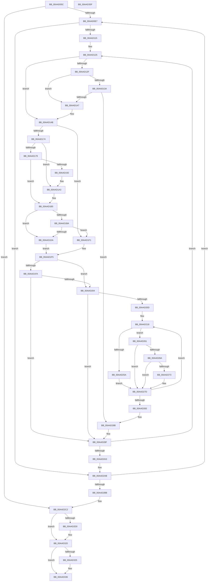

# MmIdentifyPhysicalMemory

- RVA: `0x00AAD05C`–`0x00AAD360` (길이 `772` bytes)
- VA: `0x0000000140AAD05C`
- 실행 섹션: `PAGE`
- PDB 이름 있음: `예`; PDB Function 태그: `아니요`
- unwind 정보 RVA: `0x000BC0C0`
- 디코드: `204`개 명령, `772/772` bytes 표시
- 미해석 바이트: `0` (있으면 어셈블리에 `.byte`로 보존)

> 이 문서는 커널 이미지의 기계어와 PDB 기호를 분석해 생성했습니다. 4번과 5번은 함수 원형과 자료형을 바이너리 사용 방식에서 추정한 C 해석이며 원본 소스 복구 결과는 아닙니다.

## 1. Dependencies

- 직접 호출 지점: **10**; 고유 호출 대상: **8**
- 직접 호출자로 확인된 함수: **2**
- RIP 상대 이미지 참조: **5**

### Outgoing calls
- `0x00AAD0CC` → [MiReferencePageRuns](../../text/37/MiReferencePageRuns_function_00379540.md) (function, `0x00379540`)
- `0x00AAD15F` → [MiIdentifyPfnWrapper](../../text/31/MiIdentifyPfnWrapper_function_0031C8F0.md) (function, `0x0031C8F0`)
- `0x00AAD19E` → [PsDereferencePartition](../../text/34/PsDereferencePartition_function_00342E70.md) (function, `0x00342E70`)
- `0x00AAD1AC` → [MiReferencePagePartition](../../text/67/MiReferencePagePartition_function_00679304.md) (function, `0x00679304`)
- `0x00AAD1D0` → [MiPfnsWorthTrying](../../text/31/MiPfnsWorthTrying_function_0031B0C0.md) (function, `0x0031B0C0`)
- `0x00AAD248` → [EtwTraceSiloDcEvent](../../text/48/EtwTraceSiloDcEvent_function_0048B28C.md) (function, `0x0048B28C`)
- `0x00AAD2C5` → [MiDereferencePageRuns](../../text/3B/MiDereferencePageRuns_function_003BD388.md) (function, `0x003BD388`)
- `0x00AAD31B` → [EtwTraceSiloDcEvent](../../text/48/EtwTraceSiloDcEvent_function_0048B28C.md) (function, `0x0048B28C`)
- `0x00AAD331` → [PsDereferencePartition](../../text/34/PsDereferencePartition_function_00342E70.md) (function, `0x00342E70`)
- `0x00AAD33F` → [_security_check_cookie](../../text/6A/_security_check_cookie_function_006AC640.md) (function, `0x006AC640`)

### Direct callers
- [EtwpSetMark](../7B/EtwpSetMark_function_007B878C.md) at `0x007B88C6`
- [EtwpKernelTraceRundown](../9E/EtwpKernelTraceRundown_function_009E4080.md) at `0x009E42FC`
- [EtwpKernelTraceRundown](../9E/EtwpKernelTraceRundown_function_009E4080.md) at `0x009E4345`
- [EtwpKernelTraceRundown](../9E/EtwpKernelTraceRundown_function_009E4080.md) at `0x009E440F`

### Static image references
- `0x00AAD078` → RVA `0x00E0A740` (`.data`; read)
- `0x00AAD0B1` → RVA `0x00E38D00` (`.data`; read)
- `0x00AAD26A` → RVA `0x00FC6C08` (`ALMOSTRO`; read)
- `0x00AAD2D0` → RVA `0x00FC6C38` (`ALMOSTRO`; read)
- `0x00AAD2F2` → RVA `0x00FC6DE0` (`ALMOSTRO`; read)

## 2. Other-region calls and transfers

- 다른 실행 섹션으로 향하는 call: **10**
  - `0x00AAD0CC` → [MiReferencePageRuns](../../text/37/MiReferencePageRuns_function_00379540.md) (`PAGE` → `.text`)
  - `0x00AAD15F` → [MiIdentifyPfnWrapper](../../text/31/MiIdentifyPfnWrapper_function_0031C8F0.md) (`PAGE` → `.text`)
  - `0x00AAD19E` → [PsDereferencePartition](../../text/34/PsDereferencePartition_function_00342E70.md) (`PAGE` → `.text`)
  - `0x00AAD1AC` → [MiReferencePagePartition](../../text/67/MiReferencePagePartition_function_00679304.md) (`PAGE` → `.text`)
  - `0x00AAD1D0` → [MiPfnsWorthTrying](../../text/31/MiPfnsWorthTrying_function_0031B0C0.md) (`PAGE` → `.text`)
  - `0x00AAD248` → [EtwTraceSiloDcEvent](../../text/48/EtwTraceSiloDcEvent_function_0048B28C.md) (`PAGE` → `.text`)
  - `0x00AAD2C5` → [MiDereferencePageRuns](../../text/3B/MiDereferencePageRuns_function_003BD388.md) (`PAGE` → `.text`)
  - `0x00AAD31B` → [EtwTraceSiloDcEvent](../../text/48/EtwTraceSiloDcEvent_function_0048B28C.md) (`PAGE` → `.text`)
  - `0x00AAD331` → [PsDereferencePartition](../../text/34/PsDereferencePartition_function_00342E70.md) (`PAGE` → `.text`)
  - `0x00AAD33F` → [_security_check_cookie](../../text/6A/_security_check_cookie_function_006AC640.md) (`PAGE` → `.text`)
- 별도 외부 분기/꼬리 이동을 확인하지 못했습니다.

## 3. Assembly (complete function range)

```asm
00AAD05C  48 89 5C 24 18                  mov qword ptr [rsp + 0x18], rbx
00AAD061  55                              push rbp
00AAD062  56                              push rsi
00AAD063  57                              push rdi
00AAD064  41 54                           push r12
00AAD066  41 55                           push r13
00AAD068  41 56                           push r14
00AAD06A  41 57                           push r15
00AAD06C  48 8D 6C 24 D9                  lea rbp, [rsp - 0x27]
00AAD071  48 81 EC B0 00 00 00            sub rsp, 0xb0
00AAD078  48 8B 05 C1 D6 35 00            mov rax, qword ptr [rip + 0x35d6c1]
00AAD07F  48 33 C4                        xor rax, rsp
00AAD082  48 89 45 1F                     mov qword ptr [rbp + 0x1f], rax
00AAD086  33 C0                           xor eax, eax
00AAD088  89 55 BB                        mov dword ptr [rbp - 0x45], edx
00AAD08B  21 45 D7                        and dword ptr [rbp - 0x29], eax
00AAD08E  0F 57 C0                        xorps xmm0, xmm0
00AAD091  8B F2                           mov esi, edx
00AAD093  48 89 4D E7                     mov qword ptr [rbp - 0x19], rcx
00AAD097  48 8B F9                        mov rdi, rcx
00AAD09A  48 89 45 CF                     mov qword ptr [rbp - 0x31], rax
00AAD09E  0F 57 C9                        xorps xmm1, xmm1
00AAD0A1  48 89 45 FF                     mov qword ptr [rbp - 1], rax
00AAD0A5  33 DB                           xor ebx, ebx
00AAD0A7  44 89 4D DF                     mov dword ptr [rbp - 0x21], r9d
00AAD0AB  33 D2                           xor edx, edx
00AAD0AD  48 89 5D AF                     mov qword ptr [rbp - 0x51], rbx
00AAD0B1  48 8D 0D 48 BC 38 00            lea rcx, [rip + 0x38bc48]
00AAD0B8  66 44 89 45 A7                  mov word ptr [rbp - 0x59], r8w
00AAD0BD  0F 11 45 BF                     movups xmmword ptr [rbp - 0x41], xmm0
00AAD0C1  45 8B F1                        mov r14d, r9d
00AAD0C4  0F 11 45 0F                     movups xmmword ptr [rbp + 0xf], xmm0
00AAD0C8  0F 11 4D EF                     movups xmmword ptr [rbp - 0x11], xmm1
00AAD0CC  E8 6F C4 8C FF                  call 0x140379540
00AAD0D1  45 33 ED                        xor r13d, r13d
00AAD0D4  48 89 45 07                     mov qword ptr [rbp + 7], rax
00AAD0D8  48 8B D0                        mov rdx, rax
00AAD0DB  44 89 6D B7                     mov dword ptr [rbp - 0x49], r13d
00AAD0DF  39 18                           cmp dword ptr [rax], ebx
00AAD0E1  0F 86 DB 01 00 00               jbe 0x140aad2c2
00AAD0E7  41 8B CD                        mov ecx, r13d
00AAD0EA  48 03 C9                        add rcx, rcx
00AAD0ED  48 8B 44 CA 10                  mov rax, qword ptr [rdx + rcx*8 + 0x10]
00AAD0F2  48 8D 3C 40                     lea rdi, [rax + rax*2]
00AAD0F6  48 C1 E7 04                     shl rdi, 4
00AAD0FA  48 B8 00 00 00 00 00 DE FF FF   movabs rax, 0xffffde0000000000
00AAD104  4C 8B 64 CA 18                  mov r12, qword ptr [rdx + rcx*8 + 0x18]
00AAD109  48 03 F8                        add rdi, rax
00AAD10C  4D 85 E4                        test r12, r12
00AAD10F  0F 84 96 01 00 00               je 0x140aad2ab
00AAD115  44 0F B7 6D A7                  movzx r13d, word ptr [rbp - 0x59]
00AAD11A  45 8B FE                        mov r15d, r14d
00AAD11D  41 83 E7 01                     and r15d, 1
00AAD121  44 89 7D DB                     mov dword ptr [rbp - 0x25], r15d
00AAD125  BE 01 00 00 00                  mov esi, 1
00AAD12A  45 85 FF                        test r15d, r15d
00AAD12D  74 1C                           je 0x140aad14b
00AAD12F  48 8B 47 28                     mov rax, qword ptr [rdi + 0x28]
00AAD133  48 0F BA E0 28                  bt rax, 0x28
00AAD138  72 0D                           jb 0x140aad147
00AAD13A  8A 47 22                        mov al, byte ptr [rdi + 0x22]
00AAD13D  24 07                           and al, 7
00AAD13F  3C 06                           cmp al, 6
00AAD141  0F 85 44 01 00 00               jne 0x140aad28b
00AAD147  48 8B 5D AF                     mov rbx, qword ptr [rbp - 0x51]
00AAD14B  0F 57 C0                        xorps xmm0, xmm0
00AAD14E  48 8D 55 BF                     lea rdx, [rbp - 0x41]
00AAD152  33 C0                           xor eax, eax
00AAD154  48 8B CF                        mov rcx, rdi
00AAD157  0F 11 45 BF                     movups xmmword ptr [rbp - 0x41], xmm0
00AAD15B  48 89 45 CF                     mov qword ptr [rbp - 0x31], rax
00AAD15F  E8 8C F7 86 FF                  call 0x14031c8f0
00AAD164  49 3B C4                        cmp rax, r12
00AAD167  48 8B F0                        mov rsi, rax
00AAD16A  49 0F 47 F4                     cmova rsi, r12
00AAD16E  41 F6 C6 02                     test r14b, 2
00AAD172  74 7D                           je 0x140aad1f1
00AAD174  48 85 DB                        test rbx, rbx
00AAD177  74 2A                           je 0x140aad1a3
00AAD179  48 8B 57 28                     mov rdx, qword ptr [rdi + 0x28]
00AAD17D  B8 FF 03 00 00                  mov eax, 0x3ff
00AAD182  48 8B 5D AF                     mov rbx, qword ptr [rbp - 0x51]
00AAD186  48 C1 EA 2B                     shr rdx, 0x2b
00AAD18A  66 23 D0                        and dx, ax
00AAD18D  66 39 13                        cmp word ptr [rbx], dx
00AAD190  74 23                           je 0x140aad1b5
00AAD192  48 8B 8B B8 00 00 00            mov rcx, qword ptr [rbx + 0xb8]
00AAD199  BA 4D 6D 50 61                  mov edx, 0x61506d4d
00AAD19E  E8 CD 5C 89 FF                  call 0x140342e70
00AAD1A3  4C 8D 45 AF                     lea r8, [rbp - 0x51]
00AAD1A7  33 D2                           xor edx, edx
00AAD1A9  48 8B CF                        mov rcx, rdi
00AAD1AC  E8 53 C1 BC FF                  call 0x140679304
00AAD1B1  48 8B 5D AF                     mov rbx, qword ptr [rbp - 0x51]
00AAD1B5  48 85 DB                        test rbx, rbx
00AAD1B8  74 20                           je 0x140aad1da
00AAD1BA  45 33 C9                        xor r9d, r9d
00AAD1BD  48 8D 45 D7                     lea rax, [rbp - 0x29]
00AAD1C1  48 8B D7                        mov rdx, rdi
00AAD1C4  48 89 44 24 20                  mov qword ptr [rsp + 0x20], rax
00AAD1C9  48 8B CB                        mov rcx, rbx
00AAD1CC  45 8D 41 01                     lea r8d, [r9 + 1]
00AAD1D0  E8 EB DE 86 FF                  call 0x14031b0c0
00AAD1D5  48 85 C0                        test rax, rax
00AAD1D8  74 17                           je 0x140aad1f1
00AAD1DA  48 8B 45 BF                     mov rax, qword ptr [rbp - 0x41]
00AAD1DE  48 B9 00 00 00 00 00 00 00 10   movabs rcx, 0x1000000000000000
00AAD1E8  48 0B C1                        or rax, rcx
00AAD1EB  48 89 45 BF                     mov qword ptr [rbp - 0x41], rax
00AAD1EF  EB 04                           jmp 0x140aad1f5
00AAD1F1  48 8B 45 BF                     mov rax, qword ptr [rbp - 0x41]
00AAD1F5  45 85 FF                        test r15d, r15d
00AAD1F8  74 0A                           je 0x140aad204
00AAD1FA  24 70                           and al, 0x70
00AAD1FC  3C 60                           cmp al, 0x60
00AAD1FE  0F 85 8B 00 00 00               jne 0x140aad28f
00AAD204  48 85 F6                        test rsi, rsi
00AAD207  0F 84 82 00 00 00               je 0x140aad28f
00AAD20D  48 8B 5D E7                     mov rbx, qword ptr [rbp - 0x19]
00AAD211  4C 8B F6                        mov r14, rsi
00AAD214  44 8B 7D BB                     mov r15d, dword ptr [rbp - 0x45]
00AAD218  83 65 1B 00                     and dword ptr [rbp + 0x1b], 0
00AAD21C  48 8D 45 BF                     lea rax, [rbp - 0x41]
00AAD220  C7 44 24 28 04 18 50 00         mov dword ptr [rsp + 0x28], 0x501804
00AAD228  48 8D 4D 0F                     lea rcx, [rbp + 0xf]
00AAD22C  45 8B CF                        mov r9d, r15d
00AAD22F  48 89 45 0F                     mov qword ptr [rbp + 0xf], rax
00AAD233  4C 8B C3                        mov r8, rbx
00AAD236  C7 45 17 18 00 00 00            mov dword ptr [rbp + 0x17], 0x18
00AAD23D  BA 01 00 00 00                  mov edx, 1
00AAD242  66 44 89 6C 24 20               mov word ptr [rsp + 0x20], r13w
00AAD248  E8 3F E0 9D FF                  call 0x14048b28c
00AAD24D  8A 45 BF                        mov al, byte ptr [rbp - 0x41]
00AAD250  48 FF 45 C7                     inc qword ptr [rbp - 0x39]
00AAD254  24 0F                           and al, 0xf
00AAD256  3C 02                           cmp al, 2
00AAD258  75 07                           jne 0x140aad261
00AAD25A  48 83 45 CF 08                  add qword ptr [rbp - 0x31], 8
00AAD25F  EB 1C                           jmp 0x140aad27d
00AAD261  48 8B 45 CF                     mov rax, qword ptr [rbp - 0x31]
00AAD265  48 85 C0                        test rax, rax
00AAD268  74 13                           je 0x140aad27d
00AAD26A  48 3B 05 97 99 51 00            cmp rax, qword ptr [rip + 0x519997]
00AAD271  74 0A                           je 0x140aad27d
00AAD273  48 05 00 10 00 00               add rax, 0x1000
00AAD279  48 89 45 CF                     mov qword ptr [rbp - 0x31], rax
00AAD27D  49 83 EE 01                     sub r14, 1
00AAD281  75 95                           jne 0x140aad218
00AAD283  44 8B 7D DB                     mov r15d, dword ptr [rbp - 0x25]
00AAD287  44 8B 75 DF                     mov r14d, dword ptr [rbp - 0x21]
00AAD28B  48 8B 5D AF                     mov rbx, qword ptr [rbp - 0x51]
00AAD28F  48 8D 04 76                     lea rax, [rsi + rsi*2]
00AAD293  48 C1 E0 04                     shl rax, 4
00AAD297  48 03 F8                        add rdi, rax
00AAD29A  4C 2B E6                        sub r12, rsi
00AAD29D  0F 85 82 FE FF FF               jne 0x140aad125
00AAD2A3  44 8B 6D B7                     mov r13d, dword ptr [rbp - 0x49]
00AAD2A7  48 8B 55 07                     mov rdx, qword ptr [rbp + 7]
00AAD2AB  41 FF C5                        inc r13d
00AAD2AE  44 89 6D B7                     mov dword ptr [rbp - 0x49], r13d
00AAD2B2  44 3B 2A                        cmp r13d, dword ptr [rdx]
00AAD2B5  0F 82 2C FE FF FF               jb 0x140aad0e7
00AAD2BB  48 8B 7D E7                     mov rdi, qword ptr [rbp - 0x19]
00AAD2BF  8B 75 BB                        mov esi, dword ptr [rbp - 0x45]
00AAD2C2  48 8B CA                        mov rcx, rdx
00AAD2C5  E8 BE 00 91 FF                  call 0x1403bd388
00AAD2CA  41 F6 C6 01                     test r14b, 1
00AAD2CE  75 50                           jne 0x140aad320
00AAD2D0  48 8B 05 61 99 51 00            mov rax, qword ptr [rip + 0x519961]
00AAD2D7  48 8D 4D 0F                     lea rcx, [rbp + 0xf]
00AAD2DB  83 65 EF E0                     and dword ptr [rbp - 0x11], 0xffffffe0
00AAD2DF  44 8B CE                        mov r9d, esi
00AAD2E2  83 65 1B 00                     and dword ptr [rbp + 0x1b], 0
00AAD2E6  4C 8B C7                        mov r8, rdi
00AAD2E9  48 89 45 F7                     mov qword ptr [rbp - 9], rax
00AAD2ED  BA 01 00 00 00                  mov edx, 1
00AAD2F2  48 8B 05 E7 9A 51 00            mov rax, qword ptr [rip + 0x519ae7]
00AAD2F9  48 89 45 FF                     mov qword ptr [rbp - 1], rax
00AAD2FD  48 8D 45 EF                     lea rax, [rbp - 0x11]
00AAD301  C7 44 24 28 04 18 50 00         mov dword ptr [rsp + 0x28], 0x501804
00AAD309  48 89 45 0F                     mov qword ptr [rbp + 0xf], rax
00AAD30D  C7 45 17 18 00 00 00            mov dword ptr [rbp + 0x17], 0x18
00AAD314  66 C7 44 24 20 7B 02            mov word ptr [rsp + 0x20], 0x27b
00AAD31B  E8 6C DF 9D FF                  call 0x14048b28c
00AAD320  48 85 DB                        test rbx, rbx
00AAD323  74 11                           je 0x140aad336
00AAD325  48 8B 8B B8 00 00 00            mov rcx, qword ptr [rbx + 0xb8]
00AAD32C  BA 4D 6D 50 61                  mov edx, 0x61506d4d
00AAD331  E8 3A 5B 89 FF                  call 0x140342e70
00AAD336  33 C0                           xor eax, eax
00AAD338  48 8B 4D 1F                     mov rcx, qword ptr [rbp + 0x1f]
00AAD33C  48 33 CC                        xor rcx, rsp
00AAD33F  E8 FC F2 BF FF                  call 0x1406ac640
00AAD344  48 8B 9C 24 00 01 00 00         mov rbx, qword ptr [rsp + 0x100]
00AAD34C  48 81 C4 B0 00 00 00            add rsp, 0xb0
00AAD353  41 5F                           pop r15
00AAD355  41 5E                           pop r14
00AAD357  41 5D                           pop r13
00AAD359  41 5C                           pop r12
00AAD35B  5F                              pop rdi
00AAD35C  5E                              pop rsi
00AAD35D  5D                              pop rbp
00AAD35E  C3                              ret
00AAD35F  CC                              int3
```

## 4. C-style interpretation (structured pseudocode)

```c
__int64 __fastcall MmIdentifyPhysicalMemory(__int64 a1, int a2, unsigned __int16 a3, int a4)
{
    __int64 result;
    __int64 v_r12;
    __int64 v_r13;
    __int64 v_r14;
    __int64 v_r15;
    __int64 v_rbx;
    __int64 v_rdi;
    __int64 v_rsi;
    __int64 v_rsp;
    unsigned __int64 v_stack_m40;
    unsigned int v_stack_m44;
    unsigned int v_stack_m48;
    unsigned __int64 v_stack_m50;
    unsigned __int64 v_stack_m58;
    unsigned __int64 v_stack_m5F;
    unsigned __int64 v_stack_m60;
    unsigned __int64 v_stack_m68;
    unsigned __int64 v_stack_m70;
    unsigned __int64 v_stack_m78;
    unsigned int v_stack_m80;
    unsigned int v_stack_m84;
    unsigned int v_stack_m88;
    unsigned __int64 v_stack_m90;
    unsigned __int64 v_stack_m98;
    unsigned __int64 v_stack_mA0;
    unsigned int v_stack_mA4;
    unsigned int v_stack_mA8;
    unsigned __int64 v_stack_mB0;
    unsigned __int16 v_stack_mB8;
    unsigned int v_stack_mC0;
    unsigned __int64 v_stack_mC8;
    unsigned __int64 v_stack_p18;

    v_stack_p18 = v_rbx;
    v_rsp = (v_rsp) - (176);
    result = (*(unsigned __int64 *)(v_rip + 3528385)) ^ (v_rsp);
    v_stack_m40 = result;
    result = 0;
    v_stack_mA4 = a2;
    v_stack_m78 = a1;
    v_stack_m90 = 0;
    v_stack_m60 = 0;
    v_rbx = 0;
    v_stack_m80 = a4;
    a2 = 0;
    v_stack_mB0 = 0;
    v_stack_mB8 = a3;
    v_stack_mA0 = v_xmm0;
    v_stack_m50 = v_xmm0;
    v_stack_m70 = v_xmm1;
    result = MiReferencePageRuns(v_rip + 3718216, a2, a3, a4);
    v_r13 = 0;
    v_stack_m58 = result;
    v_stack_mA8 = 0;
    if ((*(unsigned int *)(result)) <= 0) goto loc_00AAD2C2;
loc_00AAD0E7:
    a1 = (0) + (0);
    v_rdi = (*(unsigned __int64 *)(result + a1 * 8 + 16) + *(unsigned __int64 *)(result + a1 * 8 + 16) * 2) << (4);
    v_rdi = (v_rdi) + (*(unsigned __int64 *)(result + a1 * 8 + 16));
    if (*(unsigned __int64 *)(result + a1 * 8 + 24) == 0) goto loc_00AAD2AB;
    v_r15 = (unsigned int)(((unsigned int)((unsigned int)((unsigned int)(a4)))) & (1));
    v_stack_m84 = (unsigned int)(v_r15);
loc_00AAD125:
    if ((unsigned int)(v_r15) == 0) goto loc_00AAD14B;
    if (condition_is_below) goto loc_00AAD147;
    result = (unsigned __int8)((*(unsigned __int8 *)(v_rdi + 34)) & (7));
    if (((unsigned __int8)(result)) != 6) goto loc_00AAD28B;
loc_00AAD147:
loc_00AAD14B:
    result = 0;
    v_stack_mA0 = v_xmm0;
    v_stack_m90 = 0;
    result = MiIdentifyPfnWrapper(v_rdi, v_stack_mA0, a3, a4);
    v_rsi = result;
    if (result > (*(unsigned __int64 *)(result + a1 * 8 + 24))) { v_rsi = *(unsigned __int64 *)(result + a1 * 8 + 24); }
    if ((((unsigned __int8)((unsigned int)(a4))) & (2)) == 0) goto loc_00AAD1F1;
    if (v_stack_mB0 == 0) goto loc_00AAD1A3;
    a2 = (*(unsigned __int64 *)(v_rdi + 40)) >> (43);
    a2 = (unsigned __int16)((a2) & ((unsigned __int16)((unsigned int)(0x3FFULL))));
    if ((*(unsigned __int16 *)(v_stack_mB0)) == ((unsigned __int16)(a2))) goto loc_00AAD1B5;
    result = PsDereferencePartition(*(unsigned __int64 *)(v_stack_mB0 + 184), (unsigned int)(0x61506D4DULL), a3, a4);
loc_00AAD1A3:
    a2 = 0;
    result = MiReferencePagePartition(v_rdi, a2, v_stack_mB0, a4);
loc_00AAD1B5:
    if (v_stack_mB0 == 0) goto loc_00AAD1DA;
    a4 = 0;
    v_stack_mC8 = v_stack_m88;
    result = MiPfnsWorthTrying(v_stack_mB0, v_rdi, a4 + 1, a4);
    if (result == 0) goto loc_00AAD1F1;
loc_00AAD1DA:
    result = (v_stack_mA0) | (v_stack_mB0);
    v_stack_mA0 = result;
    goto loc_00AAD1F5;
loc_00AAD1F1:
loc_00AAD1F5:
    if ((unsigned int)(v_r15) == 0) goto loc_00AAD204;
    result = (unsigned __int8)((v_stack_mA0) & (112));
    if (((unsigned __int8)(result)) != 96) goto loc_00AAD28F;
loc_00AAD204:
    if (v_rsi == 0) goto loc_00AAD28F;
loc_00AAD218:
    v_stack_mC0 = 0x501804ULL;
    v_stack_m50 = v_stack_mA0;
    v_stack_m48 = 24;
    v_stack_mC8 = (unsigned __int16)(v_stack_mB8);
    result = EtwTraceSiloDcEvent(v_stack_m50, 1, v_stack_m78, (unsigned int)((unsigned int)((unsigned int)(v_stack_mA4))));
    result = (unsigned __int8)((v_stack_mA0) & (15));
    if (((unsigned __int8)(result)) != 2) goto loc_00AAD261;
    goto loc_00AAD27D;
loc_00AAD261:
    if (v_stack_m90 == 0) goto loc_00AAD27D;
    result = v_stack_m90;
    if (v_stack_m90 != (*(unsigned __int64 *)(v_rip + 5347735))) {
        result = (v_stack_m90) + (0x1000ULL);
        v_stack_m90 = result;
    }
    v_r14 = (v_rsi) - (1);
    if (condition_is_not_equal) goto loc_00AAD218;
loc_00AAD28B:
loc_00AAD28F:
    result = (v_rsi + v_rsi * 2) << (4);
    v_rdi = (v_rdi) + (result);
    v_r12 = (*(unsigned __int64 *)(result + a1 * 8 + 24)) - (v_rsi);
    if (condition_is_not_equal) goto loc_00AAD125;
loc_00AAD2AB:
    v_r13 = (unsigned int)(((unsigned int)(v_stack_mA8)) + 1);
    v_stack_mA8 = (unsigned int)(v_r13);
    if (((unsigned int)(v_r13)) < (*(unsigned int *)(v_stack_m58))) goto loc_00AAD0E7;
loc_00AAD2C2:
    result = MiDereferencePageRuns(v_stack_m58, v_stack_m58, v_stack_m78, (unsigned int)((unsigned int)((unsigned int)(v_stack_mA4))));
    if ((((unsigned __int8)((unsigned int)(v_stack_m80))) & (1)) == 0) {
        result = *(unsigned __int64 *)(v_rip + 5347681);
        a1 = v_stack_m50;
        a4 = (unsigned int)((unsigned int)(v_stack_mA4));
        a3 = v_stack_m78;
        v_stack_m68 = result;
        a2 = 1;
        result = *(unsigned __int64 *)(v_rip + 5348071);
        v_stack_m60 = result;
        result = v_stack_m70;
        v_stack_mC0 = 0x501804ULL;
        v_stack_m50 = result;
        v_stack_m48 = 24;
        v_stack_mC8 = 635;
        result = EtwTraceSiloDcEvent(a1, a2, a3, a4);
    }
    if (v_stack_mB0 != 0) {
        a1 = *(unsigned __int64 *)(v_stack_mB0 + 184);
        a2 = 0x61506D4DULL;
        result = PsDereferencePartition(a1, a2, a3, a4);
    }
    result = 0;
    a1 = (v_stack_m40) ^ (v_rsp);
    result = _security_check_cookie(a1, a2, a3, a4);
    v_rsp = (v_rsp) + (176);
    return result;
}
```

## 5. (Beta) C Style

```c
int64_t MmIdentifyPhysicalMemory(int64_t Arg1, int32_t Arg2, uint16_t Arg3, int32_t Arg4)
{
    int64_t result;
    int64_t local_r12;
    int64_t local_r13;
    int64_t local_r14;
    int64_t local_r15;
    int64_t local_rbx;
    int64_t local_rdi;
    int64_t local_rsi;
    int64_t local_rsp;
    uint64_t v_stack_m40;
    uint32_t v_stack_m44;
    uint32_t v_stack_m48;
    uint64_t v_stack_m50;
    uint64_t v_stack_m58;
    uint64_t v_stack_m5F;
    uint64_t v_stack_m60;
    uint64_t v_stack_m68;
    uint64_t v_stack_m70;
    uint64_t v_stack_m78;
    uint32_t v_stack_m80;
    uint32_t v_stack_m84;
    uint32_t v_stack_m88;
    uint64_t v_stack_m90;
    uint64_t v_stack_m98;
    uint64_t v_stack_mA0;
    uint32_t v_stack_mA4;
    uint32_t v_stack_mA8;
    uint64_t v_stack_mB0;
    uint16_t v_stack_mB8;
    uint32_t v_stack_mC0;
    uint64_t v_stack_mC8;
    uint64_t v_stack_p18;

    v_stack_p18 = local_rbx;
    local_rsp = (local_rsp) - (176);
    result = (*(uint64_t *)(v_rip + 0x35D6C1)) ^ (local_rsp);
    v_stack_m40 = result;
    result = 0;
    v_stack_mA4 = Arg2;
    v_stack_m78 = Arg1;
    v_stack_m90 = 0;
    v_stack_m60 = 0;
    local_rbx = 0;
    v_stack_m80 = Arg4;
    Arg2 = 0;
    v_stack_mB0 = 0;
    v_stack_mB8 = Arg3;
    v_stack_mA0 = v_xmm0;
    v_stack_m50 = v_xmm0;
    v_stack_m70 = v_xmm1;
    result = MiReferencePageRuns(v_rip + 3718216, Arg2, Arg3, Arg4);
    local_r13 = 0;
    v_stack_m58 = result;
    v_stack_mA8 = 0;
    if ((*(uint32_t *)(result)) <= 0) goto loc_00AAD2C2;
loc_00AAD0E7:
    Arg1 = (0) + (0);
    local_rdi = (*(uint64_t *)(result + Arg1 * 8 + 0x10) + *(uint64_t *)(result + Arg1 * 8 + 0x10) * 2) << (4);
    local_rdi = (local_rdi) + (*(uint64_t *)(result + Arg1 * 8 + 0x10));
    if (*(uint64_t *)(result + Arg1 * 8 + 0x18) == 0) goto loc_00AAD2AB;
    local_r15 = (uint32_t)(((uint32_t)((uint32_t)((uint32_t)(Arg4)))) & (1));
    v_stack_m84 = (uint32_t)(local_r15);
loc_00AAD125:
    if ((uint32_t)(local_r15) == 0) goto loc_00AAD14B;
    if (condition_is_below) goto loc_00AAD147;
    result = (uint8_t)((*(uint8_t *)(local_rdi + 0x22)) & (7));
    if (((uint8_t)(result)) != 6) goto loc_00AAD28B;
loc_00AAD147:
loc_00AAD14B:
    result = 0;
    v_stack_mA0 = v_xmm0;
    v_stack_m90 = 0;
    result = MiIdentifyPfnWrapper(local_rdi, v_stack_mA0, Arg3, Arg4);
    local_rsi = result;
    if (result > (*(uint64_t *)(result + Arg1 * 8 + 0x18))) { local_rsi = *(uint64_t *)(result + Arg1 * 8 + 0x18); }
    if ((((uint8_t)((uint32_t)(Arg4))) & (2)) == 0) goto loc_00AAD1F1;
    if (v_stack_mB0 == 0) goto loc_00AAD1A3;
    Arg2 = (*(uint64_t *)(local_rdi + 0x28)) >> (43);
    Arg2 = (uint16_t)((Arg2) & ((uint16_t)((uint32_t)(0x3FFULL))));
    if ((*(uint16_t *)(v_stack_mB0)) == ((uint16_t)(Arg2))) goto loc_00AAD1B5;
    result = PsDereferencePartition(*(uint64_t *)(v_stack_mB0 + 0xB8), (uint32_t)(0x61506D4DULL), Arg3, Arg4);
loc_00AAD1A3:
    Arg2 = 0;
    result = MiReferencePagePartition(local_rdi, Arg2, v_stack_mB0, Arg4);
loc_00AAD1B5:
    if (v_stack_mB0 == 0) goto loc_00AAD1DA;
    Arg4 = 0;
    v_stack_mC8 = v_stack_m88;
    result = MiPfnsWorthTrying(v_stack_mB0, local_rdi, Arg4 + 1, Arg4);
    if (result == 0) goto loc_00AAD1F1;
loc_00AAD1DA:
    result = (v_stack_mA0) | (v_stack_mB0);
    v_stack_mA0 = result;
    goto loc_00AAD1F5;
loc_00AAD1F1:
loc_00AAD1F5:
    if ((uint32_t)(local_r15) == 0) goto loc_00AAD204;
    result = (uint8_t)((v_stack_mA0) & (112));
    if (((uint8_t)(result)) != 96) goto loc_00AAD28F;
loc_00AAD204:
    if (local_rsi == 0) goto loc_00AAD28F;
loc_00AAD218:
    v_stack_mC0 = 0x501804ULL;
    v_stack_m50 = v_stack_mA0;
    v_stack_m48 = 24;
    v_stack_mC8 = (uint16_t)(v_stack_mB8);
    result = EtwTraceSiloDcEvent(v_stack_m50, 1, v_stack_m78, (uint32_t)((uint32_t)((uint32_t)(v_stack_mA4))));
    result = (uint8_t)((v_stack_mA0) & (15));
    if (((uint8_t)(result)) != 2) goto loc_00AAD261;
    goto loc_00AAD27D;
loc_00AAD261:
    if (v_stack_m90 == 0) goto loc_00AAD27D;
    result = v_stack_m90;
    if (v_stack_m90 != (*(uint64_t *)(v_rip + 0x519997))) {
        result = (v_stack_m90) + (0x1000ULL);
        v_stack_m90 = result;
    }
    local_r14 = (local_rsi) - (1);
    if (condition_is_not_equal) goto loc_00AAD218;
loc_00AAD28B:
loc_00AAD28F:
    result = (local_rsi + local_rsi * 2) << (4);
    local_rdi = (local_rdi) + (result);
    local_r12 = (*(uint64_t *)(result + Arg1 * 8 + 0x18)) - (local_rsi);
    if (condition_is_not_equal) goto loc_00AAD125;
loc_00AAD2AB:
    local_r13 = (uint32_t)(((uint32_t)(v_stack_mA8)) + 1);
    v_stack_mA8 = (uint32_t)(local_r13);
    if (((uint32_t)(local_r13)) < (*(uint32_t *)(v_stack_m58))) goto loc_00AAD0E7;
loc_00AAD2C2:
    result = MiDereferencePageRuns(v_stack_m58, v_stack_m58, v_stack_m78, (uint32_t)((uint32_t)((uint32_t)(v_stack_mA4))));
    if ((((uint8_t)((uint32_t)(v_stack_m80))) & (1)) == 0) {
        result = *(uint64_t *)(v_rip + 0x519961);
        Arg1 = v_stack_m50;
        Arg4 = (uint32_t)((uint32_t)(v_stack_mA4));
        Arg3 = v_stack_m78;
        v_stack_m68 = result;
        Arg2 = 1;
        result = *(uint64_t *)(v_rip + 0x519AE7);
        v_stack_m60 = result;
        result = v_stack_m70;
        v_stack_mC0 = 0x501804ULL;
        v_stack_m50 = result;
        v_stack_m48 = 24;
        v_stack_mC8 = 635;
        result = EtwTraceSiloDcEvent(Arg1, Arg2, Arg3, Arg4);
    }
    if (v_stack_mB0 != 0) {
        Arg1 = *(uint64_t *)(v_stack_mB0 + 0xB8);
        Arg2 = 0x61506D4DULL;
        result = PsDereferencePartition(Arg1, Arg2, Arg3, Arg4);
    }
    result = 0;
    Arg1 = (v_stack_m40) ^ (local_rsp);
    result = _security_check_cookie(Arg1, Arg2, Arg3, Arg4);
    local_rsp = (local_rsp) + (176);
    return result;
}
```

## 6. Execution-region graph

[열기: 2D/3D 그래프와 함수 탐색 컨트롤 패널](../../../control-panel.html?section=page&rva=0x00AAD05C&view=graph)

- 2D 그래프는 위에서 아래로 흐르고, 3D 그래프는 빈 공간을 드래그해 회전합니다. Shift+드래그는 이동, 휠은 확대·축소, 함수 노드 선택은 대상 보고서 이동입니다.

### Static fallback


