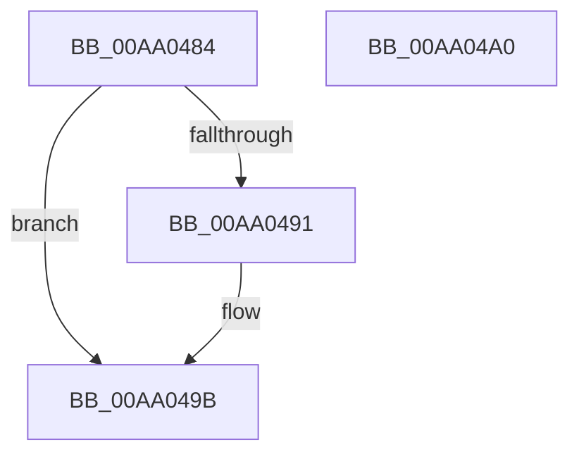

# MmSynchronizeAddressPolicy

- RVA: `0x00AA0484`–`0x00AA04A1` (길이 `29` bytes)
- VA: `0x0000000140AA0484`
- 실행 섹션: `PAGE`
- PDB 이름 있음: `예`; PDB Function 태그: `아니요`
- unwind 정보 RVA: `0x0005C788`
- 디코드: `8`개 명령, `29/29` bytes 표시
- 미해석 바이트: `0` (있으면 어셈블리에 `.byte`로 보존)

> 이 문서는 커널 이미지의 기계어와 PDB 기호를 분석해 생성했습니다. 4번과 5번은 함수 원형과 자료형을 바이너리 사용 방식에서 추정한 C 해석이며 원본 소스 복구 결과는 아닙니다.

## 1. Dependencies

- 직접 호출 지점: **1**; 고유 호출 대상: **1**
- 직접 호출자로 확인된 함수: **2**
- RIP 상대 이미지 참조: **1**

### Outgoing calls
- `0x00AA0496` → [MiDeleteProcessShadow](../../text/46/MiDeleteProcessShadow_function_00465BF8.md) (function, `0x00465BF8`)

### Direct callers
- [PsCreateMinimalProcess](../78/PsCreateMinimalProcess_function_00786D14.md) at `0x00786F7A`
- [PspDisablePrimaryTokenExchange](../8D/PspDisablePrimaryTokenExchange_function_008D5C10.md) at `0x008D5D38`

### Static image references
- `0x00AA0488` → RVA `0x00FC6AB0` (`ALMOSTRO`; read)

## 2. Other-region calls and transfers

- 다른 실행 섹션으로 향하는 call: **1**
  - `0x00AA0496` → [MiDeleteProcessShadow](../../text/46/MiDeleteProcessShadow_function_00465BF8.md) (`PAGE` → `.text`)
- 별도 외부 분기/꼬리 이동을 확인하지 못했습니다.

## 3. Assembly (complete function range)

```asm
00AA0484  48 83 EC 28                     sub rsp, 0x28
00AA0488  48 3B 0D 21 66 52 00            cmp rcx, qword ptr [rip + 0x526621]
00AA048F  74 0A                           je 0x140aa049b
00AA0491  BA 01 00 00 00                  mov edx, 1
00AA0496  E8 5D 57 9C FF                  call 0x140465bf8
00AA049B  48 83 C4 28                     add rsp, 0x28
00AA049F  C3                              ret
00AA04A0  CC                              int3
```

## 4. C-style interpretation (structured pseudocode)

```c
__int64 __fastcall MmSynchronizeAddressPolicy(__int64 a1)
{
    __int64 result;
    __int64 v_rsp;

    v_rsp = (v_rsp) - (40);
    if (a1 != (*(unsigned __int64 *)(v_rip + 5400097))) {
        a2 = 1;
        result = MiDeleteProcessShadow(a1, a2, a3, a4);
    }
    v_rsp = (v_rsp) + (40);
    return result;
}
```

## 5. (Beta) C Style

```c
int64_t MmSynchronizeAddressPolicy(int64_t Arg1)
{
    int64_t result;
    int64_t local_rsp;

    local_rsp = (local_rsp) - (40);
    if (Arg1 != (*(uint64_t *)(v_rip + 0x526621))) {
        a2 = 1;
        result = MiDeleteProcessShadow(Arg1, a2, a3, a4);
    }
    local_rsp = (local_rsp) + (40);
    return result;
}
```

## 6. Execution-region graph

[열기: 2D/3D 그래프와 함수 탐색 컨트롤 패널](../../../control-panel.html?section=page&rva=0x00AA0484&view=graph)

- 2D 그래프는 위에서 아래로 흐르고, 3D 그래프는 빈 공간을 드래그해 회전합니다. Shift+드래그는 이동, 휠은 확대·축소, 함수 노드 선택은 대상 보고서 이동입니다.

### Static fallback


