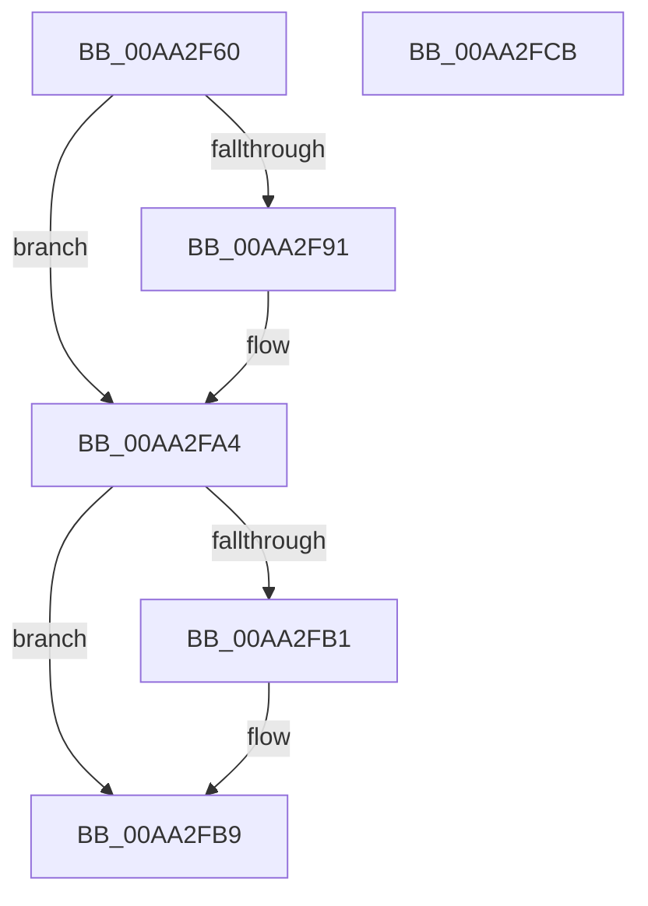

# MmUnloadSystemImage

- RVA: `0x00AA2F60`–`0x00AA2FCC` (길이 `108` bytes)
- VA: `0x0000000140AA2F60`
- 실행 섹션: `PAGE`
- PDB 이름 있음: `예`; PDB Function 태그: `아니요`
- unwind 정보 RVA: `0x00060BC4`
- 디코드: `31`개 명령, `108/108` bytes 표시
- 미해석 바이트: `0` (있으면 어셈블리에 `.byte`로 보존)

> 이 문서는 커널 이미지의 기계어와 PDB 기호를 분석해 생성했습니다. 4번과 5번은 함수 원형과 자료형을 바이너리 사용 방식에서 추정한 C 해석이며 원본 소스 복구 결과는 아닙니다.

## 1. Dependencies

- 직접 호출 지점: **5**; 고유 호출 대상: **5**
- 직접 호출자로 확인된 함수: **6**
- RIP 상대 이미지 참조: **1**

### Outgoing calls
- `0x00AA2F77` → [PsGetCurrentServerSiloGlobals](../../text/2F/PsGetCurrentServerSiloGlobals_function_002FE1F0.md) (function, `0x002FE1F0`)
- `0x00AA2F91` → [HalAdjustResourceList](../../text/48/HalAdjustResourceList_function_0048FDC0.md) (function, `0x0048FDC0`)
- `0x00AA2F99` → [PsAttachSiloToCurrentThread](../../text/44/PsAttachSiloToCurrentThread_function_004428C0.md) (function, `0x004428C0`)
- `0x00AA2FA7` → [MiUnloadSystemImage](MiUnloadSystemImage_function_00AA2FD4.md) (function, `0x00AA2FD4`)
- `0x00AA2FB4` → [PsDetachSiloFromCurrentThread](../../text/44/PsDetachSiloFromCurrentThread_function_00449AC0.md) (function, `0x00449AC0`)

### Direct callers
- [PnpReplacePartitionUnit](../73/PnpReplacePartitionUnit_function_00738550.md) at `0x00738EFF`
- [PnprLoadPluginDriver](../73/PnprLoadPluginDriver_function_00739FC4.md) at `0x0073A11F`
- [MiApplyHotPatchToLoadedDriver](../80/MiApplyHotPatchToLoadedDriver_function_00802078.md) at `0x00802307`
- [IopLoadDriver](../99/IopLoadDriver_function_00997B54.md) at `0x00998337`
- [IopDeleteDriver](IopDeleteDriver_function_00AA2E50.md) at `0x00AA2EC6`
- [NtSetSystemInformation](../AF/NtSetSystemInformation_function_00AF4A60.md) at `0x00AF4BF7`
- [NtSetSystemInformation](../AF/NtSetSystemInformation_function_00AF4A60.md) at `0x00AF4FF3`
- [NtSetSystemInformation](../AF/NtSetSystemInformation_function_00AF4A60.md) at `0x00AF5041`

### Static image references
- `0x00AA2F7F` → RVA `0x00E0A74C` (`.data`; read)

## 2. Other-region calls and transfers

- 다른 실행 섹션으로 향하는 call: **4**
  - `0x00AA2F77` → [PsGetCurrentServerSiloGlobals](../../text/2F/PsGetCurrentServerSiloGlobals_function_002FE1F0.md) (`PAGE` → `.text`)
  - `0x00AA2F91` → [HalAdjustResourceList](../../text/48/HalAdjustResourceList_function_0048FDC0.md) (`PAGE` → `.text`)
  - `0x00AA2F99` → [PsAttachSiloToCurrentThread](../../text/44/PsAttachSiloToCurrentThread_function_004428C0.md) (`PAGE` → `.text`)
  - `0x00AA2FB4` → [PsDetachSiloFromCurrentThread](../../text/44/PsDetachSiloFromCurrentThread_function_00449AC0.md) (`PAGE` → `.text`)
- 별도 외부 분기/꼬리 이동을 확인하지 못했습니다.

## 3. Assembly (complete function range)

```asm
00AA2F60  48 89 5C 24 08                  mov qword ptr [rsp + 8], rbx
00AA2F65  48 89 74 24 10                  mov qword ptr [rsp + 0x10], rsi
00AA2F6A  57                              push rdi
00AA2F6B  48 83 EC 20                     sub rsp, 0x20
00AA2F6F  48 8B F1                        mov rsi, rcx
00AA2F72  33 DB                           xor ebx, ebx
00AA2F74  40 32 FF                        xor dil, dil
00AA2F77  E8 74 B2 85 FF                  call 0x1402fe1f0
00AA2F7C  4C 8B C0                        mov r8, rax
00AA2F7F  8B 05 C7 77 36 00               mov eax, dword ptr [rip + 0x3677c7]
00AA2F85  0F B7 D0                        movzx edx, ax
00AA2F88  41 39 90 38 05 00 00            cmp dword ptr [r8 + 0x538], edx
00AA2F8F  73 13                           jae 0x140aa2fa4
00AA2F91  E8 2A CE 9E FF                  call 0x14048fdc0
00AA2F96  48 8B C8                        mov rcx, rax
00AA2F99  E8 22 F9 99 FF                  call 0x1404428c0
00AA2F9E  48 8B D8                        mov rbx, rax
00AA2FA1  40 B7 01                        mov dil, 1
00AA2FA4  48 8B CE                        mov rcx, rsi
00AA2FA7  E8 28 00 00 00                  call 0x140aa2fd4
00AA2FAC  40 84 FF                        test dil, dil
00AA2FAF  74 08                           je 0x140aa2fb9
00AA2FB1  48 8B CB                        mov rcx, rbx
00AA2FB4  E8 07 6B 9A FF                  call 0x140449ac0
00AA2FB9  48 8B 5C 24 30                  mov rbx, qword ptr [rsp + 0x30]
00AA2FBE  33 C0                           xor eax, eax
00AA2FC0  48 8B 74 24 38                  mov rsi, qword ptr [rsp + 0x38]
00AA2FC5  48 83 C4 20                     add rsp, 0x20
00AA2FC9  5F                              pop rdi
00AA2FCA  C3                              ret
00AA2FCB  CC                              int3
```

## 4. C-style interpretation (structured pseudocode)

```c
__int64 __fastcall MmUnloadSystemImage(__int64 a1)
{
    __int64 result;
    __int64 v_rbx;
    __int64 v_rdi;
    __int64 v_rsp;
    unsigned __int64 v_stack_p10;
    unsigned __int64 v_stack_p8;

    v_stack_p8 = v_rbx;
    v_stack_p10 = v_rsi;
    v_rsp = (v_rsp) - (32);
    v_rbx = 0;
    v_rdi = 0;
    result = PsGetCurrentServerSiloGlobals(a1, a2, a3, a4);
    result = (unsigned int)(*(unsigned int *)(v_rip + 3569607));
    if ((*(unsigned int *)(result + 1336)) < ((unsigned int)((unsigned __int16)((unsigned int)(*(unsigned int *)(v_rip + 3569607)))))) {
        result = HalAdjustResourceList(a1, (unsigned __int16)((unsigned int)(*(unsigned int *)(v_rip + 3569607))), result, a4);
        a1 = result;
        result = PsAttachSiloToCurrentThread(a1, (unsigned __int16)((unsigned int)(*(unsigned int *)(v_rip + 3569607))), result, a4);
        v_rbx = result;
        v_rdi = 1;
    }
    result = MiUnloadSystemImage(a1, (unsigned __int16)((unsigned int)(*(unsigned int *)(v_rip + 3569607))), result, a4);
    if ((unsigned __int8)(v_rdi) != 0) {
        a1 = v_rbx;
        result = PsDetachSiloFromCurrentThread(a1, (unsigned __int16)((unsigned int)(*(unsigned int *)(v_rip + 3569607))), result, a4);
    }
    result = 0;
    v_rsp = (v_rsp) + (32);
    return result;
}
```

## 5. (Beta) C Style

```c
int64_t MmUnloadSystemImage(int64_t Arg1)
{
    int64_t result;
    int64_t local_rbx;
    int64_t local_rdi;
    int64_t local_rsp;
    uint64_t v_stack_p10;
    uint64_t v_stack_p8;

    v_stack_p8 = local_rbx;
    v_stack_p10 = local_rsi;
    local_rsp = (local_rsp) - (32);
    local_rbx = 0;
    local_rdi = 0;
    result = PsGetCurrentServerSiloGlobals(Arg1, a2, a3, a4);
    result = (uint32_t)(*(uint32_t *)(v_rip + 0x3677C7));
    if ((*(uint32_t *)(result + 0x538)) < ((uint32_t)((uint16_t)((uint32_t)(*(uint32_t *)(v_rip + 0x3677C7)))))) {
        result = HalAdjustResourceList(Arg1, (uint16_t)((uint32_t)(*(uint32_t *)(v_rip + 0x3677C7))), result, a4);
        Arg1 = result;
        result = PsAttachSiloToCurrentThread(Arg1, (uint16_t)((uint32_t)(*(uint32_t *)(v_rip + 0x3677C7))), result, a4);
        local_rbx = result;
        local_rdi = 1;
    }
    result = MiUnloadSystemImage(Arg1, (uint16_t)((uint32_t)(*(uint32_t *)(v_rip + 0x3677C7))), result, a4);
    if ((uint8_t)(local_rdi) != 0) {
        Arg1 = local_rbx;
        result = PsDetachSiloFromCurrentThread(Arg1, (uint16_t)((uint32_t)(*(uint32_t *)(v_rip + 0x3677C7))), result, a4);
    }
    result = 0;
    local_rsp = (local_rsp) + (32);
    return result;
}
```

## 6. Execution-region graph

[열기: 2D/3D 그래프와 함수 탐색 컨트롤 패널](../../../control-panel.html?section=page&rva=0x00AA2F60&view=graph)

- 2D 그래프는 위에서 아래로 흐르고, 3D 그래프는 빈 공간을 드래그해 회전합니다. Shift+드래그는 이동, 휠은 확대·축소, 함수 노드 선택은 대상 보고서 이동입니다.

### Static fallback


