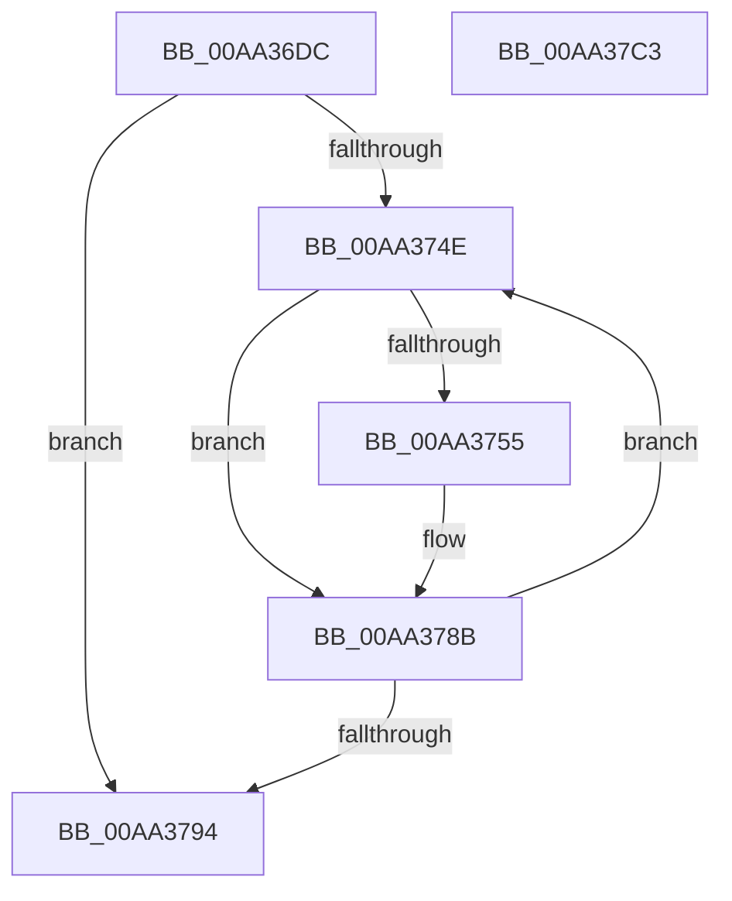

# MmUnmapProtectedKernelPageRange

- RVA: `0x00AA36DC`–`0x00AA37C4` (길이 `232` bytes)
- VA: `0x0000000140AA36DC`
- 실행 섹션: `PAGE`
- PDB 이름 있음: `예`; PDB Function 태그: `아니요`
- unwind 정보 RVA: `0x000BB334`
- 디코드: `57`개 명령, `232/232` bytes 표시
- 미해석 바이트: `0` (있으면 어셈블리에 `.byte`로 보존)

> 이 문서는 커널 이미지의 기계어와 PDB 기호를 분석해 생성했습니다. 4번과 5번은 함수 원형과 자료형을 바이너리 사용 방식에서 추정한 C 해석이며 원본 소스 복구 결과는 아닙니다.

## 1. Dependencies

- 직접 호출 지점: **7**; 고유 호출 대상: **7**
- 직접 호출자로 확인된 함수: **1**
- RIP 상대 이미지 참조: **2**

### Outgoing calls
- `0x00AA3713` → [memset](../../text/6C/memset_function_006C6C40.md) (function, `0x006C6C40`)
- `0x00AA371B` → [MiGetPteAddress](../../text/43/MiGetPteAddress_function_0043E130.md) (function, `0x0043E130`)
- `0x00AA3726` → [MiVaToFlushVm](../../text/31/MiVaToFlushVm_function_0031AD84.md) (function, `0x0031AD84`)
- `0x00AA3744` → [MiInitializeTbFlushList](../../text/29/MiInitializeTbFlushList_function_00294F00.md) (function, `0x00294F00`)
- `0x00AA377C` → [MiInsertTbFlushEntry](../../text/29/MiInsertTbFlushEntry_function_00293670.md) (function, `0x00293670`)
- `0x00AA3799` → [MiFlushTbList](../../text/31/MiFlushTbList_function_00311FC0.md) (function, `0x00311FC0`)
- `0x00AA37A9` → [_security_check_cookie](../../text/6A/_security_check_cookie_function_006AC640.md) (function, `0x006AC640`)

### Direct callers
- [sub_006F88AE](../../text/6F/Unknown_function_006F88AE.md) at `0x006F8D25`

### Static image references
- `0x00AA36EE` → RVA `0x00E0A740` (`.data`; read)
- `0x00AA3781` → RVA `0x00010880` (`.rdata`; read)

## 2. Other-region calls and transfers

- 다른 실행 섹션으로 향하는 call: **7**
  - `0x00AA3713` → [memset](../../text/6C/memset_function_006C6C40.md) (`PAGE` → `.text`)
  - `0x00AA371B` → [MiGetPteAddress](../../text/43/MiGetPteAddress_function_0043E130.md) (`PAGE` → `.text`)
  - `0x00AA3726` → [MiVaToFlushVm](../../text/31/MiVaToFlushVm_function_0031AD84.md) (`PAGE` → `.text`)
  - `0x00AA3744` → [MiInitializeTbFlushList](../../text/29/MiInitializeTbFlushList_function_00294F00.md) (`PAGE` → `.text`)
  - `0x00AA377C` → [MiInsertTbFlushEntry](../../text/29/MiInsertTbFlushEntry_function_00293670.md) (`PAGE` → `.text`)
  - `0x00AA3799` → [MiFlushTbList](../../text/31/MiFlushTbList_function_00311FC0.md) (`PAGE` → `.text`)
  - `0x00AA37A9` → [_security_check_cookie](../../text/6A/_security_check_cookie_function_006AC640.md) (`PAGE` → `.text`)
- 별도 외부 분기/꼬리 이동을 확인하지 못했습니다.

## 3. Assembly (complete function range)

```asm
00AA36DC  48 89 5C 24 10                  mov qword ptr [rsp + 0x10], rbx
00AA36E1  48 89 74 24 18                  mov qword ptr [rsp + 0x18], rsi
00AA36E6  57                              push rdi
00AA36E7  48 81 EC 20 01 00 00            sub rsp, 0x120
00AA36EE  48 8B 05 4B 70 36 00            mov rax, qword ptr [rip + 0x36704b]
00AA36F5  48 33 C4                        xor rax, rsp
00AA36F8  48 89 84 24 10 01 00 00         mov qword ptr [rsp + 0x110], rax
00AA3700  48 8B F2                        mov rsi, rdx
00AA3703  48 8B D9                        mov rbx, rcx
00AA3706  33 D2                           xor edx, edx
00AA3708  48 8D 4C 24 40                  lea rcx, [rsp + 0x40]
00AA370D  41 B8 C8 00 00 00               mov r8d, 0xc8
00AA3713  E8 28 35 C2 FF                  call 0x1406c6c40
00AA3718  48 8B CB                        mov rcx, rbx
00AA371B  E8 10 AA 99 FF                  call 0x14043e130
00AA3720  48 8B CB                        mov rcx, rbx
00AA3723  48 8B F8                        mov rdi, rax
00AA3726  E8 59 76 87 FF                  call 0x14031ad84
00AA372B  BB 01 00 00 00                  mov ebx, 1
00AA3730  48 8D 4C 24 40                  lea rcx, [rsp + 0x40]
00AA3735  48 8B D0                        mov rdx, rax
00AA3738  89 5C 24 20                     mov dword ptr [rsp + 0x20], ebx
00AA373C  44 8D 4B 07                     lea r9d, [rbx + 7]
00AA3740  44 8D 43 13                     lea r8d, [rbx + 0x13]
00AA3744  E8 B7 17 7F FF                  call 0x140294f00
00AA3749  48 85 F6                        test rsi, rsi
00AA374C  74 46                           je 0x140aa3794
00AA374E  48 8B 07                        mov rax, qword ptr [rdi]
00AA3751  84 C3                           test bl, al
00AA3753  74 36                           je 0x140aa378b
00AA3755  48 8B D7                        mov rdx, rdi
00AA3758  48 C1 E2 19                     shl rdx, 0x19
00AA375C  48 B8 00 00 00 00 80 F6 FF FF   movabs rax, 0xfffff68000000000
00AA3766  48 C1 E0 19                     shl rax, 0x19
00AA376A  48 8D 4C 24 40                  lea rcx, [rsp + 0x40]
00AA376F  48 2B D0                        sub rdx, rax
00AA3772  45 33 C9                        xor r9d, r9d
00AA3775  48 C1 FA 10                     sar rdx, 0x10
00AA3779  4C 8B C3                        mov r8, rbx
00AA377C  E8 EF FE 7E FF                  call 0x140293670
00AA3781  48 8B 05 F8 D0 56 FF            mov rax, qword ptr [rip - 0xa92f08]
00AA3788  48 89 07                        mov qword ptr [rdi], rax
00AA378B  48 83 C7 08                     add rdi, 8
00AA378F  48 2B F3                        sub rsi, rbx
00AA3792  75 BA                           jne 0x140aa374e
00AA3794  48 8D 4C 24 40                  lea rcx, [rsp + 0x40]
00AA3799  E8 22 E8 86 FF                  call 0x140311fc0
00AA379E  48 8B 8C 24 10 01 00 00         mov rcx, qword ptr [rsp + 0x110]
00AA37A6  48 33 CC                        xor rcx, rsp
00AA37A9  E8 92 8E C0 FF                  call 0x1406ac640
00AA37AE  4C 8D 9C 24 20 01 00 00         lea r11, [rsp + 0x120]
00AA37B6  49 8B 5B 18                     mov rbx, qword ptr [r11 + 0x18]
00AA37BA  49 8B 73 20                     mov rsi, qword ptr [r11 + 0x20]
00AA37BE  49 8B E3                        mov rsp, r11
00AA37C1  5F                              pop rdi
00AA37C2  C3                              ret
00AA37C3  CC                              int3
```

## 4. C-style interpretation (structured pseudocode)

```c
__int64 __fastcall MmUnmapProtectedKernelPageRange(__int64 a1, __int64 a2)
{
    __int64 result;
    __int64 v_rdi;
    __int64 v_rsi;
    __int64 v_rsp;
    unsigned int v_stack_m108;
    unsigned __int64 v_stack_m18;
    unsigned __int64 v_stack_m8;
    unsigned __int64 v_stack_mE8;
    unsigned __int64 v_stack_p10;
    unsigned __int64 v_stack_p18;

    v_stack_p10 = v_rbx;
    v_stack_p18 = v_rsi;
    v_rsp = (v_rsp) - (288);
    result = (*(unsigned __int64 *)(v_rip + 3567691)) ^ (v_rsp);
    v_stack_m18 = result;
    a2 = 0;
    result = memset(v_stack_mE8, a2, 200, a4);
    result = MiGetPteAddress(a1, a2, 200, a4);
    result = MiVaToFlushVm(a1, a2, 200, a4);
    v_stack_m108 = 1;
    result = MiInitializeTbFlushList(v_stack_mE8, result, 1 + 19, 1 + 7);
    if (0 == 0) goto loc_00AA3794;
loc_00AA374E:
    result = *(unsigned __int64 *)(result);
    if (((1) & ((unsigned __int8)(*(unsigned __int64 *)(result)))) != 0) {
        a2 = result;
        a2 = (a2) << (25);
        result = (*(unsigned __int64 *)(result)) << (25);
        a1 = v_stack_mE8;
        a2 = (a2) - (result);
        a4 = 0;
        a2 = (a2) >> (16);
        a3 = 1;
        result = MiInsertTbFlushEntry(a1, a2, a3, a4);
        result = *(unsigned __int64 *)(v_rip - 11087624);
        *(unsigned __int64 *)(result) = result;
    }
    v_rdi = (result) + (8);
    v_rsi = (a2) - (1);
    if (condition_is_not_equal) goto loc_00AA374E;
loc_00AA3794:
    result = MiFlushTbList(v_stack_mE8, a2, a3, a4);
    a1 = (v_stack_m18) ^ (v_rsp);
    result = _security_check_cookie(a1, a2, a3, a4);
    return result;
}
```

## 5. (Beta) C Style

```c
int64_t MmUnmapProtectedKernelPageRange(int64_t Arg1, int64_t Arg2)
{
    int64_t result;
    int64_t local_rdi;
    int64_t local_rsi;
    int64_t local_rsp;
    uint32_t v_stack_m108;
    uint64_t v_stack_m18;
    uint64_t v_stack_m8;
    uint64_t v_stack_mE8;
    uint64_t v_stack_p10;
    uint64_t v_stack_p18;

    v_stack_p10 = local_rbx;
    v_stack_p18 = local_rsi;
    local_rsp = (local_rsp) - (288);
    result = (*(uint64_t *)(v_rip + 0x36704B)) ^ (local_rsp);
    v_stack_m18 = result;
    Arg2 = 0;
    result = memset(v_stack_mE8, Arg2, 200, a4);
    result = MiGetPteAddress(Arg1, Arg2, 200, a4);
    result = MiVaToFlushVm(Arg1, Arg2, 200, a4);
    v_stack_m108 = 1;
    result = MiInitializeTbFlushList(v_stack_mE8, result, 1 + 19, 1 + 7);
    if (0 == 0) goto loc_00AA3794;
loc_00AA374E:
    result = *(uint64_t *)(result);
    if (((1) & ((uint8_t)(*(uint64_t *)(result)))) != 0) {
        Arg2 = result;
        Arg2 = (Arg2) << (25);
        result = (*(uint64_t *)(result)) << (25);
        Arg1 = v_stack_mE8;
        Arg2 = (Arg2) - (result);
        a4 = 0;
        Arg2 = (Arg2) >> (16);
        a3 = 1;
        result = MiInsertTbFlushEntry(Arg1, Arg2, a3, a4);
        result = *(uint64_t *)(v_rip - 0xA92F08);
        *(uint64_t *)(result) = result;
    }
    local_rdi = (result) + (8);
    local_rsi = (Arg2) - (1);
    if (condition_is_not_equal) goto loc_00AA374E;
loc_00AA3794:
    result = MiFlushTbList(v_stack_mE8, Arg2, a3, a4);
    Arg1 = (v_stack_m18) ^ (local_rsp);
    result = _security_check_cookie(Arg1, Arg2, a3, a4);
    return result;
}
```

## 6. Execution-region graph

[열기: 2D/3D 그래프와 함수 탐색 컨트롤 패널](../../../control-panel.html?section=page&rva=0x00AA36DC&view=graph)

- 2D 그래프는 위에서 아래로 흐르고, 3D 그래프는 빈 공간을 드래그해 회전합니다. Shift+드래그는 이동, 휠은 확대·축소, 함수 노드 선택은 대상 보고서 이동입니다.

### Static fallback


