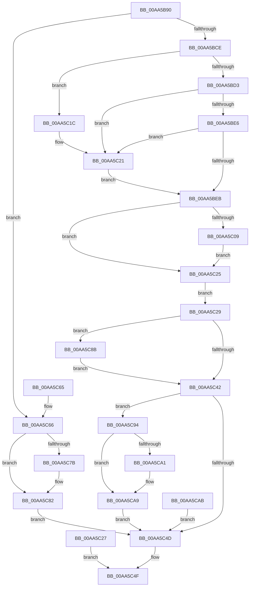

# NtConvertBetweenAuxiliaryCounterAndPerformanceCounter

- RVA: `0x00AA5B90`–`0x00AA5CAF` (길이 `287` bytes)
- VA: `0x0000000140AA5B90`
- 실행 섹션: `PAGE`
- PDB 이름 있음: `예`; PDB Function 태그: `아니요`
- unwind 정보 RVA: `0x000BB7E0`
- 디코드: `79`개 명령, `287/287` bytes 표시
- 미해석 바이트: `0` (있으면 어셈블리에 `.byte`로 보존)

> 이 문서는 커널 이미지의 기계어와 PDB 기호를 분석해 생성했습니다. 4번과 5번은 함수 원형과 자료형을 바이너리 사용 방식에서 추정한 C 해석이며 원본 소스 복구 결과는 아닙니다.

## 1. Dependencies

- 직접 호출 지점: **5**; 고유 호출 대상: **3**
- 직접 호출자로 확인된 함수: **0**
- RIP 상대 이미지 참조: **2**

### Outgoing calls
- `0x00AA5BFF` → [ProbeForWrite](../8E/ProbeForWrite_function_008E91C0.md) (function, `0x008E91C0`)
- `0x00AA5C15` → [ProbeForWrite](../8E/ProbeForWrite_function_008E91C0.md) (function, `0x008E91C0`)
- `0x00AA5C1C` → [ExRaiseDatatypeMisalignment](../89/ExRaiseDatatypeMisalignment_function_00899FD0.md) (function, `0x00899FD0`)
- `0x00AA5C42` → [guard_dispatch_icall](../../text/6B/guard_dispatch_icall_function_006BAAD0.md) (function, `0x006BAAD0`)
- `0x00AA5C82` → [guard_dispatch_icall](../../text/6B/guard_dispatch_icall_function_006BAAD0.md) (function, `0x006BAAD0`)

### Direct callers
- 이 함수 시작 RVA로 연결되는 직접 call은 확인되지 않았습니다. 간접 호출은 완전히 역산할 수 없습니다.

### Static image references
- `0x00AA5C39` → RVA `0x00E00B88` (`.data`; read)
- `0x00AA5C7B` → RVA `0x00E00B80` (`.data`; read)

## 2. Other-region calls and transfers

- 다른 실행 섹션으로 향하는 call: **2**
  - `0x00AA5C42` → [guard_dispatch_icall](../../text/6B/guard_dispatch_icall_function_006BAAD0.md) (`PAGE` → `.text`)
  - `0x00AA5C82` → [guard_dispatch_icall](../../text/6B/guard_dispatch_icall_function_006BAAD0.md) (`PAGE` → `.text`)
- 별도 외부 분기/꼬리 이동을 확인하지 못했습니다.

## 3. Assembly (complete function range)

```asm
00AA5B90  48 8B C4                        mov rax, rsp
00AA5B93  48 89 58 08                     mov qword ptr [rax + 8], rbx
00AA5B97  48 89 70 10                     mov qword ptr [rax + 0x10], rsi
00AA5B9B  48 89 78 18                     mov qword ptr [rax + 0x18], rdi
00AA5B9F  41 56                           push r14
00AA5BA1  48 83 EC 40                     sub rsp, 0x40
00AA5BA5  49 8B D9                        mov rbx, r9
00AA5BA8  49 8B F8                        mov rdi, r8
00AA5BAB  40 8A F1                        mov sil, cl
00AA5BAE  48 83 60 E0 00                  and qword ptr [rax - 0x20], 0
00AA5BB3  48 83 60 D8 00                  and qword ptr [rax - 0x28], 0
00AA5BB8  65 48 8B 04 25 88 01 00 00      mov rax, qword ptr gs:[0x188]
00AA5BC1  80 B8 32 02 00 00 00            cmp byte ptr [rax + 0x232], 0
00AA5BC8  0F 84 98 00 00 00               je 0x140aa5c66
00AA5BCE  F6 C2 03                        test dl, 3
00AA5BD1  75 49                           jne 0x140aa5c1c
00AA5BD3  48 8D 42 08                     lea rax, [rdx + 8]
00AA5BD7  48 B9 00 00 FF FF FF 7F 00 00   movabs rcx, 0x7fffffff0000
00AA5BE1  48 3B C1                        cmp rax, rcx
00AA5BE4  77 3B                           ja 0x140aa5c21
00AA5BE6  48 3B C2                        cmp rax, rdx
00AA5BE9  72 36                           jb 0x140aa5c21
00AA5BEB  4C 8B 32                        mov r14, qword ptr [rdx]
00AA5BEE  4C 89 74 24 30                  mov qword ptr [rsp + 0x30], r14
00AA5BF3  BA 08 00 00 00                  mov edx, 8
00AA5BF8  44 8D 42 FC                     lea r8d, [rdx - 4]
00AA5BFC  48 8B CF                        mov rcx, rdi
00AA5BFF  E8 BC 35 E4 FF                  call 0x1408e91c0
00AA5C04  48 85 DB                        test rbx, rbx
00AA5C07  74 1C                           je 0x140aa5c25
00AA5C09  BA 08 00 00 00                  mov edx, 8
00AA5C0E  44 8D 42 FC                     lea r8d, [rdx - 4]
00AA5C12  48 8B CB                        mov rcx, rbx
00AA5C15  E8 A6 35 E4 FF                  call 0x1408e91c0
00AA5C1A  EB 09                           jmp 0x140aa5c25
00AA5C1C  E8 AF 43 DF FF                  call 0x140899fd0
00AA5C21  8A 01                           mov al, byte ptr [rcx]
00AA5C23  EB C6                           jmp 0x140aa5beb
00AA5C25  EB 02                           jmp 0x140aa5c29
00AA5C27  EB 26                           jmp 0x140aa5c4f
00AA5C29  4C 8D 44 24 28                  lea r8, [rsp + 0x28]
00AA5C2E  48 8D 54 24 20                  lea rdx, [rsp + 0x20]
00AA5C33  49 8B CE                        mov rcx, r14
00AA5C36  40 84 F6                        test sil, sil
00AA5C39  48 8B 05 48 AF 35 00            mov rax, qword ptr [rip + 0x35af48]
00AA5C40  74 49                           je 0x140aa5c8b
00AA5C42  E8 89 4E C1 FF                  call 0x1406baad0
00AA5C47  8B C8                           mov ecx, eax
00AA5C49  85 C0                           test eax, eax
00AA5C4B  79 47                           jns 0x140aa5c94
00AA5C4D  8B C1                           mov eax, ecx
00AA5C4F  48 8B 5C 24 50                  mov rbx, qword ptr [rsp + 0x50]
00AA5C54  48 8B 74 24 58                  mov rsi, qword ptr [rsp + 0x58]
00AA5C59  48 8B 7C 24 60                  mov rdi, qword ptr [rsp + 0x60]
00AA5C5E  48 83 C4 40                     add rsp, 0x40
00AA5C62  41 5E                           pop r14
00AA5C64  C3                              ret
00AA5C65  CC                              int3
00AA5C66  48 8B 0A                        mov rcx, qword ptr [rdx]
00AA5C69  4C 8B C3                        mov r8, rbx
00AA5C6C  48 8B D7                        mov rdx, rdi
00AA5C6F  40 84 F6                        test sil, sil
00AA5C72  48 8B 05 0F AF 35 00            mov rax, qword ptr [rip + 0x35af0f]
00AA5C79  75 07                           jne 0x140aa5c82
00AA5C7B  48 8B 05 FE AE 35 00            mov rax, qword ptr [rip + 0x35aefe]
00AA5C82  E8 49 4E C1 FF                  call 0x1406baad0
00AA5C87  8B C8                           mov ecx, eax
00AA5C89  EB C2                           jmp 0x140aa5c4d
00AA5C8B  48 8B 05 EE AE 35 00            mov rax, qword ptr [rip + 0x35aeee]
00AA5C92  EB AE                           jmp 0x140aa5c42
00AA5C94  48 8B 44 24 20                  mov rax, qword ptr [rsp + 0x20]
00AA5C99  48 89 07                        mov qword ptr [rdi], rax
00AA5C9C  48 85 DB                        test rbx, rbx
00AA5C9F  74 08                           je 0x140aa5ca9
00AA5CA1  48 8B 44 24 28                  mov rax, qword ptr [rsp + 0x28]
00AA5CA6  48 89 03                        mov qword ptr [rbx], rax
00AA5CA9  EB A2                           jmp 0x140aa5c4d
00AA5CAB  8B C8                           mov ecx, eax
00AA5CAD  EB 9E                           jmp 0x140aa5c4d
```

## 4. C-style interpretation (structured pseudocode)

```c
__int64 __fastcall NtConvertBetweenAuxiliaryCounterAndPerformanceCounter(unsigned __int8 a1, __int64 a2, __int64 a3, __int64 a4)
{
    __int64 result;
    __int64 v_rsp;
    unsigned __int64 v_stack_m18;
    unsigned __int64 v_stack_m20;
    unsigned __int64 v_stack_m28;
    unsigned __int64 v_stack_p10;
    unsigned __int64 v_stack_p18;
    unsigned __int64 v_stack_p20;
    unsigned __int64 v_stack_p28;
    unsigned __int64 v_stack_p8;

    *(unsigned __int64 *)(v_rsp + 8) = v_rbx;
    *(unsigned __int64 *)(v_rsp + 16) = v_rsi;
    *(unsigned __int64 *)(v_rsp + 24) = v_rdi;
    v_rsp = (v_rsp) - (64);
    if ((*(unsigned __int8 *)(*(unsigned __int64 *)(gs_base + (0 + 392)) + 562)) == 0) goto loc_00AA5C66;
    if ((((unsigned __int8)(a2)) & (3)) != 0) goto loc_00AA5C1C;
    if ((a2 + 8) > a1) goto loc_00AA5C21;
    if ((a2 + 8) < a2) goto loc_00AA5C21;
loc_00AA5BEB:
    v_stack_m18 = *(unsigned __int64 *)(a2);
    result = ProbeForWrite(a3, 8, 8 - 4, a4);
    if (a4 == 0) goto loc_00AA5C25;
    result = ProbeForWrite(a4, 8, 8 - 4, a4);
    goto loc_00AA5C25;
loc_00AA5C1C:
    result = ExRaiseDatatypeMisalignment(a4, 8, 8 - 4, a4);
loc_00AA5C21:
    goto loc_00AA5BEB;
loc_00AA5C25:
    goto loc_00AA5C29;
loc_00AA5C29:
    if (a1 == 0) goto loc_00AA5C8B;
loc_00AA5C42:
    result = guard_dispatch_icall(*(unsigned __int64 *)(a2), v_stack_m28, v_stack_m20, a4);
    if (!sign_flag) goto loc_00AA5C94;
loc_00AA5C4D:
loc_00AA5C4F:
    v_rsp = (v_rsp) + (64);
    return (unsigned int)((unsigned int)((unsigned int)((unsigned int)(result))));
loc_00AA5C66:
    result = *(unsigned __int64 *)(v_rip + 3518223);
    if ((unsigned __int8)(v_stack_p10) == 0) {
        result = *(unsigned __int64 *)(v_rip + 3518206);
    }
    result = guard_dispatch_icall(*(unsigned __int64 *)(v_stack_m28), v_stack_p18, v_stack_p8, a4);
    goto loc_00AA5C4D;
loc_00AA5C8B:
    goto loc_00AA5C42;
loc_00AA5C94:
    *(unsigned __int64 *)(v_stack_p18) = v_stack_p20;
    result = v_stack_p20;
    if (v_stack_p8 != 0) {
        result = v_stack_p28;
        *(unsigned __int64 *)(v_stack_p8) = result;
    }
    goto loc_00AA5C4D;
}
```

## 5. (Beta) C Style

```c
int64_t NtConvertBetweenAuxiliaryCounterAndPerformanceCounter(uint8_t Arg1, void *Arg2, void *Arg3, int64_t Arg4)
{
    uint8_t *arg2 = (uint8_t *)Arg2;
    uint8_t *arg3 = (uint8_t *)Arg3;

    int64_t result;
    int64_t local_rsp;
    uint64_t v_stack_m18;
    uint64_t v_stack_m20;
    uint64_t v_stack_m28;
    uint64_t v_stack_p10;
    uint64_t v_stack_p18;
    uint64_t v_stack_p20;
    uint64_t v_stack_p28;
    uint64_t v_stack_p8;

    *(uint64_t *)(local_rsp + 0x8) = local_rbx;
    *(uint64_t *)(local_rsp + 0x10) = local_rsi;
    *(uint64_t *)(local_rsp + 0x18) = local_rdi;
    local_rsp = (local_rsp) - (64);
    if ((*(uint8_t *)(*(uint64_t *)(gs_base + (0 + 0x188)) + 0x232)) == 0) goto loc_00AA5C66;
    if ((((uint8_t)(Arg2)) & (3)) != 0) goto loc_00AA5C1C;
    if ((Arg2 + 8) > Arg1) goto loc_00AA5C21;
    if ((Arg2 + 8) < Arg2) goto loc_00AA5C21;
loc_00AA5BEB:
    v_stack_m18 = *(uint64_t *)(arg2);
    result = ProbeForWrite(Arg3, 8, 8 - 4, Arg4);
    if (Arg4 == 0) goto loc_00AA5C25;
    result = ProbeForWrite(Arg4, 8, 8 - 4, Arg4);
    goto loc_00AA5C25;
loc_00AA5C1C:
    result = ExRaiseDatatypeMisalignment(Arg4, 8, 8 - 4, Arg4);
loc_00AA5C21:
    goto loc_00AA5BEB;
loc_00AA5C25:
    goto loc_00AA5C29;
loc_00AA5C29:
    if (Arg1 == 0) goto loc_00AA5C8B;
loc_00AA5C42:
    result = guard_dispatch_icall(*(uint64_t *)(arg2), v_stack_m28, v_stack_m20, Arg4);
    if (!sign_flag) goto loc_00AA5C94;
loc_00AA5C4D:
loc_00AA5C4F:
    local_rsp = (local_rsp) + (64);
    return (uint32_t)((uint32_t)((uint32_t)((uint32_t)(result))));
loc_00AA5C66:
    result = *(uint64_t *)(v_rip + 0x35AF0F);
    if ((uint8_t)(v_stack_p10) == 0) {
        result = *(uint64_t *)(v_rip + 0x35AEFE);
    }
    result = guard_dispatch_icall(*(uint64_t *)(v_stack_m28), v_stack_p18, v_stack_p8, Arg4);
    goto loc_00AA5C4D;
loc_00AA5C8B:
    goto loc_00AA5C42;
loc_00AA5C94:
    *(uint64_t *)(v_stack_p18) = v_stack_p20;
    result = v_stack_p20;
    if (v_stack_p8 != 0) {
        result = v_stack_p28;
        *(uint64_t *)(v_stack_p8) = result;
    }
    goto loc_00AA5C4D;
}
```

### 관측된 메모리 오프셋

구조체 형식이 확인되지 않은 접근은 인자 기준의 오프셋으로만 기록했습니다.

| 기준 인자 | 오프셋 표현 | 폭 (bit) | 접근 |
|---|---:|---:|---|
| `Arg2` | `+ 0x0` | `64` | `R` |
| `Arg3` | `+ 0x0` | `64` | `W` |

## 6. Execution-region graph

[열기: 2D/3D 그래프와 함수 탐색 컨트롤 패널](../../../control-panel.html?section=page&rva=0x00AA5B90&view=graph)

- 2D 그래프는 위에서 아래로 흐르고, 3D 그래프는 빈 공간을 드래그해 회전합니다. Shift+드래그는 이동, 휠은 확대·축소, 함수 노드 선택은 대상 보고서 이동입니다.

### Static fallback


