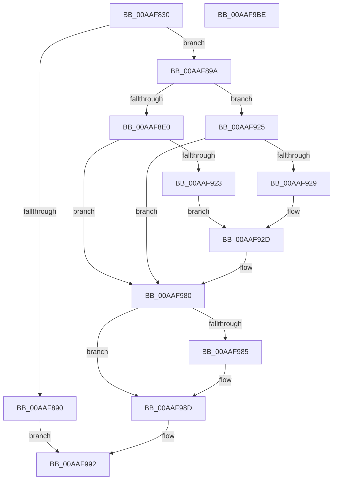

# NtCreateKeyTransacted

- RVA: `0x00AAF830`–`0x00AAF9BF` (길이 `399` bytes)
- VA: `0x0000000140AAF830`
- 실행 섹션: `PAGE`
- PDB 이름 있음: `예`; PDB Function 태그: `아니요`
- unwind 정보 RVA: `0x0008FDA0`
- 디코드: `102`개 명령, `399/399` bytes 표시
- 미해석 바이트: `0` (있으면 어셈블리에 `.byte`로 보존)

> 이 문서는 커널 이미지의 기계어와 PDB 기호를 분석해 생성했습니다. 4번과 5번은 함수 원형과 자료형을 바이너리 사용 방식에서 추정한 C 해석이며 원본 소스 복구 결과는 아닙니다.

## 1. Dependencies

- 직접 호출 지점: **9**; 고유 호출 대상: **8**
- 직접 호출자로 확인된 함수: **0**
- RIP 상대 이미지 참조: **3**

### Outgoing calls
- `0x00AAF879` → [memset](../../text/6C/memset_function_006C6C40.md) (function, `0x006C6C40`)
- `0x00AAF882` → [CmpInitializeThreadInfo](../../text/3F/CmpInitializeThreadInfo_function_003FBE70.md) (function, `0x003FBE70`)
- `0x00AAF887` → [CmpAcquireShutdownRundown](../../pagecmrc/BC/CmpAcquireShutdownRundown_function_00BC9400.md) (function, `0x00BC9400`)
- `0x00AAF8CE` → [ObReferenceObjectByHandle](../86/ObReferenceObjectByHandle_function_00868DB0.md) (function, `0x00868DB0`)
- `0x00AAF914` → [ObReferenceObjectByHandle](../86/ObReferenceObjectByHandle_function_00868DB0.md) (function, `0x00868DB0`)
- `0x00AAF973` → [KeExpandKernelStackAndCallout](../../text/46/KeExpandKernelStackAndCallout_function_004675F0.md) (function, `0x004675F0`)
- `0x00AAF988` → [CmpTransDereferenceTransaction](../87/CmpTransDereferenceTransaction_function_00873608.md) (function, `0x00873608`)
- `0x00AAF98D` → [CmpReleaseShutdownRundown](../../pagecmrc/BC/CmpReleaseShutdownRundown_function_00BC9880.md) (function, `0x00BC9880`)
- `0x00AAF996` → [CmCleanupThreadInfo](../../text/41/CmCleanupThreadInfo_function_0041FD50.md) (function, `0x0041FD50`)

### Direct callers
- 이 함수 시작 RVA로 연결되는 직접 call은 확인되지 않았습니다. 간접 호출은 완전히 역산할 수 없습니다.

### Static image references
- `0x00AAF8A8` → RVA `0x00EF5720` (`.data`; read)
- `0x00AAF8EE` → RVA `0x00FC6EF0` (`ALMOSTRO`; read)
- `0x00AAF939` → RVA `0x00A629A0` (`CmCreateKeyCallout`; read)

## 2. Other-region calls and transfers

- 다른 실행 섹션으로 향하는 call: **6**
  - `0x00AAF879` → [memset](../../text/6C/memset_function_006C6C40.md) (`PAGE` → `.text`)
  - `0x00AAF882` → [CmpInitializeThreadInfo](../../text/3F/CmpInitializeThreadInfo_function_003FBE70.md) (`PAGE` → `.text`)
  - `0x00AAF887` → [CmpAcquireShutdownRundown](../../pagecmrc/BC/CmpAcquireShutdownRundown_function_00BC9400.md) (`PAGE` → `PAGECMRC`)
  - `0x00AAF973` → [KeExpandKernelStackAndCallout](../../text/46/KeExpandKernelStackAndCallout_function_004675F0.md) (`PAGE` → `.text`)
  - `0x00AAF98D` → [CmpReleaseShutdownRundown](../../pagecmrc/BC/CmpReleaseShutdownRundown_function_00BC9880.md) (`PAGE` → `PAGECMRC`)
  - `0x00AAF996` → [CmCleanupThreadInfo](../../text/41/CmCleanupThreadInfo_function_0041FD50.md) (`PAGE` → `.text`)
- 별도 외부 분기/꼬리 이동을 확인하지 못했습니다.

## 3. Assembly (complete function range)

```asm
00AAF830  48 8B C4                        mov rax, rsp
00AAF833  48 89 58 08                     mov qword ptr [rax + 8], rbx
00AAF837  48 89 70 10                     mov qword ptr [rax + 0x10], rsi
00AAF83B  48 89 78 18                     mov qword ptr [rax + 0x18], rdi
00AAF83F  4C 89 60 20                     mov qword ptr [rax + 0x20], r12
00AAF843  55                              push rbp
00AAF844  41 56                           push r14
00AAF846  41 57                           push r15
00AAF848  48 8D 68 C1                     lea rbp, [rax - 0x3f]
00AAF84C  48 81 EC A0 00 00 00            sub rsp, 0xa0
00AAF853  33 C0                           xor eax, eax
00AAF855  4D 8B F0                        mov r14, r8
00AAF858  44 8B FA                        mov r15d, edx
00AAF85B  48 89 45 CF                     mov qword ptr [rbp - 0x31], rax
00AAF85F  4C 8B E1                        mov r12, rcx
00AAF862  89 45 DB                        mov dword ptr [rbp - 0x25], eax
00AAF865  0F 57 C0                        xorps xmm0, xmm0
00AAF868  48 8D 4D D7                     lea rcx, [rbp - 0x29]
00AAF86C  44 8D 40 44                     lea r8d, [rax + 0x44]
00AAF870  33 D2                           xor edx, edx
00AAF872  41 8B F1                        mov esi, r9d
00AAF875  0F 11 45 BF                     movups xmmword ptr [rbp - 0x41], xmm0
00AAF879  E8 C2 73 C1 FF                  call 0x1406c6c40
00AAF87E  48 8D 4D BF                     lea rcx, [rbp - 0x41]
00AAF882  E8 E9 C5 94 FF                  call 0x1403fbe70
00AAF887  E8 74 9B 11 00                  call 0x140bc9400
00AAF88C  84 C0                           test al, al
00AAF88E  75 0A                           jne 0x140aaf89a
00AAF890  BF 89 01 00 C0                  mov edi, 0xc0000189
00AAF895  E9 F8 00 00 00                  jmp 0x140aaf992
00AAF89A  65 48 8B 04 25 88 01 00 00      mov rax, qword ptr gs:[0x188]
00AAF8A3  BA 04 00 00 00                  mov edx, 4
00AAF8A8  4C 8B 05 71 5E 44 00            mov r8, qword ptr [rip + 0x445e71]
00AAF8AF  48 83 64 24 28 00               and qword ptr [rsp + 0x28], 0
00AAF8B5  48 8B 4D 77                     mov rcx, qword ptr [rbp + 0x77]
00AAF8B9  44 8A 88 32 02 00 00            mov r9b, byte ptr [rax + 0x232]
00AAF8C0  48 8D 45 B7                     lea rax, [rbp - 0x49]
00AAF8C4  48 83 65 B7 00                  and qword ptr [rbp - 0x49], 0
00AAF8C9  48 89 44 24 20                  mov qword ptr [rsp + 0x20], rax
00AAF8CE  E8 DD 94 DB FF                  call 0x140868db0
00AAF8D3  48 8B 5D B7                     mov rbx, qword ptr [rbp - 0x49]
00AAF8D7  8B F8                           mov edi, eax
00AAF8D9  3D 24 00 00 C0                  cmp eax, 0xc0000024
00AAF8DE  75 45                           jne 0x140aaf925
00AAF8E0  65 48 8B 04 25 88 01 00 00      mov rax, qword ptr gs:[0x188]
00AAF8E9  BA 04 00 00 00                  mov edx, 4
00AAF8EE  4C 8B 05 FB 75 51 00            mov r8, qword ptr [rip + 0x5175fb]
00AAF8F5  48 83 64 24 28 00               and qword ptr [rsp + 0x28], 0
00AAF8FB  48 8B 4D 77                     mov rcx, qword ptr [rbp + 0x77]
00AAF8FF  44 8A 88 32 02 00 00            mov r9b, byte ptr [rax + 0x232]
00AAF906  48 8D 45 B7                     lea rax, [rbp - 0x49]
00AAF90A  48 83 65 B7 00                  and qword ptr [rbp - 0x49], 0
00AAF90F  48 89 44 24 20                  mov qword ptr [rsp + 0x20], rax
00AAF914  E8 97 94 DB FF                  call 0x140868db0
00AAF919  48 8B 5D B7                     mov rbx, qword ptr [rbp - 0x49]
00AAF91D  8B F8                           mov edi, eax
00AAF91F  85 C0                           test eax, eax
00AAF921  78 5D                           js 0x140aaf980
00AAF923  EB 08                           jmp 0x140aaf92d
00AAF925  85 C0                           test eax, eax
00AAF927  78 57                           js 0x140aaf980
00AAF929  48 83 CB 01                     or rbx, 1
00AAF92D  48 8B 45 67                     mov rax, qword ptr [rbp + 0x67]
00AAF931  48 8D 55 D7                     lea rdx, [rbp - 0x29]
00AAF935  83 65 EB 00                     and dword ptr [rbp - 0x15], 0
00AAF939  48 8D 0D 60 30 FB FF            lea rcx, [rip - 0x4cfa0]
00AAF940  83 65 FB 00                     and dword ptr [rbp - 5], 0
00AAF944  41 B8 00 48 00 00               mov r8d, 0x4800
00AAF94A  83 65 0B 00                     and dword ptr [rbp + 0xb], 0
00AAF94E  48 89 45 FF                     mov qword ptr [rbp - 1], rax
00AAF952  8B 45 6F                        mov eax, dword ptr [rbp + 0x6f]
00AAF955  89 45 07                        mov dword ptr [rbp + 7], eax
00AAF958  48 8B 45 7F                     mov rax, qword ptr [rbp + 0x7f]
00AAF95C  48 89 45 0F                     mov qword ptr [rbp + 0xf], rax
00AAF960  4C 89 65 DF                     mov qword ptr [rbp - 0x21], r12
00AAF964  44 89 7D E7                     mov dword ptr [rbp - 0x19], r15d
00AAF968  4C 89 75 EF                     mov qword ptr [rbp - 0x11], r14
00AAF96C  89 75 F7                        mov dword ptr [rbp - 9], esi
00AAF96F  48 89 5D 17                     mov qword ptr [rbp + 0x17], rbx
00AAF973  E8 78 7C 9B FF                  call 0x1404675f0
00AAF978  85 C0                           test eax, eax
00AAF97A  8B F8                           mov edi, eax
00AAF97C  0F 49 7D D7                     cmovns edi, dword ptr [rbp - 0x29]
00AAF980  48 85 DB                        test rbx, rbx
00AAF983  74 08                           je 0x140aaf98d
00AAF985  48 8B CB                        mov rcx, rbx
00AAF988  E8 7B 3C DC FF                  call 0x140873608
00AAF98D  E8 EE 9E 11 00                  call 0x140bc9880
00AAF992  48 8D 4D BF                     lea rcx, [rbp - 0x41]
00AAF996  E8 B5 03 97 FF                  call 0x14041fd50
00AAF99B  4C 8D 9C 24 A0 00 00 00         lea r11, [rsp + 0xa0]
00AAF9A3  8B C7                           mov eax, edi
00AAF9A5  49 8B 5B 20                     mov rbx, qword ptr [r11 + 0x20]
00AAF9A9  49 8B 73 28                     mov rsi, qword ptr [r11 + 0x28]
00AAF9AD  49 8B 7B 30                     mov rdi, qword ptr [r11 + 0x30]
00AAF9B1  4D 8B 63 38                     mov r12, qword ptr [r11 + 0x38]
00AAF9B5  49 8B E3                        mov rsp, r11
00AAF9B8  41 5F                           pop r15
00AAF9BA  41 5E                           pop r14
00AAF9BC  5D                              pop rbp
00AAF9BD  C3                              ret
00AAF9BE  CC                              int3
```

## 4. C-style interpretation (structured pseudocode)

```c
__int64 __fastcall NtCreateKeyTransacted(__int64 a1, int a2, __int64 a3, int a4)
{
    __int64 result;
    __int64 v_rbx;
    __int64 v_rdi;
    __int64 v_rsp;
    unsigned __int64 v_stack_m18;
    unsigned __int64 v_stack_m90;
    unsigned __int64 v_stack_m98;

    *(unsigned __int64 *)(v_rsp + 8) = v_rbx;
    *(unsigned __int64 *)(v_rsp + 16) = v_rsi;
    *(unsigned __int64 *)(v_rsp + 24) = v_rdi;
    *(unsigned __int64 *)(v_rsp + 32) = v_r12;
    v_rsp = (v_rsp) - (160);
    result = 0;
    *(unsigned __int64 *)(v_rsp - 63 - 49) = 0;
    *(unsigned int *)(v_rsp - 63 - 37) = 0;
    a2 = 0;
    *(unsigned __int64 *)(v_rsp - 63 - 65) = v_xmm0;
    result = memset(v_rsp - 63 - 41, a2, result + 68, a4);
    result = CmpInitializeThreadInfo(v_rsp - 63 - 65, a2, result + 68, a4);
    result = CmpAcquireShutdownRundown(v_rsp - 63 - 65, a2, result + 68, a4);
    if ((unsigned __int8)(result) != 0) goto loc_00AAF89A;
    goto loc_00AAF992;
loc_00AAF89A:
    v_stack_m98 = v_rsp - 63 - 73;
    result = ObReferenceObjectByHandle(*(unsigned __int64 *)(v_rsp - 63 + 119), 4, *(unsigned __int64 *)(v_rip + 4480625), *(unsigned __int8 *)(*(unsigned __int64 *)(gs_base + (0 + 392)) + 562));
    if (((unsigned int)(result)) != 0xC0000024ULL) goto loc_00AAF925;
    v_stack_m98 = v_rsp - 63 - 73;
    result = ObReferenceObjectByHandle(*(unsigned __int64 *)(v_rsp - 63 + 119), 4, *(unsigned __int64 *)(v_rip + 5338619), *(unsigned __int8 *)(*(unsigned __int64 *)(gs_base + (0 + 392)) + 562));
    if (sign_flag) goto loc_00AAF980;
    goto loc_00AAF92D;
loc_00AAF925:
    if (sign_flag) goto loc_00AAF980;
    v_rbx = (*(unsigned __int64 *)(v_rsp - 63 - 73)) | (1);
loc_00AAF92D:
    *(unsigned __int64 *)(v_rsp - 63 - 1) = *(unsigned __int64 *)(v_rsp - 63 + 103);
    *(unsigned int *)(v_rsp - 63 + 7) = (unsigned int)((unsigned int)(*(unsigned int *)(v_rsp - 63 + 111)));
    *(unsigned __int64 *)(v_rsp - 63 + 15) = *(unsigned __int64 *)(v_rsp - 63 + 127);
    *(unsigned __int64 *)(v_rsp - 63 - 33) = a1;
    *(unsigned int *)(v_rsp - 63 - 25) = (unsigned int)((unsigned int)(a2));
    *(unsigned __int64 *)(v_rsp - 63 - 17) = a3;
    *(unsigned int *)(v_rsp - 63 - 9) = (unsigned int)((unsigned int)(a4));
    *(unsigned __int64 *)(v_rsp - 63 + 23) = v_rbx;
    result = KeExpandKernelStackAndCallout(v_rip - 315296, v_rsp - 63 - 41, (unsigned int)(0x4800ULL), *(unsigned __int8 *)(*(unsigned __int64 *)(gs_base + (0 + 392)) + 562));
    v_rdi = (unsigned int)((unsigned int)(result));
    if (!sign_flag) { v_rdi = *(unsigned int *)(v_rsp - 63 - 41); }
loc_00AAF980:
    if (v_rbx != 0) {
        a1 = v_rbx;
        result = CmpTransDereferenceTransaction(a1, v_rsp - 63 - 41, (unsigned int)(0x4800ULL), *(unsigned __int8 *)(*(unsigned __int64 *)(gs_base + (0 + 392)) + 562));
    }
    result = CmpReleaseShutdownRundown(a1, v_rsp - 63 - 41, (unsigned int)(0x4800ULL), *(unsigned __int8 *)(*(unsigned __int64 *)(gs_base + (0 + 392)) + 562));
loc_00AAF992:
    result = CmCleanupThreadInfo(v_rsp - 63 - 65, v_rsp - 63 - 41, (unsigned int)(0x4800ULL), *(unsigned __int8 *)(*(unsigned __int64 *)(gs_base + (0 + 392)) + 562));
    return (unsigned int)((unsigned int)(v_rdi));
}
```

## 5. (Beta) C Style

```c
int64_t NtCreateKeyTransacted(int64_t Arg1, int32_t Arg2, int64_t Arg3, int32_t Arg4)
{
    int64_t result;
    int64_t local_rbx;
    int64_t local_rdi;
    int64_t local_rsp;
    uint64_t v_stack_m18;
    uint64_t v_stack_m90;
    uint64_t v_stack_m98;

    *(uint64_t *)(local_rsp + 0x8) = local_rbx;
    *(uint64_t *)(local_rsp + 0x10) = local_rsi;
    *(uint64_t *)(local_rsp + 0x18) = local_rdi;
    *(uint64_t *)(local_rsp + 0x20) = local_r12;
    local_rsp = (local_rsp) - (160);
    result = 0;
    *(uint64_t *)(local_rsp - 0x3F - 0x31) = 0;
    *(uint32_t *)(local_rsp - 0x3F - 0x25) = 0;
    Arg2 = 0;
    *(uint64_t *)(local_rsp - 0x3F - 0x41) = v_xmm0;
    result = memset(local_rsp - 63 - 41, Arg2, result + 68, Arg4);
    result = CmpInitializeThreadInfo(local_rsp - 63 - 65, Arg2, result + 68, Arg4);
    result = CmpAcquireShutdownRundown(local_rsp - 63 - 65, Arg2, result + 68, Arg4);
    if ((uint8_t)(result) != 0) goto loc_00AAF89A;
    goto loc_00AAF992;
loc_00AAF89A:
    v_stack_m98 = local_rsp - 63 - 73;
    result = ObReferenceObjectByHandle(*(uint64_t *)(local_rsp - 0x3F + 0x77), 4, *(uint64_t *)(v_rip + 0x445E71), *(uint8_t *)(*(uint64_t *)(gs_base + (0 + 0x188)) + 0x232));
    if (((uint32_t)(result)) != 0xC0000024ULL) goto loc_00AAF925;
    v_stack_m98 = local_rsp - 63 - 73;
    result = ObReferenceObjectByHandle(*(uint64_t *)(local_rsp - 0x3F + 0x77), 4, *(uint64_t *)(v_rip + 0x5175FB), *(uint8_t *)(*(uint64_t *)(gs_base + (0 + 0x188)) + 0x232));
    if (sign_flag) goto loc_00AAF980;
    goto loc_00AAF92D;
loc_00AAF925:
    if (sign_flag) goto loc_00AAF980;
    local_rbx = (*(uint64_t *)(local_rsp - 0x3F - 0x49)) | (1);
loc_00AAF92D:
    *(uint64_t *)(local_rsp - 0x3F - 0x1) = *(uint64_t *)(local_rsp - 0x3F + 0x67);
    *(uint32_t *)(local_rsp - 0x3F + 0x7) = (uint32_t)((uint32_t)(*(uint32_t *)(local_rsp - 0x3F + 0x6F)));
    *(uint64_t *)(local_rsp - 0x3F + 0xF) = *(uint64_t *)(local_rsp - 0x3F + 0x7F);
    *(uint64_t *)(local_rsp - 0x3F - 0x21) = Arg1;
    *(uint32_t *)(local_rsp - 0x3F - 0x19) = (uint32_t)((uint32_t)(Arg2));
    *(uint64_t *)(local_rsp - 0x3F - 0x11) = Arg3;
    *(uint32_t *)(local_rsp - 0x3F - 0x9) = (uint32_t)((uint32_t)(Arg4));
    *(uint64_t *)(local_rsp - 0x3F + 0x17) = local_rbx;
    result = KeExpandKernelStackAndCallout(v_rip - 315296, local_rsp - 63 - 41, (uint32_t)(0x4800ULL), *(uint8_t *)(*(uint64_t *)(gs_base + (0 + 0x188)) + 0x232));
    local_rdi = (uint32_t)((uint32_t)(result));
    if (!sign_flag) { local_rdi = *(uint32_t *)(local_rsp - 0x3F - 0x29); }
loc_00AAF980:
    if (local_rbx != 0) {
        Arg1 = local_rbx;
        result = CmpTransDereferenceTransaction(Arg1, local_rsp - 63 - 41, (uint32_t)(0x4800ULL), *(uint8_t *)(*(uint64_t *)(gs_base + (0 + 0x188)) + 0x232));
    }
    result = CmpReleaseShutdownRundown(Arg1, local_rsp - 63 - 41, (uint32_t)(0x4800ULL), *(uint8_t *)(*(uint64_t *)(gs_base + (0 + 0x188)) + 0x232));
loc_00AAF992:
    result = CmCleanupThreadInfo(local_rsp - 63 - 65, local_rsp - 63 - 41, (uint32_t)(0x4800ULL), *(uint8_t *)(*(uint64_t *)(gs_base + (0 + 0x188)) + 0x232));
    return (uint32_t)((uint32_t)(local_rdi));
}
```

## 6. Execution-region graph

[열기: 2D/3D 그래프와 함수 탐색 컨트롤 패널](../../../control-panel.html?section=page&rva=0x00AAF830&view=graph)

- 2D 그래프는 위에서 아래로 흐르고, 3D 그래프는 빈 공간을 드래그해 회전합니다. Shift+드래그는 이동, 휠은 확대·축소, 함수 노드 선택은 대상 보고서 이동입니다.

### Static fallback


