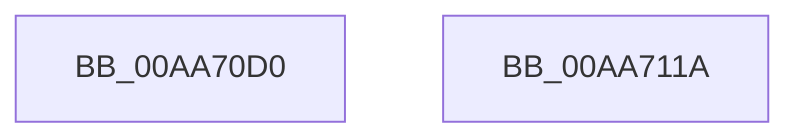

# NtLoadKey2

- RVA: `0x00AA70D0`–`0x00AA711B` (길이 `75` bytes)
- VA: `0x0000000140AA70D0`
- 실행 섹션: `PAGE`
- PDB 이름 있음: `예`; PDB Function 태그: `아니요`
- unwind 정보 RVA: `0x0006C9B8`
- 디코드: `19`개 명령, `75/75` bytes 표시
- 미해석 바이트: `0` (있으면 어셈블리에 `.byte`로 보존)

> 이 문서는 커널 이미지의 기계어와 PDB 기호를 분석해 생성했습니다. 4번과 5번은 함수 원형과 자료형을 바이너리 사용 방식에서 추정한 C 해석이며 원본 소스 복구 결과는 아닙니다.

## 1. Dependencies

- 직접 호출 지점: **1**; 고유 호출 대상: **1**
- 직접 호출자로 확인된 함수: **0**
- RIP 상대 이미지 참조: **0**

### Outgoing calls
- `0x00AA7110` → [CmLoadDifferencingKey](../87/CmLoadDifferencingKey_function_00875670.md) (function, `0x00875670`)

### Direct callers
- 이 함수 시작 RVA로 연결되는 직접 call은 확인되지 않았습니다. 간접 호출은 완전히 역산할 수 없습니다.

### Static image references
- 디코드된 RIP-relative 메모리 참조가 없습니다.

## 2. Other-region calls and transfers

- 다른 실행 섹션으로 향하는 call: **0**
- 별도 외부 분기/꼬리 이동을 확인하지 못했습니다.

## 3. Assembly (complete function range)

```asm
00AA70D0  4C 8B DC                        mov r11, rsp
00AA70D3  48 83 EC 78                     sub rsp, 0x78
00AA70D7  65 48 8B 04 25 88 01 00 00      mov rax, qword ptr gs:[0x188]
00AA70E0  44 8A 88 32 02 00 00            mov r9b, byte ptr [rax + 0x232]
00AA70E7  33 C0                           xor eax, eax
00AA70E9  45 88 4B E8                     mov byte ptr [r11 - 0x18], r9b
00AA70ED  45 33 C9                        xor r9d, r9d
00AA70F0  49 89 43 E0                     mov qword ptr [r11 - 0x20], rax
00AA70F4  88 44 24 50                     mov byte ptr [rsp + 0x50], al
00AA70F8  49 89 43 D0                     mov qword ptr [r11 - 0x30], rax
00AA70FC  49 89 43 C8                     mov qword ptr [r11 - 0x38], rax
00AA7100  49 89 43 C0                     mov qword ptr [r11 - 0x40], rax
00AA7104  89 44 24 30                     mov dword ptr [rsp + 0x30], eax
00AA7108  49 89 43 B0                     mov qword ptr [r11 - 0x50], rax
00AA710C  49 89 43 A8                     mov qword ptr [r11 - 0x58], rax
00AA7110  E8 5B E5 DC FF                  call 0x140875670
00AA7115  48 83 C4 78                     add rsp, 0x78
00AA7119  C3                              ret
00AA711A  CC                              int3
```

## 4. C-style interpretation (structured pseudocode)

```c
__int64 __fastcall NtLoadKey2(void)
{
    __int64 result;
    __int64 v_rsp;
    unsigned __int8 v_stack_m28;
    unsigned int v_stack_m48;

    v_rsp = (v_rsp) - (120);
    result = 0;
    *(unsigned __int8 *)(v_rsp - 24) = (unsigned __int8)(*(unsigned __int8 *)(*(unsigned __int64 *)(gs_base + (0 + 392)) + 562));
    a4 = 0;
    *(unsigned __int64 *)(v_rsp - 32) = 0;
    v_stack_m28 = 0;
    *(unsigned __int64 *)(v_rsp - 48) = 0;
    *(unsigned __int64 *)(v_rsp - 56) = 0;
    *(unsigned __int64 *)(v_rsp - 64) = 0;
    v_stack_m48 = 0;
    *(unsigned __int64 *)(v_rsp - 80) = 0;
    *(unsigned __int64 *)(v_rsp - 88) = 0;
    result = CmLoadDifferencingKey(a1, a2, a3, a4);
    v_rsp = (v_rsp) + (120);
    return result;
}
```

## 5. (Beta) C Style

```c
void NtLoadKey2(void)
{
    int64_t result;
    int64_t local_rsp;
    uint8_t v_stack_m28;
    uint32_t v_stack_m48;

    local_rsp = (local_rsp) - (120);
    result = 0;
    *(uint8_t *)(local_rsp - 0x18) = (uint8_t)(*(uint8_t *)(*(uint64_t *)(gs_base + (0 + 0x188)) + 0x232));
    a4 = 0;
    *(uint64_t *)(local_rsp - 0x20) = 0;
    v_stack_m28 = 0;
    *(uint64_t *)(local_rsp - 0x30) = 0;
    *(uint64_t *)(local_rsp - 0x38) = 0;
    *(uint64_t *)(local_rsp - 0x40) = 0;
    v_stack_m48 = 0;
    *(uint64_t *)(local_rsp - 0x50) = 0;
    *(uint64_t *)(local_rsp - 0x58) = 0;
    result = CmLoadDifferencingKey(a1, a2, a3, a4);
    local_rsp = (local_rsp) + (120);
    return result;
}
```

## 6. Execution-region graph

[열기: 2D/3D 그래프와 함수 탐색 컨트롤 패널](../../../control-panel.html?section=page&rva=0x00AA70D0&view=graph)

- 2D 그래프는 위에서 아래로 흐르고, 3D 그래프는 빈 공간을 드래그해 회전합니다. Shift+드래그는 이동, 휠은 확대·축소, 함수 노드 선택은 대상 보고서 이동입니다.

### Static fallback


