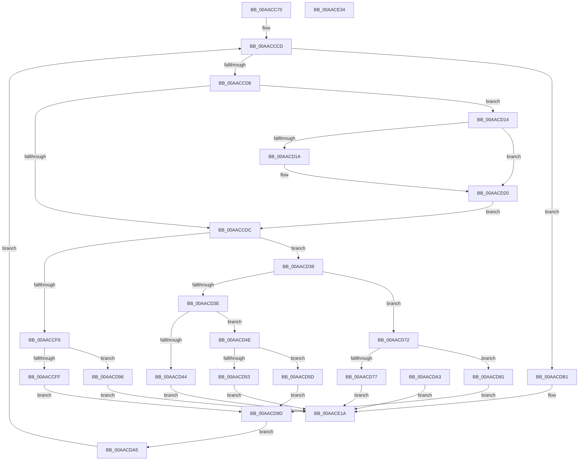

# NtLoadKey3

- RVA: `0x00AACC70`–`0x00AACE35` (길이 `453` bytes)
- VA: `0x0000000140AACC70`
- 실행 섹션: `PAGE`
- PDB 이름 있음: `예`; PDB Function 태그: `아니요`
- unwind 정보 RVA: `0x000BBFF0`
- 디코드: `105`개 명령, `453/453` bytes 표시
- 미해석 바이트: `0` (있으면 어셈블리에 `.byte`로 보존)

> 이 문서는 커널 이미지의 기계어와 PDB 기호를 분석해 생성했습니다. 4번과 5번은 함수 원형과 자료형을 바이너리 사용 방식에서 추정한 C 해석이며 원본 소스 복구 결과는 아닙니다.

## 1. Dependencies

- 직접 호출 지점: **2**; 고유 호출 대상: **2**
- 직접 호출자로 확인된 함수: **0**
- RIP 상대 이미지 참조: **0**

### Outgoing calls
- `0x00AACD1A` → [ExRaiseDatatypeMisalignment](../89/ExRaiseDatatypeMisalignment_function_00899FD0.md) (function, `0x00899FD0`)
- `0x00AACE15` → [CmLoadDifferencingKey](../87/CmLoadDifferencingKey_function_00875670.md) (function, `0x00875670`)

### Direct callers
- 이 함수 시작 RVA로 연결되는 직접 call은 확인되지 않았습니다. 간접 호출은 완전히 역산할 수 없습니다.

### Static image references
- 디코드된 RIP-relative 메모리 참조가 없습니다.

## 2. Other-region calls and transfers

- 다른 실행 섹션으로 향하는 call: **0**
- 별도 외부 분기/꼬리 이동을 확인하지 못했습니다.

## 3. Assembly (complete function range)

```asm
00AACC70  48 8B C4                        mov rax, rsp
00AACC73  48 89 58 08                     mov qword ptr [rax + 8], rbx
00AACC77  48 89 70 10                     mov qword ptr [rax + 0x10], rsi
00AACC7B  48 89 78 18                     mov qword ptr [rax + 0x18], rdi
00AACC7F  41 57                           push r15
00AACC81  48 81 EC A0 00 00 00            sub rsp, 0xa0
00AACC88  41 8B D8                        mov ebx, r8d
00AACC8B  48 8B FA                        mov rdi, rdx
00AACC8E  48 8B F1                        mov rsi, rcx
00AACC91  48 83 60 E0 00                  and qword ptr [rax - 0x20], 0
00AACC96  48 83 60 D8 00                  and qword ptr [rax - 0x28], 0
00AACC9B  83 60 C8 00                     and dword ptr [rax - 0x38], 0
00AACC9F  65 48 8B 04 25 88 01 00 00      mov rax, qword ptr gs:[0x188]
00AACCA8  44 8A 98 32 02 00 00            mov r11b, byte ptr [rax + 0x232]
00AACCAF  45 33 D2                        xor r10d, r10d
00AACCB2  4C 89 54 24 78                  mov qword ptr [rsp + 0x78], r10
00AACCB7  49 BF 00 00 FF FF FF 7F 00 00   movabs r15, 0x7fffffff0000
00AACCC1  44 8B 84 24 D0 00 00 00         mov r8d, dword ptr [rsp + 0xd0]
00AACCC9  8B 4C 24 70                     mov ecx, dword ptr [rsp + 0x70]
00AACCCD  45 85 C0                        test r8d, r8d
00AACCD0  0F 84 DB 00 00 00               je 0x140aacdb1
00AACCD6  41 80 FB 01                     cmp r11b, 1
00AACCDA  74 38                           je 0x140aacd14
00AACCDC  41 0F 10 01                     movups xmm0, xmmword ptr [r9]
00AACCE0  0F 11 84 24 90 00 00 00         movups xmmword ptr [rsp + 0x90], xmm0
00AACCE8  66 48 0F 7E C0                  movq rax, xmm0
00AACCED  0F B6 D0                        movzx edx, al
00AACCF0  48 83 EA 01                     sub rdx, 1
00AACCF4  75 42                           jne 0x140aacd38
00AACCF6  F6 C1 02                        test cl, 2
00AACCF9  0F 85 97 00 00 00               jne 0x140aacd96
00AACCFF  4C 8B 94 24 98 00 00 00         mov r10, qword ptr [rsp + 0x98]
00AACD07  4C 89 54 24 78                  mov qword ptr [rsp + 0x78], r10
00AACD0C  83 C9 02                        or ecx, 2
00AACD0F  E9 89 00 00 00                  jmp 0x140aacd9d
00AACD14  41 F6 C1 07                     test r9b, 7
00AACD18  74 06                           je 0x140aacd20
00AACD1A  E8 B1 D2 DE FF                  call 0x140899fd0
00AACD1F  CC                              int3
00AACD20  49 8B C1                        mov rax, r9
00AACD23  4D 3B CF                        cmp r9, r15
00AACD26  49 0F 43 C7                     cmovae rax, r15
00AACD2A  90                              nop
00AACD2B  8A 00                           mov al, byte ptr [rax]
00AACD2D  8B 4C 24 70                     mov ecx, dword ptr [rsp + 0x70]
00AACD31  4C 8B 54 24 78                  mov r10, qword ptr [rsp + 0x78]
00AACD36  EB A4                           jmp 0x140aaccdc
00AACD38  48 83 EA 01                     sub rdx, 1
00AACD3C  74 34                           je 0x140aacd72
00AACD3E  48 83 FA 01                     cmp rdx, 1
00AACD42  74 0A                           je 0x140aacd4e
00AACD44  B8 F2 00 00 C0                  mov eax, 0xc00000f2
00AACD49  E9 CC 00 00 00                  jmp 0x140aace1a
00AACD4E  F6 C1 08                        test cl, 8
00AACD51  74 0A                           je 0x140aacd5d
00AACD53  B8 F2 00 00 C0                  mov eax, 0xc00000f2
00AACD58  E9 BD 00 00 00                  jmp 0x140aace1a
00AACD5D  48 8B 84 24 98 00 00 00         mov rax, qword ptr [rsp + 0x98]
00AACD65  48 89 84 24 80 00 00 00         mov qword ptr [rsp + 0x80], rax
00AACD6D  83 C9 08                        or ecx, 8
00AACD70  EB 2B                           jmp 0x140aacd9d
00AACD72  F6 C1 04                        test cl, 4
00AACD75  74 0A                           je 0x140aacd81
00AACD77  B8 F2 00 00 C0                  mov eax, 0xc00000f2
00AACD7C  E9 99 00 00 00                  jmp 0x140aace1a
00AACD81  48 8B 84 24 98 00 00 00         mov rax, qword ptr [rsp + 0x98]
00AACD89  48 89 84 24 88 00 00 00         mov qword ptr [rsp + 0x88], rax
00AACD91  83 C9 04                        or ecx, 4
00AACD94  EB 07                           jmp 0x140aacd9d
00AACD96  B8 F2 00 00 C0                  mov eax, 0xc00000f2
00AACD9B  EB 7D                           jmp 0x140aace1a
00AACD9D  89 4C 24 70                     mov dword ptr [rsp + 0x70], ecx
00AACDA1  EB 02                           jmp 0x140aacda5
00AACDA3  EB 75                           jmp 0x140aace1a
00AACDA5  49 83 C1 10                     add r9, 0x10
00AACDA9  41 FF C8                        dec r8d
00AACDAC  E9 1C FF FF FF                  jmp 0x140aacccd
00AACDB1  0F BA EB 0F                     bts ebx, 0xf
00AACDB5  44 88 5C 24 60                  mov byte ptr [rsp + 0x60], r11b
00AACDBA  48 8B 84 24 80 00 00 00         mov rax, qword ptr [rsp + 0x80]
00AACDC2  48 89 44 24 58                  mov qword ptr [rsp + 0x58], rax
00AACDC7  C6 44 24 50 00                  mov byte ptr [rsp + 0x50], 0
00AACDCC  48 83 64 24 48 00               and qword ptr [rsp + 0x48], 0
00AACDD2  48 8B 84 24 E8 00 00 00         mov rax, qword ptr [rsp + 0xe8]
00AACDDA  48 89 44 24 40                  mov qword ptr [rsp + 0x40], rax
00AACDDF  48 8B 84 24 E0 00 00 00         mov rax, qword ptr [rsp + 0xe0]
00AACDE7  48 89 44 24 38                  mov qword ptr [rsp + 0x38], rax
00AACDEC  8B 84 24 D8 00 00 00            mov eax, dword ptr [rsp + 0xd8]
00AACDF3  89 44 24 30                     mov dword ptr [rsp + 0x30], eax
00AACDF7  48 8B 84 24 88 00 00 00         mov rax, qword ptr [rsp + 0x88]
00AACDFF  48 89 44 24 28                  mov qword ptr [rsp + 0x28], rax
00AACE04  4C 89 54 24 20                  mov qword ptr [rsp + 0x20], r10
00AACE09  45 33 C9                        xor r9d, r9d
00AACE0C  44 8B C3                        mov r8d, ebx
00AACE0F  48 8B D7                        mov rdx, rdi
00AACE12  48 8B CE                        mov rcx, rsi
00AACE15  E8 56 88 DC FF                  call 0x140875670
00AACE1A  4C 8D 9C 24 A0 00 00 00         lea r11, [rsp + 0xa0]
00AACE22  49 8B 5B 10                     mov rbx, qword ptr [r11 + 0x10]
00AACE26  49 8B 73 18                     mov rsi, qword ptr [r11 + 0x18]
00AACE2A  49 8B 7B 20                     mov rdi, qword ptr [r11 + 0x20]
00AACE2E  49 8B E3                        mov rsp, r11
00AACE31  41 5F                           pop r15
00AACE33  C3                              ret
00AACE34  CC                              int3
```

## 4. C-style interpretation (structured pseudocode)

```c
__int64 __fastcall NtLoadKey3(__int64 a1, __int64 a2, int a3, __int64 a4, unsigned int a5, unsigned int a6, __int64 a7, __int64 a8)
{
    __int64 result;
    __int64 v_r10;
    __int64 v_rsp;
    unsigned __int64 v_stack_m10;
    unsigned __int64 v_stack_m18;
    unsigned __int64 v_stack_m20;
    unsigned __int64 v_stack_m28;
    unsigned __int64 v_stack_m30;
    unsigned int v_stack_m38;
    unsigned __int8 v_stack_m48;
    unsigned __int64 v_stack_m50;
    unsigned __int8 v_stack_m58;
    unsigned __int64 v_stack_m60;
    unsigned __int64 v_stack_m68;
    unsigned __int64 v_stack_m70;
    unsigned int v_stack_m78;
    unsigned __int64 v_stack_m8;
    unsigned __int64 v_stack_m80;
    unsigned __int64 v_stack_m88;

    *(unsigned __int64 *)(v_rsp + 8) = v_rbx;
    *(unsigned __int64 *)(v_rsp + 16) = v_rsi;
    *(unsigned __int64 *)(v_rsp + 24) = v_rdi;
    v_rsp = (v_rsp) - (160);
    v_r10 = 0;
    v_stack_m30 = 0;
loc_00AACCCD:
    if ((unsigned int)((unsigned int)(a5)) == 0) goto loc_00AACDB1;
    if (((unsigned __int8)(*(unsigned __int8 *)(*(unsigned __int64 *)(gs_base + (0 + 392)) + 562))) == 1) goto loc_00AACD14;
loc_00AACCDC:
    v_stack_m18 = v_xmm0;
    a2 = ((unsigned __int8)(*(unsigned __int64 *)(gs_base + (0 + 392)))) - (1);
    if (condition_is_not_equal) goto loc_00AACD38;
    if ((((unsigned __int8)((unsigned int)(v_stack_m38))) & (2)) != 0) goto loc_00AACD96;
    v_stack_m30 = v_stack_m10;
    a1 = (unsigned int)(((unsigned int)(v_stack_m38)) | (2));
    goto loc_00AACD9D;
loc_00AACD14:
    result = *(unsigned __int64 *)(gs_base + (0 + 392));
    if ((((unsigned __int8)(a4)) & (7)) != 0) {
        result = ExRaiseDatatypeMisalignment(a1, a2, (unsigned int)(a5), a4);
    }
    if (a4 >= v_r15) { a4 = v_r15; }
    goto loc_00AACCDC;
loc_00AACD38:
    a2 = (a2) - (1);
    if (condition_is_equal) goto loc_00AACD72;
    if (a2 == 1) goto loc_00AACD4E;
    goto loc_00AACE1A;
loc_00AACD4E:
    if ((((unsigned __int8)((unsigned int)(v_stack_m38))) & (8)) == 0) goto loc_00AACD5D;
    goto loc_00AACE1A;
loc_00AACD5D:
    v_stack_m28 = v_stack_m10;
    a1 = (unsigned int)(((unsigned int)(v_stack_m38)) | (8));
    goto loc_00AACD9D;
loc_00AACD72:
    if ((((unsigned __int8)(a1)) & (4)) == 0) goto loc_00AACD81;
    goto loc_00AACE1A;
loc_00AACD81:
    v_stack_m20 = v_stack_m10;
    a1 = (unsigned int)((a1) | (4));
    goto loc_00AACD9D;
loc_00AACD96:
    goto loc_00AACE1A;
loc_00AACD9D:
    v_stack_m38 = (unsigned int)(a1);
    goto loc_00AACDA5;
loc_00AACDA5:
    a4 = (a4) + (16);
    a3 = (unsigned int)(((unsigned int)(a5)) - 1);
    goto loc_00AACCCD;
loc_00AACDB1:
    v_stack_m48 = (unsigned __int8)(*(unsigned __int8 *)(*(unsigned __int64 *)(gs_base + (0 + 392)) + 562));
    v_stack_m50 = v_stack_m28;
    v_stack_m58 = 0;
    v_stack_m68 = a8;
    v_stack_m70 = a7;
    v_stack_m78 = (unsigned int)((unsigned int)(a6));
    v_stack_m80 = v_stack_m20;
    v_stack_m88 = v_stack_m30;
    a4 = 0;
    result = CmLoadDifferencingKey(a1, a2, (unsigned int)((unsigned int)((unsigned int)(a3))), a4);
loc_00AACE1A:
    return result;
}
```

## 5. (Beta) C Style

```c
int64_t NtLoadKey3(int64_t Arg1, int64_t Arg2, int32_t Arg3, int64_t Arg4, uint32_t Arg5, uint32_t Arg6, int64_t Arg7, int64_t Arg8)
{
    int64_t result;
    int64_t local_r10;
    int64_t local_rsp;
    uint64_t v_stack_m10;
    uint64_t v_stack_m18;
    uint64_t v_stack_m20;
    uint64_t v_stack_m28;
    uint64_t v_stack_m30;
    uint32_t v_stack_m38;
    uint8_t v_stack_m48;
    uint64_t v_stack_m50;
    uint8_t v_stack_m58;
    uint64_t v_stack_m60;
    uint64_t v_stack_m68;
    uint64_t v_stack_m70;
    uint32_t v_stack_m78;
    uint64_t v_stack_m8;
    uint64_t v_stack_m80;
    uint64_t v_stack_m88;

    *(uint64_t *)(local_rsp + 0x8) = local_rbx;
    *(uint64_t *)(local_rsp + 0x10) = local_rsi;
    *(uint64_t *)(local_rsp + 0x18) = local_rdi;
    local_rsp = (local_rsp) - (160);
    local_r10 = 0;
    v_stack_m30 = 0;
loc_00AACCCD:
    if ((uint32_t)((uint32_t)(Arg5)) == 0) goto loc_00AACDB1;
    if (((uint8_t)(*(uint8_t *)(*(uint64_t *)(gs_base + (0 + 0x188)) + 0x232))) == 1) goto loc_00AACD14;
loc_00AACCDC:
    v_stack_m18 = v_xmm0;
    Arg2 = ((uint8_t)(*(uint64_t *)(gs_base + (0 + 0x188)))) - (1);
    if (condition_is_not_equal) goto loc_00AACD38;
    if ((((uint8_t)((uint32_t)(v_stack_m38))) & (2)) != 0) goto loc_00AACD96;
    v_stack_m30 = v_stack_m10;
    Arg1 = (uint32_t)(((uint32_t)(v_stack_m38)) | (2));
    goto loc_00AACD9D;
loc_00AACD14:
    result = *(uint64_t *)(gs_base + (0 + 0x188));
    if ((((uint8_t)(Arg4)) & (7)) != 0) {
        result = ExRaiseDatatypeMisalignment(Arg1, Arg2, (uint32_t)(Arg5), Arg4);
    }
    if (Arg4 >= local_r15) { Arg4 = local_r15; }
    goto loc_00AACCDC;
loc_00AACD38:
    Arg2 = (Arg2) - (1);
    if (condition_is_equal) goto loc_00AACD72;
    if (Arg2 == 1) goto loc_00AACD4E;
    goto loc_00AACE1A;
loc_00AACD4E:
    if ((((uint8_t)((uint32_t)(v_stack_m38))) & (8)) == 0) goto loc_00AACD5D;
    goto loc_00AACE1A;
loc_00AACD5D:
    v_stack_m28 = v_stack_m10;
    Arg1 = (uint32_t)(((uint32_t)(v_stack_m38)) | (8));
    goto loc_00AACD9D;
loc_00AACD72:
    if ((((uint8_t)(Arg1)) & (4)) == 0) goto loc_00AACD81;
    goto loc_00AACE1A;
loc_00AACD81:
    v_stack_m20 = v_stack_m10;
    Arg1 = (uint32_t)((Arg1) | (4));
    goto loc_00AACD9D;
loc_00AACD96:
    goto loc_00AACE1A;
loc_00AACD9D:
    v_stack_m38 = (uint32_t)(Arg1);
    goto loc_00AACDA5;
loc_00AACDA5:
    Arg4 = (Arg4) + (16);
    Arg3 = (uint32_t)(((uint32_t)(Arg5)) - 1);
    goto loc_00AACCCD;
loc_00AACDB1:
    v_stack_m48 = (uint8_t)(*(uint8_t *)(*(uint64_t *)(gs_base + (0 + 0x188)) + 0x232));
    v_stack_m50 = v_stack_m28;
    v_stack_m58 = 0;
    v_stack_m68 = Arg8;
    v_stack_m70 = Arg7;
    v_stack_m78 = (uint32_t)((uint32_t)(Arg6));
    v_stack_m80 = v_stack_m20;
    v_stack_m88 = v_stack_m30;
    Arg4 = 0;
    result = CmLoadDifferencingKey(Arg1, Arg2, (uint32_t)((uint32_t)((uint32_t)(Arg3))), Arg4);
loc_00AACE1A:
    return result;
}
```

## 6. Execution-region graph

[열기: 2D/3D 그래프와 함수 탐색 컨트롤 패널](../../../control-panel.html?section=page&rva=0x00AACC70&view=graph)

- 2D 그래프는 위에서 아래로 흐르고, 3D 그래프는 빈 공간을 드래그해 회전합니다. Shift+드래그는 이동, 휠은 확대·축소, 함수 노드 선택은 대상 보고서 이동입니다.

### Static fallback


