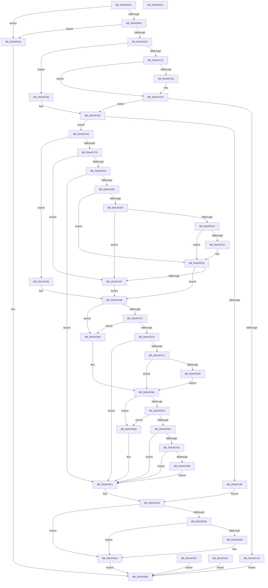

# NtQueryBootOptions

- RVA: `0x00AAFBC0`–`0x00AAFE5B` (길이 `667` bytes)
- VA: `0x0000000140AAFBC0`
- 실행 섹션: `PAGE`
- PDB 이름 있음: `예`; PDB Function 태그: `아니요`
- unwind 정보 RVA: `0x000BC424`
- 디코드: `164`개 명령, `667/667` bytes 표시
- 미해석 바이트: `0` (있으면 어셈블리에 `.byte`로 보존)

> 이 문서는 커널 이미지의 기계어와 PDB 기호를 분석해 생성했습니다. 4번과 5번은 함수 원형과 자료형을 바이너리 사용 방식에서 추정한 C 해석이며 원본 소스 복구 결과는 아닙니다.

## 1. Dependencies

- 직접 호출 지점: **9**; 고유 호출 대상: **7**
- 직접 호출자로 확인된 함수: **0**
- RIP 상대 이미지 참조: **7**

### Outgoing calls
- `0x00AAFBF6` → [PsIsCurrentThreadInServerSilo](../../text/43/PsIsCurrentThreadInServerSilo_function_004362E0.md) (function, `0x004362E0`)
- `0x00AAFC58` → [ProbeForWrite](../8E/ProbeForWrite_function_008E91C0.md) (function, `0x008E91C0`)
- `0x00AAFC6B` → [SeSinglePrivilegeCheck](../87/SeSinglePrivilegeCheck_function_00871E20.md) (function, `0x00871E20`)
- `0x00AAFCC1` → [ExAcquireFastMutexUnsafe](../../text/3F/ExAcquireFastMutexUnsafe_function_003F3720.md) (function, `0x003F3720`)
- `0x00AAFCEB` → [IoGetEnvironmentVariableEx](../95/IoGetEnvironmentVariableEx_function_00952760.md) (function, `0x00952760`)
- `0x00AAFD63` → [IoGetEnvironmentVariableEx](../95/IoGetEnvironmentVariableEx_function_00952760.md) (function, `0x00952760`)
- `0x00AAFDBB` → [IoGetEnvironmentVariableEx](../95/IoGetEnvironmentVariableEx_function_00952760.md) (function, `0x00952760`)
- `0x00AAFDF8` → [ExReleaseFastMutexUnsafe](../../text/25/ExReleaseFastMutexUnsafe_function_002503A0.md) (function, `0x002503A0`)
- `0x00AAFDFD` → [KeLeaveCriticalRegion](../../text/25/KeLeaveCriticalRegion_function_0025D8B0.md) (function, `0x0025D8B0`)

### Direct callers
- 이 함수 시작 RVA로 연결되는 직접 call은 확인되지 않았습니다. 간접 호출은 완전히 역산할 수 없습니다.

### Static image references
- `0x00AAFBE9` → RVA `0x00EFF050` (`.data`; read)
- `0x00AAFC64` → RVA `0x00FD9AB8` (`PAGEDATA`; read)
- `0x00AAFCBA` → RVA `0x00EFAB40` (`.data`; read)
- `0x00AAFCDD` → RVA `0x00019EF0` (`.rdata`; read)
- `0x00AAFCE4` → RVA `0x00B089B0` (` ?? ::NNGAKEGL::`string'`; read)
- `0x00AAFD5C` → RVA `0x00B08A00` (` ?? ::NNGAKEGL::`string'`; read)
- `0x00AAFDB4` → RVA `0x00B089E0` (` ?? ::NNGAKEGL::`string'`; read)

## 2. Other-region calls and transfers

- 다른 실행 섹션으로 향하는 call: **4**
  - `0x00AAFBF6` → [PsIsCurrentThreadInServerSilo](../../text/43/PsIsCurrentThreadInServerSilo_function_004362E0.md) (`PAGE` → `.text`)
  - `0x00AAFCC1` → [ExAcquireFastMutexUnsafe](../../text/3F/ExAcquireFastMutexUnsafe_function_003F3720.md) (`PAGE` → `.text`)
  - `0x00AAFDF8` → [ExReleaseFastMutexUnsafe](../../text/25/ExReleaseFastMutexUnsafe_function_002503A0.md) (`PAGE` → `.text`)
  - `0x00AAFDFD` → [KeLeaveCriticalRegion](../../text/25/KeLeaveCriticalRegion_function_0025D8B0.md) (`PAGE` → `.text`)
- 별도 외부 분기/꼬리 이동을 확인하지 못했습니다.

## 3. Assembly (complete function range)

```asm
00AAFBC0  48 8B C4                        mov rax, rsp
00AAFBC3  48 89 58 08                     mov qword ptr [rax + 8], rbx
00AAFBC7  57                              push rdi
00AAFBC8  41 54                           push r12
00AAFBCA  41 57                           push r15
00AAFBCC  48 83 EC 60                     sub rsp, 0x60
00AAFBD0  4C 8B FA                        mov r15, rdx
00AAFBD3  48 8B F9                        mov rdi, rcx
00AAFBD6  45 33 E4                        xor r12d, r12d
00AAFBD9  44 89 60 BC                     mov dword ptr [rax - 0x44], r12d
00AAFBDD  44 89 60 C4                     mov dword ptr [rax - 0x3c], r12d
00AAFBE1  44 89 60 C8                     mov dword ptr [rax - 0x38], r12d
00AAFBE5  44 89 60 B8                     mov dword ptr [rax - 0x48], r12d
00AAFBE9  83 3D 60 F4 44 00 02            cmp dword ptr [rip + 0x44f460], 2
00AAFBF0  0F 85 4D 02 00 00               jne 0x140aafe43
00AAFBF6  E8 E5 66 98 FF                  call 0x1404362e0
00AAFBFB  84 C0                           test al, al
00AAFBFD  0F 85 40 02 00 00               jne 0x140aafe43
00AAFC03  65 48 8B 04 25 88 01 00 00      mov rax, qword ptr gs:[0x188]
00AAFC0C  48 89 44 24 58                  mov qword ptr [rsp + 0x58], rax
00AAFC11  8A 80 32 02 00 00               mov al, byte ptr [rax + 0x232]
00AAFC17  88 84 24 90 00 00 00            mov byte ptr [rsp + 0x90], al
00AAFC1E  84 C0                           test al, al
00AAFC20  74 63                           je 0x140aafc85
00AAFC22  48 B9 00 00 FF FF FF 7F 00 00   movabs rcx, 0x7fffffff0000
00AAFC2C  4C 3B F9                        cmp r15, rcx
00AAFC2F  49 0F 42 CF                     cmovb rcx, r15
00AAFC33  8B 01                           mov eax, dword ptr [rcx]
00AAFC35  89 01                           mov dword ptr [rcx], eax
00AAFC37  41 8B 0F                        mov ecx, dword ptr [r15]
00AAFC3A  89 4C 24 44                     mov dword ptr [rsp + 0x44], ecx
00AAFC3E  48 8B C7                        mov rax, rdi
00AAFC41  48 F7 D8                        neg rax
00AAFC44  1B DB                           sbb ebx, ebx
00AAFC46  23 D9                           and ebx, ecx
00AAFC48  89 5C 24 44                     mov dword ptr [rsp + 0x44], ebx
00AAFC4C  74 0F                           je 0x140aafc5d
00AAFC4E  8B D3                           mov edx, ebx
00AAFC50  45 8D 44 24 04                  lea r8d, [r12 + 4]
00AAFC55  48 8B CF                        mov rcx, rdi
00AAFC58  E8 63 95 E3 FF                  call 0x1408e91c0
00AAFC5D  8A 94 24 90 00 00 00            mov dl, byte ptr [rsp + 0x90]
00AAFC64  48 8B 0D 4D 9E 52 00            mov rcx, qword ptr [rip + 0x529e4d]
00AAFC6B  E8 B0 21 DC FF                  call 0x140871e20
00AAFC70  88 84 24 98 00 00 00            mov byte ptr [rsp + 0x98], al
00AAFC77  84 C0                           test al, al
00AAFC79  75 1F                           jne 0x140aafc9a
00AAFC7B  B8 61 00 00 C0                  mov eax, 0xc0000061
00AAFC80  E9 C3 01 00 00                  jmp 0x140aafe48
00AAFC85  41 8B 0F                        mov ecx, dword ptr [r15]
00AAFC88  89 4C 24 44                     mov dword ptr [rsp + 0x44], ecx
00AAFC8C  48 8B C7                        mov rax, rdi
00AAFC8F  48 F7 D8                        neg rax
00AAFC92  1B DB                           sbb ebx, ebx
00AAFC94  23 D9                           and ebx, ecx
00AAFC96  89 5C 24 44                     mov dword ptr [rsp + 0x44], ebx
00AAFC9A  83 FB 16                        cmp ebx, 0x16
00AAFC9D  73 0A                           jae 0x140aafca9
00AAFC9F  BB 23 00 00 C0                  mov ebx, 0xc0000023
00AAFCA4  E9 5A 01 00 00                  jmp 0x140aafe03
00AAFCA9  65 48 8B 04 25 88 01 00 00      mov rax, qword ptr gs:[0x188]
00AAFCB2  66 FF 88 E4 01 00 00            dec word ptr [rax + 0x1e4]
00AAFCB9  90                              nop
00AAFCBA  48 8D 0D 7F AE 44 00            lea rcx, [rip + 0x44ae7f]
00AAFCC1  E8 5A 3A 94 FF                  call 0x1403f3720
00AAFCC6  C7 44 24 30 04 00 00 00         mov dword ptr [rsp + 0x30], 4
00AAFCCE  4C 89 64 24 20                  mov qword ptr [rsp + 0x20], r12
00AAFCD3  4C 8D 4C 24 30                  lea r9, [rsp + 0x30]
00AAFCD8  4C 8D 44 24 34                  lea r8, [rsp + 0x34]
00AAFCDD  48 8D 15 0C A2 56 FF            lea rdx, [rip - 0xa95df4]
00AAFCE4  48 8D 0D C5 8C 05 00            lea rcx, [rip + 0x58cc5]
00AAFCEB  E8 70 2A EA FF                  call 0x140952760
00AAFCF0  8B D8                           mov ebx, eax
00AAFCF2  3D 23 00 00 C0                  cmp eax, 0xc0000023
00AAFCF7  74 3D                           je 0x140aafd36
00AAFCF9  3D 00 01 00 C0                  cmp eax, 0xc0000100
00AAFCFE  74 2F                           je 0x140aafd2f
00AAFD00  85 C0                           test eax, eax
00AAFD02  0F 85 E9 00 00 00               jne 0x140aafdf1
00AAFD08  83 7C 24 30 02                  cmp dword ptr [rsp + 0x30], 2
00AAFD0D  76 16                           jbe 0x140aafd25
00AAFD0F  83 7C 24 34 FF                  cmp dword ptr [rsp + 0x34], -1
00AAFD14  74 19                           je 0x140aafd2f
00AAFD16  B8 FE FF 00 00                  mov eax, 0xfffe
00AAFD1B  39 44 24 34                     cmp dword ptr [rsp + 0x34], eax
00AAFD1F  76 04                           jbe 0x140aafd25
00AAFD21  89 44 24 34                     mov dword ptr [rsp + 0x34], eax
00AAFD25  81 7C 24 34 FF FF 00 00         cmp dword ptr [rsp + 0x34], 0xffff
00AAFD2D  75 0F                           jne 0x140aafd3e
00AAFD2F  83 4C 24 34 FF                  or dword ptr [rsp + 0x34], 0xffffffff
00AAFD34  EB 08                           jmp 0x140aafd3e
00AAFD36  C7 44 24 34 FE FF FF FF         mov dword ptr [rsp + 0x34], 0xfffffffe
00AAFD3E  C7 44 24 30 04 00 00 00         mov dword ptr [rsp + 0x30], 4
00AAFD46  4C 89 64 24 20                  mov qword ptr [rsp + 0x20], r12
00AAFD4B  4C 8D 4C 24 30                  lea r9, [rsp + 0x30]
00AAFD50  4C 8D 44 24 3C                  lea r8, [rsp + 0x3c]
00AAFD55  48 8D 15 94 A1 56 FF            lea rdx, [rip - 0xa95e6c]
00AAFD5C  48 8D 0D 9D 8C 05 00            lea rcx, [rip + 0x58c9d]
00AAFD63  E8 F8 29 EA FF                  call 0x140952760
00AAFD68  8B D8                           mov ebx, eax
00AAFD6A  3D 23 00 00 C0                  cmp eax, 0xc0000023
00AAFD6F  74 1D                           je 0x140aafd8e
00AAFD71  3D 00 01 00 C0                  cmp eax, 0xc0000100
00AAFD76  74 16                           je 0x140aafd8e
00AAFD78  85 C0                           test eax, eax
00AAFD7A  75 75                           jne 0x140aafdf1
00AAFD7C  83 7C 24 30 02                  cmp dword ptr [rsp + 0x30], 2
00AAFD81  76 13                           jbe 0x140aafd96
00AAFD83  0F B7 44 24 3C                  movzx eax, word ptr [rsp + 0x3c]
00AAFD88  89 44 24 3C                     mov dword ptr [rsp + 0x3c], eax
00AAFD8C  EB 08                           jmp 0x140aafd96
00AAFD8E  C7 44 24 3C FE FF FF FF         mov dword ptr [rsp + 0x3c], 0xfffffffe
00AAFD96  C7 44 24 30 02 00 00 00         mov dword ptr [rsp + 0x30], 2
00AAFD9E  4C 89 64 24 20                  mov qword ptr [rsp + 0x20], r12
00AAFDA3  4C 8D 4C 24 30                  lea r9, [rsp + 0x30]
00AAFDA8  4C 8D 44 24 40                  lea r8, [rsp + 0x40]
00AAFDAD  48 8D 15 3C A1 56 FF            lea rdx, [rip - 0xa95ec4]
00AAFDB4  48 8D 0D 25 8C 05 00            lea rcx, [rip + 0x58c25]
00AAFDBB  E8 A0 29 EA FF                  call 0x140952760
00AAFDC0  8B D8                           mov ebx, eax
00AAFDC2  3D 23 00 00 C0                  cmp eax, 0xc0000023
00AAFDC7  74 1D                           je 0x140aafde6
00AAFDC9  3D 00 01 00 C0                  cmp eax, 0xc0000100
00AAFDCE  74 16                           je 0x140aafde6
00AAFDD0  85 C0                           test eax, eax
00AAFDD2  75 1D                           jne 0x140aafdf1
00AAFDD4  83 7C 24 30 02                  cmp dword ptr [rsp + 0x30], 2
00AAFDD9  76 16                           jbe 0x140aafdf1
00AAFDDB  0F B7 44 24 40                  movzx eax, word ptr [rsp + 0x40]
00AAFDE0  89 44 24 40                     mov dword ptr [rsp + 0x40], eax
00AAFDE4  EB 0B                           jmp 0x140aafdf1
00AAFDE6  C7 44 24 40 FE FF FF FF         mov dword ptr [rsp + 0x40], 0xfffffffe
00AAFDEE  41 8B DC                        mov ebx, r12d
00AAFDF1  48 8D 0D 48 AD 44 00            lea rcx, [rip + 0x44ad48]
00AAFDF8  E8 A3 05 7A FF                  call 0x1402503a0
00AAFDFD  E8 AE DA 7A FF                  call 0x14025d8b0
00AAFE02  90                              nop
00AAFE03  90                              nop
00AAFE04  85 DB                           test ebx, ebx
00AAFE06  75 2C                           jne 0x140aafe34
00AAFE08  48 85 FF                        test rdi, rdi
00AAFE0B  74 27                           je 0x140aafe34
00AAFE0D  C7 07 01 00 00 00               mov dword ptr [rdi], 1
00AAFE13  C7 47 04 16 00 00 00            mov dword ptr [rdi + 4], 0x16
00AAFE1A  8B 44 24 34                     mov eax, dword ptr [rsp + 0x34]
00AAFE1E  89 47 08                        mov dword ptr [rdi + 8], eax
00AAFE21  8B 44 24 3C                     mov eax, dword ptr [rsp + 0x3c]
00AAFE25  89 47 0C                        mov dword ptr [rdi + 0xc], eax
00AAFE28  8B 44 24 40                     mov eax, dword ptr [rsp + 0x40]
00AAFE2C  89 47 10                        mov dword ptr [rdi + 0x10], eax
00AAFE2F  66 44 89 67 14                  mov word ptr [rdi + 0x14], r12w
00AAFE34  41 C7 07 16 00 00 00            mov dword ptr [r15], 0x16
00AAFE3B  8B C3                           mov eax, ebx
00AAFE3D  EB 09                           jmp 0x140aafe48
00AAFE3F  EB 07                           jmp 0x140aafe48
00AAFE41  EB 05                           jmp 0x140aafe48
00AAFE43  B8 02 00 00 C0                  mov eax, 0xc0000002
00AAFE48  48 8B 9C 24 80 00 00 00         mov rbx, qword ptr [rsp + 0x80]
00AAFE50  48 83 C4 60                     add rsp, 0x60
00AAFE54  41 5F                           pop r15
00AAFE56  41 5C                           pop r12
00AAFE58  5F                              pop rdi
00AAFE59  C3                              ret
00AAFE5A  CC                              int3
```

## 4. C-style interpretation (structured pseudocode)

```c
__int64 __fastcall NtQueryBootOptions(__int64 a1, __int64 a2)
{
    __int64 result;
    __int64 v_r12;
    __int64 v_rbx;
    __int64 v_rsp;
    unsigned __int64 v_stack_m20;
    unsigned int v_stack_m34;
    unsigned __int64 v_stack_m38;
    unsigned __int64 v_stack_m3C;
    unsigned __int64 v_stack_m44;
    unsigned int v_stack_m48;
    unsigned __int64 v_stack_m58;
    unsigned __int8 v_stack_p18;
    unsigned __int8 v_stack_p20;
    unsigned __int64 v_stack_p8;

    *(unsigned __int64 *)(v_rsp + 8) = v_rbx;
    v_rsp = (v_rsp) - (96);
    v_r12 = 0;
    *(unsigned int *)(v_rsp - 68) = 0;
    *(unsigned int *)(v_rsp - 60) = 0;
    *(unsigned int *)(v_rsp - 56) = 0;
    *(unsigned int *)(v_rsp - 72) = 0;
    if ((*(unsigned int *)(v_rip + 4519008)) != 2) goto loc_00AAFE43;
    result = PsIsCurrentThreadInServerSilo(a1, a2, a3, a4);
    if ((unsigned __int8)(result) != 0) goto loc_00AAFE43;
    v_stack_m20 = *(unsigned __int64 *)(gs_base + (0 + 392));
    v_stack_p18 = (unsigned __int8)(*(unsigned __int8 *)(*(unsigned __int64 *)(gs_base + (0 + 392)) + 562));
    if ((unsigned __int8)(*(unsigned __int8 *)(*(unsigned __int64 *)(gs_base + (0 + 392)) + 562)) == 0) goto loc_00AAFC85;
    if (a2 < a1) { a1 = a2; }
    *(unsigned int *)(a1) = (unsigned int)((unsigned int)(*(unsigned int *)(a1)));
    v_stack_m34 = (unsigned int)((unsigned int)(*(unsigned int *)(a2)));
    result = -(a1);
    v_rbx = (unsigned int)((v_rbx) & ((unsigned int)((unsigned int)(*(unsigned int *)(a2)))));
    v_stack_m34 = (unsigned int)(v_rbx);
    if (!(condition_is_equal)) {
        a2 = (unsigned int)(v_rbx);
        a3 = v_r12 + 4;
        a1 = a1;
        result = ProbeForWrite(a1, a2, a3, a4);
    }
    result = SeSinglePrivilegeCheck(*(unsigned __int64 *)(v_rip + 5414477), v_stack_p18, a3, a4);
    v_stack_p20 = (unsigned __int8)(result);
    if ((unsigned __int8)(result) != 0) goto loc_00AAFC9A;
    goto loc_00AAFE48;
loc_00AAFC85:
    v_stack_m34 = (unsigned int)((unsigned int)(*(unsigned int *)(a2)));
    result = -(a1);
    v_rbx = (unsigned int)((v_rbx) & ((unsigned int)((unsigned int)(*(unsigned int *)(a2)))));
    v_stack_m34 = (unsigned int)(v_rbx);
loc_00AAFC9A:
    if (((unsigned int)(v_rbx)) >= 22) goto loc_00AAFCA9;
    goto loc_00AAFE03;
loc_00AAFCA9:
    result = ExAcquireFastMutexUnsafe(v_rip + 4501119, v_stack_p18, a3, a4);
    v_stack_m48 = 4;
    v_stack_m58 = 0;
    result = IoGetEnvironmentVariableEx(v_rip + 363717, v_rip - 11099636, v_stack_m44, v_stack_m48);
    if (((unsigned int)(result)) == 0xC0000023ULL) goto loc_00AAFD36;
    if (((unsigned int)(result)) == 0xC0000100ULL) goto loc_00AAFD2F;
    if ((unsigned int)(result) != 0) goto loc_00AAFDF1;
    if (v_stack_m48 <= 2) goto loc_00AAFD25;
    if (v_stack_m44 == -1) goto loc_00AAFD2F;
    if (v_stack_m44 >= = ((unsigned int)((unsigned int)(0xFFFEULL)))) {
        v_stack_m44 = (unsigned int)((unsigned int)(0xFFFEULL));
    }
    if (v_stack_m44 != 0xFFFFULL) goto loc_00AAFD3E;
loc_00AAFD2F:
    goto loc_00AAFD3E;
loc_00AAFD36:
    v_stack_m44 = 0xFFFFFFFEULL;
loc_00AAFD3E:
    v_stack_m48 = 4;
    v_stack_m58 = 0;
    result = IoGetEnvironmentVariableEx(v_rip + 363677, v_rip - 11099756, v_stack_m3C, v_stack_m48);
    if (((unsigned int)(result)) == 0xC0000023ULL) goto loc_00AAFD8E;
    if (((unsigned int)(result)) == 0xC0000100ULL) goto loc_00AAFD8E;
    if ((unsigned int)(result) != 0) goto loc_00AAFDF1;
    if (v_stack_m48 <= 2) goto loc_00AAFD96;
    v_stack_m3C = (unsigned int)(v_stack_m3C);
    goto loc_00AAFD96;
loc_00AAFD8E:
    v_stack_m3C = 0xFFFFFFFEULL;
loc_00AAFD96:
    v_stack_m48 = 2;
    v_stack_m58 = 0;
    result = IoGetEnvironmentVariableEx(v_rip + 363557, v_rip - 11099844, v_stack_m38, v_stack_m48);
    if (((unsigned int)(result)) == 0xC0000023ULL) goto loc_00AAFDE6;
    if (((unsigned int)(result)) == 0xC0000100ULL) goto loc_00AAFDE6;
    if ((unsigned int)(result) != 0) goto loc_00AAFDF1;
    if (v_stack_m48 <= 2) goto loc_00AAFDF1;
    v_stack_m38 = (unsigned int)(v_stack_m38);
    goto loc_00AAFDF1;
loc_00AAFDE6:
    v_stack_m38 = 0xFFFFFFFEULL;
loc_00AAFDF1:
    result = ExReleaseFastMutexUnsafe(v_rip + 4500808, v_rip - 11099844, v_stack_m38, v_stack_m48);
    result = KeLeaveCriticalRegion(v_rip + 4500808, v_rip - 11099844, v_stack_m38, v_stack_m48);
loc_00AAFE03:
    if (0 != 0) goto loc_00AAFE34;
    if (a1 != 0) {
        *(unsigned int *)(a1) = 1;
        *(unsigned int *)(a1 + 4) = 22;
        result = v_stack_m44;
        *(unsigned int *)(a1 + 8) = (unsigned int)(result);
        result = v_stack_m3C;
        *(unsigned int *)(a1 + 12) = (unsigned int)(result);
        result = v_stack_m38;
        *(unsigned int *)(a1 + 16) = (unsigned int)(result);
        *(unsigned __int16 *)(a1 + 20) = 0;
    }
    *(unsigned int *)(a2) = 22;
    goto loc_00AAFE48;
loc_00AAFE43:
loc_00AAFE48:
    v_rsp = (v_rsp) + (96);
    return (unsigned int)(0xC0000002ULL);
}
```

## 5. (Beta) C Style

```c
int64_t NtQueryBootOptions(int64_t Arg1, void *Arg2)
{
    uint8_t *arg2 = (uint8_t *)Arg2;

    int64_t result;
    int64_t local_r12;
    int64_t local_rbx;
    int64_t local_rsp;
    uint64_t v_stack_m20;
    uint32_t v_stack_m34;
    uint64_t v_stack_m38;
    uint64_t v_stack_m3C;
    uint64_t v_stack_m44;
    uint32_t v_stack_m48;
    uint64_t v_stack_m58;
    uint8_t v_stack_p18;
    uint8_t v_stack_p20;
    uint64_t v_stack_p8;

    *(uint64_t *)(local_rsp + 0x8) = local_rbx;
    local_rsp = (local_rsp) - (96);
    local_r12 = 0;
    *(uint32_t *)(local_rsp - 0x44) = 0;
    *(uint32_t *)(local_rsp - 0x3C) = 0;
    *(uint32_t *)(local_rsp - 0x38) = 0;
    *(uint32_t *)(local_rsp - 0x48) = 0;
    if ((*(uint32_t *)(v_rip + 0x44F460)) != 2) goto loc_00AAFE43;
    result = PsIsCurrentThreadInServerSilo(Arg1, Arg2, a3, a4);
    if ((uint8_t)(result) != 0) goto loc_00AAFE43;
    v_stack_m20 = *(uint64_t *)(gs_base + (0 + 0x188));
    v_stack_p18 = (uint8_t)(*(uint8_t *)(*(uint64_t *)(gs_base + (0 + 0x188)) + 0x232));
    if ((uint8_t)(*(uint8_t *)(*(uint64_t *)(gs_base + (0 + 0x188)) + 0x232)) == 0) goto loc_00AAFC85;
    if (Arg2 < Arg1) { Arg1 = Arg2; }
    *(uint32_t *)(Arg1) = (uint32_t)((uint32_t)(*(uint32_t *)(Arg1)));
    v_stack_m34 = (uint32_t)((uint32_t)(*(uint32_t *)(arg2)));
    result = -(Arg1);
    local_rbx = (uint32_t)((local_rbx) & ((uint32_t)((uint32_t)(*(uint32_t *)(arg2)))));
    v_stack_m34 = (uint32_t)(local_rbx);
    if (!(condition_is_equal)) {
        Arg2 = (uint32_t)(local_rbx);
        a3 = local_r12 + 4;
        Arg1 = Arg1;
        result = ProbeForWrite(Arg1, Arg2, a3, a4);
    }
    result = SeSinglePrivilegeCheck(*(uint64_t *)(v_rip + 0x529E4D), v_stack_p18, a3, a4);
    v_stack_p20 = (uint8_t)(result);
    if ((uint8_t)(result) != 0) goto loc_00AAFC9A;
    goto loc_00AAFE48;
loc_00AAFC85:
    v_stack_m34 = (uint32_t)((uint32_t)(*(uint32_t *)(arg2)));
    result = -(Arg1);
    local_rbx = (uint32_t)((local_rbx) & ((uint32_t)((uint32_t)(*(uint32_t *)(arg2)))));
    v_stack_m34 = (uint32_t)(local_rbx);
loc_00AAFC9A:
    if (((uint32_t)(local_rbx)) >= 22) goto loc_00AAFCA9;
    goto loc_00AAFE03;
loc_00AAFCA9:
    result = ExAcquireFastMutexUnsafe(v_rip + 4501119, v_stack_p18, a3, a4);
    v_stack_m48 = 4;
    v_stack_m58 = 0;
    result = IoGetEnvironmentVariableEx(v_rip + 363717, v_rip - 11099636, v_stack_m44, v_stack_m48);
    if (((uint32_t)(result)) == 0xC0000023ULL) goto loc_00AAFD36;
    if (((uint32_t)(result)) == 0xC0000100ULL) goto loc_00AAFD2F;
    if ((uint32_t)(result) != 0) goto loc_00AAFDF1;
    if (v_stack_m48 <= 2) goto loc_00AAFD25;
    if (v_stack_m44 == -1) goto loc_00AAFD2F;
    if (v_stack_m44 >= = ((uint32_t)((uint32_t)(0xFFFEULL)))) {
        v_stack_m44 = (uint32_t)((uint32_t)(0xFFFEULL));
    }
    if (v_stack_m44 != 0xFFFFULL) goto loc_00AAFD3E;
loc_00AAFD2F:
    goto loc_00AAFD3E;
loc_00AAFD36:
    v_stack_m44 = 0xFFFFFFFEULL;
loc_00AAFD3E:
    v_stack_m48 = 4;
    v_stack_m58 = 0;
    result = IoGetEnvironmentVariableEx(v_rip + 363677, v_rip - 11099756, v_stack_m3C, v_stack_m48);
    if (((uint32_t)(result)) == 0xC0000023ULL) goto loc_00AAFD8E;
    if (((uint32_t)(result)) == 0xC0000100ULL) goto loc_00AAFD8E;
    if ((uint32_t)(result) != 0) goto loc_00AAFDF1;
    if (v_stack_m48 <= 2) goto loc_00AAFD96;
    v_stack_m3C = (uint32_t)(v_stack_m3C);
    goto loc_00AAFD96;
loc_00AAFD8E:
    v_stack_m3C = 0xFFFFFFFEULL;
loc_00AAFD96:
    v_stack_m48 = 2;
    v_stack_m58 = 0;
    result = IoGetEnvironmentVariableEx(v_rip + 363557, v_rip - 11099844, v_stack_m38, v_stack_m48);
    if (((uint32_t)(result)) == 0xC0000023ULL) goto loc_00AAFDE6;
    if (((uint32_t)(result)) == 0xC0000100ULL) goto loc_00AAFDE6;
    if ((uint32_t)(result) != 0) goto loc_00AAFDF1;
    if (v_stack_m48 <= 2) goto loc_00AAFDF1;
    v_stack_m38 = (uint32_t)(v_stack_m38);
    goto loc_00AAFDF1;
loc_00AAFDE6:
    v_stack_m38 = 0xFFFFFFFEULL;
loc_00AAFDF1:
    result = ExReleaseFastMutexUnsafe(v_rip + 4500808, v_rip - 11099844, v_stack_m38, v_stack_m48);
    result = KeLeaveCriticalRegion(v_rip + 4500808, v_rip - 11099844, v_stack_m38, v_stack_m48);
loc_00AAFE03:
    if (0 != 0) goto loc_00AAFE34;
    if (Arg1 != 0) {
        *(uint32_t *)(Arg1) = 1;
        *(uint32_t *)(Arg1 + 0x4) = 22;
        result = v_stack_m44;
        *(uint32_t *)(Arg1 + 0x8) = (uint32_t)(result);
        result = v_stack_m3C;
        *(uint32_t *)(Arg1 + 0xC) = (uint32_t)(result);
        result = v_stack_m38;
        *(uint32_t *)(Arg1 + 0x10) = (uint32_t)(result);
        *(uint16_t *)(Arg1 + 0x14) = 0;
    }
    *(uint32_t *)(arg2) = 22;
    goto loc_00AAFE48;
loc_00AAFE43:
loc_00AAFE48:
    local_rsp = (local_rsp) + (96);
    return (uint32_t)(0xC0000002ULL);
}
```

### 관측된 메모리 오프셋

구조체 형식이 확인되지 않은 접근은 인자 기준의 오프셋으로만 기록했습니다.

| 기준 인자 | 오프셋 표현 | 폭 (bit) | 접근 |
|---|---:|---:|---|
| `Arg2` | `+ 0x0` | `32` | `R` |

## 6. Execution-region graph

[열기: 2D/3D 그래프와 함수 탐색 컨트롤 패널](../../../control-panel.html?section=page&rva=0x00AAFBC0&view=graph)

- 2D 그래프는 위에서 아래로 흐르고, 3D 그래프는 빈 공간을 드래그해 회전합니다. Shift+드래그는 이동, 휠은 확대·축소, 함수 노드 선택은 대상 보고서 이동입니다.

### Static fallback


