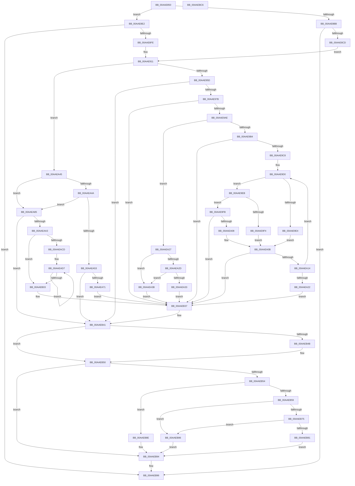

# NtSetDefaultLocale

- RVA: `0x00AAE850`–`0x00AAEBC7` (길이 `887` bytes)
- VA: `0x0000000140AAE850`
- 실행 섹션: `PAGE`
- PDB 이름 있음: `예`; PDB Function 태그: `아니요`
- unwind 정보 RVA: `0x000BC300`
- 디코드: `224`개 명령, `887/887` bytes 표시
- 미해석 바이트: `0` (있으면 어셈블리에 `.byte`로 보존)

> 이 문서는 커널 이미지의 기계어와 PDB 기호를 분석해 생성했습니다. 4번과 5번은 함수 원형과 자료형을 바이너리 사용 방식에서 추정한 C 해석이며 원본 소스 복구 결과는 아닙니다.

## 1. Dependencies

- 직접 호출 지점: **14**; 고유 호출 대상: **10**
- 직접 호출자로 확인된 함수: **0**
- RIP 상대 이미지 참조: **7**

### Outgoing calls
- `0x00AAE8C0` → [OpenGlobalizationUserSettingsKey](../../text/4D/OpenGlobalizationUserSettingsKey_function_004D5B3C.md) (function, `0x004D5B3C`)
- `0x00AAE8F1` → [ExCheckFullProcessInformationAccess](../95/ExCheckFullProcessInformationAccess_function_0095D93C.md) (function, `0x0095D93C`)
- `0x00AAE91B` → [RtlInitUnicodeString](../../text/42/RtlInitUnicodeString_function_0042A780.md) (function, `0x0042A780`)
- `0x00AAE926` → [RtlInitUnicodeString](../../text/42/RtlInitUnicodeString_function_0042A780.md) (function, `0x0042A780`)
- `0x00AAE96C` → [ZwOpenKey](../../text/6A/ZwOpenKey_function_006AD310.md) (function, `0x006AD310`)
- `0x00AAE99F` → [ZwQueryValueKey](../../text/6A/ZwQueryValueKey_function_006AD3B0.md) (function, `0x006AD3B0`)
- `0x00AAEA4A` → [RtlIsMultiSessionSku](../A2/RtlIsMultiSessionSku_function_00A20730.md) (function, `0x00A20730`)
- `0x00AAEA62` → [ZwOpenKey](../../text/6A/ZwOpenKey_function_006AD310.md) (function, `0x006AD310`)
- `0x00AAEA7B` → [ZwDeleteValueKey](../../text/6A/ZwDeleteValueKey_function_006AECB0.md) (function, `0x006AECB0`)
- `0x00AAEA94` → [ZwOpenKey](../../text/6A/ZwOpenKey_function_006AD310.md) (function, `0x006AD310`)
- `0x00AAEB30` → [ZwSetValueKey](../../text/6A/ZwSetValueKey_function_006ADCD0.md) (function, `0x006ADCD0`)
- `0x00AAEB3C` → [ZwClose](../../text/6A/ZwClose_function_006AD2B0.md) (function, `0x006AD2B0`)
- `0x00AAEB4B` → [ZwClose](../../text/6A/ZwClose_function_006AD2B0.md) (function, `0x006AD2B0`)
- `0x00AAEBA0` → [_security_check_cookie](../../text/6A/_security_check_cookie_function_006AC640.md) (function, `0x006AC640`)

### Direct callers
- 이 함수 시작 RVA로 연결되는 직접 call은 확인되지 않았습니다. 간접 호출은 완전히 역산할 수 없습니다.

### Static image references
- `0x00AAE876` → RVA `0x00E0A740` (`.data`; read)
- `0x00AAE8D2` → RVA `0x00B083A0` (` ?? ::NNGAKEGL::`string'`; read)
- `0x00AAE8D9` → RVA `0x00B083E0` (` ?? ::NNGAKEGL::`string'`; read)
- `0x00AAE903` → RVA `0x00B082B0` (` ?? ::NNGAKEGL::`string'`; read)
- `0x00AAE90A` → RVA `0x00AFF600` (` ?? ::NNGAKEGL::`string'`; read)
- `0x00AAEB86` → RVA `0x00FD9C74` (`PAGEDATA`; write)
- `0x00AAEB8E` → RVA `0x00FD9A98` (`PAGEDATA`; write)

## 2. Other-region calls and transfers

- 다른 실행 섹션으로 향하는 call: **12**
  - `0x00AAE8C0` → [OpenGlobalizationUserSettingsKey](../../text/4D/OpenGlobalizationUserSettingsKey_function_004D5B3C.md) (`PAGE` → `.text`)
  - `0x00AAE91B` → [RtlInitUnicodeString](../../text/42/RtlInitUnicodeString_function_0042A780.md) (`PAGE` → `.text`)
  - `0x00AAE926` → [RtlInitUnicodeString](../../text/42/RtlInitUnicodeString_function_0042A780.md) (`PAGE` → `.text`)
  - `0x00AAE96C` → [ZwOpenKey](../../text/6A/ZwOpenKey_function_006AD310.md) (`PAGE` → `.text`)
  - `0x00AAE99F` → [ZwQueryValueKey](../../text/6A/ZwQueryValueKey_function_006AD3B0.md) (`PAGE` → `.text`)
  - `0x00AAEA62` → [ZwOpenKey](../../text/6A/ZwOpenKey_function_006AD310.md) (`PAGE` → `.text`)
  - `0x00AAEA7B` → [ZwDeleteValueKey](../../text/6A/ZwDeleteValueKey_function_006AECB0.md) (`PAGE` → `.text`)
  - `0x00AAEA94` → [ZwOpenKey](../../text/6A/ZwOpenKey_function_006AD310.md) (`PAGE` → `.text`)
  - `0x00AAEB30` → [ZwSetValueKey](../../text/6A/ZwSetValueKey_function_006ADCD0.md) (`PAGE` → `.text`)
  - `0x00AAEB3C` → [ZwClose](../../text/6A/ZwClose_function_006AD2B0.md) (`PAGE` → `.text`)
  - `0x00AAEB4B` → [ZwClose](../../text/6A/ZwClose_function_006AD2B0.md) (`PAGE` → `.text`)
  - `0x00AAEBA0` → [_security_check_cookie](../../text/6A/_security_check_cookie_function_006AC640.md) (`PAGE` → `.text`)
- 별도 외부 분기/꼬리 이동을 확인하지 못했습니다.

## 3. Assembly (complete function range)

```asm
00AAE850  48 8B C4                        mov rax, rsp
00AAE853  48 89 58 08                     mov qword ptr [rax + 8], rbx
00AAE857  48 89 70 10                     mov qword ptr [rax + 0x10], rsi
00AAE85B  48 89 78 18                     mov qword ptr [rax + 0x18], rdi
00AAE85F  4C 89 60 20                     mov qword ptr [rax + 0x20], r12
00AAE863  55                              push rbp
00AAE864  41 56                           push r14
00AAE866  41 57                           push r15
00AAE868  48 8D A8 38 FF FF FF            lea rbp, [rax - 0xc8]
00AAE86F  48 81 EC B0 01 00 00            sub rsp, 0x1b0
00AAE876  48 8B 05 C3 BE 35 00            mov rax, qword ptr [rip + 0x35bec3]
00AAE87D  48 33 C4                        xor rax, rsp
00AAE880  48 89 85 A0 00 00 00            mov qword ptr [rbp + 0xa0], rax
00AAE887  45 33 E4                        xor r12d, r12d
00AAE88A  0F 57 C0                        xorps xmm0, xmm0
00AAE88D  44 89 64 24 6C                  mov dword ptr [rsp + 0x6c], r12d
00AAE892  0F 57 C9                        xorps xmm1, xmm1
00AAE895  44 89 65 84                     mov dword ptr [rbp - 0x7c], r12d
00AAE899  8B FA                           mov edi, edx
00AAE89B  4C 89 64 24 40                  mov qword ptr [rsp + 0x40], r12
00AAE8A0  40 8A F1                        mov sil, cl
00AAE8A3  4C 89 64 24 30                  mov qword ptr [rsp + 0x30], r12
00AAE8A8  44 89 64 24 38                  mov dword ptr [rsp + 0x38], r12d
00AAE8AD  0F 11 44 24 58                  movups xmmword ptr [rsp + 0x58], xmm0
00AAE8B2  0F 11 4C 24 48                  movups xmmword ptr [rsp + 0x48], xmm1
00AAE8B7  84 C9                           test cl, cl
00AAE8B9  74 27                           je 0x140aae8e2
00AAE8BB  4C 8D 44 24 40                  lea r8, [rsp + 0x40]
00AAE8C0  E8 77 72 A2 FF                  call 0x1404d5b3c
00AAE8C5  85 C0                           test eax, eax
00AAE8C7  0F 88 C9 02 00 00               js 0x140aaeb96
00AAE8CD  BB 40 06 00 00                  mov ebx, 0x640
00AAE8D2  4C 8D 3D C7 9A 05 00            lea r15, [rip + 0x59ac7]
00AAE8D9  48 8D 15 00 9B 05 00            lea rdx, [rip + 0x59b00]
00AAE8E0  EB 2F                           jmp 0x140aae911
00AAE8E2  65 48 8B 04 25 88 01 00 00      mov rax, qword ptr gs:[0x188]
00AAE8EB  8A 88 32 02 00 00               mov cl, byte ptr [rax + 0x232]
00AAE8F1  E8 46 F0 EA FF                  call 0x14095d93c
00AAE8F6  85 C0                           test eax, eax
00AAE8F8  0F 88 98 02 00 00               js 0x140aaeb96
00AAE8FE  BB 40 02 00 00                  mov ebx, 0x240
00AAE903  4C 8D 3D A6 99 05 00            lea r15, [rip + 0x599a6]
00AAE90A  48 8D 15 EF 0C 05 00            lea rdx, [rip + 0x50cef]
00AAE911  48 8D 4C 24 48                  lea rcx, [rsp + 0x48]
00AAE916  4C 8D 74 24 58                  lea r14, [rsp + 0x58]
00AAE91B  E8 60 BE 97 FF                  call 0x14042a780
00AAE920  49 8B D7                        mov rdx, r15
00AAE923  49 8B CE                        mov rcx, r14
00AAE926  E8 55 BE 97 FF                  call 0x14042a780
00AAE92B  48 8B 44 24 40                  mov rax, qword ptr [rsp + 0x40]
00AAE930  41 BE 30 00 00 00               mov r14d, 0x30
00AAE936  48 89 44 24 70                  mov qword ptr [rsp + 0x70], rax
00AAE93B  48 8D 44 24 58                  lea rax, [rsp + 0x58]
00AAE940  48 89 44 24 78                  mov qword ptr [rsp + 0x78], rax
00AAE945  0F 57 C0                        xorps xmm0, xmm0
00AAE948  44 89 74 24 68                  mov dword ptr [rsp + 0x68], r14d
00AAE94D  89 5D 80                        mov dword ptr [rbp - 0x80], ebx
00AAE950  F3 0F 7F 45 88                  movdqu xmmword ptr [rbp - 0x78], xmm0
00AAE955  85 FF                           test edi, edi
00AAE957  0F 85 E8 00 00 00               jne 0x140aaea45
00AAE95D  4C 8D 44 24 68                  lea r8, [rsp + 0x68]
00AAE962  BA 00 00 00 80                  mov edx, 0x80000000
00AAE967  48 8D 4C 24 30                  lea rcx, [rsp + 0x30]
00AAE96C  E8 9F E9 BF FF                  call 0x1406ad310
00AAE971  8B D8                           mov ebx, eax
00AAE973  85 C0                           test eax, eax
00AAE975  0F 88 C6 01 00 00               js 0x140aaeb41
00AAE97B  48 8B 4C 24 30                  mov rcx, qword ptr [rsp + 0x30]
00AAE980  48 8D 44 24 38                  lea rax, [rsp + 0x38]
00AAE985  48 89 44 24 28                  mov qword ptr [rsp + 0x28], rax
00AAE98A  4C 8D 4D A0                     lea r9, [rbp - 0x60]
00AAE98E  45 8D 46 D2                     lea r8d, [r14 - 0x2e]
00AAE992  C7 44 24 20 00 01 00 00         mov dword ptr [rsp + 0x20], 0x100
00AAE99A  48 8D 54 24 48                  lea rdx, [rsp + 0x48]
00AAE99F  E8 0C EA BF FF                  call 0x1406ad3b0
00AAE9A4  8B D8                           mov ebx, eax
00AAE9A6  85 C0                           test eax, eax
00AAE9A8  0F 88 89 01 00 00               js 0x140aaeb37
00AAE9AE  83 7D A4 01                     cmp dword ptr [rbp - 0x5c], 1
00AAE9B2  75 73                           jne 0x140aaea27
00AAE9B4  4C 8B 45 A8                     mov r8, qword ptr [rbp - 0x58]
00AAE9B8  48 8D 55 AC                     lea rdx, [rbp - 0x54]
00AAE9BC  45 8B CC                        mov r9d, r12d
00AAE9BF  45 85 C0                        test r8d, r8d
00AAE9C2  0F 84 6F 01 00 00               je 0x140aaeb37
00AAE9C8  45 8D 56 D9                     lea r10d, [r14 - 0x27]
00AAE9CC  45 8D 5E 07                     lea r11d, [r14 + 7]
00AAE9D0  0F B7 0A                        movzx ecx, word ptr [rdx]
00AAE9D3  48 8D 52 02                     lea rdx, [rdx + 2]
00AAE9D7  0F B7 C1                        movzx eax, cx
00AAE9DA  66 41 2B C6                     sub ax, r14w
00AAE9DE  66 41 3B C2                     cmp ax, r10w
00AAE9E2  77 07                           ja 0x140aae9eb
00AAE9E4  8B C1                           mov eax, ecx
00AAE9E6  41 2B C6                        sub eax, r14d
00AAE9E9  EB 20                           jmp 0x140aaea0b
00AAE9EB  8D 41 BF                        lea eax, [rcx - 0x41]
00AAE9EE  66 83 F8 05                     cmp ax, 5
00AAE9F2  77 07                           ja 0x140aae9fb
00AAE9F4  8B C1                           mov eax, ecx
00AAE9F6  41 2B C3                        sub eax, r11d
00AAE9F9  EB 10                           jmp 0x140aaea0b
00AAE9FB  8D 41 9F                        lea eax, [rcx - 0x61]
00AAE9FE  66 83 F8 05                     cmp ax, 5
00AAEA02  0F 87 2F 01 00 00               ja 0x140aaeb37
00AAEA08  8D 41 A9                        lea eax, [rcx - 0x57]
00AAEA0B  83 F8 10                        cmp eax, 0x10
00AAEA0E  0F 83 23 01 00 00               jae 0x140aaeb37
00AAEA14  C1 E7 04                        shl edi, 4
00AAEA17  41 83 C1 02                     add r9d, 2
00AAEA1B  0B F8                           or edi, eax
00AAEA1D  45 3B C8                        cmp r9d, r8d
00AAEA20  72 AE                           jb 0x140aae9d0
00AAEA22  E9 10 01 00 00                  jmp 0x140aaeb37
00AAEA27  83 7D A4 04                     cmp dword ptr [rbp - 0x5c], 4
00AAEA2B  75 0E                           jne 0x140aaea3b
00AAEA2D  83 7D A8 04                     cmp dword ptr [rbp - 0x58], 4
00AAEA31  75 08                           jne 0x140aaea3b
00AAEA33  8B 7D AC                        mov edi, dword ptr [rbp - 0x54]
00AAEA36  E9 FC 00 00 00                  jmp 0x140aaeb37
00AAEA3B  BB 01 00 00 C0                  mov ebx, 0xc0000001
00AAEA40  E9 F2 00 00 00                  jmp 0x140aaeb37
00AAEA45  40 84 F6                        test sil, sil
00AAEA48  74 3B                           je 0x140aaea85
00AAEA4A  E8 E1 1C F7 FF                  call 0x140a20730
00AAEA4F  84 C0                           test al, al
00AAEA51  75 32                           jne 0x140aaea85
00AAEA53  4C 8D 44 24 68                  lea r8, [rsp + 0x68]
00AAEA58  BA 00 00 00 40                  mov edx, 0x40000000
00AAEA5D  48 8D 4C 24 30                  lea rcx, [rsp + 0x30]
00AAEA62  E8 A9 E8 BF FF                  call 0x1406ad310
00AAEA67  8B D8                           mov ebx, eax
00AAEA69  85 C0                           test eax, eax
00AAEA6B  0F 88 D0 00 00 00               js 0x140aaeb41
00AAEA71  48 8B 4C 24 30                  mov rcx, qword ptr [rsp + 0x30]
00AAEA76  48 8D 54 24 48                  lea rdx, [rsp + 0x48]
00AAEA7B  E8 30 02 C0 FF                  call 0x1406aecb0
00AAEA80  E9 B2 00 00 00                  jmp 0x140aaeb37
00AAEA85  4C 8D 44 24 68                  lea r8, [rsp + 0x68]
00AAEA8A  BA 00 00 00 40                  mov edx, 0x40000000
00AAEA8F  48 8D 4C 24 30                  lea rcx, [rsp + 0x30]
00AAEA94  E8 77 E8 BF FF                  call 0x1406ad310
00AAEA99  8B D8                           mov ebx, eax
00AAEA9B  85 C0                           test eax, eax
00AAEA9D  0F 88 9E 00 00 00               js 0x140aaeb41
00AAEAA3  40 8A C6                        mov al, sil
00AAEAA6  4C 8D 45 A0                     lea r8, [rbp - 0x60]
00AAEAAA  F6 D8                           neg al
00AAEAAC  44 8B CF                        mov r9d, edi
00AAEAAF  48 8D 45 A0                     lea rax, [rbp - 0x60]
00AAEAB3  48 1B C9                        sbb rcx, rcx
00AAEAB6  83 E1 08                        and ecx, 8
00AAEAB9  48 83 C1 08                     add rcx, 8
00AAEABD  4C 03 C1                        add r8, rcx
00AAEAC0  66 45 89 20                     mov word ptr [r8], r12w
00AAEAC4  49 83 E8 02                     sub r8, 2
00AAEAC8  4C 3B C0                        cmp r8, rax
00AAEACB  72 36                           jb 0x140aaeb03
00AAEACD  41 BA 09 00 00 00               mov r10d, 9
00AAEAD3  45 8D 5A 2E                     lea r11d, [r10 + 0x2e]
00AAEAD7  41 8B C9                        mov ecx, r9d
00AAEADA  49 8D 50 FE                     lea rdx, [r8 - 2]
00AAEADE  83 E1 0F                        and ecx, 0xf
00AAEAE1  41 8B C6                        mov eax, r14d
00AAEAE4  41 3B CA                        cmp ecx, r10d
00AAEAE7  66 41 0F 47 C3                  cmova ax, r11w
00AAEAEC  41 C1 E9 04                     shr r9d, 4
00AAEAF0  66 03 C1                        add ax, cx
00AAEAF3  66 41 89 00                     mov word ptr [r8], ax
00AAEAF7  48 8D 45 A0                     lea rax, [rbp - 0x60]
00AAEAFB  4C 8B C2                        mov r8, rdx
00AAEAFE  48 3B D0                        cmp rdx, rax
00AAEB01  73 D4                           jae 0x140aaead7
00AAEB03  40 8A C6                        mov al, sil
00AAEB06  48 8D 54 24 48                  lea rdx, [rsp + 0x48]
00AAEB0B  F6 D8                           neg al
00AAEB0D  41 B9 01 00 00 00               mov r9d, 1
00AAEB13  48 8D 45 A0                     lea rax, [rbp - 0x60]
00AAEB17  1B C9                           sbb ecx, ecx
00AAEB19  45 33 C0                        xor r8d, r8d
00AAEB1C  83 E1 08                        and ecx, 8
00AAEB1F  83 C1 0A                        add ecx, 0xa
00AAEB22  89 4C 24 28                     mov dword ptr [rsp + 0x28], ecx
00AAEB26  48 8B 4C 24 30                  mov rcx, qword ptr [rsp + 0x30]
00AAEB2B  48 89 44 24 20                  mov qword ptr [rsp + 0x20], rax
00AAEB30  E8 9B F1 BF FF                  call 0x1406adcd0
00AAEB35  8B D8                           mov ebx, eax
00AAEB37  48 8B 4C 24 30                  mov rcx, qword ptr [rsp + 0x30]
00AAEB3C  E8 6F E7 BF FF                  call 0x1406ad2b0
00AAEB41  48 8B 4C 24 40                  mov rcx, qword ptr [rsp + 0x40]
00AAEB46  48 85 C9                        test rcx, rcx
00AAEB49  74 05                           je 0x140aaeb50
00AAEB4B  E8 60 E7 BF FF                  call 0x1406ad2b0
00AAEB50  85 DB                           test ebx, ebx
00AAEB52  78 40                           js 0x140aaeb94
00AAEB54  40 84 F6                        test sil, sil
00AAEB57  74 35                           je 0x140aaeb8e
00AAEB59  65 48 8B 04 25 88 01 00 00      mov rax, qword ptr gs:[0x188]
00AAEB62  48 8B 80 B8 00 00 00            mov rax, qword ptr [rax + 0xb8]
00AAEB69  48 8B 88 E8 02 00 00            mov rcx, qword ptr [rax + 0x2e8]
00AAEB70  48 85 C9                        test rcx, rcx
00AAEB73  74 11                           je 0x140aaeb86
00AAEB75  F7 80 FC 05 00 00 00 10 00 00   test dword ptr [rax + 0x5fc], 0x1000
00AAEB7F  75 05                           jne 0x140aaeb86
00AAEB81  89 79 30                        mov dword ptr [rcx + 0x30], edi
00AAEB84  EB 0E                           jmp 0x140aaeb94
00AAEB86  89 3D E8 B0 52 00               mov dword ptr [rip + 0x52b0e8], edi
00AAEB8C  EB 06                           jmp 0x140aaeb94
00AAEB8E  89 3D 04 AF 52 00               mov dword ptr [rip + 0x52af04], edi
00AAEB94  8B C3                           mov eax, ebx
00AAEB96  48 8B 8D A0 00 00 00            mov rcx, qword ptr [rbp + 0xa0]
00AAEB9D  48 33 CC                        xor rcx, rsp
00AAEBA0  E8 9B DA BF FF                  call 0x1406ac640
00AAEBA5  4C 8D 9C 24 B0 01 00 00         lea r11, [rsp + 0x1b0]
00AAEBAD  49 8B 5B 20                     mov rbx, qword ptr [r11 + 0x20]
00AAEBB1  49 8B 73 28                     mov rsi, qword ptr [r11 + 0x28]
00AAEBB5  49 8B 7B 30                     mov rdi, qword ptr [r11 + 0x30]
00AAEBB9  4D 8B 63 38                     mov r12, qword ptr [r11 + 0x38]
00AAEBBD  49 8B E3                        mov rsp, r11
00AAEBC0  41 5F                           pop r15
00AAEBC2  41 5E                           pop r14
00AAEBC4  5D                              pop rbp
00AAEBC5  C3                              ret
00AAEBC6  CC                              int3
```

## 4. C-style interpretation (structured pseudocode)

```c
__int64 __fastcall NtSetDefaultLocale(unsigned __int8 a1, int a2)
{
    __int64 result;
    __int64 v_r12;
    __int64 v_rdi;
    __int64 v_rsp;
    unsigned __int64 v_stack_m150;
    unsigned __int64 v_stack_m158;
    unsigned int v_stack_m15C;
    unsigned int v_stack_m160;
    unsigned __int64 v_stack_m170;
    unsigned __int64 v_stack_m18;
    unsigned __int64 v_stack_m180;
    unsigned __int64 v_stack_m188;
    unsigned int v_stack_m190;
    unsigned __int64 v_stack_m198;
    unsigned __int64 v_stack_m1A0;
    unsigned int v_stack_m1A8;

    *(unsigned __int64 *)(v_rsp + 8) = v_rbx;
    *(unsigned __int64 *)(v_rsp + 16) = v_rsi;
    *(unsigned __int64 *)(v_rsp + 24) = v_rdi;
    *(unsigned __int64 *)(v_rsp + 32) = v_r12;
    v_rsp = (v_rsp) - (432);
    result = (*(unsigned __int64 *)(v_rip + 3522243)) ^ (v_rsp);
    *(unsigned __int64 *)(v_rsp - 200 + 160) = result;
    v_r12 = 0;
    v_stack_m15C = 0;
    *(unsigned int *)(v_rsp - 200 - 124) = 0;
    v_stack_m188 = 0;
    v_stack_m198 = 0;
    v_stack_m190 = 0;
    v_stack_m170 = v_xmm0;
    v_stack_m180 = v_xmm1;
    if (a1 == 0) goto loc_00AAE8E2;
    result = OpenGlobalizationUserSettingsKey(a1, a2, v_stack_m188, a4);
    if (sign_flag) goto loc_00AAEB96;
    goto loc_00AAE911;
loc_00AAE8E2:
    result = ExCheckFullProcessInformationAccess(*(unsigned __int8 *)(*(unsigned __int64 *)(gs_base + (0 + 392)) + 562), v_rip + 367360, v_stack_m188, a4);
    if (sign_flag) goto loc_00AAEB96;
loc_00AAE911:
    result = RtlInitUnicodeString(v_stack_m180, v_rip + 330991, v_stack_m188, a4);
    result = RtlInitUnicodeString(v_stack_m170, v_rip + 367014, v_stack_m188, a4);
    v_stack_m158 = v_stack_m188;
    v_stack_m150 = v_stack_m170;
    v_stack_m160 = 48;
    *(unsigned int *)(v_rsp - 200 - 128) = 576;
    *(unsigned __int64 *)(v_rsp - 200 - 120) = v_xmm0;
    if ((unsigned int)((unsigned int)(a2)) != 0) goto loc_00AAEA45;
    result = ZwOpenKey(v_stack_m198, (unsigned int)(0x80000000ULL), v_stack_m160, a4);
    if (sign_flag) goto loc_00AAEB41;
    v_stack_m1A0 = v_stack_m190;
    v_stack_m1A8 = 256;
    result = ZwQueryValueKey(v_stack_m198, v_stack_m180, 48 - 46, v_rsp - 200 - 96);
    if (sign_flag) goto loc_00AAEB37;
    if ((*(unsigned int *)(v_rsp - 200 - 92)) != 1) goto loc_00AAEA27;
    if ((unsigned int)(*(unsigned __int64 *)(v_rsp - 200 - 88)) == 0) goto loc_00AAEB37;
loc_00AAE9D0:
    result = (unsigned __int16)(((unsigned __int16)(*(unsigned __int16 *)(v_rsp - 200 - 84))) - (48));
    if (((unsigned __int16)(result)) > ((unsigned __int16)(48 - 39))) goto loc_00AAE9EB;
    result = (unsigned int)(((unsigned int)((unsigned int)(*(unsigned __int16 *)(v_rsp - 200 - 84)))) - (48));
    goto loc_00AAEA0B;
loc_00AAE9EB:
    if (((unsigned __int16)(*(unsigned __int16 *)(v_rsp - 200 - 84) - 65)) > 5) goto loc_00AAE9FB;
    result = (unsigned int)(((unsigned int)((unsigned int)(*(unsigned __int16 *)(v_rsp - 200 - 84)))) - ((unsigned int)(48 + 7)));
    goto loc_00AAEA0B;
loc_00AAE9FB:
    if (((unsigned __int16)(*(unsigned __int16 *)(v_rsp - 200 - 84) - 97)) > 5) goto loc_00AAEB37;
loc_00AAEA0B:
    if (((unsigned int)(*(unsigned __int16 *)(v_rsp - 200 - 84) - 87)) >= 16) goto loc_00AAEB37;
    v_rdi = (unsigned int)(((unsigned int)(a2)) << (4));
    a4 = (unsigned int)((0) + (2));
    v_rdi = (unsigned int)((v_rdi) | ((unsigned int)(*(unsigned __int16 *)(v_rsp - 200 - 84) - 87)));
    if (((unsigned int)(a4)) < ((unsigned int)(*(unsigned __int64 *)(v_rsp - 200 - 88)))) goto loc_00AAE9D0;
    goto loc_00AAEB37;
loc_00AAEA27:
    if ((*(unsigned int *)(v_rsp - 200 - 92)) != 4) goto loc_00AAEA3B;
    if ((*(unsigned int *)(v_rsp - 200 - 88)) != 4) goto loc_00AAEA3B;
    goto loc_00AAEB37;
loc_00AAEA3B:
    goto loc_00AAEB37;
loc_00AAEA45:
    if (a1 == 0) goto loc_00AAEA85;
    result = RtlIsMultiSessionSku(*(unsigned __int16 *)(v_rsp - 200 - 84), v_rsp - 200 - 84 + 2, *(unsigned __int64 *)(v_rsp - 200 - 88), a4);
    if ((unsigned __int8)(result) != 0) goto loc_00AAEA85;
    result = ZwOpenKey(v_stack_m198, (unsigned int)(0x40000000ULL), v_stack_m160, a4);
    if (sign_flag) goto loc_00AAEB41;
    result = ZwDeleteValueKey(v_stack_m198, v_stack_m180, v_stack_m160, a4);
    goto loc_00AAEB37;
loc_00AAEA85:
    result = ZwOpenKey(v_stack_m198, (unsigned int)(0x40000000ULL), v_stack_m160, a4);
    if (sign_flag) goto loc_00AAEB41;
    result = (unsigned __int8)(-(a1));
    a1 = (unsigned int)((v_stack_m198) & (8));
    a1 = (a1) + (8);
    a3 = (v_rsp - 200 - 96) + (a1);
    *(unsigned __int16 *)(a3) = 0;
    a3 = (a3) - (2);
    if (a3 < (v_rsp - 200 - 96)) goto loc_00AAEB03;
loc_00AAEAD7:
    a1 = (unsigned int)(((unsigned int)((unsigned int)((unsigned int)((unsigned int)((unsigned int)(*(unsigned int *)(v_rsp - 200 - 84))))))) & (15));
    result = 48;
    if (a1 > 9) { result = (unsigned __int16)(9 + 46); }
    a4 = (unsigned int)(((unsigned int)((unsigned int)((unsigned int)(*(unsigned int *)(v_rsp - 200 - 84))))) >> (4));
    result = (unsigned __int16)((result) + (a1));
    *(unsigned __int16 *)(a3) = (unsigned __int16)(result);
    if ((a3 - 2) >= (v_rsp - 200 - 96)) goto loc_00AAEAD7;
loc_00AAEB03:
    result = (unsigned __int8)(-(a1));
    a3 = 0;
    a1 = (unsigned int)((a1) & (8));
    a1 = (unsigned int)((a1) + (10));
    v_stack_m1A0 = a1;
    v_stack_m1A8 = v_rsp - 200 - 96;
    result = ZwSetValueKey(v_stack_m198, v_stack_m180, a3, 1);
loc_00AAEB37:
    result = ZwClose(v_stack_m198, v_stack_m180, a3, 1);
loc_00AAEB41:
    if (v_stack_m188 != 0) {
        result = ZwClose(v_stack_m188, v_stack_m180, a3, 1);
    }
    if (sign_flag) goto loc_00AAEB94;
    if (a1 == 0) goto loc_00AAEB8E;
    if (*(unsigned __int64 *)(*(unsigned __int64 *)(*(unsigned __int64 *)(gs_base + (0 + 392)) + 184) + 744) == 0) goto loc_00AAEB86;
    if (((*(unsigned int *)(*(unsigned __int64 *)(*(unsigned __int64 *)(gs_base + (0 + 392)) + 184) + 1532)) & (0x1000ULL)) != 0) goto loc_00AAEB86;
    *(unsigned int *)(*(unsigned __int64 *)(*(unsigned __int64 *)(*(unsigned __int64 *)(gs_base + (0 + 392)) + 184) + 744) + 48) = (unsigned int)((unsigned int)(*(unsigned int *)(v_rsp - 200 - 84)));
    goto loc_00AAEB94;
loc_00AAEB86:
    *(unsigned int *)(v_rip + 5419240) = (unsigned int)((unsigned int)(*(unsigned int *)(v_rsp - 200 - 84)));
    goto loc_00AAEB94;
loc_00AAEB8E:
    *(unsigned int *)(v_rip + 5418756) = (unsigned int)((unsigned int)(*(unsigned int *)(v_rsp - 200 - 84)));
loc_00AAEB94:
loc_00AAEB96:
    a1 = (*(unsigned __int64 *)(v_rsp - 200 + 160)) ^ (v_rsp);
    result = _security_check_cookie(a1, v_stack_m180, a3, 1);
    return result;
}
```

## 5. (Beta) C Style

```c
int64_t NtSetDefaultLocale(uint8_t Arg1, int32_t Arg2)
{
    int64_t result;
    int64_t local_r12;
    int64_t local_rdi;
    int64_t local_rsp;
    uint64_t v_stack_m150;
    uint64_t v_stack_m158;
    uint32_t v_stack_m15C;
    uint32_t v_stack_m160;
    uint64_t v_stack_m170;
    uint64_t v_stack_m18;
    uint64_t v_stack_m180;
    uint64_t v_stack_m188;
    uint32_t v_stack_m190;
    uint64_t v_stack_m198;
    uint64_t v_stack_m1A0;
    uint32_t v_stack_m1A8;

    *(uint64_t *)(local_rsp + 0x8) = local_rbx;
    *(uint64_t *)(local_rsp + 0x10) = local_rsi;
    *(uint64_t *)(local_rsp + 0x18) = local_rdi;
    *(uint64_t *)(local_rsp + 0x20) = local_r12;
    local_rsp = (local_rsp) - (432);
    result = (*(uint64_t *)(v_rip + 0x35BEC3)) ^ (local_rsp);
    *(uint64_t *)(local_rsp - 0xC8 + 0xA0) = result;
    local_r12 = 0;
    v_stack_m15C = 0;
    *(uint32_t *)(local_rsp - 0xC8 - 0x7C) = 0;
    v_stack_m188 = 0;
    v_stack_m198 = 0;
    v_stack_m190 = 0;
    v_stack_m170 = v_xmm0;
    v_stack_m180 = v_xmm1;
    if (Arg1 == 0) goto loc_00AAE8E2;
    result = OpenGlobalizationUserSettingsKey(Arg1, Arg2, v_stack_m188, a4);
    if (sign_flag) goto loc_00AAEB96;
    goto loc_00AAE911;
loc_00AAE8E2:
    result = ExCheckFullProcessInformationAccess(*(uint8_t *)(*(uint64_t *)(gs_base + (0 + 0x188)) + 0x232), v_rip + 367360, v_stack_m188, a4);
    if (sign_flag) goto loc_00AAEB96;
loc_00AAE911:
    result = RtlInitUnicodeString(v_stack_m180, v_rip + 330991, v_stack_m188, a4);
    result = RtlInitUnicodeString(v_stack_m170, v_rip + 367014, v_stack_m188, a4);
    v_stack_m158 = v_stack_m188;
    v_stack_m150 = v_stack_m170;
    v_stack_m160 = 48;
    *(uint32_t *)(local_rsp - 0xC8 - 0x80) = 576;
    *(uint64_t *)(local_rsp - 0xC8 - 0x78) = v_xmm0;
    if ((uint32_t)((uint32_t)(Arg2)) != 0) goto loc_00AAEA45;
    result = ZwOpenKey(v_stack_m198, (uint32_t)(0x80000000ULL), v_stack_m160, a4);
    if (sign_flag) goto loc_00AAEB41;
    v_stack_m1A0 = v_stack_m190;
    v_stack_m1A8 = 256;
    result = ZwQueryValueKey(v_stack_m198, v_stack_m180, 48 - 46, local_rsp - 200 - 96);
    if (sign_flag) goto loc_00AAEB37;
    if ((*(uint32_t *)(local_rsp - 0xC8 - 0x5C)) != 1) goto loc_00AAEA27;
    if ((uint32_t)(*(uint64_t *)(local_rsp - 0xC8 - 0x58)) == 0) goto loc_00AAEB37;
loc_00AAE9D0:
    result = (uint16_t)(((uint16_t)(*(uint16_t *)(local_rsp - 0xC8 - 0x54))) - (48));
    if (((uint16_t)(result)) > ((uint16_t)(48 - 39))) goto loc_00AAE9EB;
    result = (uint32_t)(((uint32_t)((uint32_t)(*(uint16_t *)(local_rsp - 0xC8 - 0x54)))) - (48));
    goto loc_00AAEA0B;
loc_00AAE9EB:
    if (((uint16_t)(*(uint16_t *)(local_rsp - 0xC8 - 0x54) - 65)) > 5) goto loc_00AAE9FB;
    result = (uint32_t)(((uint32_t)((uint32_t)(*(uint16_t *)(local_rsp - 0xC8 - 0x54)))) - ((uint32_t)(48 + 7)));
    goto loc_00AAEA0B;
loc_00AAE9FB:
    if (((uint16_t)(*(uint16_t *)(local_rsp - 0xC8 - 0x54) - 97)) > 5) goto loc_00AAEB37;
loc_00AAEA0B:
    if (((uint32_t)(*(uint16_t *)(local_rsp - 0xC8 - 0x54) - 87)) >= 16) goto loc_00AAEB37;
    local_rdi = (uint32_t)(((uint32_t)(Arg2)) << (4));
    a4 = (uint32_t)((0) + (2));
    local_rdi = (uint32_t)((local_rdi) | ((uint32_t)(*(uint16_t *)(local_rsp - 0xC8 - 0x54) - 87)));
    if (((uint32_t)(a4)) < ((uint32_t)(*(uint64_t *)(local_rsp - 0xC8 - 0x58)))) goto loc_00AAE9D0;
    goto loc_00AAEB37;
loc_00AAEA27:
    if ((*(uint32_t *)(local_rsp - 0xC8 - 0x5C)) != 4) goto loc_00AAEA3B;
    if ((*(uint32_t *)(local_rsp - 0xC8 - 0x58)) != 4) goto loc_00AAEA3B;
    goto loc_00AAEB37;
loc_00AAEA3B:
    goto loc_00AAEB37;
loc_00AAEA45:
    if (Arg1 == 0) goto loc_00AAEA85;
    result = RtlIsMultiSessionSku(*(uint16_t *)(local_rsp - 0xC8 - 0x54), local_rsp - 200 - 84 + 2, *(uint64_t *)(local_rsp - 0xC8 - 0x58), a4);
    if ((uint8_t)(result) != 0) goto loc_00AAEA85;
    result = ZwOpenKey(v_stack_m198, (uint32_t)(0x40000000ULL), v_stack_m160, a4);
    if (sign_flag) goto loc_00AAEB41;
    result = ZwDeleteValueKey(v_stack_m198, v_stack_m180, v_stack_m160, a4);
    goto loc_00AAEB37;
loc_00AAEA85:
    result = ZwOpenKey(v_stack_m198, (uint32_t)(0x40000000ULL), v_stack_m160, a4);
    if (sign_flag) goto loc_00AAEB41;
    result = (uint8_t)(-(Arg1));
    Arg1 = (uint32_t)((v_stack_m198) & (8));
    Arg1 = (Arg1) + (8);
    a3 = (local_rsp - 200 - 96) + (Arg1);
    *(uint16_t *)(a3) = 0;
    a3 = (a3) - (2);
    if (a3 < (local_rsp - 200 - 96)) goto loc_00AAEB03;
loc_00AAEAD7:
    Arg1 = (uint32_t)(((uint32_t)((uint32_t)((uint32_t)((uint32_t)((uint32_t)(*(uint32_t *)(local_rsp - 0xC8 - 0x54))))))) & (15));
    result = 48;
    if (Arg1 > 9) { result = (uint16_t)(9 + 46); }
    a4 = (uint32_t)(((uint32_t)((uint32_t)((uint32_t)(*(uint32_t *)(local_rsp - 0xC8 - 0x54))))) >> (4));
    result = (uint16_t)((result) + (Arg1));
    *(uint16_t *)(a3) = (uint16_t)(result);
    if ((a3 - 2) >= (local_rsp - 200 - 96)) goto loc_00AAEAD7;
loc_00AAEB03:
    result = (uint8_t)(-(Arg1));
    a3 = 0;
    Arg1 = (uint32_t)((Arg1) & (8));
    Arg1 = (uint32_t)((Arg1) + (10));
    v_stack_m1A0 = Arg1;
    v_stack_m1A8 = local_rsp - 200 - 96;
    result = ZwSetValueKey(v_stack_m198, v_stack_m180, a3, 1);
loc_00AAEB37:
    result = ZwClose(v_stack_m198, v_stack_m180, a3, 1);
loc_00AAEB41:
    if (v_stack_m188 != 0) {
        result = ZwClose(v_stack_m188, v_stack_m180, a3, 1);
    }
    if (sign_flag) goto loc_00AAEB94;
    if (Arg1 == 0) goto loc_00AAEB8E;
    if (*(uint64_t *)(*(uint64_t *)(*(uint64_t *)(gs_base + (0 + 0x188)) + 0xB8) + 0x2E8) == 0) goto loc_00AAEB86;
    if (((*(uint32_t *)(*(uint64_t *)(*(uint64_t *)(gs_base + (0 + 0x188)) + 0xB8) + 0x5FC)) & (0x1000ULL)) != 0) goto loc_00AAEB86;
    *(uint32_t *)(*(uint64_t *)(*(uint64_t *)(*(uint64_t *)(gs_base + (0 + 0x188)) + 0xB8) + 0x2E8) + 0x30) = (uint32_t)((uint32_t)(*(uint32_t *)(local_rsp - 0xC8 - 0x54)));
    goto loc_00AAEB94;
loc_00AAEB86:
    *(uint32_t *)(v_rip + 0x52B0E8) = (uint32_t)((uint32_t)(*(uint32_t *)(local_rsp - 0xC8 - 0x54)));
    goto loc_00AAEB94;
loc_00AAEB8E:
    *(uint32_t *)(v_rip + 0x52AF04) = (uint32_t)((uint32_t)(*(uint32_t *)(local_rsp - 0xC8 - 0x54)));
loc_00AAEB94:
loc_00AAEB96:
    Arg1 = (*(uint64_t *)(local_rsp - 0xC8 + 0xA0)) ^ (local_rsp);
    result = _security_check_cookie(Arg1, v_stack_m180, a3, 1);
    return result;
}
```

## 6. Execution-region graph

[열기: 2D/3D 그래프와 함수 탐색 컨트롤 패널](../../../control-panel.html?section=page&rva=0x00AAE850&view=graph)

- 2D 그래프는 위에서 아래로 흐르고, 3D 그래프는 빈 공간을 드래그해 회전합니다. Shift+드래그는 이동, 휠은 확대·축소, 함수 노드 선택은 대상 보고서 이동입니다.

### Static fallback


