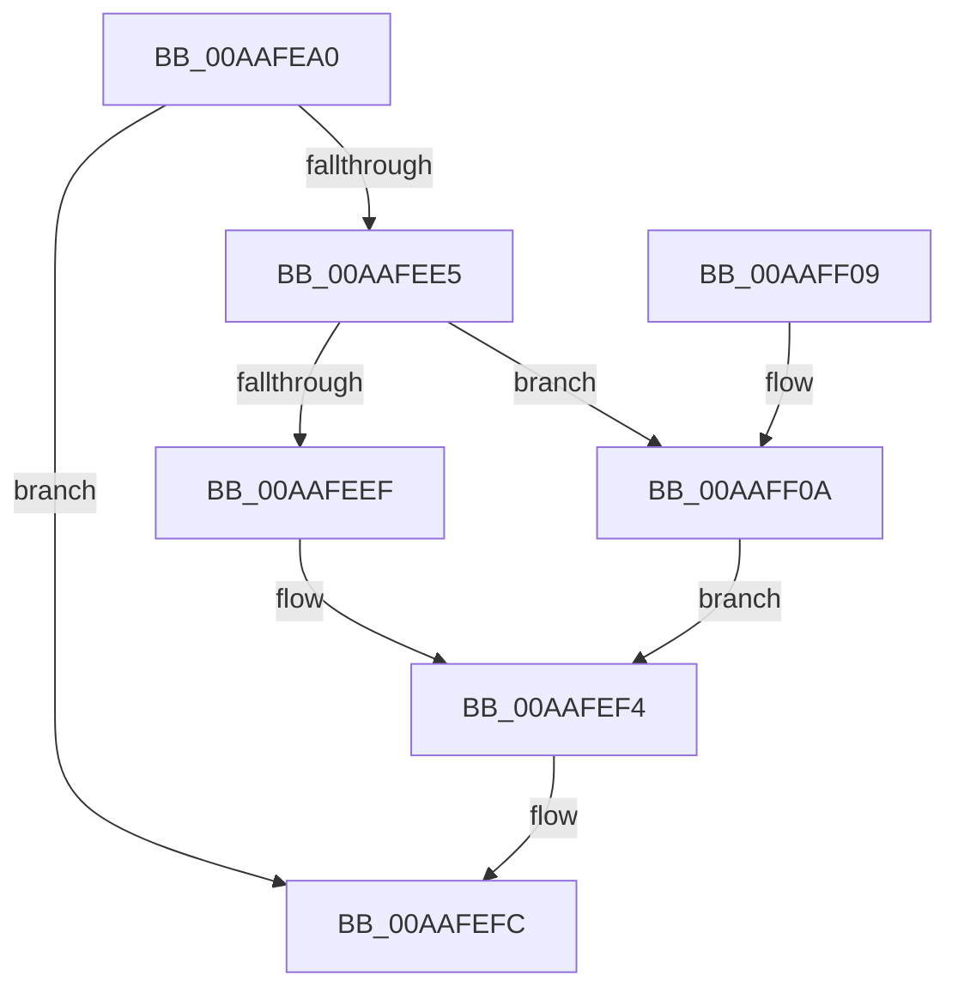

# NtSetEventBoostPriority

- RVA: `0x00AAFEA0`–`0x00AAFF16` (길이 `118` bytes)
- VA: `0x0000000140AAFEA0`
- 실행 섹션: `PAGE`
- PDB 이름 있음: `예`; PDB Function 태그: `아니요`
- unwind 정보 RVA: `0x000BC494`
- 디코드: `32`개 명령, `118/118` bytes 표시
- 미해석 바이트: `0` (있으면 어셈블리에 `.byte`로 보존)

> 이 문서는 커널 이미지의 기계어와 PDB 기호를 분석해 생성했습니다. 4번과 5번은 함수 원형과 자료형을 바이너리 사용 방식에서 추정한 C 해석이며 원본 소스 복구 결과는 아닙니다.

## 1. Dependencies

- 직접 호출 지점: **3**; 고유 호출 대상: **3**
- 직접 호출자로 확인된 함수: **0**
- RIP 상대 이미지 참조: **1**

### Outgoing calls
- `0x00AAFEDA` → [ObReferenceObjectByHandle](../86/ObReferenceObjectByHandle_function_00868DB0.md) (function, `0x00868DB0`)
- `0x00AAFEF7` → [ObfDereferenceObject](../../text/2F/ObfDereferenceObject_function_002F9350.md) (function, `0x002F9350`)
- `0x00AAFF0F` → [KeSetEventBoostPriority](../../text/4F/KeSetEventBoostPriority_function_004F8B90.md) (function, `0x004F8B90`)

### Direct callers
- 이 함수 시작 RVA로 연결되는 직접 call은 확인되지 않았습니다. 간접 호출은 완전히 역산할 수 없습니다.

### Static image references
- `0x00AAFEBF` → RVA `0x00FC6B80` (`ALMOSTRO`; read)

## 2. Other-region calls and transfers

- 다른 실행 섹션으로 향하는 call: **2**
  - `0x00AAFEF7` → [ObfDereferenceObject](../../text/2F/ObfDereferenceObject_function_002F9350.md) (`PAGE` → `.text`)
  - `0x00AAFF0F` → [KeSetEventBoostPriority](../../text/4F/KeSetEventBoostPriority_function_004F8B90.md) (`PAGE` → `.text`)
- 별도 외부 분기/꼬리 이동을 확인하지 못했습니다.

## 3. Assembly (complete function range)

```asm
00AAFEA0  4C 8B DC                        mov r11, rsp
00AAFEA3  49 89 5B 08                     mov qword ptr [r11 + 8], rbx
00AAFEA7  57                              push rdi
00AAFEA8  48 83 EC 30                     sub rsp, 0x30
00AAFEAC  65 48 8B 04 25 88 01 00 00      mov rax, qword ptr gs:[0x188]
00AAFEB5  BA 02 00 00 00                  mov edx, 2
00AAFEBA  49 83 63 F0 00                  and qword ptr [r11 - 0x10], 0
00AAFEBF  4C 8B 05 BA 6C 51 00            mov r8, qword ptr [rip + 0x516cba]
00AAFEC6  49 83 63 10 00                  and qword ptr [r11 + 0x10], 0
00AAFECB  44 8A 88 32 02 00 00            mov r9b, byte ptr [rax + 0x232]
00AAFED2  49 8D 43 10                     lea rax, [r11 + 0x10]
00AAFED6  49 89 43 E8                     mov qword ptr [r11 - 0x18], rax
00AAFEDA  E8 D1 8E DB FF                  call 0x140868db0
00AAFEDF  8B F8                           mov edi, eax
00AAFEE1  85 C0                           test eax, eax
00AAFEE3  78 17                           js 0x140aafefc
00AAFEE5  48 8B 5C 24 48                  mov rbx, qword ptr [rsp + 0x48]
00AAFEEA  F6 03 7F                        test byte ptr [rbx], 0x7f
00AAFEED  75 1B                           jne 0x140aaff0a
00AAFEEF  BF 24 00 00 C0                  mov edi, 0xc0000024
00AAFEF4  48 8B CB                        mov rcx, rbx
00AAFEF7  E8 54 94 84 FF                  call 0x1402f9350
00AAFEFC  48 8B 5C 24 40                  mov rbx, qword ptr [rsp + 0x40]
00AAFF01  8B C7                           mov eax, edi
00AAFF03  48 83 C4 30                     add rsp, 0x30
00AAFF07  5F                              pop rdi
00AAFF08  C3                              ret
00AAFF09  CC                              int3
00AAFF0A  33 D2                           xor edx, edx
00AAFF0C  48 8B CB                        mov rcx, rbx
00AAFF0F  E8 7C 8C A4 FF                  call 0x1404f8b90
00AAFF14  EB DE                           jmp 0x140aafef4
```

## 4. C-style interpretation (structured pseudocode)

```c
__int64 __fastcall NtSetEventBoostPriority(void)
{
    __int64 result;
    __int64 v_rsp;
    unsigned __int64 v_stack_p10;
    unsigned __int64 v_stack_p8;

    *(unsigned __int64 *)(v_rsp + 8) = v_rbx;
    v_rsp = (v_rsp) - (48);
    *(unsigned __int64 *)(v_rsp - 24) = v_rsp + 16;
    result = ObReferenceObjectByHandle(a1, 2, *(unsigned __int64 *)(v_rip + 5336250), *(unsigned __int8 *)(*(unsigned __int64 *)(gs_base + (0 + 392)) + 562));
    if (sign_flag) goto loc_00AAFEFC;
    if (((*(unsigned __int8 *)(v_stack_p10)) & (127)) != 0) goto loc_00AAFF0A;
loc_00AAFEF4:
    result = ObfDereferenceObject(v_stack_p10, 2, *(unsigned __int64 *)(v_rip + 5336250), *(unsigned __int8 *)(*(unsigned __int64 *)(gs_base + (0 + 392)) + 562));
loc_00AAFEFC:
    v_rsp = (v_rsp) + (48);
    return (unsigned int)((unsigned int)((unsigned int)(0xC0000024ULL)));
loc_00AAFF0A:
    a2 = 0;
    result = KeSetEventBoostPriority(v_stack_p8, a2, *(unsigned __int64 *)(v_rip + 5336250), *(unsigned __int8 *)(*(unsigned __int64 *)(gs_base + (0 + 392)) + 562));
    goto loc_00AAFEF4;
}
```

## 5. (Beta) C Style

```c
void NtSetEventBoostPriority(void)
{
    int64_t result;
    int64_t local_rsp;
    uint64_t v_stack_p10;
    uint64_t v_stack_p8;

    *(uint64_t *)(local_rsp + 0x8) = local_rbx;
    local_rsp = (local_rsp) - (48);
    *(uint64_t *)(local_rsp - 0x18) = local_rsp + 16;
    result = ObReferenceObjectByHandle(a1, 2, *(uint64_t *)(v_rip + 0x516CBA), *(uint8_t *)(*(uint64_t *)(gs_base + (0 + 0x188)) + 0x232));
    if (sign_flag) goto loc_00AAFEFC;
    if (((*(uint8_t *)(v_stack_p10)) & (127)) != 0) goto loc_00AAFF0A;
loc_00AAFEF4:
    result = ObfDereferenceObject(v_stack_p10, 2, *(uint64_t *)(v_rip + 0x516CBA), *(uint8_t *)(*(uint64_t *)(gs_base + (0 + 0x188)) + 0x232));
loc_00AAFEFC:
    local_rsp = (local_rsp) + (48);
    return (uint32_t)((uint32_t)((uint32_t)(0xC0000024ULL)));
loc_00AAFF0A:
    a2 = 0;
    result = KeSetEventBoostPriority(v_stack_p8, a2, *(uint64_t *)(v_rip + 0x516CBA), *(uint8_t *)(*(uint64_t *)(gs_base + (0 + 0x188)) + 0x232));
    goto loc_00AAFEF4;
}
```

## 6. Execution-region graph

[열기: 2D/3D 그래프와 함수 탐색 컨트롤 패널](../../../control-panel.html?section=page&rva=0x00AAFEA0&view=graph)

- 2D 그래프는 위에서 아래로 흐르고, 3D 그래프는 빈 공간을 드래그해 회전합니다. Shift+드래그는 이동, 휠은 확대·축소, 함수 노드 선택은 대상 보고서 이동입니다.

### Static fallback


