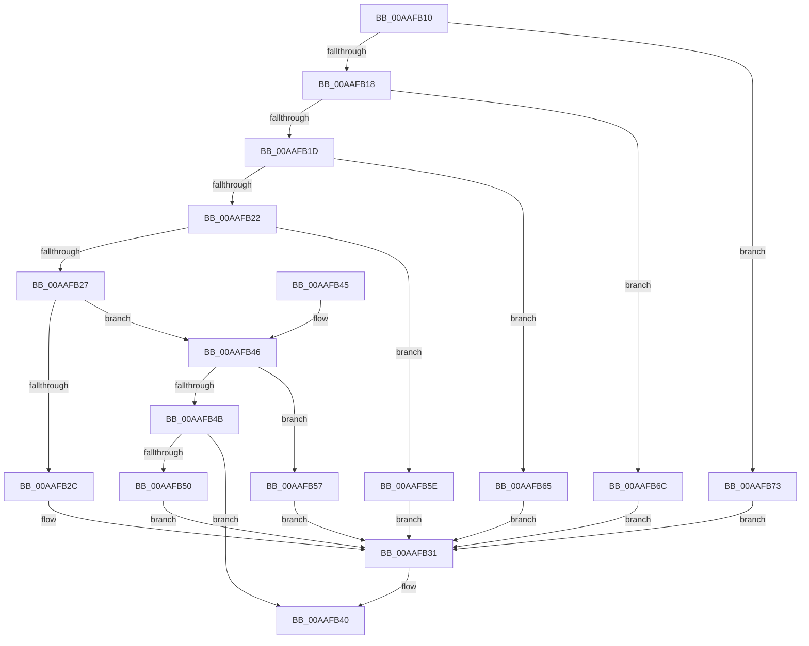

# PdcPoSleepStudyHelperSetPhaseActive

- RVA: `0x00AAFB10`–`0x00AAFB7A` (길이 `106` bytes)
- VA: `0x0000000140AAFB10`
- 실행 섹션: `PAGE`
- PDB 이름 있음: `예`; PDB Function 태그: `아니요`
- unwind 정보 RVA: `0x000B9D74`
- 디코드: `34`개 명령, `106/106` bytes 표시
- 미해석 바이트: `0` (있으면 어셈블리에 `.byte`로 보존)

> 이 문서는 커널 이미지의 기계어와 PDB 기호를 분석해 생성했습니다. 4번과 5번은 함수 원형과 자료형을 바이너리 사용 방식에서 추정한 C 해석이며 원본 소스 복구 결과는 아닙니다.

## 1. Dependencies

- 직접 호출 지점: **1**; 고유 호출 대상: **1**
- 직접 호출자로 확인된 함수: **0**
- RIP 상대 이미지 참조: **1**

### Outgoing calls
- `0x00AAFB3B` → [SshpSetCollectionActive](../../text/48/SshpSetCollectionActive_function_0048507C.md) (function, `0x0048507C`)

### Direct callers
- 이 함수 시작 RVA로 연결되는 직접 call은 확인되지 않았습니다. 간접 호출은 완전히 역산할 수 없습니다.

### Static image references
- `0x00AAFB31` → RVA `0x00E08400` (`.data`; read)

## 2. Other-region calls and transfers

- 다른 실행 섹션으로 향하는 call: **1**
  - `0x00AAFB3B` → [SshpSetCollectionActive](../../text/48/SshpSetCollectionActive_function_0048507C.md) (`PAGE` → `.text`)
- 별도 외부 분기/꼬리 이동을 확인하지 못했습니다.

## 3. Assembly (complete function range)

```asm
00AAFB10  48 83 EC 28                     sub rsp, 0x28
00AAFB14  85 C9                           test ecx, ecx
00AAFB16  74 5B                           je 0x140aafb73
00AAFB18  83 E9 01                        sub ecx, 1
00AAFB1B  74 4F                           je 0x140aafb6c
00AAFB1D  83 E9 01                        sub ecx, 1
00AAFB20  74 43                           je 0x140aafb65
00AAFB22  83 E9 01                        sub ecx, 1
00AAFB25  74 37                           je 0x140aafb5e
00AAFB27  83 E9 01                        sub ecx, 1
00AAFB2A  75 1A                           jne 0x140aafb46
00AAFB2C  B8 C0 00 00 00                  mov eax, 0xc0
00AAFB31  48 8D 0D C8 88 35 00            lea rcx, [rip + 0x3588c8]
00AAFB38  48 03 C8                        add rcx, rax
00AAFB3B  E8 3C 55 9D FF                  call 0x14048507c
00AAFB40  48 83 C4 28                     add rsp, 0x28
00AAFB44  C3                              ret
00AAFB45  CC                              int3
00AAFB46  83 E9 01                        sub ecx, 1
00AAFB49  74 0C                           je 0x140aafb57
00AAFB4B  83 F9 03                        cmp ecx, 3
00AAFB4E  75 F0                           jne 0x140aafb40
00AAFB50  B8 20 01 00 00                  mov eax, 0x120
00AAFB55  EB DA                           jmp 0x140aafb31
00AAFB57  B8 F0 00 00 00                  mov eax, 0xf0
00AAFB5C  EB D3                           jmp 0x140aafb31
00AAFB5E  B8 90 00 00 00                  mov eax, 0x90
00AAFB63  EB CC                           jmp 0x140aafb31
00AAFB65  B8 60 00 00 00                  mov eax, 0x60
00AAFB6A  EB C5                           jmp 0x140aafb31
00AAFB6C  B8 30 00 00 00                  mov eax, 0x30
00AAFB71  EB BE                           jmp 0x140aafb31
00AAFB73  B8 50 01 00 00                  mov eax, 0x150
00AAFB78  EB B7                           jmp 0x140aafb31
```

## 4. C-style interpretation (structured pseudocode)

```c
__int64 __fastcall PdcPoSleepStudyHelperSetPhaseActive(int a1)
{
    __int64 result;
    __int64 v_rsp;

    v_rsp = (v_rsp) - (40);
    if (a1 == 0) goto loc_00AAFB73;
    a1 = (unsigned int)((a1) - (1));
    if (condition_is_equal) goto loc_00AAFB6C;
    a1 = (unsigned int)((a1) - (1));
    if (condition_is_equal) goto loc_00AAFB65;
    a1 = (unsigned int)((a1) - (1));
    if (condition_is_equal) goto loc_00AAFB5E;
    a1 = (unsigned int)((a1) - (1));
    if (condition_is_not_equal) goto loc_00AAFB46;
loc_00AAFB31:
    a1 = (v_rip + 3508424) + (192);
    result = SshpSetCollectionActive(a1, a2, a3, a4);
loc_00AAFB40:
    v_rsp = (v_rsp) + (40);
    return result;
loc_00AAFB46:
    a1 = (unsigned int)((a1) - (1));
    if (condition_is_equal) goto loc_00AAFB57;
    if (a1 != 3) goto loc_00AAFB40;
    goto loc_00AAFB31;
loc_00AAFB57:
    goto loc_00AAFB31;
loc_00AAFB5E:
    goto loc_00AAFB31;
loc_00AAFB65:
    goto loc_00AAFB31;
loc_00AAFB6C:
    goto loc_00AAFB31;
loc_00AAFB73:
    goto loc_00AAFB31;
}
```

## 5. (Beta) C Style

```c
int64_t PdcPoSleepStudyHelperSetPhaseActive(int32_t Arg1)
{
    int64_t result;
    int64_t local_rsp;

    local_rsp = (local_rsp) - (40);
    if (Arg1 == 0) goto loc_00AAFB73;
    Arg1 = (uint32_t)((Arg1) - (1));
    if (condition_is_equal) goto loc_00AAFB6C;
    Arg1 = (uint32_t)((Arg1) - (1));
    if (condition_is_equal) goto loc_00AAFB65;
    Arg1 = (uint32_t)((Arg1) - (1));
    if (condition_is_equal) goto loc_00AAFB5E;
    Arg1 = (uint32_t)((Arg1) - (1));
    if (condition_is_not_equal) goto loc_00AAFB46;
loc_00AAFB31:
    Arg1 = (v_rip + 3508424) + (192);
    result = SshpSetCollectionActive(Arg1, a2, a3, a4);
loc_00AAFB40:
    local_rsp = (local_rsp) + (40);
    return result;
loc_00AAFB46:
    Arg1 = (uint32_t)((Arg1) - (1));
    if (condition_is_equal) goto loc_00AAFB57;
    if (Arg1 != 3) goto loc_00AAFB40;
    goto loc_00AAFB31;
loc_00AAFB57:
    goto loc_00AAFB31;
loc_00AAFB5E:
    goto loc_00AAFB31;
loc_00AAFB65:
    goto loc_00AAFB31;
loc_00AAFB6C:
    goto loc_00AAFB31;
loc_00AAFB73:
    goto loc_00AAFB31;
}
```

## 6. Execution-region graph

[열기: 2D/3D 그래프와 함수 탐색 컨트롤 패널](../../../control-panel.html?section=page&rva=0x00AAFB10&view=graph)

- 2D 그래프는 위에서 아래로 흐르고, 3D 그래프는 빈 공간을 드래그해 회전합니다. Shift+드래그는 이동, 휠은 확대·축소, 함수 노드 선택은 대상 보고서 이동입니다.

### Static fallback


