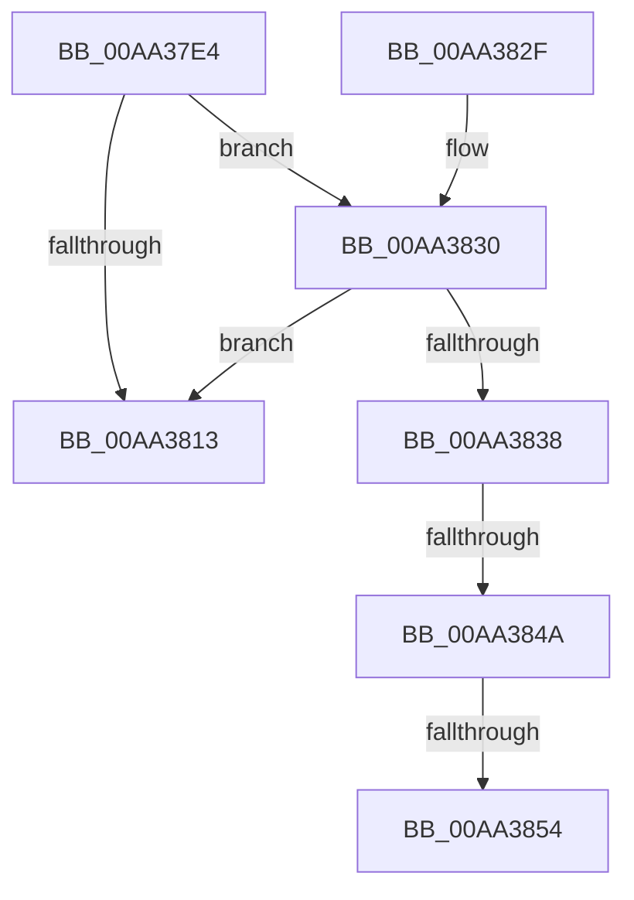

# PdcTaskClientRequest

- RVA: `0x00AA37E4`–`0x00AA385E` (길이 `122` bytes)
- VA: `0x0000000140AA37E4`
- 실행 섹션: `PAGE`
- PDB 이름 있음: `예`; PDB Function 태그: `예`
- unwind 정보 RVA: `0x000BB380`
- 디코드: `31`개 명령, `122/122` bytes 표시
- 미해석 바이트: `0` (있으면 어셈블리에 `.byte`로 보존)

> 이 문서는 커널 이미지의 기계어와 PDB 기호를 분석해 생성했습니다. 4번과 5번은 함수 원형과 자료형을 바이너리 사용 방식에서 추정한 C 해석이며 원본 소스 복구 결과는 아닙니다.

## 1. Dependencies

- 직접 호출 지점: **2**; 고유 호출 대상: **2**
- 직접 호출자로 확인된 함수: **4**
- RIP 상대 이미지 참조: **0**

### Outgoing calls
- `0x00AA3809` → [memset](../../text/6C/memset_function_006C6C40.md) (function, `0x006C6C40`)
- `0x00AA383C` → [PdcAcquireRwLockExclusive](../79/PdcAcquireRwLockExclusive_function_0079B748.md) (function, `0x0079B748`)

### Direct callers
- [PopSwitchUpdateUserShutdownScenarioState](../75/PopSwitchUpdateUserShutdownScenarioState_function_0075F260.md) at `0x0075F30D`
- [PopSwitchUpdateUserShutdownScenarioState](../75/PopSwitchUpdateUserShutdownScenarioState_function_0075F260.md) at `0x0075F363`
- [PopUserShutdownCalloutDelayTimerWorker](../75/PopUserShutdownCalloutDelayTimerWorker_function_0075F3C0.md) at `0x0075F3CD`
- [PopPowerAggregatorSessionSwitchWorker](../76/PopPowerAggregatorSessionSwitchWorker_function_00764FB0.md) at `0x0076500F`
- [PopPowerAggregatorSessionSwitchWorker](../76/PopPowerAggregatorSessionSwitchWorker_function_00764FB0.md) at `0x00765023`
- [PopDispatchShutdownEvent](../76/PopDispatchShutdownEvent_function_00765C60.md) at `0x00765C80`
- [PopDispatchShutdownEvent](../76/PopDispatchShutdownEvent_function_00765C60.md) at `0x00765CC6`

### Static image references
- 디코드된 RIP-relative 메모리 참조가 없습니다.

## 2. Other-region calls and transfers

- 다른 실행 섹션으로 향하는 call: **1**
  - `0x00AA3809` → [memset](../../text/6C/memset_function_006C6C40.md) (`PAGE` → `.text`)
- call이 아닌 외부 분기/꼬리 이동: **3**
  - `0x00AA3844` → [sub_00B49A44](../B4/Unknown_function_00B49A44.md) (`tail-transfer`)
  - `0x00AA384E` → [sub_00B49A44](../B4/Unknown_function_00B49A44.md) (`tail-transfer`)
  - `0x00AA3859` → [sub_00B49A44 + 0x4F](../B4/Unknown_function_00B49A44.md) (`tail-transfer`)

## 3. Assembly (complete function range)

```asm
00AA37E4  48 89 5C 24 08                  mov qword ptr [rsp + 8], rbx
00AA37E9  48 89 74 24 10                  mov qword ptr [rsp + 0x10], rsi
00AA37EE  57                              push rdi
00AA37EF  48 81 EC 40 03 00 00            sub rsp, 0x340
00AA37F6  40 8A F2                        mov sil, dl
00AA37F9  48 8B D9                        mov rbx, rcx
00AA37FC  33 D2                           xor edx, edx
00AA37FE  48 8D 4C 24 20                  lea rcx, [rsp + 0x20]
00AA3803  41 B8 20 03 00 00               mov r8d, 0x320
00AA3809  E8 32 34 C2 FF                  call 0x1406c6c40
00AA380E  48 85 DB                        test rbx, rbx
00AA3811  75 1D                           jne 0x140aa3830
00AA3813  BF EF 00 00 C0                  mov edi, 0xc00000ef
00AA3818  4C 8D 9C 24 40 03 00 00         lea r11, [rsp + 0x340]
00AA3820  8B C7                           mov eax, edi
00AA3822  49 8B 5B 10                     mov rbx, qword ptr [r11 + 0x10]
00AA3826  49 8B 73 18                     mov rsi, qword ptr [r11 + 0x18]
00AA382A  49 8B E3                        mov rsp, r11
00AA382D  5F                              pop rdi
00AA382E  C3                              ret
00AA382F  CC                              int3
00AA3830  81 3B 50 64 63 63               cmp dword ptr [rbx], 0x63636450
00AA3836  75 DB                           jne 0x140aa3813
00AA3838  48 8D 4B 08                     lea rcx, [rbx + 8]
00AA383C  E8 07 7F CF FF                  call 0x14079b748
00AA3841  40 84 F6                        test sil, sil
00AA3844  0F 85 FA 61 0A 00               jne 0x140b49a44
00AA384A  83 7B 30 00                     cmp dword ptr [rbx + 0x30], 0
00AA384E  0F 85 F0 61 0A 00               jne 0x140b49a44
00AA3854  BF 01 00 00 C0                  mov edi, 0xc0000001
00AA3859  E9 35 62 0A 00                  jmp 0x140b49a93
```

## 4. C-style interpretation (structured pseudocode)

```c
__int64 __fastcall PdcTaskClientRequest(__int64 a1, int a2)
{
    __int64 result;
    __int64 v_rsp;
    unsigned __int64 v_stack_m328;
    unsigned __int64 v_stack_m8;
    unsigned __int64 v_stack_p10;
    unsigned __int64 v_stack_p8;

    v_stack_p8 = v_rbx;
    v_stack_p10 = v_rsi;
    v_rsp = (v_rsp) - (832);
    a2 = 0;
    result = memset(v_stack_m328, a2, 800, a4);
    if (a1 != 0) goto loc_00AA3830;
loc_00AA3813:
    return (unsigned int)((unsigned int)((unsigned int)(0xC00000EFULL)));
loc_00AA3830:
    if ((*(unsigned int *)(*(unsigned __int64 *)(v_stack_m8 + 16))) != 0x63636450ULL) goto loc_00AA3813;
    result = PdcAcquireRwLockExclusive(*(unsigned __int64 *)(v_stack_m8 + 16) + 8, a2, 800, a4);
}
```

## 5. (Beta) C Style

```c
int64_t PdcTaskClientRequest(int64_t Arg1, int32_t Arg2)
{
    int64_t result;
    int64_t local_rsp;
    uint64_t v_stack_m328;
    uint64_t v_stack_m8;
    uint64_t v_stack_p10;
    uint64_t v_stack_p8;

    v_stack_p8 = local_rbx;
    v_stack_p10 = local_rsi;
    local_rsp = (local_rsp) - (832);
    Arg2 = 0;
    result = memset(v_stack_m328, Arg2, 800, a4);
    if (Arg1 != 0) goto loc_00AA3830;
loc_00AA3813:
    return (uint32_t)((uint32_t)((uint32_t)(0xC00000EFULL)));
loc_00AA3830:
    if ((*(uint32_t *)(*(uint64_t *)(v_stack_m8 + 0x10))) != 0x63636450ULL) goto loc_00AA3813;
    result = PdcAcquireRwLockExclusive(*(uint64_t *)(v_stack_m8 + 0x10) + 8, Arg2, 800, a4);
}
```

## 6. Execution-region graph

[열기: 2D/3D 그래프와 함수 탐색 컨트롤 패널](../../../control-panel.html?section=page&rva=0x00AA37E4&view=graph)

- 2D 그래프는 위에서 아래로 흐르고, 3D 그래프는 빈 공간을 드래그해 회전합니다. Shift+드래그는 이동, 휠은 확대·축소, 함수 노드 선택은 대상 보고서 이동입니다.

### Static fallback


