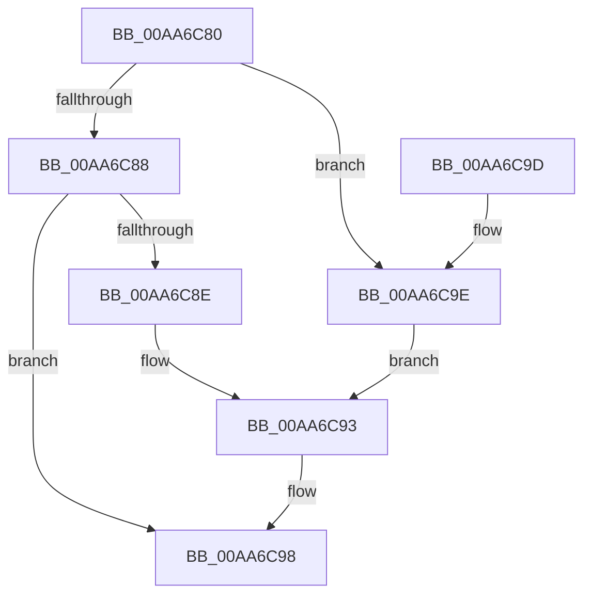

# PerfDiagpBootUserProxyCallback

- RVA: `0x00AA6C80`–`0x00AA6CA5` (길이 `37` bytes)
- VA: `0x0000000140AA6C80`
- 실행 섹션: `PAGE`
- PDB 이름 있음: `예`; PDB Function 태그: `아니요`
- unwind 정보 RVA: `0x0005CEE8`
- 디코드: `12`개 명령, `37/37` bytes 표시
- 미해석 바이트: `0` (있으면 어셈블리에 `.byte`로 보존)

> 이 문서는 커널 이미지의 기계어와 PDB 기호를 분석해 생성했습니다. 4번과 5번은 함수 원형과 자료형을 바이너리 사용 방식에서 추정한 C 해석이며 원본 소스 복구 결과는 아닙니다.

## 1. Dependencies

- 직접 호출 지점: **1**; 고유 호출 대상: **1**
- 직접 호출자로 확인된 함수: **0**
- RIP 상대 이미지 참조: **0**

### Outgoing calls
- `0x00AA6C93` → [PerfDiagpRequestState](PerfDiagpRequestState_function_00AA6CAC.md) (function, `0x00AA6CAC`)

### Direct callers
- 이 함수 시작 RVA로 연결되는 직접 call은 확인되지 않았습니다. 간접 호출은 완전히 역산할 수 없습니다.

### Static image references
- 디코드된 RIP-relative 메모리 참조가 없습니다.

## 2. Other-region calls and transfers

- 다른 실행 섹션으로 향하는 call: **0**
- 별도 외부 분기/꼬리 이동을 확인하지 못했습니다.

## 3. Assembly (complete function range)

```asm
00AA6C80  48 83 EC 28                     sub rsp, 0x28
00AA6C84  85 D2                           test edx, edx
00AA6C86  74 16                           je 0x140aa6c9e
00AA6C88  41 80 F8 55                     cmp r8b, 0x55
00AA6C8C  75 0A                           jne 0x140aa6c98
00AA6C8E  B9 03 00 00 00                  mov ecx, 3
00AA6C93  E8 14 00 00 00                  call 0x140aa6cac
00AA6C98  48 83 C4 28                     add rsp, 0x28
00AA6C9C  C3                              ret
00AA6C9D  CC                              int3
00AA6C9E  B9 04 00 00 00                  mov ecx, 4
00AA6CA3  EB EE                           jmp 0x140aa6c93
```

## 4. C-style interpretation (structured pseudocode)

```c
__int64 __fastcall PerfDiagpBootUserProxyCallback(__int64 a1, int a2, unsigned __int8 a3)
{
    __int64 result;
    __int64 v_rsp;

    v_rsp = (v_rsp) - (40);
    if (a2 == 0) goto loc_00AA6C9E;
    if (a3 != 85) goto loc_00AA6C98;
loc_00AA6C93:
    result = PerfDiagpRequestState(3, a2, a3, a4);
loc_00AA6C98:
    v_rsp = (v_rsp) + (40);
    return result;
loc_00AA6C9E:
    goto loc_00AA6C93;
}
```

## 5. (Beta) C Style

```c
int64_t PerfDiagpBootUserProxyCallback(int64_t Arg1, int32_t Arg2, uint8_t Arg3)
{
    int64_t result;
    int64_t local_rsp;

    local_rsp = (local_rsp) - (40);
    if (Arg2 == 0) goto loc_00AA6C9E;
    if (Arg3 != 85) goto loc_00AA6C98;
loc_00AA6C93:
    result = PerfDiagpRequestState(3, Arg2, Arg3, a4);
loc_00AA6C98:
    local_rsp = (local_rsp) + (40);
    return result;
loc_00AA6C9E:
    goto loc_00AA6C93;
}
```

## 6. Execution-region graph

[열기: 2D/3D 그래프와 함수 탐색 컨트롤 패널](../../../control-panel.html?section=page&rva=0x00AA6C80&view=graph)

- 2D 그래프는 위에서 아래로 흐르고, 3D 그래프는 빈 공간을 드래그해 회전합니다. Shift+드래그는 이동, 휠은 확대·축소, 함수 노드 선택은 대상 보고서 이동입니다.

### Static fallback


