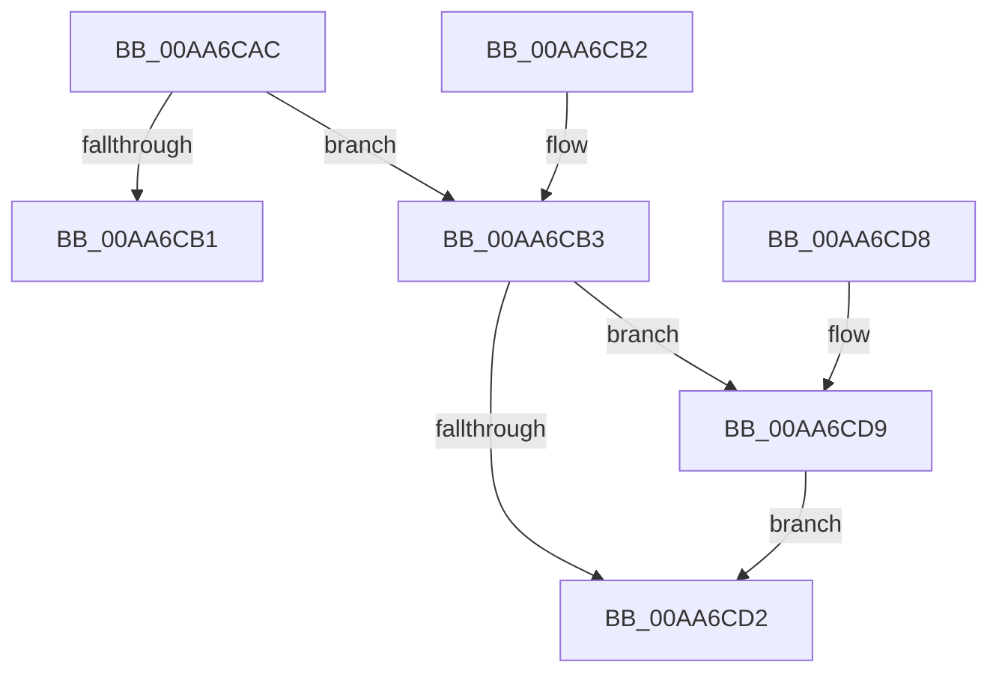

# PerfDiagpRequestState

- RVA: `0x00AA6CAC`–`0x00AA6CFE` (길이 `82` bytes)
- VA: `0x0000000140AA6CAC`
- 실행 섹션: `PAGE`
- PDB 이름 있음: `예`; PDB Function 태그: `아니요`
- unwind 정보 RVA: `0x000BB9BC`
- 디코드: `26`개 명령, `82/82` bytes 표시
- 미해석 바이트: `0` (있으면 어셈블리에 `.byte`로 보존)

> 이 문서는 커널 이미지의 기계어와 PDB 기호를 분석해 생성했습니다. 4번과 5번은 함수 원형과 자료형을 바이너리 사용 방식에서 추정한 C 해석이며 원본 소스 복구 결과는 아닙니다.

## 1. Dependencies

- 직접 호출 지점: **2**; 고유 호출 대상: **2**
- 직접 호출자로 확인된 함수: **4**
- RIP 상대 이미지 참조: **1**

### Outgoing calls
- `0x00AA6CC8` → [ExAllocatePool2](../../poolcode/B8/ExAllocatePool2_function_00B820F0.md) (function, `0x00B820F0`)
- `0x00AA6CF7` → [ExQueueWorkItem](../../text/2F/ExQueueWorkItem_function_002F9520.md) (function, `0x002F9520`)

### Direct callers
- [PerfDiagpBootSystemProxyCallback](../7A/PerfDiagpBootSystemProxyCallback_function_007AEE10.md) at `0x007AEE2A`
- [PerfDiagpSecondaryLogonProxyCallback](../7A/PerfDiagpSecondaryLogonProxyCallback_function_007AF0F0.md) at `0x007AF10A`
- [PerfDiagpShutdownProxyCallback](../7A/PerfDiagpShutdownProxyCallback_function_007AF120.md) at `0x007AF133`
- [PerfDiagpBootUserProxyCallback](PerfDiagpBootUserProxyCallback_function_00AA6C80.md) at `0x00AA6C93`

### Static image references
- `0x00AA6CDD` → RVA `0x007AEF20` (`PerfDiagpProxyWorker`; read)

## 2. Other-region calls and transfers

- 다른 실행 섹션으로 향하는 call: **2**
  - `0x00AA6CC8` → [ExAllocatePool2](../../poolcode/B8/ExAllocatePool2_function_00B820F0.md) (`PAGE` → `POOLCODE`)
  - `0x00AA6CF7` → [ExQueueWorkItem](../../text/2F/ExQueueWorkItem_function_002F9520.md) (`PAGE` → `.text`)
- 별도 외부 분기/꼬리 이동을 확인하지 못했습니다.

## 3. Assembly (complete function range)

```asm
00AA6CAC  83 F9 08                        cmp ecx, 8
00AA6CAF  7C 02                           jl 0x140aa6cb3
00AA6CB1  C3                              ret
00AA6CB2  CC                              int3
00AA6CB3  53                              push rbx
00AA6CB4  48 83 EC 20                     sub rsp, 0x20
00AA6CB8  BA 28 00 00 00                  mov edx, 0x28
00AA6CBD  8B D9                           mov ebx, ecx
00AA6CBF  41 B8 50 52 46 64               mov r8d, 0x64465250
00AA6CC5  8D 4A 18                        lea ecx, [rdx + 0x18]
00AA6CC8  E8 23 B4 0D 00                  call 0x140b820f0
00AA6CCD  48 85 C0                        test rax, rax
00AA6CD0  75 07                           jne 0x140aa6cd9
00AA6CD2  48 83 C4 20                     add rsp, 0x20
00AA6CD6  5B                              pop rbx
00AA6CD7  C3                              ret
00AA6CD8  CC                              int3
00AA6CD9  48 83 20 00                     and qword ptr [rax], 0
00AA6CDD  48 8D 0D 3C 82 D0 FF            lea rcx, [rip - 0x2f7dc4]
00AA6CE4  48 89 48 10                     mov qword ptr [rax + 0x10], rcx
00AA6CE8  BA 01 00 00 00                  mov edx, 1
00AA6CED  48 89 40 18                     mov qword ptr [rax + 0x18], rax
00AA6CF1  48 8B C8                        mov rcx, rax
00AA6CF4  89 58 20                        mov dword ptr [rax + 0x20], ebx
00AA6CF7  E8 24 28 85 FF                  call 0x1402f9520
00AA6CFC  EB D4                           jmp 0x140aa6cd2
```

## 4. C-style interpretation (structured pseudocode)

```c
__int64 __fastcall PerfDiagpRequestState(int a1)
{
    __int64 result;
    __int64 v_rsp;

    if (a1 < 8) goto loc_00AA6CB3;
    return result;
loc_00AA6CB3:
    v_rsp = (v_rsp) - (32);
    result = ExAllocatePool2(40 + 24, 40, (unsigned int)(0x64465250ULL), a4);
    if (result != 0) goto loc_00AA6CD9;
loc_00AA6CD2:
    v_rsp = (v_rsp) + (32);
    return result;
loc_00AA6CD9:
    *(unsigned __int64 *)(result + 16) = v_rip - 3112388;
    *(unsigned __int64 *)(result + 24) = result;
    *(unsigned int *)(result + 32) = (unsigned int)((unsigned int)(a1));
    result = ExQueueWorkItem(result, 1, (unsigned int)(0x64465250ULL), a4);
    goto loc_00AA6CD2;
}
```

## 5. (Beta) C Style

```c
int64_t PerfDiagpRequestState(int32_t Arg1)
{
    int64_t result;
    int64_t local_rsp;

    if (Arg1 < 8) goto loc_00AA6CB3;
    return result;
loc_00AA6CB3:
    local_rsp = (local_rsp) - (32);
    result = ExAllocatePool2(40 + 24, 40, (uint32_t)(0x64465250ULL), a4);
    if (result != 0) goto loc_00AA6CD9;
loc_00AA6CD2:
    local_rsp = (local_rsp) + (32);
    return result;
loc_00AA6CD9:
    *(uint64_t *)(result + 0x10) = v_rip - 3112388;
    *(uint64_t *)(result + 0x18) = result;
    *(uint32_t *)(result + 0x20) = (uint32_t)((uint32_t)(Arg1));
    result = ExQueueWorkItem(result, 1, (uint32_t)(0x64465250ULL), a4);
    goto loc_00AA6CD2;
}
```

## 6. Execution-region graph

[열기: 2D/3D 그래프와 함수 탐색 컨트롤 패널](../../../control-panel.html?section=page&rva=0x00AA6CAC&view=graph)

- 2D 그래프는 위에서 아래로 흐르고, 3D 그래프는 빈 공간을 드래그해 회전합니다. Shift+드래그는 이동, 휠은 확대·축소, 함수 노드 선택은 대상 보고서 이동입니다.

### Static fallback


