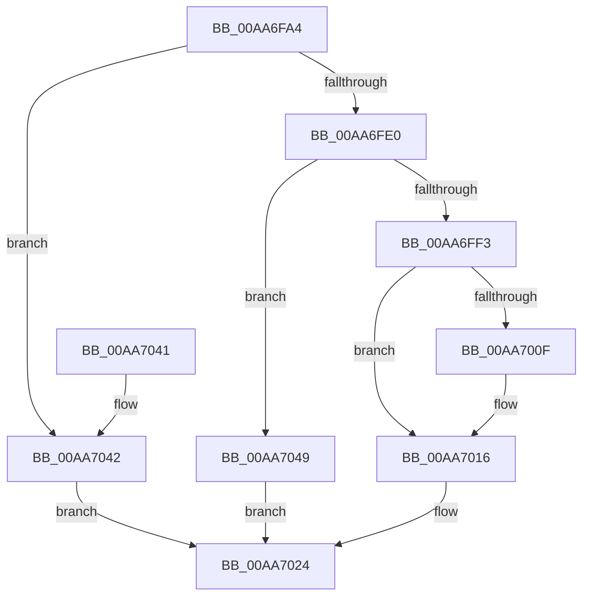

# PiDeferSetInterfaceState

- RVA: `0x00AA6FA4`–`0x00AA705A` (길이 `182` bytes)
- VA: `0x0000000140AA6FA4`
- 실행 섹션: `PAGE`
- PDB 이름 있음: `예`; PDB Function 태그: `아니요`
- unwind 정보 RVA: `0x00071698`
- 디코드: `51`개 명령, `182/182` bytes 표시
- 미해석 바이트: `0` (있으면 어셈블리에 `.byte`로 보존)

> 이 문서는 커널 이미지의 기계어와 PDB 기호를 분석해 생성했습니다. 4번과 5번은 함수 원형과 자료형을 바이너리 사용 방식에서 추정한 C 해석이며 원본 소스 복구 결과는 아닙니다.

## 1. Dependencies

- 직접 호출 지점: **4**; 고유 호출 대상: **4**
- 직접 호출자로 확인된 함수: **1**
- RIP 상대 이미지 참조: **0**

### Outgoing calls
- `0x00AA6FD3` → [ExAllocatePool2](../../poolcode/B8/ExAllocatePool2_function_00B820F0.md) (function, `0x00B820F0`)
- `0x00AA6FE8` → [IopAllocateUnicodeString](../95/IopAllocateUnicodeString_function_00951F0C.md) (function, `0x00951F0C`)
- `0x00AA6FFA` → [RtlCopyUnicodeString](../../text/3F/RtlCopyUnicodeString_function_003FEF30.md) (function, `0x003FEF30`)
- `0x00AA7053` → [ExFreePoolWithTag](../../poolcode/B8/ExFreePoolWithTag_function_00B82870.md) (function, `0x00B82870`)

### Direct callers
- [IopProcessSetInterfaceState](../95/IopProcessSetInterfaceState_function_00950964.md) at `0x00950F02`

### Static image references
- 디코드된 RIP-relative 메모리 참조가 없습니다.

## 2. Other-region calls and transfers

- 다른 실행 섹션으로 향하는 call: **3**
  - `0x00AA6FD3` → [ExAllocatePool2](../../poolcode/B8/ExAllocatePool2_function_00B820F0.md) (`PAGE` → `POOLCODE`)
  - `0x00AA6FFA` → [RtlCopyUnicodeString](../../text/3F/RtlCopyUnicodeString_function_003FEF30.md) (`PAGE` → `.text`)
  - `0x00AA7053` → [ExFreePoolWithTag](../../poolcode/B8/ExFreePoolWithTag_function_00B82870.md) (`PAGE` → `POOLCODE`)
- 별도 외부 분기/꼬리 이동을 확인하지 못했습니다.

## 3. Assembly (complete function range)

```asm
00AA6FA4  48 8B C4                        mov rax, rsp
00AA6FA7  48 89 58 08                     mov qword ptr [rax + 8], rbx
00AA6FAB  48 89 68 10                     mov qword ptr [rax + 0x10], rbp
00AA6FAF  48 89 70 18                     mov qword ptr [rax + 0x18], rsi
00AA6FB3  48 89 78 20                     mov qword ptr [rax + 0x20], rdi
00AA6FB7  41 56                           push r14
00AA6FB9  48 83 EC 20                     sub rsp, 0x20
00AA6FBD  4C 8B F2                        mov r14, rdx
00AA6FC0  48 8B E9                        mov rbp, rcx
00AA6FC3  BA 20 00 00 00                  mov edx, 0x20
00AA6FC8  B9 00 01 00 00                  mov ecx, 0x100
00AA6FCD  41 B8 50 70 20 20               mov r8d, 0x20207050
00AA6FD3  E8 18 B1 0D 00                  call 0x140b820f0
00AA6FD8  48 8B F8                        mov rdi, rax
00AA6FDB  48 85 C0                        test rax, rax
00AA6FDE  74 62                           je 0x140aa7042
00AA6FE0  41 0F B7 16                     movzx edx, word ptr [r14]
00AA6FE4  48 8D 48 10                     lea rcx, [rax + 0x10]
00AA6FE8  E8 1F AF EA FF                  call 0x140951f0c
00AA6FED  8B D8                           mov ebx, eax
00AA6FEF  85 C0                           test eax, eax
00AA6FF1  78 56                           js 0x140aa7049
00AA6FF3  49 8B D6                        mov rdx, r14
00AA6FF6  48 8D 4F 10                     lea rcx, [rdi + 0x10]
00AA6FFA  E8 31 7F 95 FF                  call 0x1403fef30
00AA6FFF  48 8D 85 60 02 00 00            lea rax, [rbp + 0x260]
00AA7006  48 8B 48 08                     mov rcx, qword ptr [rax + 8]
00AA700A  48 39 01                        cmp qword ptr [rcx], rax
00AA700D  74 07                           je 0x140aa7016
00AA700F  B9 03 00 00 00                  mov ecx, 3
00AA7014  CD 29                           int 0x29
00AA7016  48 89 07                        mov qword ptr [rdi], rax
00AA7019  48 89 4F 08                     mov qword ptr [rdi + 8], rcx
00AA701D  48 89 39                        mov qword ptr [rcx], rdi
00AA7020  48 89 78 08                     mov qword ptr [rax + 8], rdi
00AA7024  48 8B 6C 24 38                  mov rbp, qword ptr [rsp + 0x38]
00AA7029  8B C3                           mov eax, ebx
00AA702B  48 8B 5C 24 30                  mov rbx, qword ptr [rsp + 0x30]
00AA7030  48 8B 74 24 40                  mov rsi, qword ptr [rsp + 0x40]
00AA7035  48 8B 7C 24 48                  mov rdi, qword ptr [rsp + 0x48]
00AA703A  48 83 C4 20                     add rsp, 0x20
00AA703E  41 5E                           pop r14
00AA7040  C3                              ret
00AA7041  CC                              int3
00AA7042  BB 9A 00 00 C0                  mov ebx, 0xc000009a
00AA7047  EB DB                           jmp 0x140aa7024
00AA7049  33 D2                           xor edx, edx
00AA704B  48 8B CF                        mov rcx, rdi
00AA704E  BB 9A 00 00 C0                  mov ebx, 0xc000009a
00AA7053  E8 18 B8 0D 00                  call 0x140b82870
00AA7058  EB CA                           jmp 0x140aa7024
```

## 4. C-style interpretation (structured pseudocode)

```c
__int64 __fastcall PiDeferSetInterfaceState(__int64 a1, __int64 a2)
{
    __int64 result;
    __int64 v_rsp;
    unsigned __int64 v_stack_p10;
    unsigned __int64 v_stack_p18;
    unsigned __int64 v_stack_p20;
    unsigned __int64 v_stack_p8;

    *(unsigned __int64 *)(v_rsp + 8) = v_rbx;
    *(unsigned __int64 *)(v_rsp + 16) = v_rbp;
    *(unsigned __int64 *)(v_rsp + 24) = v_rsi;
    *(unsigned __int64 *)(v_rsp + 32) = v_rdi;
    v_rsp = (v_rsp) - (32);
    result = ExAllocatePool2(256, 32, (unsigned int)(0x20207050ULL), a4);
    if (result == 0) goto loc_00AA7042;
    result = IopAllocateUnicodeString(result + 16, *(unsigned __int16 *)(a2), (unsigned int)(0x20207050ULL), a4);
    if (sign_flag) goto loc_00AA7049;
    result = RtlCopyUnicodeString(result + 16, a2, (unsigned int)(0x20207050ULL), a4);
    if ((*(unsigned __int64 *)(*(unsigned __int64 *)(a1 + 608 + 8))) != (a1 + 608)) {
        a1 = 3;
    }
    *(unsigned __int64 *)(result) = a1 + 608;
    *(unsigned __int64 *)(result + 8) = a1;
    *(unsigned __int64 *)(a1) = result;
    *(unsigned __int64 *)(a1 + 608 + 8) = result;
loc_00AA7024:
    v_rsp = (v_rsp) + (32);
    return (unsigned int)((unsigned int)((unsigned int)((unsigned int)(result))));
loc_00AA7042:
    goto loc_00AA7024;
loc_00AA7049:
    a2 = 0;
    result = ExFreePoolWithTag(v_stack_p20, a2, (unsigned int)(0x20207050ULL), a4);
    goto loc_00AA7024;
}
```

## 5. (Beta) C Style

```c
int64_t PiDeferSetInterfaceState(void *Arg1, void *Arg2)
{
    uint8_t *arg1 = (uint8_t *)Arg1;
    uint8_t *arg2 = (uint8_t *)Arg2;

    int64_t result;
    int64_t local_rsp;
    uint64_t v_stack_p10;
    uint64_t v_stack_p18;
    uint64_t v_stack_p20;
    uint64_t v_stack_p8;

    *(uint64_t *)(local_rsp + 0x8) = local_rbx;
    *(uint64_t *)(local_rsp + 0x10) = local_rbp;
    *(uint64_t *)(local_rsp + 0x18) = local_rsi;
    *(uint64_t *)(local_rsp + 0x20) = local_rdi;
    local_rsp = (local_rsp) - (32);
    result = ExAllocatePool2(256, 32, (uint32_t)(0x20207050ULL), a4);
    if (result == 0) goto loc_00AA7042;
    result = IopAllocateUnicodeString(result + 16, *(uint16_t *)(arg2), (uint32_t)(0x20207050ULL), a4);
    if (sign_flag) goto loc_00AA7049;
    result = RtlCopyUnicodeString(result + 16, Arg2, (uint32_t)(0x20207050ULL), a4);
    if ((*(uint64_t *)(*(uint64_t *)(arg1 + 0x260 + 0x8))) != (Arg1 + 608)) {
        Arg1 = 3;
    }
    *(void **)(result) = Arg1 + 608;
    *(void **)(result + 0x8) = Arg1;
    *(uint64_t *)(arg1) = result;
    *(uint64_t *)(arg1 + 0x260 + 0x8) = result;
loc_00AA7024:
    local_rsp = (local_rsp) + (32);
    return (uint32_t)((uint32_t)((uint32_t)((uint32_t)(result))));
loc_00AA7042:
    goto loc_00AA7024;
loc_00AA7049:
    Arg2 = 0;
    result = ExFreePoolWithTag(v_stack_p20, Arg2, (uint32_t)(0x20207050ULL), a4);
    goto loc_00AA7024;
}
```

### 관측된 메모리 오프셋

구조체 형식이 확인되지 않은 접근은 인자 기준의 오프셋으로만 기록했습니다.

| 기준 인자 | 오프셋 표현 | 폭 (bit) | 접근 |
|---|---:|---:|---|
| `Arg1` | `+ 0x8` | `64` | `R` |
| `Arg1` | `+ 0x8` | `64` | `W` |
| `Arg1` | `+ 0x260` | `64` | `R` |
| `Arg2` | `+ 0x0` | `16` | `R` |

## 6. Execution-region graph

[열기: 2D/3D 그래프와 함수 탐색 컨트롤 패널](../../../control-panel.html?section=page&rva=0x00AA6FA4&view=graph)

- 2D 그래프는 위에서 아래로 흐르고, 3D 그래프는 빈 공간을 드래그해 회전합니다. Shift+드래그는 이동, 휠은 확대·축소, 함수 노드 선택은 대상 보고서 이동입니다.

### Static fallback


