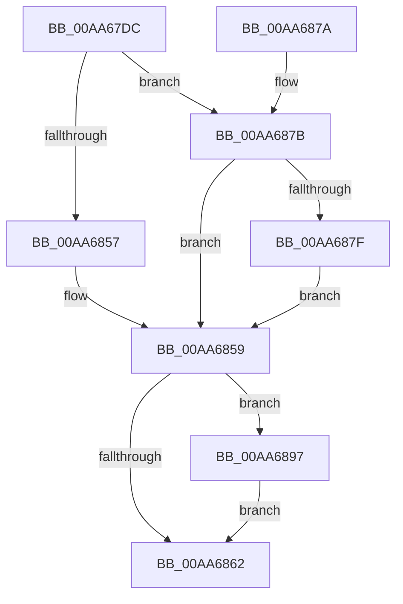

# PiDevCfgConfigureDeviceFilters

- RVA: `0x00AA67DC`–`0x00AA689E` (길이 `194` bytes)
- VA: `0x0000000140AA67DC`
- 실행 섹션: `PAGE`
- PDB 이름 있음: `예`; PDB Function 태그: `아니요`
- unwind 정보 RVA: `0x000BB95C`
- 디코드: `52`개 명령, `194/194` bytes 표시
- 미해석 바이트: `0` (있으면 어셈블리에 `.byte`로 보존)

> 이 문서는 커널 이미지의 기계어와 PDB 기호를 분석해 생성했습니다. 4번과 5번은 함수 원형과 자료형을 바이너리 사용 방식에서 추정한 C 해석이며 원본 소스 복구 결과는 아닙니다.

## 1. Dependencies

- 직접 호출 지점: **3**; 고유 호출 대상: **3**
- 직접 호출자로 확인된 함수: **1**
- RIP 상대 이미지 참조: **1**

### Outgoing calls
- `0x00AA6849` → [ZwOpenKey](../../text/6A/ZwOpenKey_function_006AD310.md) (function, `0x006AD310`)
- `0x00AA688E` → [PnpCtxRegCopyTree](../82/PnpCtxRegCopyTree_function_008291EC.md) (function, `0x008291EC`)
- `0x00AA6897` → [ZwClose](../../text/6A/ZwClose_function_006AD2B0.md) (function, `0x006AD2B0`)

### Direct callers
- [PiDevCfgConfigureDeviceKeys](../96/PiDevCfgConfigureDeviceKeys_function_00964BA8.md) at `0x00964C9E`

### Static image references
- `0x00AA67FF` → RVA `0x00AFE870` (` ?? ::NNGAKEGL::`string'`; read)

## 2. Other-region calls and transfers

- 다른 실행 섹션으로 향하는 call: **2**
  - `0x00AA6849` → [ZwOpenKey](../../text/6A/ZwOpenKey_function_006AD310.md) (`PAGE` → `.text`)
  - `0x00AA6897` → [ZwClose](../../text/6A/ZwClose_function_006AD2B0.md) (`PAGE` → `.text`)
- 별도 외부 분기/꼬리 이동을 확인하지 못했습니다.

## 3. Assembly (complete function range)

```asm
00AA67DC  48 89 5C 24 08                  mov qword ptr [rsp + 8], rbx
00AA67E1  48 89 7C 24 18                  mov qword ptr [rsp + 0x18], rdi
00AA67E6  4C 89 74 24 20                  mov qword ptr [rsp + 0x20], r14
00AA67EB  55                              push rbp
00AA67EC  48 8B EC                        mov rbp, rsp
00AA67EF  48 83 EC 70                     sub rsp, 0x70
00AA67F3  83 65 C4 00                     and dword ptr [rbp - 0x3c], 0
00AA67F7  48 8D 45 C0                     lea rax, [rbp - 0x40]
00AA67FB  83 65 EC 00                     and dword ptr [rbp - 0x14], 0
00AA67FF  4C 8D 35 6A 80 05 00            lea r14, [rip + 0x5806a]
00AA6806  48 83 65 18 00                  and qword ptr [rbp + 0x18], 0
00AA680B  4C 8D 45 D0                     lea r8, [rbp - 0x30]
00AA680F  48 8B F9                        mov rdi, rcx
00AA6812  48 89 55 D8                     mov qword ptr [rbp - 0x28], rdx
00AA6816  0F 57 C0                        xorps xmm0, xmm0
00AA6819  48 C7 45 D0 30 00 00 00         mov qword ptr [rbp - 0x30], 0x30
00AA6821  83 65 D4 00                     and dword ptr [rbp - 0x2c], 0
00AA6825  48 8D 4D 18                     lea rcx, [rbp + 0x18]
00AA6829  BA 19 00 02 00                  mov edx, 0x20019
00AA682E  4C 89 75 C8                     mov qword ptr [rbp - 0x38], r14
00AA6832  48 89 45 E0                     mov qword ptr [rbp - 0x20], rax
00AA6836  F3 0F 7F 45 F0                  movdqu xmmword ptr [rbp - 0x10], xmm0
00AA683B  C7 45 C0 0E 00 10 00            mov dword ptr [rbp - 0x40], 0x10000e
00AA6842  C7 45 E8 40 02 00 00            mov dword ptr [rbp - 0x18], 0x240
00AA6849  E8 C2 6A C0 FF                  call 0x1406ad310
00AA684E  8B D8                           mov ebx, eax
00AA6850  3D 34 00 00 C0                  cmp eax, 0xc0000034
00AA6855  75 24                           jne 0x140aa687b
00AA6857  33 DB                           xor ebx, ebx
00AA6859  48 8B 4D 18                     mov rcx, qword ptr [rbp + 0x18]
00AA685D  48 85 C9                        test rcx, rcx
00AA6860  75 35                           jne 0x140aa6897
00AA6862  4C 8D 5C 24 70                  lea r11, [rsp + 0x70]
00AA6867  8B C3                           mov eax, ebx
00AA6869  49 8B 5B 10                     mov rbx, qword ptr [r11 + 0x10]
00AA686D  49 8B 7B 20                     mov rdi, qword ptr [r11 + 0x20]
00AA6871  4D 8B 73 28                     mov r14, qword ptr [r11 + 0x28]
00AA6875  49 8B E3                        mov rsp, r11
00AA6878  5D                              pop rbp
00AA6879  C3                              ret
00AA687A  CC                              int3
00AA687B  85 C0                           test eax, eax
00AA687D  78 DA                           js 0x140aa6859
00AA687F  48 8B 55 18                     mov rdx, qword ptr [rbp + 0x18]
00AA6883  4C 8B CF                        mov r9, rdi
00AA6886  45 33 C0                        xor r8d, r8d
00AA6889  4C 89 74 24 20                  mov qword ptr [rsp + 0x20], r14
00AA688E  E8 59 29 D8 FF                  call 0x1408291ec
00AA6893  8B D8                           mov ebx, eax
00AA6895  EB C2                           jmp 0x140aa6859
00AA6897  E8 14 6A C0 FF                  call 0x1406ad2b0
00AA689C  EB C4                           jmp 0x140aa6862
```

## 4. C-style interpretation (structured pseudocode)

```c
__int64 __fastcall PiDevCfgConfigureDeviceFilters(__int64 a1, __int64 a2)
{
    __int64 result;
    __int64 v_rbx;
    __int64 v_rsp;
    unsigned __int64 v_stack_m18;
    unsigned int v_stack_m1C;
    unsigned int v_stack_m20;
    unsigned __int64 v_stack_m28;
    unsigned __int64 v_stack_m30;
    unsigned int v_stack_m34;
    unsigned __int64 v_stack_m38;
    unsigned __int64 v_stack_m40;
    unsigned int v_stack_m44;
    unsigned __int64 v_stack_m48;
    unsigned __int64 v_stack_m50;
    unsigned __int64 v_stack_m8;
    unsigned __int64 v_stack_p10;
    unsigned __int64 v_stack_p18;
    unsigned __int64 v_stack_p20;
    unsigned __int64 v_stack_p8;

    v_stack_p8 = v_rbx;
    v_stack_p18 = v_rdi;
    v_stack_p20 = v_r14;
    v_rsp = (v_rsp) - (112);
    v_stack_m30 = a2;
    v_stack_m38 = 48;
    v_stack_m40 = v_rip + 360554;
    v_stack_m28 = v_stack_m48;
    v_stack_m18 = v_xmm0;
    v_stack_m48 = 0x10000EULL;
    v_stack_m20 = 576;
    result = ZwOpenKey(v_stack_p10, (unsigned int)(0x20019ULL), v_stack_m38, a4);
    if (((unsigned int)(result)) != 0xC0000034ULL) goto loc_00AA687B;
    v_rbx = 0;
loc_00AA6859:
    if (v_stack_p10 != 0) goto loc_00AA6897;
loc_00AA6862:
    return 0;
loc_00AA687B:
    if (sign_flag) goto loc_00AA6859;
    a3 = 0;
    v_stack_m50 = *(unsigned __int64 *)(v_stack_m8 + 40);
    result = PnpCtxRegCopyTree(v_stack_p10, v_stack_p10, a3, *(unsigned __int64 *)(v_stack_m8 + 32));
    goto loc_00AA6859;
loc_00AA6897:
    result = ZwClose(v_stack_p10, v_stack_p10, a3, *(unsigned __int64 *)(v_stack_m8 + 32));
    goto loc_00AA6862;
}
```

## 5. (Beta) C Style

```c
int64_t PiDevCfgConfigureDeviceFilters(int64_t Arg1, int64_t Arg2)
{
    int64_t result;
    int64_t local_rbx;
    int64_t local_rsp;
    uint64_t v_stack_m18;
    uint32_t v_stack_m1C;
    uint32_t v_stack_m20;
    uint64_t v_stack_m28;
    uint64_t v_stack_m30;
    uint32_t v_stack_m34;
    uint64_t v_stack_m38;
    uint64_t v_stack_m40;
    uint32_t v_stack_m44;
    uint64_t v_stack_m48;
    uint64_t v_stack_m50;
    uint64_t v_stack_m8;
    uint64_t v_stack_p10;
    uint64_t v_stack_p18;
    uint64_t v_stack_p20;
    uint64_t v_stack_p8;

    v_stack_p8 = local_rbx;
    v_stack_p18 = local_rdi;
    v_stack_p20 = local_r14;
    local_rsp = (local_rsp) - (112);
    v_stack_m30 = Arg2;
    v_stack_m38 = 48;
    v_stack_m40 = v_rip + 360554;
    v_stack_m28 = v_stack_m48;
    v_stack_m18 = v_xmm0;
    v_stack_m48 = 0x10000EULL;
    v_stack_m20 = 576;
    result = ZwOpenKey(v_stack_p10, (uint32_t)(0x20019ULL), v_stack_m38, a4);
    if (((uint32_t)(result)) != 0xC0000034ULL) goto loc_00AA687B;
    local_rbx = 0;
loc_00AA6859:
    if (v_stack_p10 != 0) goto loc_00AA6897;
loc_00AA6862:
    return 0;
loc_00AA687B:
    if (sign_flag) goto loc_00AA6859;
    a3 = 0;
    v_stack_m50 = *(uint64_t *)(v_stack_m8 + 0x28);
    result = PnpCtxRegCopyTree(v_stack_p10, v_stack_p10, a3, *(uint64_t *)(v_stack_m8 + 0x20));
    goto loc_00AA6859;
loc_00AA6897:
    result = ZwClose(v_stack_p10, v_stack_p10, a3, *(uint64_t *)(v_stack_m8 + 0x20));
    goto loc_00AA6862;
}
```

## 6. Execution-region graph

[열기: 2D/3D 그래프와 함수 탐색 컨트롤 패널](../../../control-panel.html?section=page&rva=0x00AA67DC&view=graph)

- 2D 그래프는 위에서 아래로 흐르고, 3D 그래프는 빈 공간을 드래그해 회전합니다. Shift+드래그는 이동, 휠은 확대·축소, 함수 노드 선택은 대상 보고서 이동입니다.

### Static fallback


