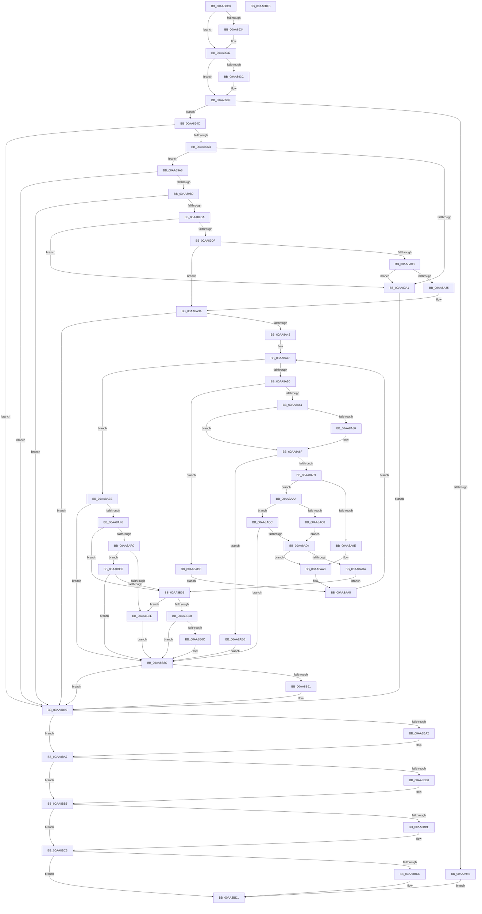

# PiDevCfgConfigureDeviceLocation

- RVA: `0x00AA88C0`–`0x00AA8BF4` (길이 `820` bytes)
- VA: `0x0000000140AA88C0`
- 실행 섹션: `PAGE`
- PDB 이름 있음: `예`; PDB Function 태그: `아니요`
- unwind 정보 RVA: `0x000BBBE4`
- 디코드: `228`개 명령, `820/820` bytes 표시
- 미해석 바이트: `0` (있으면 어셈블리에 `.byte`로 보존)

> 이 문서는 커널 이미지의 기계어와 PDB 기호를 분석해 생성했습니다. 4번과 5번은 함수 원형과 자료형을 바이너리 사용 방식에서 추정한 C 해석이며 원본 소스 복구 결과는 아닙니다.

## 1. Dependencies

- 직접 호출 지점: **18**; 고유 호출 대상: **11**
- 직접 호출자로 확인된 함수: **2**
- RIP 상대 이미지 참조: **5**

### Outgoing calls
- `0x00AA895C` → [_PnpCtxGetCachedContextBaseKey](../8E/_PnpCtxGetCachedContextBaseKey_function_008EFB2C.md) (function, `0x008EFB2C`)
- `0x00AA898F` → [IopOpenRegistryKeyEx](../A5/IopOpenRegistryKeyEx_function_00A51B44.md) (function, `0x00A51B44`)
- `0x00AA89CB` → [NtQueryKey](../86/NtQueryKey_function_008676E0.md) (function, `0x008676E0`)
- `0x00AA89F0` → [PnpOpenFirstMatchingSubKey](../72/PnpOpenFirstMatchingSubKey_function_0072CA20.md) (function, `0x0072CA20`)
- `0x00AA8A25` → [IopOpenRegistryKeyEx](../A5/IopOpenRegistryKeyEx_function_00A51B44.md) (function, `0x00A51B44`)
- `0x00AA8A6A` → [RtlFreeAnsiString](../9C/RtlFreeAnsiString_function_009C0800.md) (function, `0x009C0800`)
- `0x00AA8A7E` → [PnpDuplicateUnicodeString](../../text/4C/PnpDuplicateUnicodeString_function_004CC044.md) (function, `0x004CC044`)
- `0x00AA8A91` → [IopReplaceSeperatorWithPound](../A4/IopReplaceSeperatorWithPound_function_00A4ABD8.md) (function, `0x00A4ABD8`)
- `0x00AA8ABA` → [PnpOpenFirstMatchingSubKey](../72/PnpOpenFirstMatchingSubKey_function_0072CA20.md) (function, `0x0072CA20`)
- `0x00AA8B20` → [IopOpenRegistryKeyEx](../A5/IopOpenRegistryKeyEx_function_00A51B44.md) (function, `0x00A51B44`)
- `0x00AA8B5A` → [IopOpenRegistryKeyEx](../A5/IopOpenRegistryKeyEx_function_00A51B44.md) (function, `0x00A51B44`)
- `0x00AA8B85` → [PiDevCfgConfigureDeviceKeys](../96/PiDevCfgConfigureDeviceKeys_function_00964BA8.md) (function, `0x00964BA8`)
- `0x00AA8B94` → [ExFreePool](../../poolcode/B8/ExFreePool_function_00B82850.md) (function, `0x00B82850`)
- `0x00AA8BA2` → [ZwClose](../../text/6A/ZwClose_function_006AD2B0.md) (function, `0x006AD2B0`)
- `0x00AA8BB0` → [ZwClose](../../text/6A/ZwClose_function_006AD2B0.md) (function, `0x006AD2B0`)
- `0x00AA8BBE` → [ZwClose](../../text/6A/ZwClose_function_006AD2B0.md) (function, `0x006AD2B0`)
- `0x00AA8BCC` → [ZwClose](../../text/6A/ZwClose_function_006AD2B0.md) (function, `0x006AD2B0`)
- `0x00AA8BDA` → [_security_check_cookie](../../text/6A/_security_check_cookie_function_006AC640.md) (function, `0x006AC640`)

### Direct callers
- [PpDevCfgProcessDeviceClass](../73/PpDevCfgProcessDeviceClass_function_00736824.md) at `0x00736AEE`
- [PiDevCfgConfigureDevice](../97/PiDevCfgConfigureDevice_function_00977BB4.md) at `0x00979B72`

### Static image references
- `0x00AA88D9` → RVA `0x00E0A740` (`.data`; read)
- `0x00AA894C` → RVA `0x00E66398` (`.data`; read)
- `0x00AA896F` → RVA `0x00AFF120` (` ?? ::NNGAKEGL::`string'`; read)
- `0x00AA89F5` → RVA `0x00AFD260` (` ?? ::NNGAKEGL::`string'`; read)
- `0x00AA8B3A` → RVA `0x00AFE850` (` ?? ::NNGAKEGL::`string'`; read)

## 2. Other-region calls and transfers

- 다른 실행 섹션으로 향하는 call: **7**
  - `0x00AA8A7E` → [PnpDuplicateUnicodeString](../../text/4C/PnpDuplicateUnicodeString_function_004CC044.md) (`PAGE` → `.text`)
  - `0x00AA8B94` → [ExFreePool](../../poolcode/B8/ExFreePool_function_00B82850.md) (`PAGE` → `POOLCODE`)
  - `0x00AA8BA2` → [ZwClose](../../text/6A/ZwClose_function_006AD2B0.md) (`PAGE` → `.text`)
  - `0x00AA8BB0` → [ZwClose](../../text/6A/ZwClose_function_006AD2B0.md) (`PAGE` → `.text`)
  - `0x00AA8BBE` → [ZwClose](../../text/6A/ZwClose_function_006AD2B0.md) (`PAGE` → `.text`)
  - `0x00AA8BCC` → [ZwClose](../../text/6A/ZwClose_function_006AD2B0.md) (`PAGE` → `.text`)
  - `0x00AA8BDA` → [_security_check_cookie](../../text/6A/_security_check_cookie_function_006AC640.md) (`PAGE` → `.text`)
- 별도 외부 분기/꼬리 이동을 확인하지 못했습니다.

## 3. Assembly (complete function range)

```asm
00AA88C0  40 55                           push rbp
00AA88C2  53                              push rbx
00AA88C3  56                              push rsi
00AA88C4  57                              push rdi
00AA88C5  41 54                           push r12
00AA88C7  41 55                           push r13
00AA88C9  41 56                           push r14
00AA88CB  41 57                           push r15
00AA88CD  48 8D 6C 24 E1                  lea rbp, [rsp - 0x1f]
00AA88D2  48 81 EC C8 00 00 00            sub rsp, 0xc8
00AA88D9  48 8B 05 60 1E 36 00            mov rax, qword ptr [rip + 0x361e60]
00AA88E0  48 33 C4                        xor rax, rsp
00AA88E3  48 89 45 07                     mov qword ptr [rbp + 7], rax
00AA88E7  33 F6                           xor esi, esi
00AA88E9  48 89 4D D7                     mov qword ptr [rbp - 0x29], rcx
00AA88ED  33 C0                           xor eax, eax
00AA88EF  48 89 75 CF                     mov qword ptr [rbp - 0x31], rsi
00AA88F3  48 89 75 A7                     mov qword ptr [rbp - 0x59], rsi
00AA88F7  0F 57 C9                        xorps xmm1, xmm1
00AA88FA  48 89 75 9F                     mov qword ptr [rbp - 0x61], rsi
00AA88FE  0F 57 C0                        xorps xmm0, xmm0
00AA8901  48 89 75 97                     mov qword ptr [rbp - 0x69], rsi
00AA8905  4D 8B E1                        mov r12, r9
00AA8908  48 89 75 C7                     mov qword ptr [rbp - 0x39], rsi
00AA890C  4D 8B E8                        mov r13, r8
00AA890F  48 89 45 FF                     mov qword ptr [rbp - 1], rax
00AA8913  4C 8B FA                        mov r15, rdx
00AA8916  48 89 75 AF                     mov qword ptr [rbp - 0x51], rsi
00AA891A  8B FE                           mov edi, esi
00AA891C  48 89 75 B7                     mov qword ptr [rbp - 0x49], rsi
00AA8920  89 75 BF                        mov dword ptr [rbp - 0x41], esi
00AA8923  0F 11 45 87                     movups xmmword ptr [rbp - 0x79], xmm0
00AA8927  0F 11 4D DF                     movups xmmword ptr [rbp - 0x21], xmm1
00AA892B  0F 11 4D EF                     movups xmmword ptr [rbp - 0x11], xmm1
00AA892F  4D 85 C0                        test r8, r8
00AA8932  74 03                           je 0x140aa8937
00AA8934  41 89 30                        mov dword ptr [r8], esi
00AA8937  4D 85 E4                        test r12, r12
00AA893A  74 03                           je 0x140aa893f
00AA893C  41 89 31                        mov dword ptr [r9], esi
00AA893F  48 39 72 50                     cmp qword ptr [rdx + 0x50], rsi
00AA8943  75 07                           jne 0x140aa894c
00AA8945  8B DE                           mov ebx, esi
00AA8947  E9 85 02 00 00                  jmp 0x140aa8bd1
00AA894C  48 8B 0D 45 DA 3B 00            mov rcx, qword ptr [rip + 0x3bda45]
00AA8953  4C 8D 45 CF                     lea r8, [rbp - 0x31]
00AA8957  BA 04 00 00 00                  mov edx, 4
00AA895C  E8 CB 71 E4 FF                  call 0x1408efb2c
00AA8961  8B D8                           mov ebx, eax
00AA8963  85 C0                           test eax, eax
00AA8965  0F 88 2E 02 00 00               js 0x140aa8b99
00AA896B  48 8B 55 CF                     mov rdx, qword ptr [rbp - 0x31]
00AA896F  48 8D 05 AA 67 05 00            lea rax, [rip + 0x567aa]
00AA8976  41 B9 19 00 02 00               mov r9d, 0x20019
00AA897C  48 89 45 8F                     mov qword ptr [rbp - 0x71], rax
00AA8980  4C 8D 45 87                     lea r8, [rbp - 0x79]
00AA8984  C7 45 87 2E 00 30 00            mov dword ptr [rbp - 0x79], 0x30002e
00AA898B  48 8D 4D A7                     lea rcx, [rbp - 0x59]
00AA898F  E8 B0 91 FA FF                  call 0x140a51b44
00AA8994  41 BE 34 00 00 C0               mov r14d, 0xc0000034
00AA899A  8B D8                           mov ebx, eax
00AA899C  41 3B C6                        cmp eax, r14d
00AA899F  75 07                           jne 0x140aa89a8
00AA89A1  8B DE                           mov ebx, esi
00AA89A3  E9 F1 01 00 00                  jmp 0x140aa8b99
00AA89A8  85 C0                           test eax, eax
00AA89AA  0F 88 E9 01 00 00               js 0x140aa8b99
00AA89B0  48 8B 4D A7                     mov rcx, qword ptr [rbp - 0x59]
00AA89B4  48 8D 45 BF                     lea rax, [rbp - 0x41]
00AA89B8  41 B9 28 00 00 00               mov r9d, 0x28
00AA89BE  48 89 44 24 20                  mov qword ptr [rsp + 0x20], rax
00AA89C3  4C 8D 45 DF                     lea r8, [rbp - 0x21]
00AA89C7  41 8D 51 DC                     lea edx, [r9 - 0x24]
00AA89CB  E8 10 ED DB FF                  call 0x1408676e0
00AA89D0  8B D8                           mov ebx, eax
00AA89D2  85 C0                           test eax, eax
00AA89D4  0F 88 BF 01 00 00               js 0x140aa8b99
00AA89DA  39 75 EB                        cmp dword ptr [rbp - 0x15], esi
00AA89DD  74 C2                           je 0x140aa89a1
00AA89DF  48 8B 55 A7                     mov rdx, qword ptr [rbp - 0x59]
00AA89E3  48 8D 45 9F                     lea rax, [rbp - 0x61]
00AA89E7  49 8B 4F 50                     mov rcx, qword ptr [r15 + 0x50]
00AA89EB  48 89 44 24 20                  mov qword ptr [rsp + 0x20], rax
00AA89F0  E8 2B 40 C8 FF                  call 0x14072ca20
00AA89F5  48 8D 15 64 48 05 00            lea rdx, [rip + 0x54864]
00AA89FC  8B D8                           mov ebx, eax
00AA89FE  B9 02 00 00 00                  mov ecx, 2
00AA8A03  41 3B C6                        cmp eax, r14d
00AA8A06  75 32                           jne 0x140aa8a3a
00AA8A08  48 89 55 8F                     mov qword ptr [rbp - 0x71], rdx
00AA8A0C  4C 8D 45 87                     lea r8, [rbp - 0x79]
00AA8A10  48 8B 55 A7                     mov rdx, qword ptr [rbp - 0x59]
00AA8A14  48 8D 4D 9F                     lea rcx, [rbp - 0x61]
00AA8A18  41 B9 19 00 02 00               mov r9d, 0x20019
00AA8A1E  C7 45 87 02 00 04 00            mov dword ptr [rbp - 0x79], 0x40002
00AA8A25  E8 1A 91 FA FF                  call 0x140a51b44
00AA8A2A  8B D8                           mov ebx, eax
00AA8A2C  41 3B C6                        cmp eax, r14d
00AA8A2F  0F 84 6C FF FF FF               je 0x140aa89a1
00AA8A35  B9 02 00 00 00                  mov ecx, 2
00AA8A3A  85 DB                           test ebx, ebx
00AA8A3C  0F 88 57 01 00 00               js 0x140aa8b99
00AA8A42  44 8B F6                        mov r14d, esi
00AA8A45  8B C3                           mov eax, ebx
00AA8A47  44 3B F1                        cmp r14d, ecx
00AA8A4A  0F 83 9E 00 00 00               jae 0x140aa8aee
00AA8A50  41 8B F6                        mov esi, r14d
00AA8A53  48 8D 46 03                     lea rax, [rsi + 3]
00AA8A57  48 03 C0                        add rax, rax
00AA8A5A  49 83 3C C7 00                  cmp qword ptr [r15 + rax*8], 0
00AA8A5F  74 7B                           je 0x140aa8adc
00AA8A61  48 85 FF                        test rdi, rdi
00AA8A64  74 09                           je 0x140aa8a6f
00AA8A66  48 8D 4D AF                     lea rcx, [rbp - 0x51]
00AA8A6A  E8 91 7D F1 FF                  call 0x1409c0800
00AA8A6F  48 C1 E6 04                     shl rsi, 4
00AA8A73  49 8D 57 28                     lea rdx, [r15 + 0x28]
00AA8A77  48 03 D6                        add rdx, rsi
00AA8A7A  48 8D 4D AF                     lea rcx, [rbp - 0x51]
00AA8A7E  E8 C1 35 A2 FF                  call 0x1404cc044
00AA8A83  33 F6                           xor esi, esi
00AA8A85  84 C0                           test al, al
00AA8A87  74 57                           je 0x140aa8ae0
00AA8A89  48 8D 55 AF                     lea rdx, [rbp - 0x51]
00AA8A8D  48 8D 4D AF                     lea rcx, [rbp - 0x51]
00AA8A91  E8 42 21 FA FF                  call 0x140a4abd8
00AA8A96  48 8B 7D B7                     mov rdi, qword ptr [rbp - 0x49]
00AA8A9A  85 C0                           test eax, eax
00AA8A9C  79 0C                           jns 0x140aa8aaa
00AA8A9E  8B DE                           mov ebx, esi
00AA8AA0  B9 02 00 00 00                  mov ecx, 2
00AA8AA5  41 FF C6                        inc r14d
00AA8AA8  EB 9B                           jmp 0x140aa8a45
00AA8AAA  48 8B 55 9F                     mov rdx, qword ptr [rbp - 0x61]
00AA8AAE  48 8D 45 97                     lea rax, [rbp - 0x69]
00AA8AB2  48 8B CF                        mov rcx, rdi
00AA8AB5  48 89 44 24 20                  mov qword ptr [rsp + 0x20], rax
00AA8ABA  E8 61 3F C8 FF                  call 0x14072ca20
00AA8ABF  8B D8                           mov ebx, eax
00AA8AC1  3D 34 00 00 C0                  cmp eax, 0xc0000034
00AA8AC6  75 04                           jne 0x140aa8acc
00AA8AC8  8B DE                           mov ebx, esi
00AA8ACA  EB 08                           jmp 0x140aa8ad4
00AA8ACC  85 C0                           test eax, eax
00AA8ACE  0F 88 B8 00 00 00               js 0x140aa8b8c
00AA8AD4  48 39 75 97                     cmp qword ptr [rbp - 0x69], rsi
00AA8AD8  74 C6                           je 0x140aa8aa0
00AA8ADA  EB 5A                           jmp 0x140aa8b36
00AA8ADC  33 F6                           xor esi, esi
00AA8ADE  EB C5                           jmp 0x140aa8aa5
00AA8AE0  48 8B 7D B7                     mov rdi, qword ptr [rbp - 0x49]
00AA8AE4  BB 9A 00 00 C0                  mov ebx, 0xc000009a
00AA8AE9  E9 9E 00 00 00                  jmp 0x140aa8b8c
00AA8AEE  85 C0                           test eax, eax
00AA8AF0  0F 88 96 00 00 00               js 0x140aa8b8c
00AA8AF6  48 39 75 97                     cmp qword ptr [rbp - 0x69], rsi
00AA8AFA  75 3A                           jne 0x140aa8b36
00AA8AFC  48 8B 55 9F                     mov rdx, qword ptr [rbp - 0x61]
00AA8B00  48 8D 05 59 47 05 00            lea rax, [rip + 0x54759]
00AA8B07  41 B9 19 00 02 00               mov r9d, 0x20019
00AA8B0D  48 89 45 8F                     mov qword ptr [rbp - 0x71], rax
00AA8B11  4C 8D 45 87                     lea r8, [rbp - 0x79]
00AA8B15  C7 45 87 02 00 04 00            mov dword ptr [rbp - 0x79], 0x40002
00AA8B1C  48 8D 4D 97                     lea rcx, [rbp - 0x69]
00AA8B20  E8 1F 90 FA FF                  call 0x140a51b44
00AA8B25  8B D8                           mov ebx, eax
00AA8B27  3D 34 00 00 C0                  cmp eax, 0xc0000034
00AA8B2C  75 04                           jne 0x140aa8b32
00AA8B2E  8B DE                           mov ebx, esi
00AA8B30  EB 5A                           jmp 0x140aa8b8c
00AA8B32  85 C0                           test eax, eax
00AA8B34  78 56                           js 0x140aa8b8c
00AA8B36  48 8B 55 97                     mov rdx, qword ptr [rbp - 0x69]
00AA8B3A  48 8D 05 0F 5D 05 00            lea rax, [rip + 0x55d0f]
00AA8B41  41 B9 19 00 02 00               mov r9d, 0x20019
00AA8B47  48 89 45 8F                     mov qword ptr [rbp - 0x71], rax
00AA8B4B  4C 8D 45 87                     lea r8, [rbp - 0x79]
00AA8B4F  C7 45 87 1A 00 1C 00            mov dword ptr [rbp - 0x79], 0x1c001a
00AA8B56  48 8D 4D C7                     lea rcx, [rbp - 0x39]
00AA8B5A  E8 E5 8F FA FF                  call 0x140a51b44
00AA8B5F  8B D8                           mov ebx, eax
00AA8B61  3D 34 00 00 C0                  cmp eax, 0xc0000034
00AA8B66  74 C6                           je 0x140aa8b2e
00AA8B68  85 C0                           test eax, eax
00AA8B6A  78 20                           js 0x140aa8b8c
00AA8B6C  4C 8B 45 C7                     mov r8, qword ptr [rbp - 0x39]
00AA8B70  41 83 C9 FF                     or r9d, 0xffffffff
00AA8B74  48 8B 4D D7                     mov rcx, qword ptr [rbp - 0x29]
00AA8B78  49 8B D7                        mov rdx, r15
00AA8B7B  4C 89 64 24 28                  mov qword ptr [rsp + 0x28], r12
00AA8B80  4C 89 6C 24 20                  mov qword ptr [rsp + 0x20], r13
00AA8B85  E8 1E C0 EB FF                  call 0x140964ba8
00AA8B8A  8B D8                           mov ebx, eax
00AA8B8C  48 85 FF                        test rdi, rdi
00AA8B8F  74 08                           je 0x140aa8b99
00AA8B91  48 8B CF                        mov rcx, rdi
00AA8B94  E8 B7 9C 0D 00                  call 0x140b82850
00AA8B99  48 8B 4D C7                     mov rcx, qword ptr [rbp - 0x39]
00AA8B9D  48 85 C9                        test rcx, rcx
00AA8BA0  74 05                           je 0x140aa8ba7
00AA8BA2  E8 09 47 C0 FF                  call 0x1406ad2b0
00AA8BA7  48 8B 4D 97                     mov rcx, qword ptr [rbp - 0x69]
00AA8BAB  48 85 C9                        test rcx, rcx
00AA8BAE  74 05                           je 0x140aa8bb5
00AA8BB0  E8 FB 46 C0 FF                  call 0x1406ad2b0
00AA8BB5  48 8B 4D 9F                     mov rcx, qword ptr [rbp - 0x61]
00AA8BB9  48 85 C9                        test rcx, rcx
00AA8BBC  74 05                           je 0x140aa8bc3
00AA8BBE  E8 ED 46 C0 FF                  call 0x1406ad2b0
00AA8BC3  48 8B 4D A7                     mov rcx, qword ptr [rbp - 0x59]
00AA8BC7  48 85 C9                        test rcx, rcx
00AA8BCA  74 05                           je 0x140aa8bd1
00AA8BCC  E8 DF 46 C0 FF                  call 0x1406ad2b0
00AA8BD1  8B C3                           mov eax, ebx
00AA8BD3  48 8B 4D 07                     mov rcx, qword ptr [rbp + 7]
00AA8BD7  48 33 CC                        xor rcx, rsp
00AA8BDA  E8 61 3A C0 FF                  call 0x1406ac640
00AA8BDF  48 81 C4 C8 00 00 00            add rsp, 0xc8
00AA8BE6  41 5F                           pop r15
00AA8BE8  41 5E                           pop r14
00AA8BEA  41 5D                           pop r13
00AA8BEC  41 5C                           pop r12
00AA8BEE  5F                              pop rdi
00AA8BEF  5E                              pop rsi
00AA8BF0  5B                              pop rbx
00AA8BF1  5D                              pop rbp
00AA8BF2  C3                              ret
00AA8BF3  CC                              int3
```

## 4. C-style interpretation (structured pseudocode)

```c
__int64 __fastcall PiDevCfgConfigureDeviceLocation(__int64 a1, __int64 a2, __int64 a3, __int64 a4)
{
    __int64 result;
    __int64 v_r14;
    __int64 v_rbx;
    __int64 v_rsi;
    __int64 v_rsp;
    unsigned __int64 v_stack_m58;
    unsigned __int64 v_stack_m5F;
    unsigned __int64 v_stack_m60;
    unsigned __int64 v_stack_m70;
    unsigned int v_stack_m74;
    unsigned __int64 v_stack_m80;
    unsigned __int64 v_stack_m88;
    unsigned __int64 v_stack_m90;
    unsigned __int64 v_stack_m98;
    unsigned int v_stack_mA0;
    unsigned __int64 v_stack_mA8;
    unsigned __int64 v_stack_mB0;
    unsigned __int64 v_stack_mB8;
    unsigned __int64 v_stack_mC0;
    unsigned __int64 v_stack_mC8;
    unsigned __int64 v_stack_mD0;
    unsigned __int64 v_stack_mD8;
    unsigned __int64 v_stack_mE0;
    unsigned __int64 v_stack_mE8;

    v_rsp = (v_rsp) - (200);
    result = (*(unsigned __int64 *)(v_rip + 3546720)) ^ (v_rsp);
    v_stack_m58 = result;
    v_rsi = 0;
    v_stack_m88 = a1;
    result = 0;
    v_stack_m90 = 0;
    v_stack_mB8 = 0;
    v_stack_mC0 = 0;
    v_stack_mC8 = 0;
    v_stack_m98 = 0;
    v_stack_m60 = 0;
    v_stack_mB0 = 0;
    v_stack_mA8 = 0;
    v_stack_mA0 = 0;
    v_stack_mD8 = v_xmm0;
    v_stack_m80 = v_xmm1;
    v_stack_m70 = v_xmm1;
    if (a3 != 0) {
        *(unsigned int *)(a3) = 0;
    }
    if (a4 != 0) {
        *(unsigned int *)(a4) = 0;
    }
    if ((*(unsigned __int64 *)(a2 + 80)) != 0) goto loc_00AA894C;
    goto loc_00AA8BD1;
loc_00AA894C:
    result = _PnpCtxGetCachedContextBaseKey(*(unsigned __int64 *)(v_rip + 3922501), 4, v_stack_m90, a4);
    if (sign_flag) goto loc_00AA8B99;
    v_stack_mD0 = v_rip + 354218;
    v_stack_mD8 = 0x30002EULL;
    result = IopOpenRegistryKeyEx(v_stack_mB8, v_stack_m90, v_stack_mD8, (unsigned int)(0x20019ULL));
    if (((unsigned int)(result)) != ((unsigned int)((unsigned int)(0xC0000034ULL)))) goto loc_00AA89A8;
loc_00AA89A1:
    goto loc_00AA8B99;
loc_00AA89A8:
    if (sign_flag) goto loc_00AA8B99;
    v_stack_mE8 = v_stack_mA0;
    result = NtQueryKey(v_stack_mB8, 40 - 36, v_stack_m80, 40);
    if (sign_flag) goto loc_00AA8B99;
    if (v_stack_m74 == 0) goto loc_00AA89A1;
    v_stack_mE8 = v_stack_mC0;
    result = PnpOpenFirstMatchingSubKey(*(unsigned __int64 *)(a2 + 80), v_stack_mB8, v_stack_m80, 40);
    if (((unsigned int)(result)) != ((unsigned int)((unsigned int)(0xC0000034ULL)))) goto loc_00AA8A3A;
    v_stack_mD0 = v_rip + 346212;
    v_stack_mD8 = 0x40002ULL;
    result = IopOpenRegistryKeyEx(v_stack_mC0, v_stack_mB8, v_stack_mD8, (unsigned int)(0x20019ULL));
    if (((unsigned int)(result)) == ((unsigned int)((unsigned int)(0xC0000034ULL)))) goto loc_00AA89A1;
loc_00AA8A3A:
    if (sign_flag) goto loc_00AA8B99;
loc_00AA8A45:
    if (0 >= 2) goto loc_00AA8AEE;
    result = (0 + 3) + (0 + 3);
    if ((*(unsigned __int64 *)(a2 + result * 8)) == 0) goto loc_00AA8ADC;
    if (0 != 0) {
        a1 = v_stack_mB0;
        result = RtlFreeAnsiString(a1, v_stack_mB8, v_stack_mD8, (unsigned int)(0x20019ULL));
    }
    v_rsi = (0) << (4);
    a2 = (a2 + 40) + (v_rsi);
    result = PnpDuplicateUnicodeString(v_stack_mB0, a2, v_stack_mD8, (unsigned int)(0x20019ULL));
    v_rsi = 0;
    if ((unsigned __int8)(result) == 0) goto loc_00AA8AE0;
    result = IopReplaceSeperatorWithPound(v_stack_mB0, v_stack_mB0, v_stack_mD8, (unsigned int)(0x20019ULL));
    if (!sign_flag) goto loc_00AA8AAA;
loc_00AA8AA0:
loc_00AA8AA5:
    v_r14 = (unsigned int)((0) + 1);
    goto loc_00AA8A45;
loc_00AA8AAA:
    v_stack_mE8 = v_stack_mC8;
    result = PnpOpenFirstMatchingSubKey(v_stack_mA8, v_stack_mC0, v_stack_mD8, (unsigned int)(0x20019ULL));
    if (((unsigned int)(result)) != 0xC0000034ULL) goto loc_00AA8ACC;
    goto loc_00AA8AD4;
loc_00AA8ACC:
    if (sign_flag) goto loc_00AA8B8C;
loc_00AA8AD4:
    if (v_stack_mC8 == 0) goto loc_00AA8AA0;
    goto loc_00AA8B36;
loc_00AA8ADC:
    v_rsi = 0;
    goto loc_00AA8AA5;
loc_00AA8AE0:
    goto loc_00AA8B8C;
loc_00AA8AEE:
    if (sign_flag) goto loc_00AA8B8C;
    if (v_stack_mC8 != 0) goto loc_00AA8B36;
    v_stack_mD0 = v_rip + 345945;
    v_stack_mD8 = 0x40002ULL;
    result = IopOpenRegistryKeyEx(v_stack_mC8, v_stack_mC0, v_stack_mD8, (unsigned int)(0x20019ULL));
    if (((unsigned int)(result)) != 0xC0000034ULL) goto loc_00AA8B32;
loc_00AA8B2E:
    goto loc_00AA8B8C;
loc_00AA8B32:
    if (sign_flag) goto loc_00AA8B8C;
loc_00AA8B36:
    v_stack_mD0 = v_rip + 351503;
    v_stack_mD8 = 0x1C001AULL;
    result = IopOpenRegistryKeyEx(v_stack_m98, v_stack_mC8, v_stack_mD8, (unsigned int)(0x20019ULL));
    if (((unsigned int)(result)) == 0xC0000034ULL) goto loc_00AA8B2E;
    v_rbx = (unsigned int)((unsigned int)(result));
    if (!(sign_flag)) {
        a3 = v_stack_m98;
        a4 = (unsigned int)(((unsigned int)(0x20019ULL)) | (0xFFFFFFFFULL));
        a1 = v_stack_m88;
        a2 = a2;
        v_stack_mE0 = a4;
        v_stack_mE8 = a3;
        result = PiDevCfgConfigureDeviceKeys(a1, a2, a3, a4);
        v_rbx = (unsigned int)(result);
    }
    if (v_stack_mA8 != 0) {
        a1 = v_stack_mA8;
        result = ExFreePool(a1, a2, a3, a4);
    }
    if (v_stack_m98 != 0) {
        result = ZwClose(v_stack_m98, a2, a3, a4);
    }
    if (v_stack_mC8 != 0) {
        result = ZwClose(v_stack_mC8, a2, a3, a4);
    }
    if (v_stack_mC0 != 0) {
        result = ZwClose(v_stack_mC0, a2, a3, a4);
    }
    if (v_stack_mB8 != 0) {
        result = ZwClose(v_stack_mB8, a2, a3, a4);
    }
    a1 = (v_stack_m58) ^ (v_rsp);
    result = _security_check_cookie(a1, a2, a3, a4);
    v_rsp = (v_rsp) + (200);
    return result;
}
```

## 5. (Beta) C Style

```c
int64_t PiDevCfgConfigureDeviceLocation(int64_t Arg1, void *Arg2, int64_t Arg3, void *Arg4)
{
    uint8_t *arg2 = (uint8_t *)Arg2;
    uint8_t *arg4 = (uint8_t *)Arg4;

    int64_t result;
    int64_t local_r14;
    int64_t local_rbx;
    int64_t local_rsi;
    int64_t local_rsp;
    uint64_t v_stack_m58;
    uint64_t v_stack_m5F;
    uint64_t v_stack_m60;
    uint64_t v_stack_m70;
    uint32_t v_stack_m74;
    uint64_t v_stack_m80;
    uint64_t v_stack_m88;
    uint64_t v_stack_m90;
    uint64_t v_stack_m98;
    uint32_t v_stack_mA0;
    uint64_t v_stack_mA8;
    uint64_t v_stack_mB0;
    uint64_t v_stack_mB8;
    uint64_t v_stack_mC0;
    uint64_t v_stack_mC8;
    uint64_t v_stack_mD0;
    uint64_t v_stack_mD8;
    uint64_t v_stack_mE0;
    uint64_t v_stack_mE8;

    local_rsp = (local_rsp) - (200);
    result = (*(uint64_t *)(v_rip + 0x361E60)) ^ (local_rsp);
    v_stack_m58 = result;
    local_rsi = 0;
    v_stack_m88 = Arg1;
    result = 0;
    v_stack_m90 = 0;
    v_stack_mB8 = 0;
    v_stack_mC0 = 0;
    v_stack_mC8 = 0;
    v_stack_m98 = 0;
    v_stack_m60 = 0;
    v_stack_mB0 = 0;
    v_stack_mA8 = 0;
    v_stack_mA0 = 0;
    v_stack_mD8 = v_xmm0;
    v_stack_m80 = v_xmm1;
    v_stack_m70 = v_xmm1;
    if (Arg3 != 0) {
        *(uint32_t *)(Arg3) = 0;
    }
    if (Arg4 != NULL) {
        *(uint32_t *)(arg4) = 0;
    }
    if ((*(uint64_t *)(arg2 + 0x50)) != 0) goto loc_00AA894C;
    goto loc_00AA8BD1;
loc_00AA894C:
    result = _PnpCtxGetCachedContextBaseKey(*(uint64_t *)(v_rip + 0x3BDA45), 4, v_stack_m90, Arg4);
    if (sign_flag) goto loc_00AA8B99;
    v_stack_mD0 = v_rip + 354218;
    v_stack_mD8 = 0x30002EULL;
    result = IopOpenRegistryKeyEx(v_stack_mB8, v_stack_m90, v_stack_mD8, (uint32_t)(0x20019ULL));
    if (((uint32_t)(result)) != ((uint32_t)((uint32_t)(0xC0000034ULL)))) goto loc_00AA89A8;
loc_00AA89A1:
    goto loc_00AA8B99;
loc_00AA89A8:
    if (sign_flag) goto loc_00AA8B99;
    v_stack_mE8 = v_stack_mA0;
    result = NtQueryKey(v_stack_mB8, 40 - 36, v_stack_m80, 40);
    if (sign_flag) goto loc_00AA8B99;
    if (v_stack_m74 == 0) goto loc_00AA89A1;
    v_stack_mE8 = v_stack_mC0;
    result = PnpOpenFirstMatchingSubKey(*(uint64_t *)(arg2 + 0x50), v_stack_mB8, v_stack_m80, 40);
    if (((uint32_t)(result)) != ((uint32_t)((uint32_t)(0xC0000034ULL)))) goto loc_00AA8A3A;
    v_stack_mD0 = v_rip + 346212;
    v_stack_mD8 = 0x40002ULL;
    result = IopOpenRegistryKeyEx(v_stack_mC0, v_stack_mB8, v_stack_mD8, (uint32_t)(0x20019ULL));
    if (((uint32_t)(result)) == ((uint32_t)((uint32_t)(0xC0000034ULL)))) goto loc_00AA89A1;
loc_00AA8A3A:
    if (sign_flag) goto loc_00AA8B99;
loc_00AA8A45:
    if (0 >= 2) goto loc_00AA8AEE;
    result = (0 + 3) + (0 + 3);
    if ((*(uint64_t *)(arg2 + result * 8)) == 0) goto loc_00AA8ADC;
    if (0 != 0) {
        Arg1 = v_stack_mB0;
        result = RtlFreeAnsiString(Arg1, v_stack_mB8, v_stack_mD8, (uint32_t)(0x20019ULL));
    }
    local_rsi = (0) << (4);
    Arg2 = (Arg2 + 40) + (local_rsi);
    result = PnpDuplicateUnicodeString(v_stack_mB0, Arg2, v_stack_mD8, (uint32_t)(0x20019ULL));
    local_rsi = 0;
    if ((uint8_t)(result) == 0) goto loc_00AA8AE0;
    result = IopReplaceSeperatorWithPound(v_stack_mB0, v_stack_mB0, v_stack_mD8, (uint32_t)(0x20019ULL));
    if (!sign_flag) goto loc_00AA8AAA;
loc_00AA8AA0:
loc_00AA8AA5:
    local_r14 = (uint32_t)((0) + 1);
    goto loc_00AA8A45;
loc_00AA8AAA:
    v_stack_mE8 = v_stack_mC8;
    result = PnpOpenFirstMatchingSubKey(v_stack_mA8, v_stack_mC0, v_stack_mD8, (uint32_t)(0x20019ULL));
    if (((uint32_t)(result)) != 0xC0000034ULL) goto loc_00AA8ACC;
    goto loc_00AA8AD4;
loc_00AA8ACC:
    if (sign_flag) goto loc_00AA8B8C;
loc_00AA8AD4:
    if (v_stack_mC8 == 0) goto loc_00AA8AA0;
    goto loc_00AA8B36;
loc_00AA8ADC:
    local_rsi = 0;
    goto loc_00AA8AA5;
loc_00AA8AE0:
    goto loc_00AA8B8C;
loc_00AA8AEE:
    if (sign_flag) goto loc_00AA8B8C;
    if (v_stack_mC8 != 0) goto loc_00AA8B36;
    v_stack_mD0 = v_rip + 345945;
    v_stack_mD8 = 0x40002ULL;
    result = IopOpenRegistryKeyEx(v_stack_mC8, v_stack_mC0, v_stack_mD8, (uint32_t)(0x20019ULL));
    if (((uint32_t)(result)) != 0xC0000034ULL) goto loc_00AA8B32;
loc_00AA8B2E:
    goto loc_00AA8B8C;
loc_00AA8B32:
    if (sign_flag) goto loc_00AA8B8C;
loc_00AA8B36:
    v_stack_mD0 = v_rip + 351503;
    v_stack_mD8 = 0x1C001AULL;
    result = IopOpenRegistryKeyEx(v_stack_m98, v_stack_mC8, v_stack_mD8, (uint32_t)(0x20019ULL));
    if (((uint32_t)(result)) == 0xC0000034ULL) goto loc_00AA8B2E;
    local_rbx = (uint32_t)((uint32_t)(result));
    if (!(sign_flag)) {
        Arg3 = v_stack_m98;
        Arg4 = (uint32_t)(((uint32_t)(0x20019ULL)) | (0xFFFFFFFFULL));
        Arg1 = v_stack_m88;
        Arg2 = Arg2;
        v_stack_mE0 = Arg4;
        v_stack_mE8 = Arg3;
        result = PiDevCfgConfigureDeviceKeys(Arg1, Arg2, Arg3, Arg4);
        local_rbx = (uint32_t)(result);
    }
    if (v_stack_mA8 != 0) {
        Arg1 = v_stack_mA8;
        result = ExFreePool(Arg1, Arg2, Arg3, Arg4);
    }
    if (v_stack_m98 != 0) {
        result = ZwClose(v_stack_m98, Arg2, Arg3, Arg4);
    }
    if (v_stack_mC8 != 0) {
        result = ZwClose(v_stack_mC8, Arg2, Arg3, Arg4);
    }
    if (v_stack_mC0 != 0) {
        result = ZwClose(v_stack_mC0, Arg2, Arg3, Arg4);
    }
    if (v_stack_mB8 != 0) {
        result = ZwClose(v_stack_mB8, Arg2, Arg3, Arg4);
    }
    Arg1 = (v_stack_m58) ^ (local_rsp);
    result = _security_check_cookie(Arg1, Arg2, Arg3, Arg4);
    local_rsp = (local_rsp) + (200);
    return result;
}
```

### 관측된 메모리 오프셋

구조체 형식이 확인되지 않은 접근은 인자 기준의 오프셋으로만 기록했습니다.

| 기준 인자 | 오프셋 표현 | 폭 (bit) | 접근 |
|---|---:|---:|---|
| `Arg2` | `+ 0x0 + rax*8` | `64` | `R` |
| `Arg2` | `+ 0x28` | `64` | `R` |
| `Arg2` | `+ 0x50` | `64` | `R` |
| `Arg4` | `+ 0x0` | `32` | `W` |

## 6. Execution-region graph

[열기: 2D/3D 그래프와 함수 탐색 컨트롤 패널](../../../control-panel.html?section=page&rva=0x00AA88C0&view=graph)

- 2D 그래프는 위에서 아래로 흐르고, 3D 그래프는 빈 공간을 드래그해 회전합니다. Shift+드래그는 이동, 휠은 확대·축소, 함수 노드 선택은 대상 보고서 이동입니다.

### Static fallback


