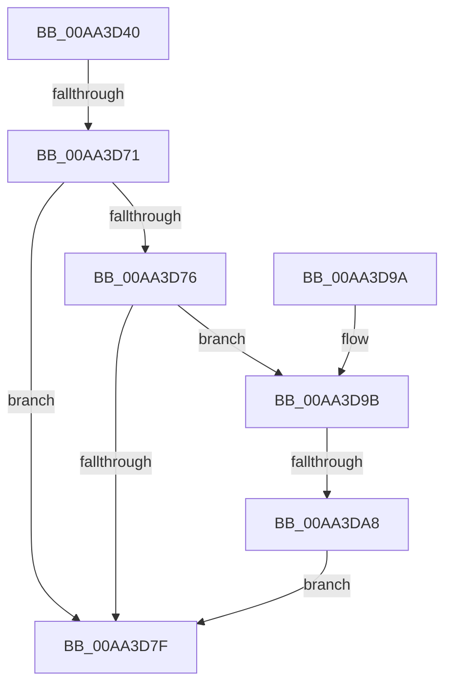

# PiDmaGuardProcessPostRemove

- RVA: `0x00AA3D40`–`0x00AA3DB7` (길이 `119` bytes)
- VA: `0x0000000140AA3D40`
- 실행 섹션: `PAGE`
- PDB 이름 있음: `예`; PDB Function 태그: `예`
- unwind 정보 RVA: `0x000BB47C`
- 디코드: `32`개 명령, `119/119` bytes 표시
- 미해석 바이트: `0` (있으면 어셈블리에 `.byte`로 보존)

> 이 문서는 커널 이미지의 기계어와 PDB 기호를 분석해 생성했습니다. 4번과 5번은 함수 원형과 자료형을 바이너리 사용 방식에서 추정한 C 해석이며 원본 소스 복구 결과는 아닙니다.

## 1. Dependencies

- 직접 호출 지점: **2**; 고유 호출 대상: **2**
- 직접 호출자로 확인된 함수: **1**
- RIP 상대 이미지 참조: **1**

### Outgoing calls
- `0x00AA3DAB` → [PiDmaGuardQueueInsertEntry](../74/PiDmaGuardQueueInsertEntry_function_007445F0.md) (function, `0x007445F0`)
- `0x00AA3DB0` → [PipDmgReevaluateQueue](../73/PipDmgReevaluateQueue_function_0073C1A4.md) (function, `0x0073C1A4`)

### Direct callers
- [PnpRemoveLockedDeviceNode](../../text/47/PnpRemoveLockedDeviceNode_function_004702AC.md) at `0x00470421`

### Static image references
- `0x00AA3D76` → RVA `0x00F8A9AC` (`.data`; read)

## 2. Other-region calls and transfers

- 다른 실행 섹션으로 향하는 call: **0**
- call이 아닌 외부 분기/꼬리 이동: **2**
  - `0x00AA3D6B` → [sub_00B49BD6](../B4/Unknown_function_00B49BD6.md) (`tail-transfer`)
  - `0x00AA3DA2` → [sub_00B49BD6 + 0xC2](../B4/Unknown_function_00B49BD6.md) (`tail-transfer`)

## 3. Assembly (complete function range)

```asm
00AA3D40  48 8B C4                        mov rax, rsp
00AA3D43  48 89 58 08                     mov qword ptr [rax + 8], rbx
00AA3D47  48 89 68 10                     mov qword ptr [rax + 0x10], rbp
00AA3D4B  48 89 70 18                     mov qword ptr [rax + 0x18], rsi
00AA3D4F  48 89 78 20                     mov qword ptr [rax + 0x20], rdi
00AA3D53  41 56                           push r14
00AA3D55  48 83 EC 30                     sub rsp, 0x30
00AA3D59  45 33 F6                        xor r14d, r14d
00AA3D5C  41 8A F0                        mov sil, r8b
00AA3D5F  8B FA                           mov edi, edx
00AA3D61  48 8B D9                        mov rbx, rcx
00AA3D64  4C 39 B1 D0 02 00 00            cmp qword ptr [rcx + 0x2d0], r14
00AA3D6B  0F 85 65 5E 0A 00               jne 0x140b49bd6
00AA3D71  40 84 F6                        test sil, sil
00AA3D74  74 09                           je 0x140aa3d7f
00AA3D76  44 39 35 2F 6C 4E 00            cmp dword ptr [rip + 0x4e6c2f], r14d
00AA3D7D  75 1C                           jne 0x140aa3d9b
00AA3D7F  48 8B 5C 24 40                  mov rbx, qword ptr [rsp + 0x40]
00AA3D84  48 8B 6C 24 48                  mov rbp, qword ptr [rsp + 0x48]
00AA3D89  48 8B 74 24 50                  mov rsi, qword ptr [rsp + 0x50]
00AA3D8E  48 8B 7C 24 58                  mov rdi, qword ptr [rsp + 0x58]
00AA3D93  48 83 C4 30                     add rsp, 0x30
00AA3D97  41 5E                           pop r14
00AA3D99  C3                              ret
00AA3D9A  CC                              int3
00AA3D9B  48 8B 4B 20                     mov rcx, qword ptr [rbx + 0x20]
00AA3D9F  83 FF 37                        cmp edi, 0x37
00AA3DA2  0F 85 F0 5E 0A 00               jne 0x140b49c98
00AA3DA8  8D 57 CF                        lea edx, [rdi - 0x31]
00AA3DAB  E8 40 08 CA FF                  call 0x1407445f0
00AA3DB0  E8 EF 83 C9 FF                  call 0x14073c1a4
00AA3DB5  EB C8                           jmp 0x140aa3d7f
```

## 4. C-style interpretation (structured pseudocode)

```c
__int64 __fastcall PiDmaGuardProcessPostRemove(__int64 a1, int a2, unsigned __int8 a3)
{
    __int64 result;
    __int64 v_r14;
    __int64 v_rsp;
    unsigned __int64 v_stack_p10;
    unsigned __int64 v_stack_p18;
    unsigned __int64 v_stack_p20;
    unsigned __int64 v_stack_p8;

    *(unsigned __int64 *)(v_rsp + 8) = v_rbx;
    *(unsigned __int64 *)(v_rsp + 16) = v_rbp;
    *(unsigned __int64 *)(v_rsp + 24) = v_rsi;
    *(unsigned __int64 *)(v_rsp + 32) = v_rdi;
    v_rsp = (v_rsp) - (48);
    v_r14 = 0;
    if (a3 == 0) goto loc_00AA3D7F;
    if ((*(unsigned int *)(v_rip + 5139503)) != 0) goto loc_00AA3D9B;
loc_00AA3D7F:
    v_rsp = (v_rsp) + (48);
    return v_rsp;
loc_00AA3D9B:
    result = PiDmaGuardQueueInsertEntry(*(unsigned __int64 *)(v_stack_p8 + 32), v_stack_p20 - 49, a3, a4);
    result = PipDmgReevaluateQueue(*(unsigned __int64 *)(v_stack_p8 + 32), v_stack_p20 - 49, a3, a4);
    goto loc_00AA3D7F;
}
```

## 5. (Beta) C Style

```c
int64_t PiDmaGuardProcessPostRemove(void *Arg1, int32_t Arg2, uint8_t Arg3)
{
    uint8_t *arg1 = (uint8_t *)Arg1;

    int64_t result;
    int64_t local_r14;
    int64_t local_rsp;
    uint64_t v_stack_p10;
    uint64_t v_stack_p18;
    uint64_t v_stack_p20;
    uint64_t v_stack_p8;

    *(uint64_t *)(local_rsp + 0x8) = local_rbx;
    *(uint64_t *)(local_rsp + 0x10) = local_rbp;
    *(uint64_t *)(local_rsp + 0x18) = local_rsi;
    *(uint64_t *)(local_rsp + 0x20) = local_rdi;
    local_rsp = (local_rsp) - (48);
    local_r14 = 0;
    if (Arg3 == 0) goto loc_00AA3D7F;
    if ((*(uint32_t *)(v_rip + 0x4E6C2F)) != 0) goto loc_00AA3D9B;
loc_00AA3D7F:
    local_rsp = (local_rsp) + (48);
    return local_rsp;
loc_00AA3D9B:
    result = PiDmaGuardQueueInsertEntry(*(uint64_t *)(v_stack_p8 + 0x20), v_stack_p20 - 49, Arg3, a4);
    result = PipDmgReevaluateQueue(*(uint64_t *)(v_stack_p8 + 0x20), v_stack_p20 - 49, Arg3, a4);
    goto loc_00AA3D7F;
}
```

### 관측된 메모리 오프셋

구조체 형식이 확인되지 않은 접근은 인자 기준의 오프셋으로만 기록했습니다.

| 기준 인자 | 오프셋 표현 | 폭 (bit) | 접근 |
|---|---:|---:|---|
| `Arg1` | `+ 0x20` | `64` | `R` |
| `Arg1` | `+ 0x2D0` | `64` | `R` |

## 6. Execution-region graph

[열기: 2D/3D 그래프와 함수 탐색 컨트롤 패널](../../../control-panel.html?section=page&rva=0x00AA3D40&view=graph)

- 2D 그래프는 위에서 아래로 흐르고, 3D 그래프는 빈 공간을 드래그해 회전합니다. Shift+드래그는 이동, 휠은 확대·축소, 함수 노드 선택은 대상 보고서 이동입니다.

### Static fallback


