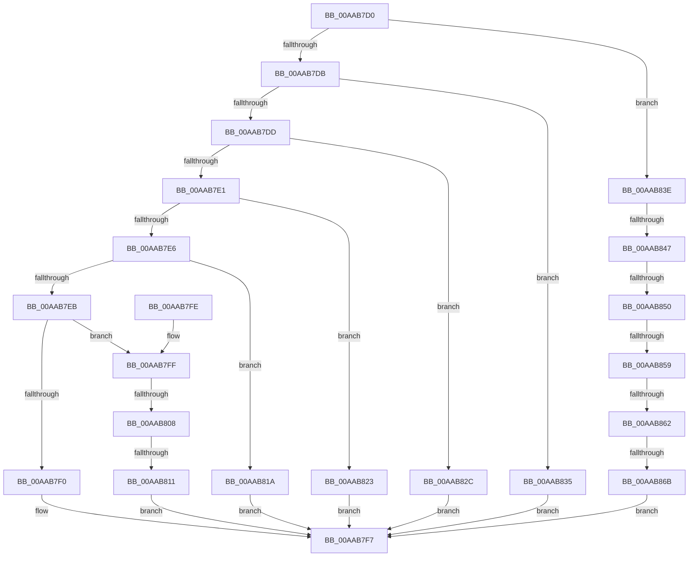

# PiDqConvertObjectTypeToString

- RVA: `0x00AAB7D0`–`0x00AAB874` (길이 `164` bytes)
- VA: `0x0000000140AAB7D0`
- 실행 섹션: `PAGE`
- PDB 이름 있음: `예`; PDB Function 태그: `예`
- unwind 정보 RVA: `0x000DB714`
- 디코드: `44`개 명령, `164/164` bytes 표시
- 미해석 바이트: `0` (있으면 어셈블리에 `.byte`로 보존)

> 이 문서는 커널 이미지의 기계어와 PDB 기호를 분석해 생성했습니다. 4번과 5번은 함수 원형과 자료형을 바이너리 사용 방식에서 추정한 C 해석이며 원본 소스 복구 결과는 아닙니다.

## 1. Dependencies

- 직접 호출 지점: **0**; 고유 호출 대상: **0**
- 직접 호출자로 확인된 함수: **1**
- RIP 상대 이미지 참조: **7**

### Outgoing calls
- 직접 디코드된 call 명령이 없습니다.

### Direct callers
- [sub_00B1C93A](../B1/Unknown_function_00B1C93A.md) at `0x00B1C959`

### Static image references
- `0x00AAB7F0` → RVA `0x00AFE540` (` ?? ::NNGAKEGL::`string'`; read)
- `0x00AAB811` → RVA `0x00AFE680` (` ?? ::NNGAKEGL::`string'`; read)
- `0x00AAB81A` → RVA `0x00AFE520` (` ?? ::NNGAKEGL::`string'`; read)
- `0x00AAB823` → RVA `0x00AFE500` (` ?? ::NNGAKEGL::`string'`; read)
- `0x00AAB82C` → RVA `0x00AFE5E0` (` ?? ::NNGAKEGL::`string'`; read)
- `0x00AAB835` → RVA `0x00AFE690` (` ?? ::NNGAKEGL::`string'`; read)
- `0x00AAB86B` → RVA `0x00AFE640` (` ?? ::NNGAKEGL::`string'`; read)

## 2. Other-region calls and transfers

- 다른 실행 섹션으로 향하는 call: **0**
- call이 아닌 외부 분기/꼬리 이동: **7**
  - `0x00AAB802` → `0x00B4A5B0` (`tail-transfer`)
  - `0x00AAB80B` → `0x00B4A5BC` (`tail-transfer`)
  - `0x00AAB841` → `0x00B4A5EB` (`tail-transfer`)
  - `0x00AAB84A` → `0x00B4A5DF` (`tail-transfer`)
  - `0x00AAB853` → `0x00B4A5D3` (`tail-transfer`)
  - `0x00AAB85C` → `0x00B4A5C7` (`tail-transfer`)
  - `0x00AAB865` → `0x00B4A5BC` (`tail-transfer`)

## 3. Assembly (complete function range)

```asm
00AAB7D0  45 33 C0                        xor r8d, r8d
00AAB7D3  4C 89 02                        mov qword ptr [rdx], r8
00AAB7D6  83 F9 06                        cmp ecx, 6
00AAB7D9  7F 63                           jg 0x140aab83e
00AAB7DB  74 58                           je 0x140aab835
00AAB7DD  85 C9                           test ecx, ecx
00AAB7DF  74 4B                           je 0x140aab82c
00AAB7E1  83 E9 01                        sub ecx, 1
00AAB7E4  74 3D                           je 0x140aab823
00AAB7E6  83 E9 01                        sub ecx, 1
00AAB7E9  74 2F                           je 0x140aab81a
00AAB7EB  83 E9 01                        sub ecx, 1
00AAB7EE  75 0F                           jne 0x140aab7ff
00AAB7F0  48 8D 05 49 2D 05 00            lea rax, [rip + 0x52d49]
00AAB7F7  48 89 02                        mov qword ptr [rdx], rax
00AAB7FA  41 8B C0                        mov eax, r8d
00AAB7FD  C3                              ret
00AAB7FE  CC                              int3
00AAB7FF  83 E9 01                        sub ecx, 1
00AAB802  0F 84 A8 ED 09 00               je 0x140b4a5b0
00AAB808  83 F9 01                        cmp ecx, 1
00AAB80B  0F 85 AB ED 09 00               jne 0x140b4a5bc
00AAB811  48 8D 05 68 2E 05 00            lea rax, [rip + 0x52e68]
00AAB818  EB DD                           jmp 0x140aab7f7
00AAB81A  48 8D 05 FF 2C 05 00            lea rax, [rip + 0x52cff]
00AAB821  EB D4                           jmp 0x140aab7f7
00AAB823  48 8D 05 D6 2C 05 00            lea rax, [rip + 0x52cd6]
00AAB82A  EB CB                           jmp 0x140aab7f7
00AAB82C  48 8D 05 AD 2D 05 00            lea rax, [rip + 0x52dad]
00AAB833  EB C2                           jmp 0x140aab7f7
00AAB835  48 8D 05 54 2E 05 00            lea rax, [rip + 0x52e54]
00AAB83C  EB B9                           jmp 0x140aab7f7
00AAB83E  83 E9 07                        sub ecx, 7
00AAB841  0F 84 A4 ED 09 00               je 0x140b4a5eb
00AAB847  83 E9 01                        sub ecx, 1
00AAB84A  0F 84 8F ED 09 00               je 0x140b4a5df
00AAB850  83 E9 01                        sub ecx, 1
00AAB853  0F 84 7A ED 09 00               je 0x140b4a5d3
00AAB859  83 E9 01                        sub ecx, 1
00AAB85C  0F 84 65 ED 09 00               je 0x140b4a5c7
00AAB862  83 F9 01                        cmp ecx, 1
00AAB865  0F 85 51 ED 09 00               jne 0x140b4a5bc
00AAB86B  48 8D 05 CE 2D 05 00            lea rax, [rip + 0x52dce]
00AAB872  EB 83                           jmp 0x140aab7f7
```

## 4. C-style interpretation (structured pseudocode)

```c
__int64 __fastcall PiDqConvertObjectTypeToString(int a1, __int64 a2, int a3)
{
    a3 = 0;
    *(unsigned __int64 *)(a2) = 0;
    if (a1 > 6) goto loc_00AAB83E;
    if (a1 == 6) goto loc_00AAB835;
    if (a1 == 0) goto loc_00AAB82C;
    a1 = (unsigned int)((a1) - (1));
    if (condition_is_equal) goto loc_00AAB823;
    a1 = (unsigned int)((a1) - (1));
    if (condition_is_equal) goto loc_00AAB81A;
    a1 = (unsigned int)((a1) - (1));
    if (condition_is_not_equal) goto loc_00AAB7FF;
loc_00AAB7F7:
    *(unsigned __int64 *)(a2) = v_rip + 339273;
    return 0;
loc_00AAB7FF:
    a1 = (unsigned int)((a1) - (1));
    goto loc_00AAB7F7;
loc_00AAB81A:
    goto loc_00AAB7F7;
loc_00AAB823:
    goto loc_00AAB7F7;
loc_00AAB82C:
    goto loc_00AAB7F7;
loc_00AAB835:
    goto loc_00AAB7F7;
loc_00AAB83E:
    a1 = (unsigned int)((a1) - (7));
    a1 = (unsigned int)((a1) - (1));
    a1 = (unsigned int)((a1) - (1));
    a1 = (unsigned int)((a1) - (1));
    goto loc_00AAB7F7;
}
```

## 5. (Beta) C Style

```c
int64_t PiDqConvertObjectTypeToString(int32_t Arg1, void *Arg2, int32_t Arg3)
{
    uint8_t *arg2 = (uint8_t *)Arg2;

    Arg3 = 0;
    *(uint64_t *)(arg2) = 0;
    if (Arg1 > 6) goto loc_00AAB83E;
    if (Arg1 == 6) goto loc_00AAB835;
    if (Arg1 == 0) goto loc_00AAB82C;
    Arg1 = (uint32_t)((Arg1) - (1));
    if (condition_is_equal) goto loc_00AAB823;
    Arg1 = (uint32_t)((Arg1) - (1));
    if (condition_is_equal) goto loc_00AAB81A;
    Arg1 = (uint32_t)((Arg1) - (1));
    if (condition_is_not_equal) goto loc_00AAB7FF;
loc_00AAB7F7:
    *(uint64_t *)(arg2) = v_rip + 339273;
    return 0;
loc_00AAB7FF:
    Arg1 = (uint32_t)((Arg1) - (1));
    goto loc_00AAB7F7;
loc_00AAB81A:
    goto loc_00AAB7F7;
loc_00AAB823:
    goto loc_00AAB7F7;
loc_00AAB82C:
    goto loc_00AAB7F7;
loc_00AAB835:
    goto loc_00AAB7F7;
loc_00AAB83E:
    Arg1 = (uint32_t)((Arg1) - (7));
    Arg1 = (uint32_t)((Arg1) - (1));
    Arg1 = (uint32_t)((Arg1) - (1));
    Arg1 = (uint32_t)((Arg1) - (1));
    goto loc_00AAB7F7;
}
```

### 관측된 메모리 오프셋

구조체 형식이 확인되지 않은 접근은 인자 기준의 오프셋으로만 기록했습니다.

| 기준 인자 | 오프셋 표현 | 폭 (bit) | 접근 |
|---|---:|---:|---|
| `Arg2` | `+ 0x0` | `64` | `W` |

## 6. Execution-region graph

[열기: 2D/3D 그래프와 함수 탐색 컨트롤 패널](../../../control-panel.html?section=page&rva=0x00AAB7D0&view=graph)

- 2D 그래프는 위에서 아래로 흐르고, 3D 그래프는 빈 공간을 드래그해 회전합니다. Shift+드래그는 이동, 휠은 확대·축소, 함수 노드 선택은 대상 보고서 이동입니다.

### Static fallback


