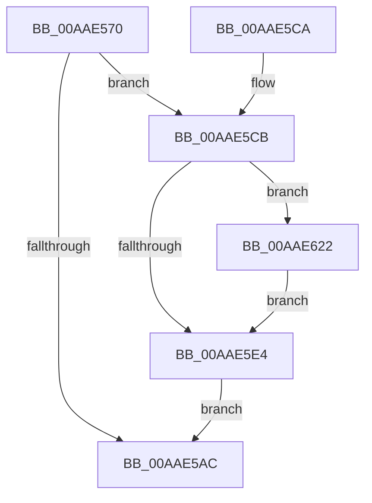

# PiDrvDbUnloadNodeWorkerCallback

- RVA: `0x00AAE570`–`0x00AAE62E` (길이 `190` bytes)
- VA: `0x0000000140AAE570`
- 실행 섹션: `PAGE`
- PDB 이름 있음: `예`; PDB Function 태그: `아니요`
- unwind 정보 RVA: `0x000BC2EC`
- 디코드: `44`개 명령, `190/190` bytes 표시
- 미해석 바이트: `0` (있으면 어셈블리에 `.byte`로 보존)

> 이 문서는 커널 이미지의 기계어와 PDB 기호를 분석해 생성했습니다. 4번과 5번은 함수 원형과 자료형을 바이너리 사용 방식에서 추정한 C 해석이며 원본 소스 복구 결과는 아닙니다.

## 1. Dependencies

- 직접 호출 지점: **8**; 고유 호출 대상: **7**
- 직접 호출자로 확인된 함수: **0**
- RIP 상대 이미지 참조: **3**

### Outgoing calls
- `0x00AAE582` → [PiDrvDbUnloadNodeReset](../../text/4E/PiDrvDbUnloadNodeReset_function_004E3F84.md) (function, `0x004E3F84`)
- `0x00AAE59E` → [ExAcquireResourceExclusiveLite](../../text/21/ExAcquireResourceExclusiveLite_function_00214E20.md) (function, `0x00214E20`)
- `0x00AAE5B0` → [ExReleaseResourceLite](../../text/25/ExReleaseResourceLite_function_0025FA10.md) (function, `0x0025FA10`)
- `0x00AAE5B5` → [KeLeaveCriticalRegion](../../text/25/KeLeaveCriticalRegion_function_0025D8B0.md) (function, `0x0025D8B0`)
- `0x00AAE5D6` → [PnpDiagnosticTraceObject](../../text/26/PnpDiagnosticTraceObject_function_0026E834.md) (function, `0x0026E834`)
- `0x00AAE5F7` → [PnpDiagnosticTraceObject](../../text/26/PnpDiagnosticTraceObject_function_0026E834.md) (function, `0x0026E834`)
- `0x00AAE61B` → [ExQueueWorkItem](../../text/2F/ExQueueWorkItem_function_002F9520.md) (function, `0x002F9520`)
- `0x00AAE622` → [ZwClose](../../text/6A/ZwClose_function_006AD2B0.md) (function, `0x006AD2B0`)

### Direct callers
- 이 함수 시작 RVA로 연결되는 직접 call은 확인되지 않았습니다. 간접 호출은 완전히 역산할 수 없습니다.

### Static image references
- `0x00AAE5CF` → RVA `0x0001E120` (`.rdata`; read)
- `0x00AAE5F0` → RVA `0x0001E110` (`.rdata`; read)
- `0x00AAE60C` → RVA `0x005AA910` (`PiDrvDbUnloadNodeWaitWorkerCallback`; read)

## 2. Other-region calls and transfers

- 다른 실행 섹션으로 향하는 call: **8**
  - `0x00AAE582` → [PiDrvDbUnloadNodeReset](../../text/4E/PiDrvDbUnloadNodeReset_function_004E3F84.md) (`PAGE` → `.text`)
  - `0x00AAE59E` → [ExAcquireResourceExclusiveLite](../../text/21/ExAcquireResourceExclusiveLite_function_00214E20.md) (`PAGE` → `.text`)
  - `0x00AAE5B0` → [ExReleaseResourceLite](../../text/25/ExReleaseResourceLite_function_0025FA10.md) (`PAGE` → `.text`)
  - `0x00AAE5B5` → [KeLeaveCriticalRegion](../../text/25/KeLeaveCriticalRegion_function_0025D8B0.md) (`PAGE` → `.text`)
  - `0x00AAE5D6` → [PnpDiagnosticTraceObject](../../text/26/PnpDiagnosticTraceObject_function_0026E834.md) (`PAGE` → `.text`)
  - `0x00AAE5F7` → [PnpDiagnosticTraceObject](../../text/26/PnpDiagnosticTraceObject_function_0026E834.md) (`PAGE` → `.text`)
  - `0x00AAE61B` → [ExQueueWorkItem](../../text/2F/ExQueueWorkItem_function_002F9520.md) (`PAGE` → `.text`)
  - `0x00AAE622` → [ZwClose](../../text/6A/ZwClose_function_006AD2B0.md) (`PAGE` → `.text`)
- 별도 외부 분기/꼬리 이동을 확인하지 못했습니다.

## 3. Assembly (complete function range)

```asm
00AAE570  48 89 5C 24 08                  mov qword ptr [rsp + 8], rbx
00AAE575  48 89 74 24 10                  mov qword ptr [rsp + 0x10], rsi
00AAE57A  57                              push rdi
00AAE57B  48 83 EC 20                     sub rsp, 0x20
00AAE57F  48 8B D9                        mov rbx, rcx
00AAE582  E8 FD 59 A3 FF                  call 0x1404e3f84
00AAE587  65 48 8B 04 25 88 01 00 00      mov rax, qword ptr gs:[0x188]
00AAE590  48 8D 4B 58                     lea rcx, [rbx + 0x58]
00AAE594  B2 01                           mov dl, 1
00AAE596  66 FF 88 E4 01 00 00            dec word ptr [rax + 0x1e4]
00AAE59D  90                              nop
00AAE59E  E8 7D 68 76 FF                  call 0x140214e20
00AAE5A3  80 BB E8 01 00 00 00            cmp byte ptr [rbx + 0x1e8], 0
00AAE5AA  75 1F                           jne 0x140aae5cb
00AAE5AC  48 8D 4B 58                     lea rcx, [rbx + 0x58]
00AAE5B0  E8 5B 14 7B FF                  call 0x14025fa10
00AAE5B5  E8 F6 F2 7A FF                  call 0x14025d8b0
00AAE5BA  48 8B 5C 24 30                  mov rbx, qword ptr [rsp + 0x30]
00AAE5BF  48 8B 74 24 38                  mov rsi, qword ptr [rsp + 0x38]
00AAE5C4  48 83 C4 20                     add rsp, 0x20
00AAE5C8  5F                              pop rdi
00AAE5C9  C3                              ret
00AAE5CA  CC                              int3
00AAE5CB  48 8D 53 10                     lea rdx, [rbx + 0x10]
00AAE5CF  48 8D 0D 4A FB 56 FF            lea rcx, [rip - 0xa904b6]
00AAE5D6  E8 59 02 7C FF                  call 0x14026e834
00AAE5DB  48 8B 4B 48                     mov rcx, qword ptr [rbx + 0x48]
00AAE5DF  48 85 C9                        test rcx, rcx
00AAE5E2  75 3E                           jne 0x140aae622
00AAE5E4  66 83 A3 E8 01 00 00 00         and word ptr [rbx + 0x1e8], 0
00AAE5EC  48 8D 53 10                     lea rdx, [rbx + 0x10]
00AAE5F0  48 8D 0D 19 FB 56 FF            lea rcx, [rip - 0xa904e7]
00AAE5F7  E8 38 02 7C FF                  call 0x14026e834
00AAE5FC  48 8D 8B B8 01 00 00            lea rcx, [rbx + 0x1b8]
00AAE603  BA 01 00 00 00                  mov edx, 1
00AAE608  48 83 21 00                     and qword ptr [rcx], 0
00AAE60C  48 8D 05 FD C2 AF FF            lea rax, [rip - 0x503d03]
00AAE613  48 89 41 10                     mov qword ptr [rcx + 0x10], rax
00AAE617  48 89 59 18                     mov qword ptr [rcx + 0x18], rbx
00AAE61B  E8 00 AF 84 FF                  call 0x1402f9520
00AAE620  EB 8A                           jmp 0x140aae5ac
00AAE622  E8 89 EC BF FF                  call 0x1406ad2b0
00AAE627  48 83 63 48 00                  and qword ptr [rbx + 0x48], 0
00AAE62C  EB B6                           jmp 0x140aae5e4
```

## 4. C-style interpretation (structured pseudocode)

```c
__int64 __fastcall PiDrvDbUnloadNodeWorkerCallback(__int64 a1)
{
    __int64 result;
    __int64 v_rsp;
    unsigned __int64 v_stack_p10;
    unsigned __int64 v_stack_p8;

    v_stack_p8 = v_rbx;
    v_stack_p10 = v_rsi;
    v_rsp = (v_rsp) - (32);
    result = PiDrvDbUnloadNodeReset(a1, a2, a3, a4);
    result = ExAcquireResourceExclusiveLite(a1 + 88, 1, a3, a4);
    if ((*(unsigned __int8 *)(a1 + 488)) != 0) goto loc_00AAE5CB;
loc_00AAE5AC:
    result = ExReleaseResourceLite(a1 + 88, 1, a3, a4);
    result = KeLeaveCriticalRegion(a1 + 88, 1, a3, a4);
    v_rsp = (v_rsp) + (32);
    return result;
loc_00AAE5CB:
    result = PnpDiagnosticTraceObject(v_rip - 11076790, v_stack_p8 + 16, a3, a4);
    if (*(unsigned __int64 *)(v_stack_p8 + 72) != 0) goto loc_00AAE622;
loc_00AAE5E4:
    result = PnpDiagnosticTraceObject(v_rip - 11076839, v_stack_p8 + 16, a3, a4);
    *(unsigned __int64 *)(v_stack_p8 + 440 + 16) = v_rip - 5258499;
    *(unsigned __int64 *)(v_stack_p8 + 440 + 24) = v_stack_p8;
    result = ExQueueWorkItem(v_stack_p8 + 440, 1, a3, a4);
    goto loc_00AAE5AC;
loc_00AAE622:
    result = ZwClose(v_stack_p8 + 440, 1, a3, a4);
    goto loc_00AAE5E4;
}
```

## 5. (Beta) C Style

```c
int64_t PiDrvDbUnloadNodeWorkerCallback(void *Arg1)
{
    uint8_t *arg1 = (uint8_t *)Arg1;

    int64_t result;
    int64_t local_rsp;
    uint64_t v_stack_p10;
    uint64_t v_stack_p8;

    v_stack_p8 = local_rbx;
    v_stack_p10 = local_rsi;
    local_rsp = (local_rsp) - (32);
    result = PiDrvDbUnloadNodeReset(Arg1, a2, a3, a4);
    result = ExAcquireResourceExclusiveLite(Arg1 + 88, 1, a3, a4);
    if ((*(uint8_t *)(arg1 + 0x1E8)) != 0) goto loc_00AAE5CB;
loc_00AAE5AC:
    result = ExReleaseResourceLite(Arg1 + 88, 1, a3, a4);
    result = KeLeaveCriticalRegion(Arg1 + 88, 1, a3, a4);
    local_rsp = (local_rsp) + (32);
    return result;
loc_00AAE5CB:
    result = PnpDiagnosticTraceObject(v_rip - 11076790, v_stack_p8 + 16, a3, a4);
    if (*(uint64_t *)(v_stack_p8 + 0x48) != 0) goto loc_00AAE622;
loc_00AAE5E4:
    result = PnpDiagnosticTraceObject(v_rip - 11076839, v_stack_p8 + 16, a3, a4);
    *(uint64_t *)(v_stack_p8 + 0x1B8 + 0x10) = v_rip - 5258499;
    *(uint64_t *)(v_stack_p8 + 0x1B8 + 0x18) = v_stack_p8;
    result = ExQueueWorkItem(v_stack_p8 + 440, 1, a3, a4);
    goto loc_00AAE5AC;
loc_00AAE622:
    result = ZwClose(v_stack_p8 + 440, 1, a3, a4);
    goto loc_00AAE5E4;
}
```

### 관측된 메모리 오프셋

구조체 형식이 확인되지 않은 접근은 인자 기준의 오프셋으로만 기록했습니다.

| 기준 인자 | 오프셋 표현 | 폭 (bit) | 접근 |
|---|---:|---:|---|
| `Arg1` | `+ 0x0` | `64` | `R/W` |
| `Arg1` | `+ 0x10` | `64` | `R` |
| `Arg1` | `+ 0x10` | `64` | `W` |
| `Arg1` | `+ 0x18` | `64` | `W` |
| `Arg1` | `+ 0x48` | `64` | `R` |
| `Arg1` | `+ 0x48` | `64` | `R/W` |
| `Arg1` | `+ 0x58` | `64` | `R` |
| `Arg1` | `+ 0x1B8` | `64` | `R` |
| `Arg1` | `+ 0x1E8` | `8` | `R` |
| `Arg1` | `+ 0x1E8` | `16` | `R/W` |

## 6. Execution-region graph

[열기: 2D/3D 그래프와 함수 탐색 컨트롤 패널](../../../control-panel.html?section=page&rva=0x00AAE570&view=graph)

- 2D 그래프는 위에서 아래로 흐르고, 3D 그래프는 빈 공간을 드래그해 회전합니다. Shift+드래그는 이동, 휠은 확대·축소, 함수 노드 선택은 대상 보고서 이동입니다.

### Static fallback


