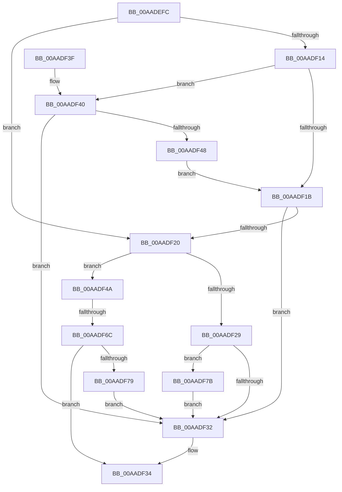

# PiIommuUnblockDevice

- RVA: `0x00AADEFC`–`0x00AADF81` (길이 `133` bytes)
- VA: `0x0000000140AADEFC`
- 실행 섹션: `PAGE`
- PDB 이름 있음: `예`; PDB Function 태그: `예`
- unwind 정보 RVA: `0x0007013C`
- 디코드: `39`개 명령, `133/133` bytes 표시
- 미해석 바이트: `0` (있으면 어셈블리에 `.byte`로 보존)

> 이 문서는 커널 이미지의 기계어와 PDB 기호를 분석해 생성했습니다. 4번과 5번은 함수 원형과 자료형을 바이너리 사용 방식에서 추정한 C 해석이며 원본 소스 복구 결과는 아닙니다.

## 1. Dependencies

- 직접 호출 지점: **1**; 고유 호출 대상: **1**
- 직접 호출자로 확인된 함수: **2**
- RIP 상대 이미지 참조: **3**

### Outgoing calls
- `0x00AADF5C` → [guard_dispatch_icall](../../text/6B/guard_dispatch_icall_function_006BAAD0.md) (function, `0x006BAAD0`)

### Direct callers
- [PnpIommuBlockUnblockDevice](../74/PnpIommuBlockUnblockDevice_function_00740408.md) at `0x00740470`
- [PiDmaGuardProcessPreStart](../8F/PiDmaGuardProcessPreStart_function_008FE304.md) at `0x008FE33E`

### Static image references
- `0x00AADF20` → RVA `0x00F8A9A8` (`.data`; read)
- `0x00AADF29` → RVA `0x00F8B408` (`.data`; read)
- `0x00AADF55` → RVA `0x00E00C28` (`.data`; read)

## 2. Other-region calls and transfers

- 다른 실행 섹션으로 향하는 call: **1**
  - `0x00AADF5C` → [guard_dispatch_icall](../../text/6B/guard_dispatch_icall_function_006BAAD0.md) (`PAGE` → `.text`)
- call이 아닌 외부 분기/꼬리 이동: **1**
  - `0x00AADF66` → [sub_00B4A830](../B4/Unknown_function_00B4A830.md) (`tail-transfer`)

## 3. Assembly (complete function range)

```asm
00AADEFC  48 89 5C 24 08                  mov qword ptr [rsp + 8], rbx
00AADF01  57                              push rdi
00AADF02  48 83 EC 20                     sub rsp, 0x20
00AADF06  48 8B 99 D0 02 00 00            mov rbx, qword ptr [rcx + 0x2d0]
00AADF0D  48 8B F9                        mov rdi, rcx
00AADF10  84 D2                           test dl, dl
00AADF12  75 0C                           jne 0x140aadf20
00AADF14  B2 01                           mov dl, 1
00AADF16  84 53 10                        test byte ptr [rbx + 0x10], dl
00AADF19  75 25                           jne 0x140aadf40
00AADF1B  84 53 11                        test byte ptr [rbx + 0x11], dl
00AADF1E  75 12                           jne 0x140aadf32
00AADF20  80 3D 81 CA 4D 00 00            cmp byte ptr [rip + 0x4dca81], 0
00AADF27  75 21                           jne 0x140aadf4a
00AADF29  80 3D D8 D4 4D 00 00            cmp byte ptr [rip + 0x4dd4d8], 0
00AADF30  75 49                           jne 0x140aadf7b
00AADF32  33 C0                           xor eax, eax
00AADF34  48 8B 5C 24 30                  mov rbx, qword ptr [rsp + 0x30]
00AADF39  48 83 C4 20                     add rsp, 0x20
00AADF3D  5F                              pop rdi
00AADF3E  C3                              ret
00AADF3F  CC                              int3
00AADF40  48 8B 03                        mov rax, qword ptr [rbx]
00AADF43  84 50 04                        test byte ptr [rax + 4], dl
00AADF46  74 EA                           je 0x140aadf32
00AADF48  EB D1                           jmp 0x140aadf1b
00AADF4A  48 8B 51 20                     mov rdx, qword ptr [rcx + 0x20]
00AADF4E  4C 8D 43 08                     lea r8, [rbx + 8]
00AADF52  48 8B 0B                        mov rcx, qword ptr [rbx]
00AADF55  48 8B 05 CC 2C 35 00            mov rax, qword ptr [rip + 0x352ccc]
00AADF5C  E8 6F CB C0 FF                  call 0x1406baad0
00AADF61  3D 19 00 35 C0                  cmp eax, 0xc0350019
00AADF66  0F 85 C4 C8 09 00               jne 0x140b4a830
00AADF6C  48 8B 4F 20                     mov rcx, qword ptr [rdi + 0x20]
00AADF70  F7 41 30 00 00 00 02            test dword ptr [rcx + 0x30], 0x2000000
00AADF77  74 BB                           je 0x140aadf34
00AADF79  EB B7                           jmp 0x140aadf32
00AADF7B  80 4B 10 02                     or byte ptr [rbx + 0x10], 2
00AADF7F  EB B1                           jmp 0x140aadf32
```

## 4. C-style interpretation (structured pseudocode)

```c
__int64 __fastcall PiIommuUnblockDevice(__int64 a1, unsigned __int8 a2)
{
    __int64 result;
    __int64 v_rsp;
    unsigned __int64 v_stack_p8;

    v_stack_p8 = v_rbx;
    v_rsp = (v_rsp) - (32);
    if (a2 != 0) goto loc_00AADF20;
    if (((*(unsigned __int8 *)(*(unsigned __int64 *)(a1 + 720) + 16)) & (1)) != 0) goto loc_00AADF40;
loc_00AADF1B:
    if (((*(unsigned __int8 *)(*(unsigned __int64 *)(a1 + 720) + 17)) & (1)) != 0) goto loc_00AADF32;
loc_00AADF20:
    if ((*(unsigned __int8 *)(v_rip + 5098113)) != 0) goto loc_00AADF4A;
    if ((*(unsigned __int8 *)(v_rip + 5100760)) != 0) goto loc_00AADF7B;
loc_00AADF32:
    result = 0;
loc_00AADF34:
    v_rsp = (v_rsp) + (32);
    return result;
loc_00AADF40:
    if (((*(unsigned __int8 *)(*(unsigned __int64 *)(v_stack_p8) + 4)) & (1)) == 0) goto loc_00AADF32;
    goto loc_00AADF1B;
loc_00AADF4A:
    result = guard_dispatch_icall(*(unsigned __int64 *)(v_stack_p8), *(unsigned __int64 *)(a1 + 32), v_stack_p8 + 8, a4);
    if (((*(unsigned int *)(*(unsigned __int64 *)(a1 + 32) + 48)) & (0x2000000ULL)) == 0) goto loc_00AADF34;
    goto loc_00AADF32;
loc_00AADF7B:
    goto loc_00AADF32;
}
```

## 5. (Beta) C Style

```c
int64_t PiIommuUnblockDevice(void *Arg1, uint8_t Arg2)
{
    uint8_t *arg1 = (uint8_t *)Arg1;

    int64_t result;
    int64_t local_rsp;
    uint64_t v_stack_p8;

    v_stack_p8 = local_rbx;
    local_rsp = (local_rsp) - (32);
    if (Arg2 != 0) goto loc_00AADF20;
    if (((*(uint8_t *)(*(uint64_t *)(arg1 + 0x2D0) + 0x10)) & (1)) != 0) goto loc_00AADF40;
loc_00AADF1B:
    if (((*(uint8_t *)(*(uint64_t *)(arg1 + 0x2D0) + 0x11)) & (1)) != 0) goto loc_00AADF32;
loc_00AADF20:
    if ((*(uint8_t *)(v_rip + 0x4DCA81)) != 0) goto loc_00AADF4A;
    if ((*(uint8_t *)(v_rip + 0x4DD4D8)) != 0) goto loc_00AADF7B;
loc_00AADF32:
    result = 0;
loc_00AADF34:
    local_rsp = (local_rsp) + (32);
    return result;
loc_00AADF40:
    if (((*(uint8_t *)(*(uint64_t *)(v_stack_p8) + 0x4)) & (1)) == 0) goto loc_00AADF32;
    goto loc_00AADF1B;
loc_00AADF4A:
    result = guard_dispatch_icall(*(uint64_t *)(v_stack_p8), *(uint64_t *)(arg1 + 0x20), v_stack_p8 + 8, a4);
    if (((*(uint32_t *)(*(uint64_t *)(arg1 + 0x20) + 0x30)) & (0x2000000ULL)) == 0) goto loc_00AADF34;
    goto loc_00AADF32;
loc_00AADF7B:
    goto loc_00AADF32;
}
```

### 관측된 메모리 오프셋

구조체 형식이 확인되지 않은 접근은 인자 기준의 오프셋으로만 기록했습니다.

| 기준 인자 | 오프셋 표현 | 폭 (bit) | 접근 |
|---|---:|---:|---|
| `Arg1` | `+ 0x20` | `64` | `R` |
| `Arg1` | `+ 0x2D0` | `64` | `R` |

## 6. Execution-region graph

[열기: 2D/3D 그래프와 함수 탐색 컨트롤 패널](../../../control-panel.html?section=page&rva=0x00AADEFC&view=graph)

- 2D 그래프는 위에서 아래로 흐르고, 3D 그래프는 빈 공간을 드래그해 회전합니다. Shift+드래그는 이동, 휠은 확대·축소, 함수 노드 선택은 대상 보고서 이동입니다.

### Static fallback


