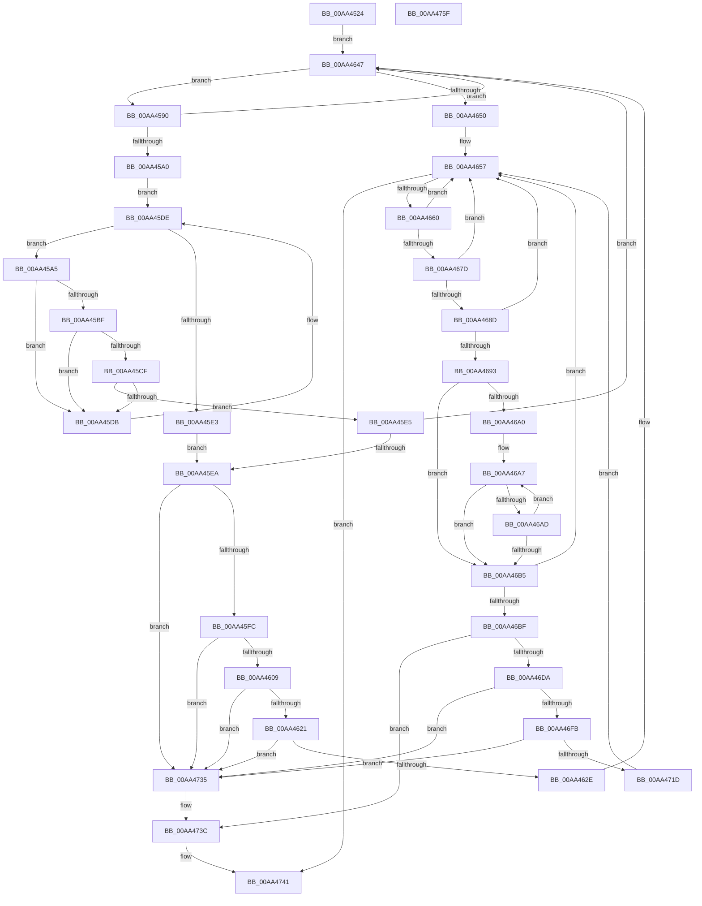

# PiQueryPowerDependencyRelations

- RVA: `0x00AA4524`–`0x00AA4760` (길이 `572` bytes)
- VA: `0x0000000140AA4524`
- 실행 섹션: `PAGE`
- PDB 이름 있음: `예`; PDB Function 태그: `아니요`
- unwind 정보 RVA: `0x000BB528`
- 디코드: `153`개 명령, `572/572` bytes 표시
- 미해석 바이트: `0` (있으면 어셈블리에 `.byte`로 보존)

> 이 문서는 커널 이미지의 기계어와 PDB 기호를 분석해 생성했습니다. 4번과 5번은 함수 원형과 자료형을 바이너리 사용 방식에서 추정한 C 해석이며 원본 소스 복구 결과는 아닙니다.

## 1. Dependencies

- 직접 호출 지점: **14**; 고유 호출 대상: **8**
- 직접 호출자로 확인된 함수: **1**
- RIP 상대 이미지 참조: **2**

### Outgoing calls
- `0x00AA455E` → [ExAcquireResourceSharedLite](../../text/21/ExAcquireResourceSharedLite_function_00211BC0.md) (function, `0x00211BC0`)
- `0x00AA456C` → [ExAcquireResourceSharedLite](../../text/21/ExAcquireResourceSharedLite_function_00211BC0.md) (function, `0x00211BC0`)
- `0x00AA4575` → [PiGetProviderList](../A0/PiGetProviderList_function_00A07140.md) (function, `0x00A07140`)
- `0x00AA45B0` → [PiEnumerateProviderListEntry](../72/PiEnumerateProviderListEntry_function_007277E4.md) (function, `0x007277E4`)
- `0x00AA45EA` → [PnpAcquirePowerRelationsQueueLock](../../text/4B/PnpAcquirePowerRelationsQueueLock_function_004B9534.md) (function, `0x004B9534`)
- `0x00AA4635` → [PnpReleasePowerRelationsQueueLock](../../text/4B/PnpReleasePowerRelationsQueueLock_function_004BE70C.md) (function, `0x004BE70C`)
- `0x00AA4642` → [ExFreePoolWithTag](../../poolcode/B8/ExFreePoolWithTag_function_00B82870.md) (function, `0x00B82870`)
- `0x00AA466B` → [PiEnumerateProviderListEntry](../72/PiEnumerateProviderListEntry_function_007277E4.md) (function, `0x007277E4`)
- `0x00AA4693` → [PnpAcquirePowerRelationsQueueLock](../../text/4B/PnpAcquirePowerRelationsQueueLock_function_004B9534.md) (function, `0x004B9534`)
- `0x00AA46B5` → [PnpReleasePowerRelationsQueueLock](../../text/4B/PnpReleasePowerRelationsQueueLock_function_004BE70C.md) (function, `0x004BE70C`)
- `0x00AA46CD` → [ExAllocatePool2](../../poolcode/B8/ExAllocatePool2_function_00B820F0.md) (function, `0x00B820F0`)
- `0x00AA46DA` → [PnpAcquirePowerRelationsQueueLock](../../text/4B/PnpAcquirePowerRelationsQueueLock_function_004B9534.md) (function, `0x004B9534`)
- `0x00AA472B` → [PnpReleasePowerRelationsQueueLock](../../text/4B/PnpReleasePowerRelationsQueueLock_function_004BE70C.md) (function, `0x004BE70C`)
- `0x00AA4741` → [PnpReleaseDependencyRelationsLock](../A0/PnpReleaseDependencyRelationsLock_function_00A06E14.md) (function, `0x00A06E14`)

### Direct callers
- [PiQueryPowerRelations](PiQueryPowerRelations_function_00AA3F9C.md) at `0x00AA445D`

### Static image references
- `0x00AA4548` → RVA `0x00F8C560` (`.data`; read)
- `0x00AA4565` → RVA `0x00F8CEA0` (`.data`; read)

## 2. Other-region calls and transfers

- 다른 실행 섹션으로 향하는 call: **10**
  - `0x00AA455E` → [ExAcquireResourceSharedLite](../../text/21/ExAcquireResourceSharedLite_function_00211BC0.md) (`PAGE` → `.text`)
  - `0x00AA456C` → [ExAcquireResourceSharedLite](../../text/21/ExAcquireResourceSharedLite_function_00211BC0.md) (`PAGE` → `.text`)
  - `0x00AA45EA` → [PnpAcquirePowerRelationsQueueLock](../../text/4B/PnpAcquirePowerRelationsQueueLock_function_004B9534.md) (`PAGE` → `.text`)
  - `0x00AA4635` → [PnpReleasePowerRelationsQueueLock](../../text/4B/PnpReleasePowerRelationsQueueLock_function_004BE70C.md) (`PAGE` → `.text`)
  - `0x00AA4642` → [ExFreePoolWithTag](../../poolcode/B8/ExFreePoolWithTag_function_00B82870.md) (`PAGE` → `POOLCODE`)
  - `0x00AA4693` → [PnpAcquirePowerRelationsQueueLock](../../text/4B/PnpAcquirePowerRelationsQueueLock_function_004B9534.md) (`PAGE` → `.text`)
  - `0x00AA46B5` → [PnpReleasePowerRelationsQueueLock](../../text/4B/PnpReleasePowerRelationsQueueLock_function_004BE70C.md) (`PAGE` → `.text`)
  - `0x00AA46CD` → [ExAllocatePool2](../../poolcode/B8/ExAllocatePool2_function_00B820F0.md) (`PAGE` → `POOLCODE`)
  - `0x00AA46DA` → [PnpAcquirePowerRelationsQueueLock](../../text/4B/PnpAcquirePowerRelationsQueueLock_function_004B9534.md) (`PAGE` → `.text`)
  - `0x00AA472B` → [PnpReleasePowerRelationsQueueLock](../../text/4B/PnpReleasePowerRelationsQueueLock_function_004BE70C.md) (`PAGE` → `.text`)
- 별도 외부 분기/꼬리 이동을 확인하지 못했습니다.

## 3. Assembly (complete function range)

```asm
00AA4524  48 89 5C 24 10                  mov qword ptr [rsp + 0x10], rbx
00AA4529  48 89 6C 24 18                  mov qword ptr [rsp + 0x18], rbp
00AA452E  56                              push rsi
00AA452F  57                              push rdi
00AA4530  41 55                           push r13
00AA4532  41 56                           push r14
00AA4534  41 57                           push r15
00AA4536  48 83 EC 20                     sub rsp, 0x20
00AA453A  65 48 8B 04 25 88 01 00 00      mov rax, qword ptr gs:[0x188]
00AA4543  48 8B D9                        mov rbx, rcx
00AA4546  33 FF                           xor edi, edi
00AA4548  48 8D 0D 11 80 4E 00            lea rcx, [rip + 0x4e8011]
00AA454F  B2 01                           mov dl, 1
00AA4551  48 89 7C 24 50                  mov qword ptr [rsp + 0x50], rdi
00AA4556  66 FF 88 E4 01 00 00            dec word ptr [rax + 0x1e4]
00AA455D  90                              nop
00AA455E  E8 5D D6 76 FF                  call 0x140211bc0
00AA4563  B2 01                           mov dl, 1
00AA4565  48 8D 0D 34 89 4E 00            lea rcx, [rip + 0x4e8934]
00AA456C  E8 4F D6 76 FF                  call 0x140211bc0
00AA4571  48 8B 4B 20                     mov rcx, qword ptr [rbx + 0x20]
00AA4575  E8 C6 2B F6 FF                  call 0x140a07140
00AA457A  4C 8D AB A0 00 00 00            lea r13, [rbx + 0xa0]
00AA4581  4C 8B F0                        mov r14, rax
00AA4584  4D 8D 7D 20                     lea r15, [r13 + 0x20]
00AA4588  49 8B 37                        mov rsi, qword ptr [r15]
00AA458B  E9 B7 00 00 00                  jmp 0x140aa4647
00AA4590  48 8B DE                        mov rbx, rsi
00AA4593  48 8B 36                        mov rsi, qword ptr [rsi]
00AA4596  40 38 7B 30                     cmp byte ptr [rbx + 0x30], dil
00AA459A  0F 84 A7 00 00 00               je 0x140aa4647
00AA45A0  4D 8B 1E                        mov r11, qword ptr [r14]
00AA45A3  EB 39                           jmp 0x140aa45de
00AA45A5  45 33 C0                        xor r8d, r8d
00AA45A8  48 8D 54 24 50                  lea rdx, [rsp + 0x50]
00AA45AD  49 8B CB                        mov rcx, r11
00AA45B0  E8 2F 32 C8 FF                  call 0x1407277e4
00AA45B5  48 8B 44 24 50                  mov rax, qword ptr [rsp + 0x50]
00AA45BA  48 85 C0                        test rax, rax
00AA45BD  74 1C                           je 0x140aa45db
00AA45BF  48 8B 80 38 01 00 00            mov rax, qword ptr [rax + 0x138]
00AA45C6  48 8B 40 28                     mov rax, qword ptr [rax + 0x28]
00AA45CA  48 85 C0                        test rax, rax
00AA45CD  74 0C                           je 0x140aa45db
00AA45CF  48 05 A0 00 00 00               add rax, 0xa0
00AA45D5  48 39 43 28                     cmp qword ptr [rbx + 0x28], rax
00AA45D9  74 0A                           je 0x140aa45e5
00AA45DB  4D 8B 1B                        mov r11, qword ptr [r11]
00AA45DE  4D 3B DE                        cmp r11, r14
00AA45E1  75 C2                           jne 0x140aa45a5
00AA45E3  EB 05                           jmp 0x140aa45ea
00AA45E5  4D 3B DE                        cmp r11, r14
00AA45E8  75 5D                           jne 0x140aa4647
00AA45EA  E8 45 4F A1 FF                  call 0x1404b9534
00AA45EF  48 8B 0B                        mov rcx, qword ptr [rbx]
00AA45F2  48 39 59 08                     cmp qword ptr [rcx + 8], rbx
00AA45F6  0F 85 39 01 00 00               jne 0x140aa4735
00AA45FC  48 8B 43 08                     mov rax, qword ptr [rbx + 8]
00AA4600  48 39 18                        cmp qword ptr [rax], rbx
00AA4603  0F 85 2C 01 00 00               jne 0x140aa4735
00AA4609  48 89 08                        mov qword ptr [rax], rcx
00AA460C  48 89 41 08                     mov qword ptr [rcx + 8], rax
00AA4610  48 8D 43 18                     lea rax, [rbx + 0x18]
00AA4614  48 8B 10                        mov rdx, qword ptr [rax]
00AA4617  48 39 42 08                     cmp qword ptr [rdx + 8], rax
00AA461B  0F 85 14 01 00 00               jne 0x140aa4735
00AA4621  48 8B 48 08                     mov rcx, qword ptr [rax + 8]
00AA4625  48 39 01                        cmp qword ptr [rcx], rax
00AA4628  0F 85 07 01 00 00               jne 0x140aa4735
00AA462E  48 89 11                        mov qword ptr [rcx], rdx
00AA4631  48 89 4A 08                     mov qword ptr [rdx + 8], rcx
00AA4635  E8 D2 A0 A1 FF                  call 0x1404be70c
00AA463A  BA 44 50 77 72                  mov edx, 0x72775044
00AA463F  48 8B CB                        mov rcx, rbx
00AA4642  E8 29 E2 0D 00                  call 0x140b82870
00AA4647  49 3B F7                        cmp rsi, r15
00AA464A  0F 85 40 FF FF FF               jne 0x140aa4590
00AA4650  4D 8B 3E                        mov r15, qword ptr [r14]
00AA4653  49 8D 75 20                     lea rsi, [r13 + 0x20]
00AA4657  4D 3B FE                        cmp r15, r14
00AA465A  0F 84 E1 00 00 00               je 0x140aa4741
00AA4660  45 33 C0                        xor r8d, r8d
00AA4663  48 8D 54 24 50                  lea rdx, [rsp + 0x50]
00AA4668  49 8B CF                        mov rcx, r15
00AA466B  E8 74 31 C8 FF                  call 0x1407277e4
00AA4670  48 8B 44 24 50                  mov rax, qword ptr [rsp + 0x50]
00AA4675  4D 8B 3F                        mov r15, qword ptr [r15]
00AA4678  48 85 C0                        test rax, rax
00AA467B  74 DA                           je 0x140aa4657
00AA467D  48 8B 80 38 01 00 00            mov rax, qword ptr [rax + 0x138]
00AA4684  48 8B 68 28                     mov rbp, qword ptr [rax + 0x28]
00AA4688  48 85 ED                        test rbp, rbp
00AA468B  74 CA                           je 0x140aa4657
00AA468D  48 39 7D 10                     cmp qword ptr [rbp + 0x10], rdi
00AA4691  74 C4                           je 0x140aa4657
00AA4693  E8 9C 4E A1 FF                  call 0x1404b9534
00AA4698  48 8B 1E                        mov rbx, qword ptr [rsi]
00AA469B  48 3B DE                        cmp rbx, rsi
00AA469E  74 15                           je 0x140aa46b5
00AA46A0  48 8D 85 A0 00 00 00            lea rax, [rbp + 0xa0]
00AA46A7  48 39 43 28                     cmp qword ptr [rbx + 0x28], rax
00AA46AB  74 08                           je 0x140aa46b5
00AA46AD  48 8B 1B                        mov rbx, qword ptr [rbx]
00AA46B0  48 3B DE                        cmp rbx, rsi
00AA46B3  75 F2                           jne 0x140aa46a7
00AA46B5  E8 52 A0 A1 FF                  call 0x1404be70c
00AA46BA  48 3B DE                        cmp rbx, rsi
00AA46BD  75 98                           jne 0x140aa4657
00AA46BF  BA 38 00 00 00                  mov edx, 0x38
00AA46C4  41 B8 44 50 77 72               mov r8d, 0x72775044
00AA46CA  8D 4A 08                        lea ecx, [rdx + 8]
00AA46CD  E8 1E DA 0D 00                  call 0x140b820f0
00AA46D2  48 8B D8                        mov rbx, rax
00AA46D5  48 85 C0                        test rax, rax
00AA46D8  74 62                           je 0x140aa473c
00AA46DA  E8 55 4E A1 FF                  call 0x1404b9534
00AA46DF  48 8D 85 A0 00 00 00            lea rax, [rbp + 0xa0]
00AA46E6  C6 43 30 01                     mov byte ptr [rbx + 0x30], 1
00AA46EA  48 89 43 28                     mov qword ptr [rbx + 0x28], rax
00AA46EE  4C 89 6B 10                     mov qword ptr [rbx + 0x10], r13
00AA46F2  48 8B 46 08                     mov rax, qword ptr [rsi + 8]
00AA46F6  48 39 30                        cmp qword ptr [rax], rsi
00AA46F9  75 3A                           jne 0x140aa4735
00AA46FB  48 89 33                        mov qword ptr [rbx], rsi
00AA46FE  48 81 C5 B0 00 00 00            add rbp, 0xb0
00AA4705  48 89 43 08                     mov qword ptr [rbx + 8], rax
00AA4709  48 89 18                        mov qword ptr [rax], rbx
00AA470C  48 89 5E 08                     mov qword ptr [rsi + 8], rbx
00AA4710  48 83 C3 18                     add rbx, 0x18
00AA4714  48 8B 45 08                     mov rax, qword ptr [rbp + 8]
00AA4718  48 39 28                        cmp qword ptr [rax], rbp
00AA471B  75 18                           jne 0x140aa4735
00AA471D  48 89 2B                        mov qword ptr [rbx], rbp
00AA4720  48 89 43 08                     mov qword ptr [rbx + 8], rax
00AA4724  48 89 18                        mov qword ptr [rax], rbx
00AA4727  48 89 5D 08                     mov qword ptr [rbp + 8], rbx
00AA472B  E8 DC 9F A1 FF                  call 0x1404be70c
00AA4730  E9 22 FF FF FF                  jmp 0x140aa4657
00AA4735  B9 03 00 00 00                  mov ecx, 3
00AA473A  CD 29                           int 0x29
00AA473C  BF 9A 00 00 C0                  mov edi, 0xc000009a
00AA4741  E8 CE 26 F6 FF                  call 0x140a06e14
00AA4746  48 8B 5C 24 58                  mov rbx, qword ptr [rsp + 0x58]
00AA474B  8B C7                           mov eax, edi
00AA474D  48 8B 6C 24 60                  mov rbp, qword ptr [rsp + 0x60]
00AA4752  48 83 C4 20                     add rsp, 0x20
00AA4756  41 5F                           pop r15
00AA4758  41 5E                           pop r14
00AA475A  41 5D                           pop r13
00AA475C  5F                              pop rdi
00AA475D  5E                              pop rsi
00AA475E  C3                              ret
00AA475F  CC                              int3
```

## 4. C-style interpretation (structured pseudocode)

```c
__int64 __fastcall PiQueryPowerDependencyRelations(__int64 a1, __int64 a2, int a3)
{
    __int64 result;
    __int64 v_rbp;
    __int64 v_rbx;
    __int64 v_rdi;
    __int64 v_rsp;
    unsigned __int64 v_stack_p10;
    unsigned __int64 v_stack_p18;
    unsigned __int64 v_stack_p8;

    v_stack_p10 = v_rbx;
    v_stack_p18 = v_rbp;
    v_rsp = (v_rsp) - (32);
    v_rdi = 0;
    v_stack_p8 = 0;
    result = ExAcquireResourceSharedLite(v_rip + 5144593, 1, a3, a4);
    result = ExAcquireResourceSharedLite(v_rip + 5146932, 1, a3, a4);
    result = PiGetProviderList(*(unsigned __int64 *)(a1 + 32), 1, a3, a4);
    goto loc_00AA4647;
loc_00AA4590:
    if ((*(unsigned __int8 *)(*(unsigned __int64 *)(a1 + 160 + 32) + 48)) == 0) goto loc_00AA4647;
    goto loc_00AA45DE;
loc_00AA45A5:
    a3 = 0;
    result = PiEnumerateProviderListEntry(*(unsigned __int64 *)(result), v_stack_p8, a3, a4);
    if (v_stack_p8 == 0) goto loc_00AA45DB;
    if (*(unsigned __int64 *)(*(unsigned __int64 *)(v_stack_p8 + 312) + 40) == 0) goto loc_00AA45DB;
    result = (*(unsigned __int64 *)(*(unsigned __int64 *)(v_stack_p8 + 312) + 40)) + (160);
    if ((*(unsigned __int64 *)(*(unsigned __int64 *)(a1 + 160 + 32) + 40)) == result) goto loc_00AA45E5;
loc_00AA45DB:
loc_00AA45DE:
    if ((*(unsigned __int64 *)(*(unsigned __int64 *)(result))) != result) goto loc_00AA45A5;
    goto loc_00AA45EA;
loc_00AA45E5:
    if ((*(unsigned __int64 *)(*(unsigned __int64 *)(result))) != result) goto loc_00AA4647;
loc_00AA45EA:
    result = PnpAcquirePowerRelationsQueueLock(*(unsigned __int64 *)(result), v_stack_p8, a3, a4);
    if ((*(unsigned __int64 *)(*(unsigned __int64 *)(*(unsigned __int64 *)(a1 + 160 + 32)) + 8)) != (*(unsigned __int64 *)(a1 + 160 + 32))) goto loc_00AA4735;
    if ((*(unsigned __int64 *)(*(unsigned __int64 *)(*(unsigned __int64 *)(a1 + 160 + 32) + 8))) != (*(unsigned __int64 *)(a1 + 160 + 32))) goto loc_00AA4735;
    *(unsigned __int64 *)(*(unsigned __int64 *)(*(unsigned __int64 *)(a1 + 160 + 32) + 8)) = *(unsigned __int64 *)(*(unsigned __int64 *)(a1 + 160 + 32));
    *(unsigned __int64 *)(*(unsigned __int64 *)(*(unsigned __int64 *)(a1 + 160 + 32)) + 8) = *(unsigned __int64 *)(*(unsigned __int64 *)(a1 + 160 + 32) + 8);
    if ((*(unsigned __int64 *)(*(unsigned __int64 *)(*(unsigned __int64 *)(a1 + 160 + 32) + 24) + 8)) != (*(unsigned __int64 *)(a1 + 160 + 32) + 24)) goto loc_00AA4735;
    if ((*(unsigned __int64 *)(*(unsigned __int64 *)(*(unsigned __int64 *)(a1 + 160 + 32) + 24 + 8))) != (*(unsigned __int64 *)(a1 + 160 + 32) + 24)) goto loc_00AA4735;
    *(unsigned __int64 *)(*(unsigned __int64 *)(*(unsigned __int64 *)(a1 + 160 + 32) + 24 + 8)) = *(unsigned __int64 *)(*(unsigned __int64 *)(a1 + 160 + 32) + 24);
    *(unsigned __int64 *)(*(unsigned __int64 *)(*(unsigned __int64 *)(a1 + 160 + 32) + 24) + 8) = *(unsigned __int64 *)(*(unsigned __int64 *)(a1 + 160 + 32) + 24 + 8);
    result = PnpReleasePowerRelationsQueueLock(*(unsigned __int64 *)(*(unsigned __int64 *)(a1 + 160 + 32) + 24 + 8), *(unsigned __int64 *)(*(unsigned __int64 *)(a1 + 160 + 32) + 24), a3, a4);
    result = ExFreePoolWithTag(*(unsigned __int64 *)(a1 + 160 + 32), (unsigned int)(0x72775044ULL), a3, a4);
loc_00AA4647:
    if ((*(unsigned __int64 *)(*(unsigned __int64 *)(a1 + 160 + 32))) != (a1 + 160 + 32)) goto loc_00AA4590;
loc_00AA4657:
    if ((*(unsigned __int64 *)(result)) == result) goto loc_00AA4741;
    a3 = 0;
    result = PiEnumerateProviderListEntry(*(unsigned __int64 *)(result), v_stack_p8, a3, a4);
    if (v_stack_p8 == 0) goto loc_00AA4657;
    if (*(unsigned __int64 *)(*(unsigned __int64 *)(v_stack_p8 + 312) + 40) == 0) goto loc_00AA4657;
    if ((*(unsigned __int64 *)(*(unsigned __int64 *)(*(unsigned __int64 *)(v_stack_p8 + 312) + 40) + 16)) == 0) goto loc_00AA4657;
    result = PnpAcquirePowerRelationsQueueLock(*(unsigned __int64 *)(result), v_stack_p8, a3, a4);
    if ((*(unsigned __int64 *)(a1 + 160 + 32)) == (a1 + 160 + 32)) goto loc_00AA46B5;
loc_00AA46A7:
    if ((*(unsigned __int64 *)(*(unsigned __int64 *)(a1 + 160 + 32) + 40)) == (*(unsigned __int64 *)(*(unsigned __int64 *)(v_stack_p8 + 312) + 40) + 160)) goto loc_00AA46B5;
    if ((*(unsigned __int64 *)(*(unsigned __int64 *)(a1 + 160 + 32))) != (a1 + 160 + 32)) goto loc_00AA46A7;
loc_00AA46B5:
    result = PnpReleasePowerRelationsQueueLock(*(unsigned __int64 *)(result), v_stack_p8, a3, a4);
    if ((*(unsigned __int64 *)(*(unsigned __int64 *)(a1 + 160 + 32))) != (a1 + 160 + 32)) goto loc_00AA4657;
    result = ExAllocatePool2(56 + 8, 56, (unsigned int)(0x72775044ULL), a4);
    if (result == 0) goto loc_00AA473C;
    result = PnpAcquirePowerRelationsQueueLock(56 + 8, 56, (unsigned int)(0x72775044ULL), a4);
    *(unsigned __int8 *)(result + 48) = 1;
    *(unsigned __int64 *)(result + 40) = *(unsigned __int64 *)(*(unsigned __int64 *)(v_stack_p8 + 312) + 40) + 160;
    *(unsigned __int64 *)(result + 16) = a1 + 160;
    if ((*(unsigned __int64 *)(*(unsigned __int64 *)(a1 + 160 + 32 + 8))) != (a1 + 160 + 32)) goto loc_00AA4735;
    *(unsigned __int64 *)(result) = a1 + 160 + 32;
    v_rbp = (*(unsigned __int64 *)(*(unsigned __int64 *)(v_stack_p8 + 312) + 40)) + (176);
    *(unsigned __int64 *)(result + 8) = *(unsigned __int64 *)(a1 + 160 + 32 + 8);
    *(unsigned __int64 *)(*(unsigned __int64 *)(a1 + 160 + 32 + 8)) = result;
    *(unsigned __int64 *)(a1 + 160 + 32 + 8) = result;
    v_rbx = (result) + (24);
    if ((*(unsigned __int64 *)(*(unsigned __int64 *)(v_rbp + 8))) != v_rbp) goto loc_00AA4735;
    *(unsigned __int64 *)(v_rbx) = v_rbp;
    *(unsigned __int64 *)(v_rbx + 8) = *(unsigned __int64 *)(v_rbp + 8);
    *(unsigned __int64 *)(*(unsigned __int64 *)(v_rbp + 8)) = v_rbx;
    *(unsigned __int64 *)(v_rbp + 8) = v_rbx;
    result = PnpReleasePowerRelationsQueueLock(56 + 8, 56, (unsigned int)(0x72775044ULL), a4);
    goto loc_00AA4657;
loc_00AA4735:
loc_00AA473C:
loc_00AA4741:
    result = PnpReleaseDependencyRelationsLock(3, 56, (unsigned int)(0x72775044ULL), a4);
    v_rsp = (v_rsp) + (32);
    return (unsigned int)((unsigned int)((unsigned int)(0xC000009AULL)));
}
```

## 5. (Beta) C Style

```c
int64_t PiQueryPowerDependencyRelations(void *Arg1, int64_t Arg2, int32_t Arg3)
{
    uint8_t *arg1 = (uint8_t *)Arg1;

    int64_t result;
    int64_t local_rbp;
    int64_t local_rbx;
    int64_t local_rdi;
    int64_t local_rsp;
    uint64_t v_stack_p10;
    uint64_t v_stack_p18;
    uint64_t v_stack_p8;

    v_stack_p10 = local_rbx;
    v_stack_p18 = local_rbp;
    local_rsp = (local_rsp) - (32);
    local_rdi = 0;
    v_stack_p8 = 0;
    result = ExAcquireResourceSharedLite(v_rip + 5144593, 1, Arg3, a4);
    result = ExAcquireResourceSharedLite(v_rip + 5146932, 1, Arg3, a4);
    result = PiGetProviderList(*(uint64_t *)(arg1 + 0x20), 1, Arg3, a4);
    goto loc_00AA4647;
loc_00AA4590:
    if ((*(uint8_t *)(*(uint64_t *)(arg1 + 0xA0 + 0x20) + 0x30)) == 0) goto loc_00AA4647;
    goto loc_00AA45DE;
loc_00AA45A5:
    Arg3 = 0;
    result = PiEnumerateProviderListEntry(*(uint64_t *)(result), v_stack_p8, Arg3, a4);
    if (v_stack_p8 == 0) goto loc_00AA45DB;
    if (*(uint64_t *)(*(uint64_t *)(v_stack_p8 + 0x138) + 0x28) == 0) goto loc_00AA45DB;
    result = (*(uint64_t *)(*(uint64_t *)(v_stack_p8 + 0x138) + 0x28)) + (160);
    if ((*(uint64_t *)(*(uint64_t *)(arg1 + 0xA0 + 0x20) + 0x28)) == result) goto loc_00AA45E5;
loc_00AA45DB:
loc_00AA45DE:
    if ((*(uint64_t *)(*(uint64_t *)(result))) != result) goto loc_00AA45A5;
    goto loc_00AA45EA;
loc_00AA45E5:
    if ((*(uint64_t *)(*(uint64_t *)(result))) != result) goto loc_00AA4647;
loc_00AA45EA:
    result = PnpAcquirePowerRelationsQueueLock(*(uint64_t *)(result), v_stack_p8, Arg3, a4);
    if ((*(uint64_t *)(*(uint64_t *)(*(uint64_t *)(arg1 + 0xA0 + 0x20)) + 0x8)) != (*(uint64_t *)(arg1 + 0xA0 + 0x20))) goto loc_00AA4735;
    if ((*(uint64_t *)(*(uint64_t *)(*(uint64_t *)(arg1 + 0xA0 + 0x20) + 0x8))) != (*(uint64_t *)(arg1 + 0xA0 + 0x20))) goto loc_00AA4735;
    *(uint64_t *)(*(uint64_t *)(*(uint64_t *)(arg1 + 0xA0 + 0x20) + 0x8)) = *(uint64_t *)(*(uint64_t *)(arg1 + 0xA0 + 0x20));
    *(uint64_t *)(*(uint64_t *)(*(uint64_t *)(arg1 + 0xA0 + 0x20)) + 0x8) = *(uint64_t *)(*(uint64_t *)(arg1 + 0xA0 + 0x20) + 0x8);
    if ((*(uint64_t *)(*(uint64_t *)(*(uint64_t *)(arg1 + 0xA0 + 0x20) + 0x18) + 0x8)) != (*(uint64_t *)(arg1 + 0xA0 + 0x20) + 24)) goto loc_00AA4735;
    if ((*(uint64_t *)(*(uint64_t *)(*(uint64_t *)(arg1 + 0xA0 + 0x20) + 0x18 + 0x8))) != (*(uint64_t *)(arg1 + 0xA0 + 0x20) + 24)) goto loc_00AA4735;
    *(uint64_t *)(*(uint64_t *)(*(uint64_t *)(arg1 + 0xA0 + 0x20) + 0x18 + 0x8)) = *(uint64_t *)(*(uint64_t *)(arg1 + 0xA0 + 0x20) + 0x18);
    *(uint64_t *)(*(uint64_t *)(*(uint64_t *)(arg1 + 0xA0 + 0x20) + 0x18) + 0x8) = *(uint64_t *)(*(uint64_t *)(arg1 + 0xA0 + 0x20) + 0x18 + 0x8);
    result = PnpReleasePowerRelationsQueueLock(*(uint64_t *)(*(uint64_t *)(arg1 + 0xA0 + 0x20) + 0x18 + 0x8), *(uint64_t *)(*(uint64_t *)(arg1 + 0xA0 + 0x20) + 0x18), Arg3, a4);
    result = ExFreePoolWithTag(*(uint64_t *)(arg1 + 0xA0 + 0x20), (uint32_t)(0x72775044ULL), Arg3, a4);
loc_00AA4647:
    if ((*(uint64_t *)(*(uint64_t *)(arg1 + 0xA0 + 0x20))) != (Arg1 + 160 + 32)) goto loc_00AA4590;
loc_00AA4657:
    if ((*(uint64_t *)(result)) == result) goto loc_00AA4741;
    Arg3 = 0;
    result = PiEnumerateProviderListEntry(*(uint64_t *)(result), v_stack_p8, Arg3, a4);
    if (v_stack_p8 == 0) goto loc_00AA4657;
    if (*(uint64_t *)(*(uint64_t *)(v_stack_p8 + 0x138) + 0x28) == 0) goto loc_00AA4657;
    if ((*(uint64_t *)(*(uint64_t *)(*(uint64_t *)(v_stack_p8 + 0x138) + 0x28) + 0x10)) == 0) goto loc_00AA4657;
    result = PnpAcquirePowerRelationsQueueLock(*(uint64_t *)(result), v_stack_p8, Arg3, a4);
    if ((*(uint64_t *)(arg1 + 0xA0 + 0x20)) == (Arg1 + 160 + 32)) goto loc_00AA46B5;
loc_00AA46A7:
    if ((*(uint64_t *)(*(uint64_t *)(arg1 + 0xA0 + 0x20) + 0x28)) == (*(uint64_t *)(*(uint64_t *)(v_stack_p8 + 0x138) + 0x28) + 160)) goto loc_00AA46B5;
    if ((*(uint64_t *)(*(uint64_t *)(arg1 + 0xA0 + 0x20))) != (Arg1 + 160 + 32)) goto loc_00AA46A7;
loc_00AA46B5:
    result = PnpReleasePowerRelationsQueueLock(*(uint64_t *)(result), v_stack_p8, Arg3, a4);
    if ((*(uint64_t *)(*(uint64_t *)(arg1 + 0xA0 + 0x20))) != (Arg1 + 160 + 32)) goto loc_00AA4657;
    result = ExAllocatePool2(56 + 8, 56, (uint32_t)(0x72775044ULL), a4);
    if (result == 0) goto loc_00AA473C;
    result = PnpAcquirePowerRelationsQueueLock(56 + 8, 56, (uint32_t)(0x72775044ULL), a4);
    *(uint8_t *)(result + 0x30) = 1;
    *(uint64_t *)(result + 0x28) = *(uint64_t *)(*(uint64_t *)(v_stack_p8 + 0x138) + 0x28) + 160;
    *(void **)(result + 0x10) = Arg1 + 160;
    if ((*(uint64_t *)(*(uint64_t *)(arg1 + 0xA0 + 0x20 + 0x8))) != (Arg1 + 160 + 32)) goto loc_00AA4735;
    *(void **)(result) = Arg1 + 160 + 32;
    local_rbp = (*(uint64_t *)(*(uint64_t *)(v_stack_p8 + 0x138) + 0x28)) + (176);
    *(uint64_t *)(result + 0x8) = *(uint64_t *)(arg1 + 0xA0 + 0x20 + 0x8);
    *(uint64_t *)(*(uint64_t *)(arg1 + 0xA0 + 0x20 + 0x8)) = result;
    *(uint64_t *)(arg1 + 0xA0 + 0x20 + 0x8) = result;
    local_rbx = (result) + (24);
    if ((*(uint64_t *)(*(uint64_t *)(local_rbp + 0x8))) != local_rbp) goto loc_00AA4735;
    *(uint64_t *)(local_rbx) = local_rbp;
    *(uint64_t *)(local_rbx + 0x8) = *(uint64_t *)(local_rbp + 0x8);
    *(uint64_t *)(*(uint64_t *)(local_rbp + 0x8)) = local_rbx;
    *(uint64_t *)(local_rbp + 0x8) = local_rbx;
    result = PnpReleasePowerRelationsQueueLock(56 + 8, 56, (uint32_t)(0x72775044ULL), a4);
    goto loc_00AA4657;
loc_00AA4735:
loc_00AA473C:
loc_00AA4741:
    result = PnpReleaseDependencyRelationsLock(3, 56, (uint32_t)(0x72775044ULL), a4);
    local_rsp = (local_rsp) + (32);
    return (uint32_t)((uint32_t)((uint32_t)(0xC000009AULL)));
}
```

### 관측된 메모리 오프셋

구조체 형식이 확인되지 않은 접근은 인자 기준의 오프셋으로만 기록했습니다.

| 기준 인자 | 오프셋 표현 | 폭 (bit) | 접근 |
|---|---:|---:|---|
| `Arg1` | `+ 0x0` | `64` | `R` |
| `Arg1` | `+ 0x8` | `64` | `R` |
| `Arg1` | `+ 0x8` | `64` | `W` |
| `Arg1` | `+ 0x20` | `64` | `R` |
| `Arg1` | `+ 0xA0` | `64` | `R` |

## 6. Execution-region graph

[열기: 2D/3D 그래프와 함수 탐색 컨트롤 패널](../../../control-panel.html?section=page&rva=0x00AA4524&view=graph)

- 2D 그래프는 위에서 아래로 흐르고, 3D 그래프는 빈 공간을 드래그해 회전합니다. Shift+드래그는 이동, 휠은 확대·축소, 함수 노드 선택은 대상 보고서 이동입니다.

### Static fallback


