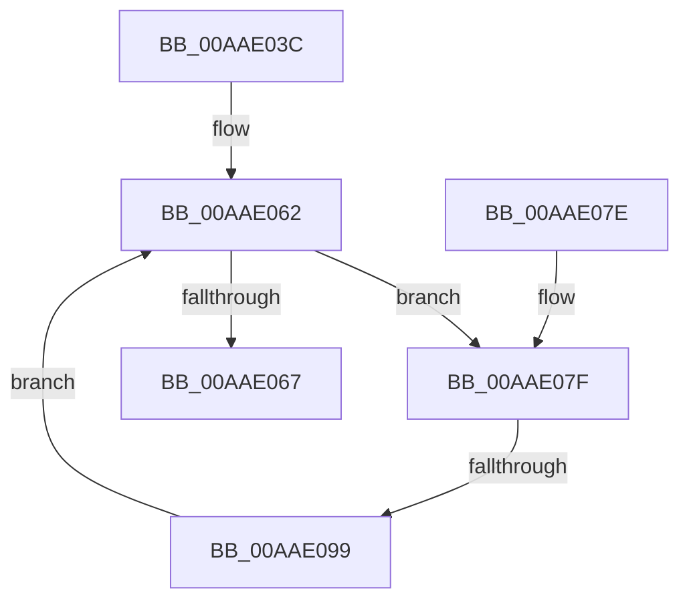

# PiRemoveDeferredSetInterfaceState

- RVA: `0x00AAE03C`–`0x00AAE09E` (길이 `98` bytes)
- VA: `0x0000000140AAE03C`
- 실행 섹션: `PAGE`
- PDB 이름 있음: `예`; PDB Function 태그: `예`
- unwind 정보 RVA: `0x00093238`
- 디코드: `28`개 명령, `98/98` bytes 표시
- 미해석 바이트: `0` (있으면 어셈블리에 `.byte`로 보존)

> 이 문서는 커널 이미지의 기계어와 PDB 기호를 분석해 생성했습니다. 4번과 5번은 함수 원형과 자료형을 바이너리 사용 방식에서 추정한 C 해석이며 원본 소스 복구 결과는 아닙니다.

## 1. Dependencies

- 직접 호출 지점: **1**; 고유 호출 대상: **1**
- 직접 호출자로 확인된 함수: **1**
- RIP 상대 이미지 참조: **0**

### Outgoing calls
- `0x00AAE089` → [RtlEqualUnicodeString](../93/RtlEqualUnicodeString_function_00932A20.md) (function, `0x00932A20`)

### Direct callers
- [IopProcessSetInterfaceState](../95/IopProcessSetInterfaceState_function_00950964.md) at `0x00950EE8`

### Static image references
- 디코드된 RIP-relative 메모리 참조가 없습니다.

## 2. Other-region calls and transfers

- 다른 실행 섹션으로 향하는 call: **0**
- call이 아닌 외부 분기/꼬리 이동: **1**
  - `0x00AAE093` → [sub_00B4A842](../B4/Unknown_function_00B4A842.md) (`tail-transfer`)

## 3. Assembly (complete function range)

```asm
00AAE03C  48 89 5C 24 08                  mov qword ptr [rsp + 8], rbx
00AAE041  48 89 6C 24 10                  mov qword ptr [rsp + 0x10], rbp
00AAE046  48 89 74 24 18                  mov qword ptr [rsp + 0x18], rsi
00AAE04B  57                              push rdi
00AAE04C  48 83 EC 20                     sub rsp, 0x20
00AAE050  48 8D B1 60 02 00 00            lea rsi, [rcx + 0x260]
00AAE057  48 8B EA                        mov rbp, rdx
00AAE05A  48 8B 1E                        mov rbx, qword ptr [rsi]
00AAE05D  BF 01 00 00 C0                  mov edi, 0xc0000001
00AAE062  48 3B DE                        cmp rbx, rsi
00AAE065  75 18                           jne 0x140aae07f
00AAE067  48 8B 5C 24 30                  mov rbx, qword ptr [rsp + 0x30]
00AAE06C  8B C7                           mov eax, edi
00AAE06E  48 8B 6C 24 38                  mov rbp, qword ptr [rsp + 0x38]
00AAE073  48 8B 74 24 40                  mov rsi, qword ptr [rsp + 0x40]
00AAE078  48 83 C4 20                     add rsp, 0x20
00AAE07C  5F                              pop rdi
00AAE07D  C3                              ret
00AAE07E  CC                              int3
00AAE07F  48 8D 4B 10                     lea rcx, [rbx + 0x10]
00AAE083  41 B0 01                        mov r8b, 1
00AAE086  48 8B D5                        mov rdx, rbp
00AAE089  E8 92 49 E8 FF                  call 0x140932a20
00AAE08E  48 8B 0B                        mov rcx, qword ptr [rbx]
00AAE091  84 C0                           test al, al
00AAE093  0F 85 A9 C7 09 00               jne 0x140b4a842
00AAE099  48 8B D9                        mov rbx, rcx
00AAE09C  EB C4                           jmp 0x140aae062
```

## 4. C-style interpretation (structured pseudocode)

```c
__int64 __fastcall PiRemoveDeferredSetInterfaceState(__int64 a1, __int64 a2)
{
    __int64 result;
    __int64 v_rsp;
    unsigned __int64 v_stack_p10;
    unsigned __int64 v_stack_p18;
    unsigned __int64 v_stack_p8;

    v_stack_p8 = v_rbx;
    v_stack_p10 = v_rbp;
    v_stack_p18 = v_rsi;
    v_rsp = (v_rsp) - (32);
loc_00AAE062:
    if ((*(unsigned __int64 *)(a1 + 608)) != (a1 + 608)) goto loc_00AAE07F;
    v_rsp = (v_rsp) + (32);
    return (unsigned int)((unsigned int)((unsigned int)(0xC0000001ULL)));
loc_00AAE07F:
    result = RtlEqualUnicodeString(v_stack_p8 + 16, v_stack_p10, 1, a4);
    goto loc_00AAE062;
}
```

## 5. (Beta) C Style

```c
int64_t PiRemoveDeferredSetInterfaceState(void *Arg1, int64_t Arg2)
{
    uint8_t *arg1 = (uint8_t *)Arg1;

    int64_t result;
    int64_t local_rsp;
    uint64_t v_stack_p10;
    uint64_t v_stack_p18;
    uint64_t v_stack_p8;

    v_stack_p8 = local_rbx;
    v_stack_p10 = local_rbp;
    v_stack_p18 = local_rsi;
    local_rsp = (local_rsp) - (32);
loc_00AAE062:
    if ((*(uint64_t *)(arg1 + 0x260)) != (Arg1 + 608)) goto loc_00AAE07F;
    local_rsp = (local_rsp) + (32);
    return (uint32_t)((uint32_t)((uint32_t)(0xC0000001ULL)));
loc_00AAE07F:
    result = RtlEqualUnicodeString(v_stack_p8 + 16, v_stack_p10, 1, a4);
    goto loc_00AAE062;
}
```

### 관측된 메모리 오프셋

구조체 형식이 확인되지 않은 접근은 인자 기준의 오프셋으로만 기록했습니다.

| 기준 인자 | 오프셋 표현 | 폭 (bit) | 접근 |
|---|---:|---:|---|
| `Arg1` | `+ 0x0` | `64` | `R` |
| `Arg1` | `+ 0x260` | `64` | `R` |

## 6. Execution-region graph

[열기: 2D/3D 그래프와 함수 탐색 컨트롤 패널](../../../control-panel.html?section=page&rva=0x00AAE03C&view=graph)

- 2D 그래프는 위에서 아래로 흐르고, 3D 그래프는 빈 공간을 드래그해 회전합니다. Shift+드래그는 이동, 휠은 확대·축소, 함수 노드 선택은 대상 보고서 이동입니다.

### Static fallback


