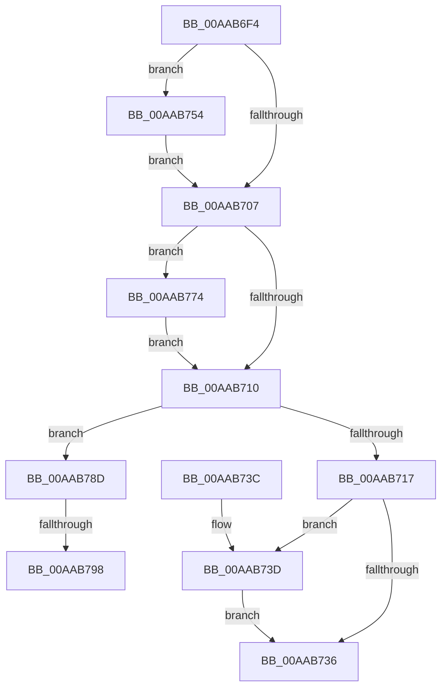

# PiSwCloseDevice

- RVA: `0x00AAB6F4`–`0x00AAB7A7` (길이 `179` bytes)
- VA: `0x0000000140AAB6F4`
- 실행 섹션: `PAGE`
- PDB 이름 있음: `예`; PDB Function 태그: `예`
- unwind 정보 RVA: `0x000BBE00`
- 디코드: `46`개 명령, `179/179` bytes 표시
- 미해석 바이트: `0` (있으면 어셈블리에 `.byte`로 보존)

> 이 문서는 커널 이미지의 기계어와 PDB 기호를 분석해 생성했습니다. 4번과 5번은 함수 원형과 자료형을 바이너리 사용 방식에서 추정한 C 해석이며 원본 소스 복구 결과는 아닙니다.

## 1. Dependencies

- 직접 호출 지점: **6**; 고유 호출 대상: **6**
- 직접 호출자로 확인된 함수: **3**
- RIP 상대 이미지 참조: **2**

### Outgoing calls
- `0x00AAB729` → [PnpDeviceObjectFromDeviceInstanceWithTag](../8E/PnpDeviceObjectFromDeviceInstanceWithTag_function_008E7490.md) (function, `0x008E7490`)
- `0x00AAB745` → [IoInvalidateDeviceRelations](../../text/49/IoInvalidateDeviceRelations_function_0049E160.md) (function, `0x0049E160`)
- `0x00AAB74D` → [ObfDereferenceObject](../../text/2F/ObfDereferenceObject_function_002F9350.md) (function, `0x002F9350`)
- `0x00AAB768` → [McTemplateK0zz_EtwWriteTransfer](../../text/5A/McTemplateK0zz_EtwWriteTransfer_function_005A9408.md) (function, `0x005A9408`)
- `0x00AAB777` → [PiSwQueuedCreateInfoFree](../94/PiSwQueuedCreateInfoFree_function_0094D92C.md) (function, `0x0094D92C`)
- `0x00AAB798` → [PiSwBusRelationRemove](../94/PiSwBusRelationRemove_function_0094D9C0.md) (function, `0x0094D9C0`)

### Direct callers
- [PiSwIrpCleanup](../73/PiSwIrpCleanup_function_0073AC10.md) at `0x0073AD14`
- [PiSwStopDestroy](../8F/PiSwStopDestroy_function_008FCA68.md) at `0x008FCB9E`
- [sub_00B49048](../B4/Unknown_function_00B49048.md) at `0x00B49057`

### Static image references
- `0x00AAB6FE` → RVA `0x00EF012C` (`.data`; read)
- `0x00AAB758` → RVA `0x00027030` (`.rdata`; read)

## 2. Other-region calls and transfers

- 다른 실행 섹션으로 향하는 call: **3**
  - `0x00AAB745` → [IoInvalidateDeviceRelations](../../text/49/IoInvalidateDeviceRelations_function_0049E160.md) (`PAGE` → `.text`)
  - `0x00AAB74D` → [ObfDereferenceObject](../../text/2F/ObfDereferenceObject_function_002F9350.md) (`PAGE` → `.text`)
  - `0x00AAB768` → [McTemplateK0zz_EtwWriteTransfer](../../text/5A/McTemplateK0zz_EtwWriteTransfer_function_005A9408.md) (`PAGE` → `.text`)
- call이 아닌 외부 분기/꼬리 이동: **2**
  - `0x00AAB792` → [sub_00B4A56C](../B4/Unknown_function_00B4A56C.md) (`tail-transfer`)
  - `0x00AAB7A2` → [sub_00B4A56C](../B4/Unknown_function_00B4A56C.md) (`tail-transfer`)

## 3. Assembly (complete function range)

```asm
00AAB6F4  48 89 4C 24 08                  mov qword ptr [rsp + 8], rcx
00AAB6F9  53                              push rbx
00AAB6FA  48 83 EC 30                     sub rsp, 0x30
00AAB6FE  F6 05 27 4A 44 00 40            test byte ptr [rip + 0x444a27], 0x40
00AAB705  75 4D                           jne 0x140aab754
00AAB707  48 8B 41 58                     mov rax, qword ptr [rcx + 0x58]
00AAB70B  48 85 C0                        test rax, rax
00AAB70E  75 64                           jne 0x140aab774
00AAB710  48 83 79 78 00                  cmp qword ptr [rcx + 0x78], 0
00AAB715  74 76                           je 0x140aab78d
00AAB717  83 49 04 02                     or dword ptr [rcx + 4], 2
00AAB71B  BA 44 66 6C 74                  mov edx, 0x746c6644
00AAB720  48 8B 4C 24 40                  mov rcx, qword ptr [rsp + 0x40]
00AAB725  48 8B 49 70                     mov rcx, qword ptr [rcx + 0x70]
00AAB729  E8 62 BD E3 FF                  call 0x1408e7490
00AAB72E  48 8B D8                        mov rbx, rax
00AAB731  48 85 C0                        test rax, rax
00AAB734  75 07                           jne 0x140aab73d
00AAB736  48 83 C4 30                     add rsp, 0x30
00AAB73A  5B                              pop rbx
00AAB73B  C3                              ret
00AAB73C  CC                              int3
00AAB73D  BA 05 00 00 00                  mov edx, 5
00AAB742  48 8B CB                        mov rcx, rbx
00AAB745  E8 16 2A 9F FF                  call 0x14049e160
00AAB74A  48 8B CB                        mov rcx, rbx
00AAB74D  E8 FE DB 84 FF                  call 0x1402f9350
00AAB752  EB E2                           jmp 0x140aab736
00AAB754  48 8B 41 10                     mov rax, qword ptr [rcx + 0x10]
00AAB758  48 8D 15 D1 B8 57 FF            lea rdx, [rip - 0xa8472f]
00AAB75F  4C 8B 49 08                     mov r9, qword ptr [rcx + 8]
00AAB763  48 89 44 24 20                  mov qword ptr [rsp + 0x20], rax
00AAB768  E8 9B DC AF FF                  call 0x1405a9408
00AAB76D  48 8B 4C 24 40                  mov rcx, qword ptr [rsp + 0x40]
00AAB772  EB 93                           jmp 0x140aab707
00AAB774  48 8B C8                        mov rcx, rax
00AAB777  E8 B0 21 EA FF                  call 0x14094d92c
00AAB77C  48 8B 44 24 40                  mov rax, qword ptr [rsp + 0x40]
00AAB781  48 83 60 58 00                  and qword ptr [rax + 0x58], 0
00AAB786  48 8B 4C 24 40                  mov rcx, qword ptr [rsp + 0x40]
00AAB78B  EB 83                           jmp 0x140aab710
00AAB78D  48 83 79 70 00                  cmp qword ptr [rcx + 0x70], 0
00AAB792  0F 84 D4 ED 09 00               je 0x140b4a56c
00AAB798  E8 23 22 EA FF                  call 0x14094d9c0
00AAB79D  48 8B 4C 24 40                  mov rcx, qword ptr [rsp + 0x40]
00AAB7A2  E9 C5 ED 09 00                  jmp 0x140b4a56c
```

## 4. C-style interpretation (structured pseudocode)

```c
__int64 __fastcall PiSwCloseDevice(__int64 a1)
{
    __int64 result;
    __int64 v_rsp;
    unsigned __int64 v_stack_p20;
    unsigned __int64 v_stack_p40;
    unsigned __int64 v_stack_p8;

    v_stack_p8 = a1;
    v_rsp = (v_rsp) - (48);
    if (((*(unsigned __int8 *)(v_rip + 4475431)) & (64)) != 0) goto loc_00AAB754;
loc_00AAB707:
    if (*(unsigned __int64 *)(a1 + 88) != 0) goto loc_00AAB774;
loc_00AAB710:
    if ((*(unsigned __int64 *)(a1 + 120)) == 0) goto loc_00AAB78D;
    result = PnpDeviceObjectFromDeviceInstanceWithTag(*(unsigned __int64 *)(v_stack_p8 + 112), (unsigned int)(0x746C6644ULL), a3, a4);
    if (result != 0) goto loc_00AAB73D;
loc_00AAB736:
    v_rsp = (v_rsp) + (48);
    return result;
loc_00AAB73D:
    result = IoInvalidateDeviceRelations(result, 5, a3, a4);
    result = ObfDereferenceObject(result, 5, a3, a4);
    goto loc_00AAB736;
loc_00AAB754:
    v_stack_p20 = *(unsigned __int64 *)(result + 16);
    result = McTemplateK0zz_EtwWriteTransfer(result, v_rip - 11028271, a3, *(unsigned __int64 *)(result + 8));
    goto loc_00AAB707;
loc_00AAB774:
    result = PiSwQueuedCreateInfoFree(result, v_rip - 11028271, a3, *(unsigned __int64 *)(result + 8));
    goto loc_00AAB710;
loc_00AAB78D:
    result = PiSwBusRelationRemove(v_stack_p40, v_rip - 11028271, a3, *(unsigned __int64 *)(result + 8));
}
```

## 5. (Beta) C Style

```c
int64_t PiSwCloseDevice(void *Arg1)
{
    uint8_t *arg1 = (uint8_t *)Arg1;

    int64_t result;
    int64_t local_rsp;
    uint64_t v_stack_p20;
    uint64_t v_stack_p40;
    uint64_t v_stack_p8;

    v_stack_p8 = Arg1;
    local_rsp = (local_rsp) - (48);
    if (((*(uint8_t *)(v_rip + 0x444A27)) & (64)) != 0) goto loc_00AAB754;
loc_00AAB707:
    if (*(uint64_t *)(arg1 + 0x58) != 0) goto loc_00AAB774;
loc_00AAB710:
    if ((*(uint64_t *)(arg1 + 0x78)) == 0) goto loc_00AAB78D;
    result = PnpDeviceObjectFromDeviceInstanceWithTag(*(uint64_t *)(v_stack_p8 + 0x70), (uint32_t)(0x746C6644ULL), a3, a4);
    if (result != 0) goto loc_00AAB73D;
loc_00AAB736:
    local_rsp = (local_rsp) + (48);
    return result;
loc_00AAB73D:
    result = IoInvalidateDeviceRelations(result, 5, a3, a4);
    result = ObfDereferenceObject(result, 5, a3, a4);
    goto loc_00AAB736;
loc_00AAB754:
    v_stack_p20 = *(uint64_t *)(result + 0x10);
    result = McTemplateK0zz_EtwWriteTransfer(result, v_rip - 11028271, a3, *(uint64_t *)(result + 0x8));
    goto loc_00AAB707;
loc_00AAB774:
    result = PiSwQueuedCreateInfoFree(result, v_rip - 11028271, a3, *(uint64_t *)(result + 0x8));
    goto loc_00AAB710;
loc_00AAB78D:
    result = PiSwBusRelationRemove(v_stack_p40, v_rip - 11028271, a3, *(uint64_t *)(result + 0x8));
}
```

### 관측된 메모리 오프셋

구조체 형식이 확인되지 않은 접근은 인자 기준의 오프셋으로만 기록했습니다.

| 기준 인자 | 오프셋 표현 | 폭 (bit) | 접근 |
|---|---:|---:|---|
| `Arg1` | `+ 0x8` | `64` | `R` |
| `Arg1` | `+ 0x10` | `64` | `R` |

## 6. Execution-region graph

[열기: 2D/3D 그래프와 함수 탐색 컨트롤 패널](../../../control-panel.html?section=page&rva=0x00AAB6F4&view=graph)

- 2D 그래프는 위에서 아래로 흐르고, 3D 그래프는 빈 공간을 드래그해 회전합니다. Shift+드래그는 이동, 휠은 확대·축소, 함수 노드 선택은 대상 보고서 이동입니다.

### Static fallback


