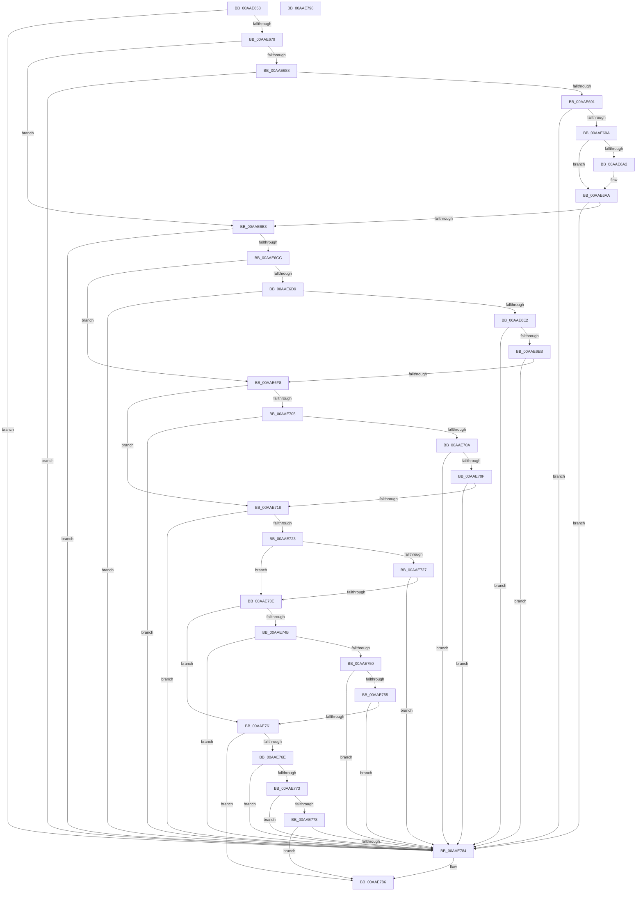

# PiSwDoesCreateChangesRequireReEnum

- RVA: `0x00AAE658`–`0x00AAE799` (길이 `321` bytes)
- VA: `0x0000000140AAE658`
- 실행 섹션: `PAGE`
- PDB 이름 있음: `예`; PDB Function 태그: `아니요`
- unwind 정보 RVA: `0x00060BC4`
- 디코드: `96`개 명령, `321/321` bytes 표시
- 미해석 바이트: `0` (있으면 어셈블리에 `.byte`로 보존)

> 이 문서는 커널 이미지의 기계어와 PDB 기호를 분석해 생성했습니다. 4번과 5번은 함수 원형과 자료형을 바이너리 사용 방식에서 추정한 C 해석이며 원본 소스 복구 결과는 아닙니다.

## 1. Dependencies

- 직접 호출 지점: **6**; 고유 호출 대상: **3**
- 직접 호출자로 확인된 함수: **1**
- RIP 상대 이미지 참조: **0**

### Outgoing calls
- `0x00AAE6BF` → [wcsicmp](../../text/50/wcsicmp_function_00500080.md) (function, `0x00500080`)
- `0x00AAE6EB` → [wcsicmp](../../text/50/wcsicmp_function_00500080.md) (function, `0x00500080`)
- `0x00AAE70F` → [wcsicmp](../../text/50/wcsicmp_function_00500080.md) (function, `0x00500080`)
- `0x00AAE735` → [memcmp](../../text/6C/memcmp_function_006C6B10.md) (function, `0x006C6B10`)
- `0x00AAE758` → [PnpCompareMultiSz](../73/PnpCompareMultiSz_function_0073D27C.md) (function, `0x0073D27C`)
- `0x00AAE77B` → [PnpCompareMultiSz](../73/PnpCompareMultiSz_function_0073D27C.md) (function, `0x0073D27C`)

### Direct callers
- [sub_00B1C4F6](../B1/Unknown_function_00B1C4F6.md) at `0x00B1C525`

### Static image references
- 디코드된 RIP-relative 메모리 참조가 없습니다.

## 2. Other-region calls and transfers

- 다른 실행 섹션으로 향하는 call: **4**
  - `0x00AAE6BF` → [wcsicmp](../../text/50/wcsicmp_function_00500080.md) (`PAGE` → `.text`)
  - `0x00AAE6EB` → [wcsicmp](../../text/50/wcsicmp_function_00500080.md) (`PAGE` → `.text`)
  - `0x00AAE70F` → [wcsicmp](../../text/50/wcsicmp_function_00500080.md) (`PAGE` → `.text`)
  - `0x00AAE735` → [memcmp](../../text/6C/memcmp_function_006C6B10.md) (`PAGE` → `.text`)
- 별도 외부 분기/꼬리 이동을 확인하지 못했습니다.

## 3. Assembly (complete function range)

```asm
00AAE658  48 89 5C 24 08                  mov qword ptr [rsp + 8], rbx
00AAE65D  48 89 74 24 10                  mov qword ptr [rsp + 0x10], rsi
00AAE662  57                              push rdi
00AAE663  48 83 EC 20                     sub rsp, 0x20
00AAE667  8B 42 40                        mov eax, dword ptr [rdx + 0x40]
00AAE66A  48 8B FA                        mov rdi, rdx
00AAE66D  48 8B F1                        mov rsi, rcx
00AAE670  39 41 40                        cmp dword ptr [rcx + 0x40], eax
00AAE673  0F 85 0B 01 00 00               jne 0x140aae784
00AAE679  48 8B 51 28                     mov rdx, qword ptr [rcx + 0x28]
00AAE67D  33 DB                           xor ebx, ebx
00AAE67F  4C 8B 47 38                     mov r8, qword ptr [rdi + 0x38]
00AAE683  49 3B D0                        cmp rdx, r8
00AAE686  74 2B                           je 0x140aae6b3
00AAE688  48 85 D2                        test rdx, rdx
00AAE68B  0F 84 F3 00 00 00               je 0x140aae784
00AAE691  4D 85 C0                        test r8, r8
00AAE694  0F 84 EA 00 00 00               je 0x140aae784
00AAE69A  48 8B 0A                        mov rcx, qword ptr [rdx]
00AAE69D  49 2B 08                        sub rcx, qword ptr [r8]
00AAE6A0  75 08                           jne 0x140aae6aa
00AAE6A2  48 8B 4A 08                     mov rcx, qword ptr [rdx + 8]
00AAE6A6  49 2B 48 08                     sub rcx, qword ptr [r8 + 8]
00AAE6AA  48 85 C9                        test rcx, rcx
00AAE6AD  0F 85 D1 00 00 00               jne 0x140aae784
00AAE6B3  48 8B 4E 70                     mov rcx, qword ptr [rsi + 0x70]
00AAE6B7  48 8B 57 08                     mov rdx, qword ptr [rdi + 8]
00AAE6BB  48 8B 49 08                     mov rcx, qword ptr [rcx + 8]
00AAE6BF  E8 BC 19 A5 FF                  call 0x140500080
00AAE6C4  85 C0                           test eax, eax
00AAE6C6  0F 85 B8 00 00 00               jne 0x140aae784
00AAE6CC  48 8B 4E 30                     mov rcx, qword ptr [rsi + 0x30]
00AAE6D0  48 8B 57 48                     mov rdx, qword ptr [rdi + 0x48]
00AAE6D4  48 3B CA                        cmp rcx, rdx
00AAE6D7  74 1F                           je 0x140aae6f8
00AAE6D9  48 85 C9                        test rcx, rcx
00AAE6DC  0F 84 A2 00 00 00               je 0x140aae784
00AAE6E2  48 85 D2                        test rdx, rdx
00AAE6E5  0F 84 99 00 00 00               je 0x140aae784
00AAE6EB  E8 90 19 A5 FF                  call 0x140500080
00AAE6F0  85 C0                           test eax, eax
00AAE6F2  0F 85 8C 00 00 00               jne 0x140aae784
00AAE6F8  48 8B 4E 38                     mov rcx, qword ptr [rsi + 0x38]
00AAE6FC  48 8B 57 50                     mov rdx, qword ptr [rdi + 0x50]
00AAE700  48 3B CA                        cmp rcx, rdx
00AAE703  74 13                           je 0x140aae718
00AAE705  48 85 C9                        test rcx, rcx
00AAE708  74 7A                           je 0x140aae784
00AAE70A  48 85 D2                        test rdx, rdx
00AAE70D  74 75                           je 0x140aae784
00AAE70F  E8 6C 19 A5 FF                  call 0x140500080
00AAE714  85 C0                           test eax, eax
00AAE716  75 6C                           jne 0x140aae784
00AAE718  8B 86 A0 00 00 00               mov eax, dword ptr [rsi + 0xa0]
00AAE71E  3B 47 58                        cmp eax, dword ptr [rdi + 0x58]
00AAE721  75 61                           jne 0x140aae784
00AAE723  85 C0                           test eax, eax
00AAE725  74 17                           je 0x140aae73e
00AAE727  48 8B 57 60                     mov rdx, qword ptr [rdi + 0x60]
00AAE72B  44 8B C0                        mov r8d, eax
00AAE72E  48 8B 8E 98 00 00 00            mov rcx, qword ptr [rsi + 0x98]
00AAE735  E8 D6 83 C1 FF                  call 0x1406c6b10
00AAE73A  85 C0                           test eax, eax
00AAE73C  75 46                           jne 0x140aae784
00AAE73E  48 8B 4E 18                     mov rcx, qword ptr [rsi + 0x18]
00AAE742  48 8B 57 20                     mov rdx, qword ptr [rdi + 0x20]
00AAE746  48 3B CA                        cmp rcx, rdx
00AAE749  74 16                           je 0x140aae761
00AAE74B  48 85 C9                        test rcx, rcx
00AAE74E  74 34                           je 0x140aae784
00AAE750  48 85 D2                        test rdx, rdx
00AAE753  74 2F                           je 0x140aae784
00AAE755  41 B0 01                        mov r8b, 1
00AAE758  E8 1F EB C8 FF                  call 0x14073d27c
00AAE75D  84 C0                           test al, al
00AAE75F  74 23                           je 0x140aae784
00AAE761  48 8B 4E 20                     mov rcx, qword ptr [rsi + 0x20]
00AAE765  48 8B 57 30                     mov rdx, qword ptr [rdi + 0x30]
00AAE769  48 3B CA                        cmp rcx, rdx
00AAE76C  74 18                           je 0x140aae786
00AAE76E  48 85 C9                        test rcx, rcx
00AAE771  74 11                           je 0x140aae784
00AAE773  48 85 D2                        test rdx, rdx
00AAE776  74 0C                           je 0x140aae784
00AAE778  41 B0 01                        mov r8b, 1
00AAE77B  E8 FC EA C8 FF                  call 0x14073d27c
00AAE780  84 C0                           test al, al
00AAE782  75 02                           jne 0x140aae786
00AAE784  B3 01                           mov bl, 1
00AAE786  48 8B 74 24 38                  mov rsi, qword ptr [rsp + 0x38]
00AAE78B  8A C3                           mov al, bl
00AAE78D  48 8B 5C 24 30                  mov rbx, qword ptr [rsp + 0x30]
00AAE792  48 83 C4 20                     add rsp, 0x20
00AAE796  5F                              pop rdi
00AAE797  C3                              ret
00AAE798  CC                              int3
```

## 4. C-style interpretation (structured pseudocode)

```c
__int64 __fastcall PiSwDoesCreateChangesRequireReEnum(__int64 a1, __int64 a2)
{
    __int64 result;
    __int64 v_rbx;
    __int64 v_rsp;
    unsigned __int64 v_stack_p10;
    unsigned __int64 v_stack_p8;

    v_stack_p8 = v_rbx;
    v_stack_p10 = v_rsi;
    v_rsp = (v_rsp) - (32);
    if ((*(unsigned int *)(a1 + 64)) != ((unsigned int)((unsigned int)(*(unsigned int *)(a2 + 64))))) goto loc_00AAE784;
    v_rbx = 0;
    if ((*(unsigned __int64 *)(a1 + 40)) == (*(unsigned __int64 *)(a2 + 56))) goto loc_00AAE6B3;
    if (*(unsigned __int64 *)(a1 + 40) == 0) goto loc_00AAE784;
    if (*(unsigned __int64 *)(a2 + 56) == 0) goto loc_00AAE784;
    a1 = (*(unsigned __int64 *)(*(unsigned __int64 *)(a1 + 40))) - (*(unsigned __int64 *)(*(unsigned __int64 *)(a2 + 56)));
    if (!(condition_is_not_equal)) {
        a1 = *(unsigned __int64 *)(*(unsigned __int64 *)(a1 + 40) + 8);
        a1 = (a1) - (*(unsigned __int64 *)(*(unsigned __int64 *)(a2 + 56) + 8));
    }
    if (a1 != 0) goto loc_00AAE784;
loc_00AAE6B3:
    result = wcsicmp(*(unsigned __int64 *)(*(unsigned __int64 *)(a1 + 112) + 8), *(unsigned __int64 *)(a2 + 8), *(unsigned __int64 *)(a2 + 56), a4);
    if ((unsigned int)(result) != 0) goto loc_00AAE784;
    if ((*(unsigned __int64 *)(a1 + 48)) == (*(unsigned __int64 *)(a2 + 72))) goto loc_00AAE6F8;
    if (*(unsigned __int64 *)(a1 + 48) == 0) goto loc_00AAE784;
    if (*(unsigned __int64 *)(a2 + 72) == 0) goto loc_00AAE784;
    result = wcsicmp(*(unsigned __int64 *)(a1 + 48), *(unsigned __int64 *)(a2 + 72), *(unsigned __int64 *)(a2 + 56), a4);
    if ((unsigned int)(result) != 0) goto loc_00AAE784;
loc_00AAE6F8:
    if ((*(unsigned __int64 *)(a1 + 56)) == (*(unsigned __int64 *)(a2 + 80))) goto loc_00AAE718;
    if (*(unsigned __int64 *)(a1 + 56) == 0) goto loc_00AAE784;
    if (*(unsigned __int64 *)(a2 + 80) == 0) goto loc_00AAE784;
    result = wcsicmp(*(unsigned __int64 *)(a1 + 56), *(unsigned __int64 *)(a2 + 80), *(unsigned __int64 *)(a2 + 56), a4);
    if ((unsigned int)(result) != 0) goto loc_00AAE784;
loc_00AAE718:
    if (((unsigned int)((unsigned int)(*(unsigned int *)(a1 + 160)))) != (*(unsigned int *)(a2 + 88))) goto loc_00AAE784;
    if ((unsigned int)((unsigned int)(*(unsigned int *)(a1 + 160))) == 0) goto loc_00AAE73E;
    result = memcmp(*(unsigned __int64 *)(a1 + 152), *(unsigned __int64 *)(a2 + 96), (unsigned int)((unsigned int)((unsigned int)(*(unsigned int *)(a1 + 160)))), a4);
    if ((unsigned int)(result) != 0) goto loc_00AAE784;
loc_00AAE73E:
    if ((*(unsigned __int64 *)(a1 + 24)) == (*(unsigned __int64 *)(a2 + 32))) goto loc_00AAE761;
    if (*(unsigned __int64 *)(a1 + 24) == 0) goto loc_00AAE784;
    if (*(unsigned __int64 *)(a2 + 32) == 0) goto loc_00AAE784;
    result = PnpCompareMultiSz(*(unsigned __int64 *)(a1 + 24), *(unsigned __int64 *)(a2 + 32), 1, a4);
    if ((unsigned __int8)(result) == 0) goto loc_00AAE784;
loc_00AAE761:
    if ((*(unsigned __int64 *)(a1 + 32)) == (*(unsigned __int64 *)(a2 + 48))) goto loc_00AAE786;
    if (*(unsigned __int64 *)(a1 + 32) == 0) goto loc_00AAE784;
    if (*(unsigned __int64 *)(a2 + 48) == 0) goto loc_00AAE784;
    result = PnpCompareMultiSz(*(unsigned __int64 *)(a1 + 32), *(unsigned __int64 *)(a2 + 48), 1, a4);
    if ((unsigned __int8)(result) == 0) {
        v_rbx = 1;
    }
    v_rsp = (v_rsp) + (32);
    return (unsigned __int8)(v_rbx);
}
```

## 5. (Beta) C Style

```c
int64_t PiSwDoesCreateChangesRequireReEnum(void *Arg1, void *Arg2)
{
    uint8_t *arg1 = (uint8_t *)Arg1;
    uint8_t *arg2 = (uint8_t *)Arg2;

    int64_t result;
    int64_t local_rbx;
    int64_t local_rsp;
    uint64_t v_stack_p10;
    uint64_t v_stack_p8;

    v_stack_p8 = local_rbx;
    v_stack_p10 = local_rsi;
    local_rsp = (local_rsp) - (32);
    if ((*(uint32_t *)(arg1 + 0x40)) != ((uint32_t)((uint32_t)(*(uint32_t *)(arg2 + 0x40))))) goto loc_00AAE784;
    local_rbx = 0;
    if ((*(uint64_t *)(arg1 + 0x28)) == (*(uint64_t *)(arg2 + 0x38))) goto loc_00AAE6B3;
    if (*(uint64_t *)(arg1 + 0x28) == 0) goto loc_00AAE784;
    if (*(uint64_t *)(arg2 + 0x38) == 0) goto loc_00AAE784;
    Arg1 = (*(uint64_t *)(*(uint64_t *)(arg1 + 0x28))) - (*(uint64_t *)(*(uint64_t *)(arg2 + 0x38)));
    if (!(condition_is_not_equal)) {
        Arg1 = *(uint64_t *)(*(uint64_t *)(arg1 + 0x28) + 0x8);
        Arg1 = (Arg1) - (*(uint64_t *)(*(uint64_t *)(arg2 + 0x38) + 0x8));
    }
    if (Arg1 != NULL) goto loc_00AAE784;
loc_00AAE6B3:
    result = wcsicmp(*(uint64_t *)(*(uint64_t *)(arg1 + 0x70) + 0x8), *(uint64_t *)(arg2 + 0x8), *(uint64_t *)(arg2 + 0x38), a4);
    if ((uint32_t)(result) != 0) goto loc_00AAE784;
    if ((*(uint64_t *)(arg1 + 0x30)) == (*(uint64_t *)(arg2 + 0x48))) goto loc_00AAE6F8;
    if (*(uint64_t *)(arg1 + 0x30) == 0) goto loc_00AAE784;
    if (*(uint64_t *)(arg2 + 0x48) == 0) goto loc_00AAE784;
    result = wcsicmp(*(uint64_t *)(arg1 + 0x30), *(uint64_t *)(arg2 + 0x48), *(uint64_t *)(arg2 + 0x38), a4);
    if ((uint32_t)(result) != 0) goto loc_00AAE784;
loc_00AAE6F8:
    if ((*(uint64_t *)(arg1 + 0x38)) == (*(uint64_t *)(arg2 + 0x50))) goto loc_00AAE718;
    if (*(uint64_t *)(arg1 + 0x38) == 0) goto loc_00AAE784;
    if (*(uint64_t *)(arg2 + 0x50) == 0) goto loc_00AAE784;
    result = wcsicmp(*(uint64_t *)(arg1 + 0x38), *(uint64_t *)(arg2 + 0x50), *(uint64_t *)(arg2 + 0x38), a4);
    if ((uint32_t)(result) != 0) goto loc_00AAE784;
loc_00AAE718:
    if (((uint32_t)((uint32_t)(*(uint32_t *)(arg1 + 0xA0)))) != (*(uint32_t *)(arg2 + 0x58))) goto loc_00AAE784;
    if ((uint32_t)((uint32_t)(*(uint32_t *)(arg1 + 0xA0))) == 0) goto loc_00AAE73E;
    result = memcmp(*(uint64_t *)(arg1 + 0x98), *(uint64_t *)(arg2 + 0x60), (uint32_t)((uint32_t)((uint32_t)(*(uint32_t *)(arg1 + 0xA0)))), a4);
    if ((uint32_t)(result) != 0) goto loc_00AAE784;
loc_00AAE73E:
    if ((*(uint64_t *)(arg1 + 0x18)) == (*(uint64_t *)(arg2 + 0x20))) goto loc_00AAE761;
    if (*(uint64_t *)(arg1 + 0x18) == 0) goto loc_00AAE784;
    if (*(uint64_t *)(arg2 + 0x20) == 0) goto loc_00AAE784;
    result = PnpCompareMultiSz(*(uint64_t *)(arg1 + 0x18), *(uint64_t *)(arg2 + 0x20), 1, a4);
    if ((uint8_t)(result) == 0) goto loc_00AAE784;
loc_00AAE761:
    if ((*(uint64_t *)(arg1 + 0x20)) == (*(uint64_t *)(arg2 + 0x30))) goto loc_00AAE786;
    if (*(uint64_t *)(arg1 + 0x20) == 0) goto loc_00AAE784;
    if (*(uint64_t *)(arg2 + 0x30) == 0) goto loc_00AAE784;
    result = PnpCompareMultiSz(*(uint64_t *)(arg1 + 0x20), *(uint64_t *)(arg2 + 0x30), 1, a4);
    if ((uint8_t)(result) == 0) {
        local_rbx = 1;
    }
    local_rsp = (local_rsp) + (32);
    return (uint8_t)(local_rbx);
}
```

### 관측된 메모리 오프셋

구조체 형식이 확인되지 않은 접근은 인자 기준의 오프셋으로만 기록했습니다.

| 기준 인자 | 오프셋 표현 | 폭 (bit) | 접근 |
|---|---:|---:|---|
| `Arg1` | `+ 0x18` | `64` | `R` |
| `Arg1` | `+ 0x20` | `64` | `R` |
| `Arg1` | `+ 0x28` | `64` | `R` |
| `Arg1` | `+ 0x30` | `64` | `R` |
| `Arg1` | `+ 0x38` | `64` | `R` |
| `Arg1` | `+ 0x40` | `32` | `R` |
| `Arg1` | `+ 0x70` | `64` | `R` |
| `Arg1` | `+ 0x98` | `64` | `R` |
| `Arg1` | `+ 0xA0` | `32` | `R` |
| `Arg2` | `+ 0x8` | `64` | `R` |
| `Arg2` | `+ 0x20` | `64` | `R` |
| `Arg2` | `+ 0x30` | `64` | `R` |
| `Arg2` | `+ 0x38` | `64` | `R` |
| `Arg2` | `+ 0x40` | `32` | `R` |
| `Arg2` | `+ 0x48` | `64` | `R` |
| `Arg2` | `+ 0x50` | `64` | `R` |
| `Arg2` | `+ 0x58` | `32` | `R` |
| `Arg2` | `+ 0x60` | `64` | `R` |

## 6. Execution-region graph

[열기: 2D/3D 그래프와 함수 탐색 컨트롤 패널](../../../control-panel.html?section=page&rva=0x00AAE658&view=graph)

- 2D 그래프는 위에서 아래로 흐르고, 3D 그래프는 빈 공간을 드래그해 회전합니다. Shift+드래그는 이동, 휠은 확대·축소, 함수 노드 선택은 대상 보고서 이동입니다.

### Static fallback


