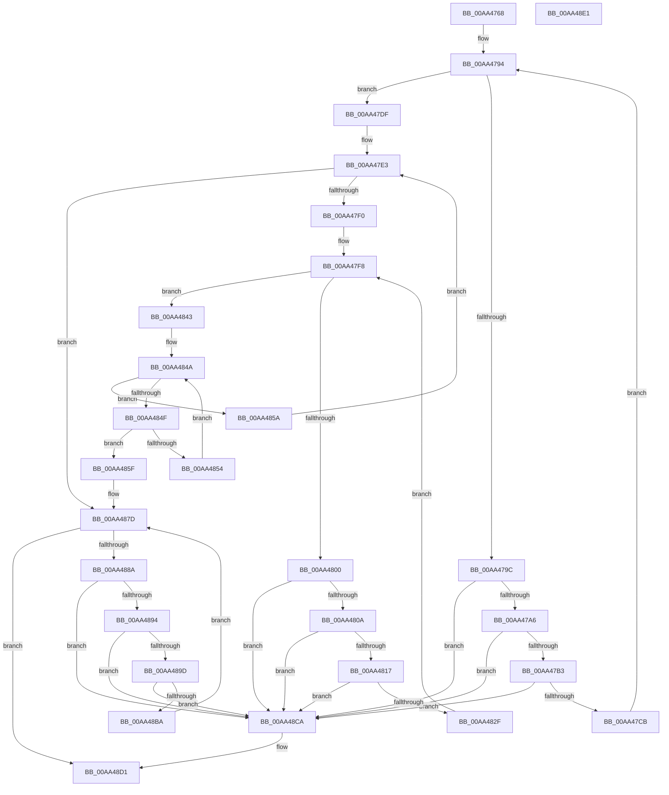

# PiValidatePowerRelations

- RVA: `0x00AA4768`–`0x00AA48E2` (길이 `378` bytes)
- VA: `0x0000000140AA4768`
- 실행 섹션: `PAGE`
- PDB 이름 있음: `예`; PDB Function 태그: `아니요`
- unwind 정보 RVA: `0x000BB544`
- 디코드: `104`개 명령, `378/378` bytes 표시
- 미해석 바이트: `0` (있으면 어셈블리에 `.byte`로 보존)

> 이 문서는 커널 이미지의 기계어와 PDB 기호를 분석해 생성했습니다. 4번과 5번은 함수 원형과 자료형을 바이너리 사용 방식에서 추정한 C 해석이며 원본 소스 복구 결과는 아닙니다.

## 1. Dependencies

- 직접 호출 지점: **3**; 고유 호출 대상: **3**
- 직접 호출자로 확인된 함수: **1**
- RIP 상대 이미지 참조: **0**

### Outgoing calls
- `0x00AA4778` → [PnpAcquirePowerRelationsQueueLock](../../text/4B/PnpAcquirePowerRelationsQueueLock_function_004B9534.md) (function, `0x004B9534`)
- `0x00AA4877` → [KeBugCheckEx](../../text/4F/KeBugCheckEx_function_004FD660.md) (function, `0x004FD660`)
- `0x00AA48D1` → [PnpReleasePowerRelationsQueueLock](../../text/4B/PnpReleasePowerRelationsQueueLock_function_004BE70C.md) (function, `0x004BE70C`)

### Direct callers
- [PiQueryPowerRelations](PiQueryPowerRelations_function_00AA3F9C.md) at `0x00AA446E`

### Static image references
- 디코드된 RIP-relative 메모리 참조가 없습니다.

## 2. Other-region calls and transfers

- 다른 실행 섹션으로 향하는 call: **3**
  - `0x00AA4778` → [PnpAcquirePowerRelationsQueueLock](../../text/4B/PnpAcquirePowerRelationsQueueLock_function_004B9534.md) (`PAGE` → `.text`)
  - `0x00AA4877` → [KeBugCheckEx](../../text/4F/KeBugCheckEx_function_004FD660.md) (`PAGE` → `.text`)
  - `0x00AA48D1` → [PnpReleasePowerRelationsQueueLock](../../text/4B/PnpReleasePowerRelationsQueueLock_function_004BE70C.md) (`PAGE` → `.text`)
- 별도 외부 분기/꼬리 이동을 확인하지 못했습니다.

## 3. Assembly (complete function range)

```asm
00AA4768  48 89 5C 24 08                  mov qword ptr [rsp + 8], rbx
00AA476D  55                              push rbp
00AA476E  48 8B EC                        mov rbp, rsp
00AA4771  48 83 EC 40                     sub rsp, 0x40
00AA4775  48 8B D9                        mov rbx, rcx
00AA4778  E8 B7 4D A1 FF                  call 0x1404b9534
00AA477D  48 8D 45 F0                     lea rax, [rbp - 0x10]
00AA4781  48 89 45 F8                     mov qword ptr [rbp - 8], rax
00AA4785  48 8D 93 C0 00 00 00            lea rdx, [rbx + 0xc0]
00AA478C  48 8D 45 F0                     lea rax, [rbp - 0x10]
00AA4790  48 89 45 F0                     mov qword ptr [rbp - 0x10], rax
00AA4794  48 8B 02                        mov rax, qword ptr [rdx]
00AA4797  48 3B C2                        cmp rax, rdx
00AA479A  74 43                           je 0x140aa47df
00AA479C  48 39 50 08                     cmp qword ptr [rax + 8], rdx
00AA47A0  0F 85 24 01 00 00               jne 0x140aa48ca
00AA47A6  48 8B 08                        mov rcx, qword ptr [rax]
00AA47A9  48 39 41 08                     cmp qword ptr [rcx + 8], rax
00AA47AD  0F 85 17 01 00 00               jne 0x140aa48ca
00AA47B3  48 89 0A                        mov qword ptr [rdx], rcx
00AA47B6  4C 8D 45 F0                     lea r8, [rbp - 0x10]
00AA47BA  48 89 51 08                     mov qword ptr [rcx + 8], rdx
00AA47BE  48 8B 4D F8                     mov rcx, qword ptr [rbp - 8]
00AA47C2  4C 39 01                        cmp qword ptr [rcx], r8
00AA47C5  0F 85 FF 00 00 00               jne 0x140aa48ca
00AA47CB  48 89 48 08                     mov qword ptr [rax + 8], rcx
00AA47CF  4C 8D 45 F0                     lea r8, [rbp - 0x10]
00AA47D3  4C 89 00                        mov qword ptr [rax], r8
00AA47D6  48 89 01                        mov qword ptr [rcx], rax
00AA47D9  48 89 45 F8                     mov qword ptr [rbp - 8], rax
00AA47DD  EB B5                           jmp 0x140aa4794
00AA47DF  48 8B 4D F0                     mov rcx, qword ptr [rbp - 0x10]
00AA47E3  48 8D 45 F0                     lea rax, [rbp - 0x10]
00AA47E7  48 3B C8                        cmp rcx, rax
00AA47EA  0F 84 8D 00 00 00               je 0x140aa487d
00AA47F0  4C 8B 49 28                     mov r9, qword ptr [rcx + 0x28]
00AA47F4  49 8D 51 20                     lea rdx, [r9 + 0x20]
00AA47F8  48 8B 02                        mov rax, qword ptr [rdx]
00AA47FB  48 3B C2                        cmp rax, rdx
00AA47FE  74 43                           je 0x140aa4843
00AA4800  48 39 50 08                     cmp qword ptr [rax + 8], rdx
00AA4804  0F 85 C0 00 00 00               jne 0x140aa48ca
00AA480A  4C 8B 00                        mov r8, qword ptr [rax]
00AA480D  49 39 40 08                     cmp qword ptr [r8 + 8], rax
00AA4811  0F 85 B3 00 00 00               jne 0x140aa48ca
00AA4817  4C 89 02                        mov qword ptr [rdx], r8
00AA481A  4C 8D 55 F0                     lea r10, [rbp - 0x10]
00AA481E  49 89 50 08                     mov qword ptr [r8 + 8], rdx
00AA4822  4C 8B 45 F8                     mov r8, qword ptr [rbp - 8]
00AA4826  4D 39 10                        cmp qword ptr [r8], r10
00AA4829  0F 85 9B 00 00 00               jne 0x140aa48ca
00AA482F  4C 89 40 08                     mov qword ptr [rax + 8], r8
00AA4833  4C 8D 55 F0                     lea r10, [rbp - 0x10]
00AA4837  4C 89 10                        mov qword ptr [rax], r10
00AA483A  49 89 00                        mov qword ptr [r8], rax
00AA483D  48 89 45 F8                     mov qword ptr [rbp - 8], rax
00AA4841  EB B5                           jmp 0x140aa47f8
00AA4843  49 8D 81 60 FF FF FF            lea rax, [r9 - 0xa0]
00AA484A  48 85 C0                        test rax, rax
00AA484D  74 0B                           je 0x140aa485a
00AA484F  48 3B C3                        cmp rax, rbx
00AA4852  74 0B                           je 0x140aa485f
00AA4854  48 8B 40 10                     mov rax, qword ptr [rax + 0x10]
00AA4858  EB F0                           jmp 0x140aa484a
00AA485A  48 8B 09                        mov rcx, qword ptr [rcx]
00AA485D  EB 84                           jmp 0x140aa47e3
00AA485F  48 83 64 24 20 00               and qword ptr [rsp + 0x20], 0
00AA4865  BA 0C 00 00 00                  mov edx, 0xc
00AA486A  4D 8B 49 80                     mov r9, qword ptr [r9 - 0x80]
00AA486E  B9 CA 00 00 00                  mov ecx, 0xca
00AA4873  4C 8B 43 20                     mov r8, qword ptr [rbx + 0x20]
00AA4877  E8 E4 8D A5 FF                  call 0x1404fd660
00AA487C  CC                              int3
00AA487D  48 8B 45 F0                     mov rax, qword ptr [rbp - 0x10]
00AA4881  48 8D 4D F0                     lea rcx, [rbp - 0x10]
00AA4885  48 3B C1                        cmp rax, rcx
00AA4888  74 47                           je 0x140aa48d1
00AA488A  48 8D 4D F0                     lea rcx, [rbp - 0x10]
00AA488E  48 39 48 08                     cmp qword ptr [rax + 8], rcx
00AA4892  75 36                           jne 0x140aa48ca
00AA4894  48 8B 08                        mov rcx, qword ptr [rax]
00AA4897  48 39 41 08                     cmp qword ptr [rcx + 8], rax
00AA489B  75 2D                           jne 0x140aa48ca
00AA489D  48 89 4D F0                     mov qword ptr [rbp - 0x10], rcx
00AA48A1  48 8D 55 F0                     lea rdx, [rbp - 0x10]
00AA48A5  48 89 51 08                     mov qword ptr [rcx + 8], rdx
00AA48A9  48 8B 48 10                     mov rcx, qword ptr [rax + 0x10]
00AA48AD  48 83 C1 20                     add rcx, 0x20
00AA48B1  48 8B 51 08                     mov rdx, qword ptr [rcx + 8]
00AA48B5  48 39 0A                        cmp qword ptr [rdx], rcx
00AA48B8  75 10                           jne 0x140aa48ca
00AA48BA  48 89 08                        mov qword ptr [rax], rcx
00AA48BD  48 89 50 08                     mov qword ptr [rax + 8], rdx
00AA48C1  48 89 02                        mov qword ptr [rdx], rax
00AA48C4  48 89 41 08                     mov qword ptr [rcx + 8], rax
00AA48C8  EB B3                           jmp 0x140aa487d
00AA48CA  B9 03 00 00 00                  mov ecx, 3
00AA48CF  CD 29                           int 0x29
00AA48D1  E8 36 9E A1 FF                  call 0x1404be70c
00AA48D6  48 8B 5C 24 50                  mov rbx, qword ptr [rsp + 0x50]
00AA48DB  48 83 C4 40                     add rsp, 0x40
00AA48DF  5D                              pop rbp
00AA48E0  C3                              ret
00AA48E1  CC                              int3
```

## 4. C-style interpretation (structured pseudocode)

```c
__int64 __fastcall PiValidatePowerRelations(__int64 a1)
{
    __int64 result;
    __int64 v_rsp;
    unsigned __int64 v_stack_m10;
    unsigned __int64 v_stack_m18;
    unsigned __int64 v_stack_m28;
    unsigned __int64 v_stack_p8;

    v_stack_p8 = v_rbx;
    v_rsp = (v_rsp) - (64);
    result = PnpAcquirePowerRelationsQueueLock(a1, a2, a3, a4);
    v_stack_m10 = v_stack_m18;
    v_stack_m18 = v_stack_m18;
loc_00AA4794:
    if ((*(unsigned __int64 *)(a1 + 192)) == (a1 + 192)) goto loc_00AA47DF;
    if ((*(unsigned __int64 *)(*(unsigned __int64 *)(a1 + 192) + 8)) != (a1 + 192)) goto loc_00AA48CA;
    if ((*(unsigned __int64 *)(*(unsigned __int64 *)(*(unsigned __int64 *)(a1 + 192)) + 8)) != (*(unsigned __int64 *)(a1 + 192))) goto loc_00AA48CA;
    *(unsigned __int64 *)(a1 + 192) = *(unsigned __int64 *)(*(unsigned __int64 *)(a1 + 192));
    *(unsigned __int64 *)(*(unsigned __int64 *)(*(unsigned __int64 *)(a1 + 192)) + 8) = a1 + 192;
    if ((*(unsigned __int64 *)(v_stack_m10)) != v_stack_m18) goto loc_00AA48CA;
    *(unsigned __int64 *)(*(unsigned __int64 *)(a1 + 192) + 8) = v_stack_m10;
    *(unsigned __int64 *)(*(unsigned __int64 *)(a1 + 192)) = v_stack_m18;
    *(unsigned __int64 *)(v_stack_m10) = *(unsigned __int64 *)(a1 + 192);
    v_stack_m10 = *(unsigned __int64 *)(a1 + 192);
    goto loc_00AA4794;
loc_00AA47DF:
loc_00AA47E3:
    if (v_stack_m18 == v_stack_m18) goto loc_00AA487D;
loc_00AA47F8:
    if ((*(unsigned __int64 *)(*(unsigned __int64 *)(v_stack_m18 + 40) + 32)) == (*(unsigned __int64 *)(v_stack_m18 + 40) + 32)) goto loc_00AA4843;
    if ((*(unsigned __int64 *)(*(unsigned __int64 *)(*(unsigned __int64 *)(v_stack_m18 + 40) + 32) + 8)) != (*(unsigned __int64 *)(v_stack_m18 + 40) + 32)) goto loc_00AA48CA;
    if ((*(unsigned __int64 *)(*(unsigned __int64 *)(*(unsigned __int64 *)(*(unsigned __int64 *)(v_stack_m18 + 40) + 32)) + 8)) != (*(unsigned __int64 *)(*(unsigned __int64 *)(v_stack_m18 + 40) + 32))) goto loc_00AA48CA;
    *(unsigned __int64 *)(*(unsigned __int64 *)(v_stack_m18 + 40) + 32) = *(unsigned __int64 *)(*(unsigned __int64 *)(*(unsigned __int64 *)(v_stack_m18 + 40) + 32));
    *(unsigned __int64 *)(*(unsigned __int64 *)(*(unsigned __int64 *)(*(unsigned __int64 *)(v_stack_m18 + 40) + 32)) + 8) = *(unsigned __int64 *)(v_stack_m18 + 40) + 32;
    if ((*(unsigned __int64 *)(v_stack_m10)) != v_stack_m18) goto loc_00AA48CA;
    *(unsigned __int64 *)(*(unsigned __int64 *)(*(unsigned __int64 *)(v_stack_m18 + 40) + 32) + 8) = v_stack_m10;
    *(unsigned __int64 *)(*(unsigned __int64 *)(*(unsigned __int64 *)(v_stack_m18 + 40) + 32)) = v_stack_m18;
    *(unsigned __int64 *)(v_stack_m10) = *(unsigned __int64 *)(*(unsigned __int64 *)(v_stack_m18 + 40) + 32);
    v_stack_m10 = *(unsigned __int64 *)(*(unsigned __int64 *)(v_stack_m18 + 40) + 32);
    goto loc_00AA47F8;
loc_00AA4843:
loc_00AA484A:
    if (*(unsigned __int64 *)(v_stack_m18 + 40) - 160 == 0) goto loc_00AA485A;
    if ((*(unsigned __int64 *)(v_stack_m18 + 40) - 160) == a1) goto loc_00AA485F;
    goto loc_00AA484A;
loc_00AA485A:
    goto loc_00AA47E3;
loc_00AA485F:
    result = KeBugCheckEx(202, 12, *(unsigned __int64 *)(a1 + 32), *(unsigned __int64 *)(*(unsigned __int64 *)(v_stack_m18 + 40) - 128));
loc_00AA487D:
    if (v_stack_m18 == v_stack_m18) goto loc_00AA48D1;
    if ((*(unsigned __int64 *)(v_stack_m18 + 8)) != v_stack_m18) goto loc_00AA48CA;
    if ((*(unsigned __int64 *)(*(unsigned __int64 *)(v_stack_m18) + 8)) != v_stack_m18) goto loc_00AA48CA;
    v_stack_m18 = *(unsigned __int64 *)(v_stack_m18);
    *(unsigned __int64 *)(*(unsigned __int64 *)(v_stack_m18) + 8) = v_stack_m18;
    a1 = (*(unsigned __int64 *)(v_stack_m18 + 16)) + (32);
    if ((*(unsigned __int64 *)(*(unsigned __int64 *)(a1 + 8))) != a1) goto loc_00AA48CA;
    *(unsigned __int64 *)(v_stack_m18) = a1;
    *(unsigned __int64 *)(v_stack_m18 + 8) = *(unsigned __int64 *)(a1 + 8);
    *(unsigned __int64 *)(*(unsigned __int64 *)(a1 + 8)) = v_stack_m18;
    *(unsigned __int64 *)(a1 + 8) = v_stack_m18;
    goto loc_00AA487D;
loc_00AA48CA:
loc_00AA48D1:
    result = PnpReleasePowerRelationsQueueLock(3, *(unsigned __int64 *)(a1 + 8), *(unsigned __int64 *)(a1 + 32), *(unsigned __int64 *)(*(unsigned __int64 *)(v_stack_m18 + 40) - 128));
    v_rsp = (v_rsp) + (64);
    return result;
}
```

## 5. (Beta) C Style

```c
int64_t PiValidatePowerRelations(void *Arg1)
{
    uint8_t *arg1 = (uint8_t *)Arg1;

    int64_t result;
    int64_t local_rsp;
    uint64_t v_stack_m10;
    uint64_t v_stack_m18;
    uint64_t v_stack_m28;
    uint64_t v_stack_p8;

    v_stack_p8 = local_rbx;
    local_rsp = (local_rsp) - (64);
    result = PnpAcquirePowerRelationsQueueLock(Arg1, a2, a3, a4);
    v_stack_m10 = v_stack_m18;
    v_stack_m18 = v_stack_m18;
loc_00AA4794:
    if ((*(uint64_t *)(arg1 + 0xC0)) == (Arg1 + 192)) goto loc_00AA47DF;
    if ((*(uint64_t *)(*(uint64_t *)(arg1 + 0xC0) + 0x8)) != (Arg1 + 192)) goto loc_00AA48CA;
    if ((*(uint64_t *)(*(uint64_t *)(*(uint64_t *)(arg1 + 0xC0)) + 0x8)) != (*(uint64_t *)(arg1 + 0xC0))) goto loc_00AA48CA;
    *(uint64_t *)(arg1 + 0xC0) = *(uint64_t *)(*(uint64_t *)(arg1 + 0xC0));
    *(void **)(*(uint64_t *)(*(uint64_t *)(arg1 + 0xC0)) + 0x8) = Arg1 + 192;
    if ((*(uint64_t *)(v_stack_m10)) != v_stack_m18) goto loc_00AA48CA;
    *(uint64_t *)(*(uint64_t *)(arg1 + 0xC0) + 0x8) = v_stack_m10;
    *(uint64_t *)(*(uint64_t *)(arg1 + 0xC0)) = v_stack_m18;
    *(uint64_t *)(v_stack_m10) = *(uint64_t *)(arg1 + 0xC0);
    v_stack_m10 = *(uint64_t *)(arg1 + 0xC0);
    goto loc_00AA4794;
loc_00AA47DF:
loc_00AA47E3:
    if (v_stack_m18 == v_stack_m18) goto loc_00AA487D;
loc_00AA47F8:
    if ((*(uint64_t *)(*(uint64_t *)(v_stack_m18 + 0x28) + 0x20)) == (*(uint64_t *)(v_stack_m18 + 0x28) + 32)) goto loc_00AA4843;
    if ((*(uint64_t *)(*(uint64_t *)(*(uint64_t *)(v_stack_m18 + 0x28) + 0x20) + 0x8)) != (*(uint64_t *)(v_stack_m18 + 0x28) + 32)) goto loc_00AA48CA;
    if ((*(uint64_t *)(*(uint64_t *)(*(uint64_t *)(*(uint64_t *)(v_stack_m18 + 0x28) + 0x20)) + 0x8)) != (*(uint64_t *)(*(uint64_t *)(v_stack_m18 + 0x28) + 0x20))) goto loc_00AA48CA;
    *(uint64_t *)(*(uint64_t *)(v_stack_m18 + 0x28) + 0x20) = *(uint64_t *)(*(uint64_t *)(*(uint64_t *)(v_stack_m18 + 0x28) + 0x20));
    *(uint64_t *)(*(uint64_t *)(*(uint64_t *)(*(uint64_t *)(v_stack_m18 + 0x28) + 0x20)) + 0x8) = *(uint64_t *)(v_stack_m18 + 0x28) + 32;
    if ((*(uint64_t *)(v_stack_m10)) != v_stack_m18) goto loc_00AA48CA;
    *(uint64_t *)(*(uint64_t *)(*(uint64_t *)(v_stack_m18 + 0x28) + 0x20) + 0x8) = v_stack_m10;
    *(uint64_t *)(*(uint64_t *)(*(uint64_t *)(v_stack_m18 + 0x28) + 0x20)) = v_stack_m18;
    *(uint64_t *)(v_stack_m10) = *(uint64_t *)(*(uint64_t *)(v_stack_m18 + 0x28) + 0x20);
    v_stack_m10 = *(uint64_t *)(*(uint64_t *)(v_stack_m18 + 0x28) + 0x20);
    goto loc_00AA47F8;
loc_00AA4843:
loc_00AA484A:
    if (*(uint64_t *)(v_stack_m18 + 0x28) - 160 == 0) goto loc_00AA485A;
    if ((*(uint64_t *)(v_stack_m18 + 0x28) - 160) == Arg1) goto loc_00AA485F;
    goto loc_00AA484A;
loc_00AA485A:
    goto loc_00AA47E3;
loc_00AA485F:
    result = KeBugCheckEx(202, 12, *(uint64_t *)(arg1 + 0x20), *(uint64_t *)(*(uint64_t *)(v_stack_m18 + 0x28) - 0x80));
loc_00AA487D:
    if (v_stack_m18 == v_stack_m18) goto loc_00AA48D1;
    if ((*(uint64_t *)(v_stack_m18 + 0x8)) != v_stack_m18) goto loc_00AA48CA;
    if ((*(uint64_t *)(*(uint64_t *)(v_stack_m18) + 0x8)) != v_stack_m18) goto loc_00AA48CA;
    v_stack_m18 = *(uint64_t *)(v_stack_m18);
    *(uint64_t *)(*(uint64_t *)(v_stack_m18) + 0x8) = v_stack_m18;
    Arg1 = (*(uint64_t *)(v_stack_m18 + 0x10)) + (32);
    if ((*(uint64_t *)(*(uint64_t *)(arg1 + 0x8))) != Arg1) goto loc_00AA48CA;
    *(void **)(v_stack_m18) = Arg1;
    *(uint64_t *)(v_stack_m18 + 0x8) = *(uint64_t *)(arg1 + 0x8);
    *(uint64_t *)(*(uint64_t *)(arg1 + 0x8)) = v_stack_m18;
    *(uint64_t *)(arg1 + 0x8) = v_stack_m18;
    goto loc_00AA487D;
loc_00AA48CA:
loc_00AA48D1:
    result = PnpReleasePowerRelationsQueueLock(3, *(uint64_t *)(arg1 + 0x8), *(uint64_t *)(arg1 + 0x20), *(uint64_t *)(*(uint64_t *)(v_stack_m18 + 0x28) - 0x80));
    local_rsp = (local_rsp) + (64);
    return result;
}
```

### 관측된 메모리 오프셋

구조체 형식이 확인되지 않은 접근은 인자 기준의 오프셋으로만 기록했습니다.

| 기준 인자 | 오프셋 표현 | 폭 (bit) | 접근 |
|---|---:|---:|---|
| `Arg1` | `+ 0x0` | `64` | `R` |
| `Arg1` | `+ 0x0` | `64` | `W` |
| `Arg1` | `+ 0x20` | `64` | `R` |
| `Arg1` | `+ 0xC0` | `64` | `R` |

## 6. Execution-region graph

[열기: 2D/3D 그래프와 함수 탐색 컨트롤 패널](../../../control-panel.html?section=page&rva=0x00AA4768&view=graph)

- 2D 그래프는 위에서 아래로 흐르고, 3D 그래프는 빈 공간을 드래그해 회전합니다. Shift+드래그는 이동, 휠은 확대·축소, 함수 노드 선택은 대상 보고서 이동입니다.

### Static fallback


