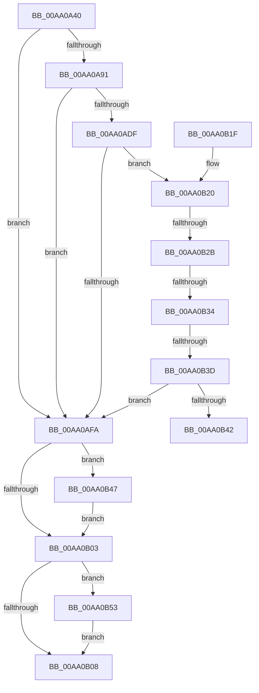

# PipDmgGetDriverDmarCompatLevel

- RVA: `0x00AA0A40`–`0x00AA0B5D` (길이 `285` bytes)
- VA: `0x0000000140AA0A40`
- 실행 섹션: `PAGE`
- PDB 이름 있음: `예`; PDB Function 태그: `예`
- unwind 정보 RVA: `0x000BABBC`
- 디코드: `80`개 명령, `285/285` bytes 표시
- 미해석 바이트: `0` (있으면 어셈블리에 `.byte`로 보존)

> 이 문서는 커널 이미지의 기계어와 PDB 기호를 분석해 생성했습니다. 4번과 5번은 함수 원형과 자료형을 바이너리 사용 방식에서 추정한 C 해석이며 원본 소스 복구 결과는 아닙니다.

## 1. Dependencies

- 직접 호출 지점: **5**; 고유 호출 대상: **4**
- 직접 호출자로 확인된 함수: **1**
- RIP 상대 이미지 참조: **2**

### Outgoing calls
- `0x00AA0A84` → [PipOpenServiceEnumKeys](../99/PipOpenServiceEnumKeys_function_00998E94.md) (function, `0x00998E94`)
- `0x00AA0AD6` → [ZwOpenKey](../../text/6A/ZwOpenKey_function_006AD310.md) (function, `0x006AD310`)
- `0x00AA0AF1` → [PnpGetRegistryDword](../../text/4B/PnpGetRegistryDword_function_004BFDE8.md) (function, `0x004BFDE8`)
- `0x00AA0B47` → [ZwClose](../../text/6A/ZwClose_function_006AD2B0.md) (function, `0x006AD2B0`)
- `0x00AA0B56` → [ZwClose](../../text/6A/ZwClose_function_006AD2B0.md) (function, `0x006AD2B0`)

### Direct callers
- [PipDmgGetDriversDmarPolicy](../73/PipDmgGetDriversDmarPolicy_function_007308EC.md) at `0x00730935`

### Static image references
- `0x00AA0A94` → RVA `0x00AFD4B0` (` ?? ::NNGAKEGL::`string'`; read)
- `0x00AA0AEA` → RVA `0x00AFE390` (` ?? ::NNGAKEGL::`string'`; read)

## 2. Other-region calls and transfers

- 다른 실행 섹션으로 향하는 call: **4**
  - `0x00AA0AD6` → [ZwOpenKey](../../text/6A/ZwOpenKey_function_006AD310.md) (`PAGE` → `.text`)
  - `0x00AA0AF1` → [PnpGetRegistryDword](../../text/4B/PnpGetRegistryDword_function_004BFDE8.md) (`PAGE` → `.text`)
  - `0x00AA0B47` → [ZwClose](../../text/6A/ZwClose_function_006AD2B0.md) (`PAGE` → `.text`)
  - `0x00AA0B56` → [ZwClose](../../text/6A/ZwClose_function_006AD2B0.md) (`PAGE` → `.text`)
- call이 아닌 외부 분기/꼬리 이동: **4**
  - `0x00AA0B25` → [sub_00B492BC + 0x26](../B4/Unknown_function_00B492BC.md) (`tail-transfer`)
  - `0x00AA0B2E` → [sub_00B492BC + 0x1C](../B4/Unknown_function_00B492BC.md) (`tail-transfer`)
  - `0x00AA0B37` → [sub_00B492BC](../B4/Unknown_function_00B492BC.md) (`tail-transfer`)
  - `0x00AA0B42` → [sub_00B492BC + 0x1C](../B4/Unknown_function_00B492BC.md) (`tail-transfer`)

## 3. Assembly (complete function range)

```asm
00AA0A40  48 89 5C 24 18                  mov qword ptr [rsp + 0x18], rbx
00AA0A45  48 89 74 24 20                  mov qword ptr [rsp + 0x20], rsi
00AA0A4A  55                              push rbp
00AA0A4B  57                              push rdi
00AA0A4C  41 56                           push r14
00AA0A4E  48 8B EC                        mov rbp, rsp
00AA0A51  48 83 EC 70                     sub rsp, 0x70
00AA0A55  4C 8B F1                        mov r14, rcx
00AA0A58  4C 8D 45 20                     lea r8, [rbp + 0x20]
00AA0A5C  48 8B 49 30                     mov rcx, qword ptr [rcx + 0x30]
00AA0A60  33 FF                           xor edi, edi
00AA0A62  48 21 7D 28                     and qword ptr [rbp + 0x28], rdi
00AA0A66  0F 57 C0                        xorps xmm0, xmm0
00AA0A69  48 21 7D 20                     and qword ptr [rbp + 0x20], rdi
00AA0A6D  BB 19 00 02 00                  mov ebx, 0x20019
00AA0A72  48 83 C1 18                     add rcx, 0x18
00AA0A76  40 88 7C 24 20                  mov byte ptr [rsp + 0x20], dil
00AA0A7B  45 33 C9                        xor r9d, r9d
00AA0A7E  8B D3                           mov edx, ebx
00AA0A80  0F 11 45 C0                     movups xmmword ptr [rbp - 0x40], xmm0
00AA0A84  E8 0B 84 EF FF                  call 0x140998e94
00AA0A89  48 8B 75 20                     mov rsi, qword ptr [rbp + 0x20]
00AA0A8D  85 C0                           test eax, eax
00AA0A8F  78 69                           js 0x140aa0afa
00AA0A91  21 7D EC                        and dword ptr [rbp - 0x14], edi
00AA0A94  48 8D 05 15 CA 05 00            lea rax, [rip + 0x5ca15]
00AA0A9B  48 89 45 C8                     mov qword ptr [rbp - 0x38], rax
00AA0A9F  4C 8D 45 D0                     lea r8, [rbp - 0x30]
00AA0AA3  48 8D 45 C0                     lea rax, [rbp - 0x40]
00AA0AA7  48 C7 45 D0 30 00 00 00         mov qword ptr [rbp - 0x30], 0x30
00AA0AAF  21 7D D4                        and dword ptr [rbp - 0x2c], edi
00AA0AB2  48 8D 4D 28                     lea rcx, [rbp + 0x28]
00AA0AB6  0F 57 C0                        xorps xmm0, xmm0
00AA0AB9  48 89 45 E0                     mov qword ptr [rbp - 0x20], rax
00AA0ABD  8B D3                           mov edx, ebx
00AA0ABF  C7 45 C0 14 00 16 00            mov dword ptr [rbp - 0x40], 0x160014
00AA0AC6  48 89 75 D8                     mov qword ptr [rbp - 0x28], rsi
00AA0ACA  C7 45 E8 40 02 00 00            mov dword ptr [rbp - 0x18], 0x240
00AA0AD1  F3 0F 7F 45 F0                  movdqu xmmword ptr [rbp - 0x10], xmm0
00AA0AD6  E8 35 C8 C0 FF                  call 0x1406ad310
00AA0ADB  85 C0                           test eax, eax
00AA0ADD  78 1B                           js 0x140aa0afa
00AA0ADF  48 8B 4D 28                     mov rcx, qword ptr [rbp + 0x28]
00AA0AE3  4C 8D 45 20                     lea r8, [rbp + 0x20]
00AA0AE7  21 7D 20                        and dword ptr [rbp + 0x20], edi
00AA0AEA  48 8D 15 9F D8 05 00            lea rdx, [rip + 0x5d89f]
00AA0AF1  E8 F2 F2 A1 FF                  call 0x1404bfde8
00AA0AF6  85 C0                           test eax, eax
00AA0AF8  79 26                           jns 0x140aa0b20
00AA0AFA  48 8B 4D 28                     mov rcx, qword ptr [rbp + 0x28]
00AA0AFE  48 85 C9                        test rcx, rcx
00AA0B01  75 44                           jne 0x140aa0b47
00AA0B03  48 85 F6                        test rsi, rsi
00AA0B06  75 4B                           jne 0x140aa0b53
00AA0B08  4C 8D 5C 24 70                  lea r11, [rsp + 0x70]
00AA0B0D  8B C7                           mov eax, edi
00AA0B0F  49 8B 5B 30                     mov rbx, qword ptr [r11 + 0x30]
00AA0B13  49 8B 73 38                     mov rsi, qword ptr [r11 + 0x38]
00AA0B17  49 8B E3                        mov rsp, r11
00AA0B1A  41 5E                           pop r14
00AA0B1C  5F                              pop rdi
00AA0B1D  5D                              pop rbp
00AA0B1E  C3                              ret
00AA0B1F  CC                              int3
00AA0B20  8B 45 20                        mov eax, dword ptr [rbp + 0x20]
00AA0B23  85 C0                           test eax, eax
00AA0B25  0F 84 B7 87 0A 00               je 0x140b492e2
00AA0B2B  83 E8 01                        sub eax, 1
00AA0B2E  0F 84 A4 87 0A 00               je 0x140b492d8
00AA0B34  83 E8 01                        sub eax, 1
00AA0B37  0F 84 7F 87 0A 00               je 0x140b492bc
00AA0B3D  83 F8 01                        cmp eax, 1
00AA0B40  75 B8                           jne 0x140aa0afa
00AA0B42  E9 91 87 0A 00                  jmp 0x140b492d8
00AA0B47  E8 64 C7 C0 FF                  call 0x1406ad2b0
00AA0B4C  48 83 65 28 00                  and qword ptr [rbp + 0x28], 0
00AA0B51  EB B0                           jmp 0x140aa0b03
00AA0B53  48 8B CE                        mov rcx, rsi
00AA0B56  E8 55 C7 C0 FF                  call 0x1406ad2b0
00AA0B5B  EB AB                           jmp 0x140aa0b08
```

## 4. C-style interpretation (structured pseudocode)

```c
__int64 __fastcall PipDmgGetDriverDmarCompatLevel(__int64 a1, __int64 a2, __int64 a3, int a4)
{
    __int64 result;
    __int64 v_rdi;
    __int64 v_rsp;
    unsigned __int64 v_stack_m18;
    unsigned __int64 v_stack_m28;
    unsigned int v_stack_m2C;
    unsigned int v_stack_m30;
    unsigned __int64 v_stack_m38;
    unsigned __int64 v_stack_m40;
    unsigned int v_stack_m44;
    unsigned __int64 v_stack_m48;
    unsigned __int64 v_stack_m50;
    unsigned __int64 v_stack_m58;
    unsigned __int8 v_stack_m68;
    unsigned __int64 v_stack_p10;
    unsigned __int64 v_stack_p18;
    unsigned __int64 v_stack_p20;
    unsigned __int64 v_stack_p8;

    v_stack_p18 = v_rbx;
    v_stack_p20 = v_rsi;
    v_rsp = (v_rsp) - (112);
    v_rdi = 0;
    a1 = (*(unsigned __int64 *)(a1 + 48)) + (24);
    v_stack_m68 = 0;
    a4 = 0;
    v_stack_m58 = v_xmm0;
    result = PipOpenServiceEnumKeys(a1, (unsigned int)((unsigned int)((unsigned int)(0x20019ULL))), v_stack_p8, a4);
    if (sign_flag) goto loc_00AA0AFA;
    v_stack_m50 = v_rip + 379413;
    v_stack_m48 = 48;
    v_stack_m38 = v_stack_m58;
    v_stack_m58 = 0x160014ULL;
    v_stack_m40 = v_stack_p8;
    v_stack_m30 = 576;
    v_stack_m28 = v_xmm0;
    result = ZwOpenKey(v_stack_p10, (unsigned int)((unsigned int)((unsigned int)(0x20019ULL))), v_stack_m48, a4);
    if (sign_flag) goto loc_00AA0AFA;
    result = PnpGetRegistryDword(v_stack_p10, v_rip + 383135, v_stack_p8, a4);
    if (!sign_flag) goto loc_00AA0B20;
loc_00AA0AFA:
    if (v_stack_p10 != 0) goto loc_00AA0B47;
loc_00AA0B03:
    if (v_stack_p8 != 0) goto loc_00AA0B53;
loc_00AA0B08:
    return 0;
loc_00AA0B20:
    result = (unsigned int)(((unsigned int)(v_stack_p8)) - (1));
    result = (unsigned int)((result) - (1));
    if (((unsigned int)(result)) != 1) goto loc_00AA0AFA;
loc_00AA0B47:
    result = ZwClose(v_stack_p10, v_rip + 383135, v_stack_p8, a4);
    goto loc_00AA0B03;
loc_00AA0B53:
    result = ZwClose(*(unsigned __int64 *)(v_stack_m18 + 56), v_rip + 383135, v_stack_p8, a4);
    goto loc_00AA0B08;
}
```

## 5. (Beta) C Style

```c
int64_t PipDmgGetDriverDmarCompatLevel(void *Arg1, int64_t Arg2, int64_t Arg3, int32_t Arg4)
{
    uint8_t *arg1 = (uint8_t *)Arg1;

    int64_t result;
    int64_t local_rdi;
    int64_t local_rsp;
    uint64_t v_stack_m18;
    uint64_t v_stack_m28;
    uint32_t v_stack_m2C;
    uint32_t v_stack_m30;
    uint64_t v_stack_m38;
    uint64_t v_stack_m40;
    uint32_t v_stack_m44;
    uint64_t v_stack_m48;
    uint64_t v_stack_m50;
    uint64_t v_stack_m58;
    uint8_t v_stack_m68;
    uint64_t v_stack_p10;
    uint64_t v_stack_p18;
    uint64_t v_stack_p20;
    uint64_t v_stack_p8;

    v_stack_p18 = local_rbx;
    v_stack_p20 = local_rsi;
    local_rsp = (local_rsp) - (112);
    local_rdi = 0;
    Arg1 = (*(uint64_t *)(arg1 + 0x30)) + (24);
    v_stack_m68 = 0;
    Arg4 = 0;
    v_stack_m58 = v_xmm0;
    result = PipOpenServiceEnumKeys(Arg1, (uint32_t)((uint32_t)((uint32_t)(0x20019ULL))), v_stack_p8, Arg4);
    if (sign_flag) goto loc_00AA0AFA;
    v_stack_m50 = v_rip + 379413;
    v_stack_m48 = 48;
    v_stack_m38 = v_stack_m58;
    v_stack_m58 = 0x160014ULL;
    v_stack_m40 = v_stack_p8;
    v_stack_m30 = 576;
    v_stack_m28 = v_xmm0;
    result = ZwOpenKey(v_stack_p10, (uint32_t)((uint32_t)((uint32_t)(0x20019ULL))), v_stack_m48, Arg4);
    if (sign_flag) goto loc_00AA0AFA;
    result = PnpGetRegistryDword(v_stack_p10, v_rip + 383135, v_stack_p8, Arg4);
    if (!sign_flag) goto loc_00AA0B20;
loc_00AA0AFA:
    if (v_stack_p10 != 0) goto loc_00AA0B47;
loc_00AA0B03:
    if (v_stack_p8 != 0) goto loc_00AA0B53;
loc_00AA0B08:
    return 0;
loc_00AA0B20:
    result = (uint32_t)(((uint32_t)(v_stack_p8)) - (1));
    result = (uint32_t)((result) - (1));
    if (((uint32_t)(result)) != 1) goto loc_00AA0AFA;
loc_00AA0B47:
    result = ZwClose(v_stack_p10, v_rip + 383135, v_stack_p8, Arg4);
    goto loc_00AA0B03;
loc_00AA0B53:
    result = ZwClose(*(uint64_t *)(v_stack_m18 + 0x38), v_rip + 383135, v_stack_p8, Arg4);
    goto loc_00AA0B08;
}
```

### 관측된 메모리 오프셋

구조체 형식이 확인되지 않은 접근은 인자 기준의 오프셋으로만 기록했습니다.

| 기준 인자 | 오프셋 표현 | 폭 (bit) | 접근 |
|---|---:|---:|---|
| `Arg1` | `+ 0x30` | `64` | `R` |

## 6. Execution-region graph

[열기: 2D/3D 그래프와 함수 탐색 컨트롤 패널](../../../control-panel.html?section=page&rva=0x00AA0A40&view=graph)

- 2D 그래프는 위에서 아래로 흐르고, 3D 그래프는 빈 공간을 드래그해 회전합니다. Shift+드래그는 이동, 휠은 확대·축소, 함수 노드 선택은 대상 보고서 이동입니다.

### Static fallback


