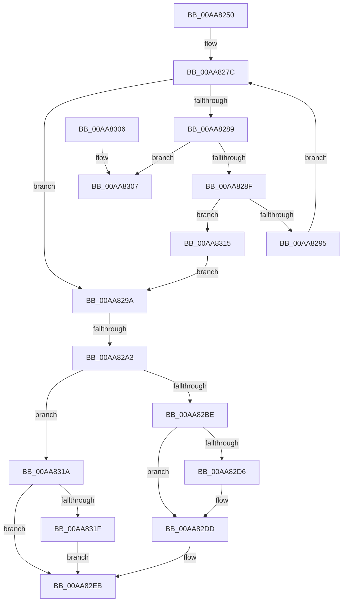

# PnpAddVetoInformation

- RVA: `0x00AA8250`–`0x00AA832E` (길이 `222` bytes)
- VA: `0x0000000140AA8250`
- 실행 섹션: `PAGE`
- PDB 이름 있음: `예`; PDB Function 태그: `예`
- unwind 정보 RVA: `0x000A5678`
- 디코드: `65`개 명령, `222/222` bytes 표시
- 미해석 바이트: `0` (있으면 어셈블리에 `.byte`로 보존)

> 이 문서는 커널 이미지의 기계어와 PDB 기호를 분석해 생성했습니다. 4번과 5번은 함수 원형과 자료형을 바이너리 사용 방식에서 추정한 C 해석이며 원본 소스 복구 결과는 아닙니다.

## 1. Dependencies

- 직접 호출 지점: **3**; 고유 호출 대상: **3**
- 직접 호출자로 확인된 함수: **1**
- RIP 상대 이미지 참조: **0**

### Outgoing calls
- `0x00AA82B1` → [ExAllocatePool2](../../poolcode/B8/ExAllocatePool2_function_00B820F0.md) (function, `0x00B820F0`)
- `0x00AA82C1` → [ObfReferenceObject](../../text/20/ObfReferenceObject_function_0020FA20.md) (function, `0x0020FA20`)
- `0x00AA8327` → [ExFreePoolWithTag](../../poolcode/B8/ExFreePoolWithTag_function_00B82870.md) (function, `0x00B82870`)

### Direct callers
- [PnpCollectOpenHandlesCallBack](../73/PnpCollectOpenHandlesCallBack_function_00737EF0.md) at `0x00737F3D`

### Static image references
- 디코드된 RIP-relative 메모리 참조가 없습니다.

## 2. Other-region calls and transfers

- 다른 실행 섹션으로 향하는 call: **3**
  - `0x00AA82B1` → [ExAllocatePool2](../../poolcode/B8/ExAllocatePool2_function_00B820F0.md) (`PAGE` → `POOLCODE`)
  - `0x00AA82C1` → [ObfReferenceObject](../../text/20/ObfReferenceObject_function_0020FA20.md) (`PAGE` → `.text`)
  - `0x00AA8327` → [ExFreePoolWithTag](../../poolcode/B8/ExFreePoolWithTag_function_00B82870.md) (`PAGE` → `POOLCODE`)
- call이 아닌 외부 분기/꼬리 이동: **2**
  - `0x00AA829D` → [sub_00B4A468 + 0x29](../B4/Unknown_function_00B4A468.md) (`tail-transfer`)
  - `0x00AA8310` → [sub_00B4A468](../B4/Unknown_function_00B4A468.md) (`tail-transfer`)

## 3. Assembly (complete function range)

```asm
00AA8250  48 8B C4                        mov rax, rsp
00AA8253  48 89 58 08                     mov qword ptr [rax + 8], rbx
00AA8257  48 89 68 10                     mov qword ptr [rax + 0x10], rbp
00AA825B  48 89 70 18                     mov qword ptr [rax + 0x18], rsi
00AA825F  48 89 78 20                     mov qword ptr [rax + 0x20], rdi
00AA8263  41 56                           push r14
00AA8265  48 83 EC 20                     sub rsp, 0x20
00AA8269  48 8B 02                        mov rax, qword ptr [rdx]
00AA826C  33 DB                           xor ebx, ebx
00AA826E  33 FF                           xor edi, edi
00AA8270  45 8B F0                        mov r14d, r8d
00AA8273  48 8B F2                        mov rsi, rdx
00AA8276  48 8B E9                        mov rbp, rcx
00AA8279  41 B2 01                        mov r10b, 1
00AA827C  48 83 E8 18                     sub rax, 0x18
00AA8280  4C 8D 48 18                     lea r9, [rax + 0x18]
00AA8284  49 3B F1                        cmp rsi, r9
00AA8287  74 11                           je 0x140aa829a
00AA8289  44 39 70 10                     cmp dword ptr [rax + 0x10], r14d
00AA828D  74 78                           je 0x140aa8307
00AA828F  0F 87 80 00 00 00               ja 0x140aa8315
00AA8295  49 8B 01                        mov rax, qword ptr [r9]
00AA8298  EB E2                           jmp 0x140aa827c
00AA829A  45 84 D2                        test r10b, r10b
00AA829D  0F 85 EE 21 0A 00               jne 0x140b4a491
00AA82A3  BA 18 00 00 00                  mov edx, 0x18
00AA82A8  41 B8 50 6E 70 50               mov r8d, 0x50706e50
00AA82AE  8D 4A 28                        lea ecx, [rdx + 0x28]
00AA82B1  E8 3A 9E 0D 00                  call 0x140b820f0
00AA82B6  48 8B F0                        mov rsi, rax
00AA82B9  48 85 C0                        test rax, rax
00AA82BC  74 5C                           je 0x140aa831a
00AA82BE  48 8B CD                        mov rcx, rbp
00AA82C1  E8 5A 77 76 FF                  call 0x14020fa20
00AA82C6  48 89 2E                        mov qword ptr [rsi], rbp
00AA82C9  48 8D 46 08                     lea rax, [rsi + 8]
00AA82CD  48 8B 4F 08                     mov rcx, qword ptr [rdi + 8]
00AA82D1  48 39 39                        cmp qword ptr [rcx], rdi
00AA82D4  74 07                           je 0x140aa82dd
00AA82D6  B9 03 00 00 00                  mov ecx, 3
00AA82DB  CD 29                           int 0x29
00AA82DD  48 89 38                        mov qword ptr [rax], rdi
00AA82E0  48 89 48 08                     mov qword ptr [rax + 8], rcx
00AA82E4  48 89 01                        mov qword ptr [rcx], rax
00AA82E7  48 89 47 08                     mov qword ptr [rdi + 8], rax
00AA82EB  48 8B 5C 24 30                  mov rbx, qword ptr [rsp + 0x30]
00AA82F0  48 8B 6C 24 38                  mov rbp, qword ptr [rsp + 0x38]
00AA82F5  48 8B 74 24 40                  mov rsi, qword ptr [rsp + 0x40]
00AA82FA  48 8B 7C 24 48                  mov rdi, qword ptr [rsp + 0x48]
00AA82FF  48 83 C4 20                     add rsp, 0x20
00AA8303  41 5E                           pop r14
00AA8305  C3                              ret
00AA8306  CC                              int3
00AA8307  48 8B 08                        mov rcx, qword ptr [rax]
00AA830A  48 8B F8                        mov rdi, rax
00AA830D  45 32 D2                        xor r10b, r10b
00AA8310  E9 53 21 0A 00                  jmp 0x140b4a468
00AA8315  49 8B F1                        mov rsi, r9
00AA8318  EB 80                           jmp 0x140aa829a
00AA831A  48 85 DB                        test rbx, rbx
00AA831D  74 CC                           je 0x140aa82eb
00AA831F  BA 50 6E 70 4F                  mov edx, 0x4f706e50
00AA8324  48 8B CB                        mov rcx, rbx
00AA8327  E8 44 A5 0D 00                  call 0x140b82870
00AA832C  EB BD                           jmp 0x140aa82eb
```

## 4. C-style interpretation (structured pseudocode)

```c
__int64 __fastcall PnpAddVetoInformation(__int64 a1, __int64 a2, int a3)
{
    __int64 result;
    __int64 v_r10;
    __int64 v_rbx;
    __int64 v_rdi;
    __int64 v_rsp;
    unsigned __int64 v_stack_p10;
    unsigned __int64 v_stack_p18;
    unsigned __int64 v_stack_p20;
    unsigned __int64 v_stack_p8;

    *(unsigned __int64 *)(v_rsp + 8) = v_rbx;
    *(unsigned __int64 *)(v_rsp + 16) = v_rbp;
    *(unsigned __int64 *)(v_rsp + 24) = v_rsi;
    *(unsigned __int64 *)(v_rsp + 32) = v_rdi;
    v_rsp = (v_rsp) - (32);
    v_rbx = 0;
    v_rdi = 0;
loc_00AA827C:
    result = (*(unsigned __int64 *)(a2)) - (24);
    if (a2 == (result + 24)) goto loc_00AA829A;
    if ((*(unsigned int *)(result + 16)) == ((unsigned int)((unsigned int)(a3)))) goto loc_00AA8307;
    if ((*(unsigned int *)(result + 16)) > ((unsigned int)((unsigned int)(a3)))) goto loc_00AA8315;
    goto loc_00AA827C;
loc_00AA829A:
    result = ExAllocatePool2(24 + 40, 24, (unsigned int)(0x50706E50ULL), result + 24);
    if (result == 0) goto loc_00AA831A;
    result = ObfReferenceObject(a1, 24, (unsigned int)(0x50706E50ULL), result + 24);
    *(unsigned __int64 *)(result) = a1;
    if ((*(unsigned __int64 *)(*(unsigned __int64 *)(v_rdi + 8))) != 0) {
        a1 = 3;
    }
    *(unsigned __int64 *)(result + 8) = 0;
    *(unsigned __int64 *)(result + 8 + 8) = a1;
    *(unsigned __int64 *)(a1) = result + 8;
    *(unsigned __int64 *)(v_rdi + 8) = result + 8;
loc_00AA82EB:
    v_rsp = (v_rsp) + (32);
    return result + 8;
loc_00AA8307:
    v_r10 = 0;
loc_00AA8315:
    goto loc_00AA829A;
loc_00AA831A:
    if (v_stack_p8 == 0) goto loc_00AA82EB;
    result = ExFreePoolWithTag(v_stack_p8, (unsigned int)(0x4F706E50ULL), (unsigned int)(0x50706E50ULL), result + 24);
    goto loc_00AA82EB;
}
```

## 5. (Beta) C Style

```c
int64_t PnpAddVetoInformation(int64_t Arg1, void *Arg2, int32_t Arg3)
{
    uint8_t *arg2 = (uint8_t *)Arg2;

    int64_t result;
    int64_t local_r10;
    int64_t local_rbx;
    int64_t local_rdi;
    int64_t local_rsp;
    uint64_t v_stack_p10;
    uint64_t v_stack_p18;
    uint64_t v_stack_p20;
    uint64_t v_stack_p8;

    *(uint64_t *)(local_rsp + 0x8) = local_rbx;
    *(uint64_t *)(local_rsp + 0x10) = local_rbp;
    *(uint64_t *)(local_rsp + 0x18) = local_rsi;
    *(uint64_t *)(local_rsp + 0x20) = local_rdi;
    local_rsp = (local_rsp) - (32);
    local_rbx = 0;
    local_rdi = 0;
loc_00AA827C:
    result = (*(uint64_t *)(arg2)) - (24);
    if (Arg2 == (result + 24)) goto loc_00AA829A;
    if ((*(uint32_t *)(result + 0x10)) == ((uint32_t)((uint32_t)(Arg3)))) goto loc_00AA8307;
    if ((*(uint32_t *)(result + 0x10)) > ((uint32_t)((uint32_t)(Arg3)))) goto loc_00AA8315;
    goto loc_00AA827C;
loc_00AA829A:
    result = ExAllocatePool2(24 + 40, 24, (uint32_t)(0x50706E50ULL), result + 24);
    if (result == 0) goto loc_00AA831A;
    result = ObfReferenceObject(Arg1, 24, (uint32_t)(0x50706E50ULL), result + 24);
    *(uint64_t *)(result) = Arg1;
    if ((*(uint64_t *)(*(uint64_t *)(local_rdi + 0x8))) != 0) {
        Arg1 = 3;
    }
    *(uint64_t *)(result + 0x8) = 0;
    *(uint64_t *)(result + 0x8 + 0x8) = Arg1;
    *(uint64_t *)(Arg1) = result + 8;
    *(uint64_t *)(local_rdi + 0x8) = result + 8;
loc_00AA82EB:
    local_rsp = (local_rsp) + (32);
    return result + 8;
loc_00AA8307:
    local_r10 = 0;
loc_00AA8315:
    goto loc_00AA829A;
loc_00AA831A:
    if (v_stack_p8 == 0) goto loc_00AA82EB;
    result = ExFreePoolWithTag(v_stack_p8, (uint32_t)(0x4F706E50ULL), (uint32_t)(0x50706E50ULL), result + 24);
    goto loc_00AA82EB;
}
```

### 관측된 메모리 오프셋

구조체 형식이 확인되지 않은 접근은 인자 기준의 오프셋으로만 기록했습니다.

| 기준 인자 | 오프셋 표현 | 폭 (bit) | 접근 |
|---|---:|---:|---|
| `Arg2` | `+ 0x0` | `64` | `R` |

## 6. Execution-region graph

[열기: 2D/3D 그래프와 함수 탐색 컨트롤 패널](../../../control-panel.html?section=page&rva=0x00AA8250&view=graph)

- 2D 그래프는 위에서 아래로 흐르고, 3D 그래프는 빈 공간을 드래그해 회전합니다. Shift+드래그는 이동, 휠은 확대·축소, 함수 노드 선택은 대상 보고서 이동입니다.

### Static fallback


