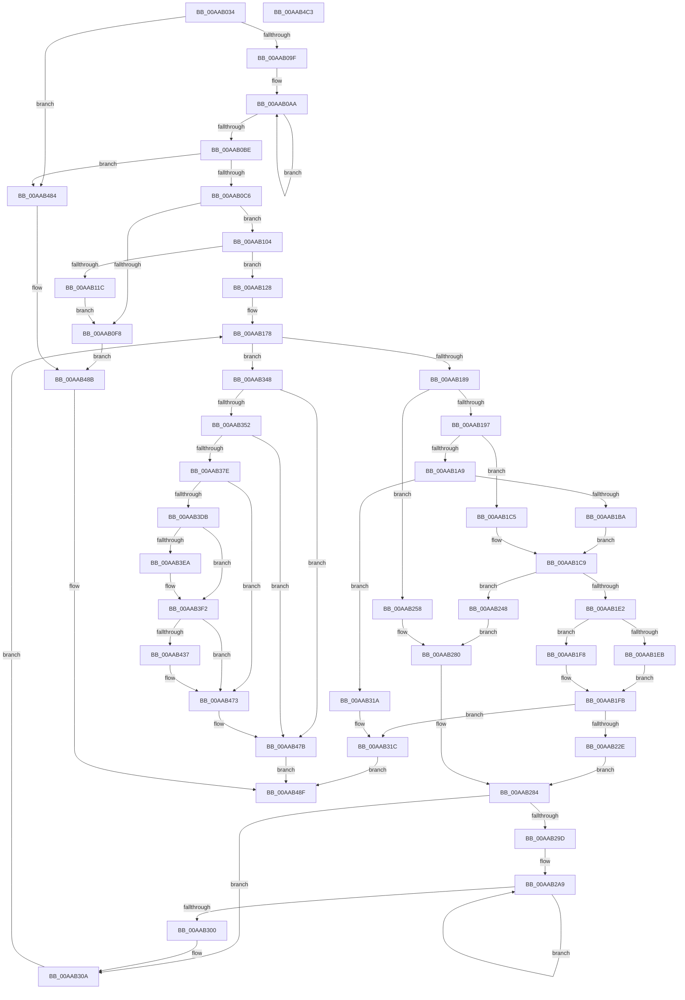

# PnpBuildCmResourceList

- RVA: `0x00AAB034`–`0x00AAB4C4` (길이 `1,168` bytes)
- VA: `0x0000000140AAB034`
- 실행 섹션: `PAGE`
- PDB 이름 있음: `예`; PDB Function 태그: `아니요`
- unwind 정보 RVA: `0x000BBDB8`
- 디코드: `280`개 명령, `1,168/1,168` bytes 표시
- 미해석 바이트: `0` (있으면 어셈블리에 `.byte`로 보존)

> 이 문서는 커널 이미지의 기계어와 PDB 기호를 분석해 생성했습니다. 4번과 5번은 함수 원형과 자료형을 바이너리 사용 방식에서 추정한 C 해석이며 원본 소스 복구 결과는 아닙니다.

## 1. Dependencies

- 직접 호출 지점: **18**; 고유 호출 대상: **11**
- 직접 호출자로 확인된 함수: **2**
- RIP 상대 이미지 참조: **6**

### Outgoing calls
- `0x00AAB0E6` → [ExAllocatePool2](../../poolcode/B8/ExAllocatePool2_function_00B820F0.md) (function, `0x00B820F0`)
- `0x00AAB10F` → [ExAllocatePool2](../../poolcode/B8/ExAllocatePool2_function_00B820F0.md) (function, `0x00B820F0`)
- `0x00AAB121` → [ExFreePoolWithTag](../../poolcode/B8/ExFreePoolWithTag_function_00B82870.md) (function, `0x00B82870`)
- `0x00AAB1A9` → [IopParentToRawTranslation](../72/IopParentToRawTranslation_function_0072AE04.md) (function, `0x0072AE04`)
- `0x00AAB21B` → [IopChildToRootTranslation](IopChildToRootTranslation_function_00AAB4CC.md) (function, `0x00AAB4CC`)
- `0x00AAB241` → [ExFreePoolWithTag](../../poolcode/B8/ExFreePoolWithTag_function_00B82870.md) (function, `0x00B82870`)
- `0x00AAB2DA` → [memcpy](../../text/6C/memcpy_function_006C6840.md) (function, `0x006C6840`)
- `0x00AAB2EC` → [memcpy](../../text/6C/memcpy_function_006C6840.md) (function, `0x006C6840`)
- `0x00AAB31F` → [ExFreePoolWithTag](../../poolcode/B8/ExFreePoolWithTag_function_00B82870.md) (function, `0x00B82870`)
- `0x00AAB329` → [ExFreePoolWithTag](../../poolcode/B8/ExFreePoolWithTag_function_00B82870.md) (function, `0x00B82870`)
- `0x00AAB371` → [IopCreateRegistryKeyEx](../A8/IopCreateRegistryKeyEx_function_00A89038.md) (function, `0x00A89038`)
- `0x00AAB3CA` → [ObQueryNameStringMode](../8A/ObQueryNameStringMode_function_008A7ED0.md) (function, `0x008A7ED0`)
- `0x00AAB408` → [RtlAppendUnicodeToString](../../text/40/RtlAppendUnicodeToString_function_0040F990.md) (function, `0x0040F990`)
- `0x00AAB42E` → [IopWriteResourceList](../72/IopWriteResourceList_function_0072A5F0.md) (function, `0x0072A5F0`)
- `0x00AAB44D` → [RtlAppendUnicodeToString](../../text/40/RtlAppendUnicodeToString_function_0040F990.md) (function, `0x0040F990`)
- `0x00AAB46E` → [IopWriteResourceList](../72/IopWriteResourceList_function_0072A5F0.md) (function, `0x0072A5F0`)
- `0x00AAB476` → [ZwClose](../../text/6A/ZwClose_function_006AD2B0.md) (function, `0x006AD2B0`)
- `0x00AAB49D` → [_security_check_cookie](../../text/6A/_security_check_cookie_function_006AC640.md) (function, `0x006AC640`)

### Direct callers
- [IopAllocateBootResourcesInternal](../72/IopAllocateBootResourcesInternal_function_0072E708.md) at `0x0072E7BD`
- [PnpBuildCmResourceLists](../73/PnpBuildCmResourceLists_function_0073E684.md) at `0x0073E776`

### Static image references
- `0x00AAB05A` → RVA `0x00E0A740` (`.data`; read)
- `0x00AAB355` → RVA `0x00FDA028` (`PAGEDATA`; read)
- `0x00AAB37E` → RVA `0x00AFD5C0` (` ?? ::NNGAKEGL::`string'`; read)
- `0x00AAB393` → RVA `0x00B00230` (` ?? ::NNGAKEGL::`string'`; read)
- `0x00AAB3F6` → RVA `0x00028448` (`.rdata`; read)
- `0x00AAB43B` → RVA `0x00028458` (`.rdata`; read)

## 2. Other-region calls and transfers

- 다른 실행 섹션으로 향하는 call: **12**
  - `0x00AAB0E6` → [ExAllocatePool2](../../poolcode/B8/ExAllocatePool2_function_00B820F0.md) (`PAGE` → `POOLCODE`)
  - `0x00AAB10F` → [ExAllocatePool2](../../poolcode/B8/ExAllocatePool2_function_00B820F0.md) (`PAGE` → `POOLCODE`)
  - `0x00AAB121` → [ExFreePoolWithTag](../../poolcode/B8/ExFreePoolWithTag_function_00B82870.md) (`PAGE` → `POOLCODE`)
  - `0x00AAB241` → [ExFreePoolWithTag](../../poolcode/B8/ExFreePoolWithTag_function_00B82870.md) (`PAGE` → `POOLCODE`)
  - `0x00AAB2DA` → [memcpy](../../text/6C/memcpy_function_006C6840.md) (`PAGE` → `.text`)
  - `0x00AAB2EC` → [memcpy](../../text/6C/memcpy_function_006C6840.md) (`PAGE` → `.text`)
  - `0x00AAB31F` → [ExFreePoolWithTag](../../poolcode/B8/ExFreePoolWithTag_function_00B82870.md) (`PAGE` → `POOLCODE`)
  - `0x00AAB329` → [ExFreePoolWithTag](../../poolcode/B8/ExFreePoolWithTag_function_00B82870.md) (`PAGE` → `POOLCODE`)
  - `0x00AAB408` → [RtlAppendUnicodeToString](../../text/40/RtlAppendUnicodeToString_function_0040F990.md) (`PAGE` → `.text`)
  - `0x00AAB44D` → [RtlAppendUnicodeToString](../../text/40/RtlAppendUnicodeToString_function_0040F990.md) (`PAGE` → `.text`)
  - `0x00AAB476` → [ZwClose](../../text/6A/ZwClose_function_006AD2B0.md) (`PAGE` → `.text`)
  - `0x00AAB49D` → [_security_check_cookie](../../text/6A/_security_check_cookie_function_006AC640.md) (`PAGE` → `.text`)
- 별도 외부 분기/꼬리 이동을 확인하지 못했습니다.

## 3. Assembly (complete function range)

```asm
00AAB034  48 8B C4                        mov rax, rsp
00AAB037  48 89 58 10                     mov qword ptr [rax + 0x10], rbx
00AAB03B  48 89 70 18                     mov qword ptr [rax + 0x18], rsi
00AAB03F  48 89 78 20                     mov qword ptr [rax + 0x20], rdi
00AAB043  55                              push rbp
00AAB044  41 54                           push r12
00AAB046  41 55                           push r13
00AAB048  41 56                           push r14
00AAB04A  41 57                           push r15
00AAB04C  48 8D A8 38 FE FF FF            lea rbp, [rax - 0x1c8]
00AAB053  48 81 EC A0 02 00 00            sub rsp, 0x2a0
00AAB05A  48 8B 05 DF F6 35 00            mov rax, qword ptr [rip + 0x35f6df]
00AAB061  48 33 C4                        xor rax, rsp
00AAB064  48 89 85 90 01 00 00            mov qword ptr [rbp + 0x190], rax
00AAB06B  4C 8B 61 20                     mov r12, qword ptr [rcx + 0x20]
00AAB06F  33 DB                           xor ebx, ebx
00AAB071  48 8B F9                        mov rdi, rcx
00AAB074  48 89 4C 24 68                  mov qword ptr [rsp + 0x68], rcx
00AAB079  89 54 24 34                     mov dword ptr [rsp + 0x34], edx
00AAB07D  8B F3                           mov esi, ebx
00AAB07F  48 89 5D 80                     mov qword ptr [rbp - 0x80], rbx
00AAB083  49 8B 44 24 10                  mov rax, qword ptr [r12 + 0x10]
00AAB088  48 89 5C 24 78                  mov qword ptr [rsp + 0x78], rbx
00AAB08D  48 8B 08                        mov rcx, qword ptr [rax]
00AAB090  48 89 4D 88                     mov qword ptr [rbp - 0x78], rcx
00AAB094  8B 41 14                        mov eax, dword ptr [rcx + 0x14]
00AAB097  85 C0                           test eax, eax
00AAB099  0F 84 E5 03 00 00               je 0x140aab484
00AAB09F  48 8D 51 18                     lea rdx, [rcx + 0x18]
00AAB0A3  44 8B C0                        mov r8d, eax
00AAB0A6  44 8D 4B 01                     lea r9d, [rbx + 1]
00AAB0AA  48 8B 02                        mov rax, qword ptr [rdx]
00AAB0AD  FF C6                           inc esi
00AAB0AF  48 8D 52 08                     lea rdx, [rdx + 8]
00AAB0B3  03 B0 14 01 00 00               add esi, dword ptr [rax + 0x114]
00AAB0B9  4D 2B C1                        sub r8, r9
00AAB0BC  75 EC                           jne 0x140aab0aa
00AAB0BE  85 F6                           test esi, esi
00AAB0C0  0F 84 BE 03 00 00               je 0x140aab484
00AAB0C6  8D 46 01                        lea eax, [rsi + 1]
00AAB0C9  41 BD 50 70 20 20               mov r13d, 0x20207050
00AAB0CF  8D 04 80                        lea eax, [rax + rax*4]
00AAB0D2  45 8B C5                        mov r8d, r13d
00AAB0D5  C1 E0 02                        shl eax, 2
00AAB0D8  B9 00 01 00 00                  mov ecx, 0x100
00AAB0DD  8B D0                           mov edx, eax
00AAB0DF  89 44 24 50                     mov dword ptr [rsp + 0x50], eax
00AAB0E3  44 8B F0                        mov r14d, eax
00AAB0E6  E8 05 70 0D 00                  call 0x140b820f0
00AAB0EB  48 89 44 24 40                  mov qword ptr [rsp + 0x40], rax
00AAB0F0  4C 8B F8                        mov r15, rax
00AAB0F3  48 85 C0                        test rax, rax
00AAB0F6  75 0C                           jne 0x140aab104
00AAB0F8  C7 47 38 9A 00 00 C0            mov dword ptr [rdi + 0x38], 0xc000009a
00AAB0FF  E9 87 03 00 00                  jmp 0x140aab48b
00AAB104  45 8B C5                        mov r8d, r13d
00AAB107  49 8B D6                        mov rdx, r14
00AAB10A  B9 00 01 00 00                  mov ecx, 0x100
00AAB10F  E8 DC 6F 0D 00                  call 0x140b820f0
00AAB114  4C 8B E8                        mov r13, rax
00AAB117  48 85 C0                        test rax, rax
00AAB11A  75 0C                           jne 0x140aab128
00AAB11C  33 D2                           xor edx, edx
00AAB11E  49 8B CF                        mov rcx, r15
00AAB121  E8 4A 77 0D 00                  call 0x140b82870
00AAB126  EB D0                           jmp 0x140aab0f8
00AAB128  BA 01 00 00 00                  mov edx, 1
00AAB12D  4D 8D 77 14                     lea r14, [r15 + 0x14]
00AAB131  41 89 17                        mov dword ptr [r15], edx
00AAB134  41 8B 04 24                     mov eax, dword ptr [r12]
00AAB138  41 89 47 04                     mov dword ptr [r15 + 4], eax
00AAB13C  41 8B 44 24 04                  mov eax, dword ptr [r12 + 4]
00AAB141  41 89 47 08                     mov dword ptr [r15 + 8], eax
00AAB145  41 C7 47 0C 01 00 01 00         mov dword ptr [r15 + 0xc], 0x10001
00AAB14D  41 89 77 10                     mov dword ptr [r15 + 0x10], esi
00AAB151  41 89 55 00                     mov dword ptr [r13], edx
00AAB155  41 8B 04 24                     mov eax, dword ptr [r12]
00AAB159  41 89 45 04                     mov dword ptr [r13 + 4], eax
00AAB15D  41 8B 44 24 04                  mov eax, dword ptr [r12 + 4]
00AAB162  4D 8D 65 14                     lea r12, [r13 + 0x14]
00AAB166  41 89 45 08                     mov dword ptr [r13 + 8], eax
00AAB16A  8B C3                           mov eax, ebx
00AAB16C  41 C7 45 0C 01 00 01 00         mov dword ptr [r13 + 0xc], 0x10001
00AAB174  41 89 75 10                     mov dword ptr [r13 + 0x10], esi
00AAB178  48 8B 4D 88                     mov rcx, qword ptr [rbp - 0x78]
00AAB17C  89 44 24 38                     mov dword ptr [rsp + 0x38], eax
00AAB180  3B 41 14                        cmp eax, dword ptr [rcx + 0x14]
00AAB183  0F 83 BF 01 00 00               jae 0x140aab348
00AAB189  48 8B 74 C1 18                  mov rsi, qword ptr [rcx + rax*8 + 0x18]
00AAB18E  38 5E 08                        cmp byte ptr [rsi + 8], bl
00AAB191  0F 84 C1 00 00 00               je 0x140aab258
00AAB197  48 8B 4E 20                     mov rcx, qword ptr [rsi + 0x20]
00AAB19B  48 89 4C 24 58                  mov qword ptr [rsp + 0x58], rcx
00AAB1A0  83 B9 80 00 00 00 02            cmp dword ptr [rcx + 0x80], 2
00AAB1A7  74 1C                           je 0x140aab1c5
00AAB1A9  E8 56 FC C7 FF                  call 0x14072ae04
00AAB1AE  89 44 24 30                     mov dword ptr [rsp + 0x30], eax
00AAB1B2  85 C0                           test eax, eax
00AAB1B4  0F 88 60 01 00 00               js 0x140aab31a
00AAB1BA  48 8B 46 70                     mov rax, qword ptr [rsi + 0x70]
00AAB1BE  48 8B 4C 24 58                  mov rcx, qword ptr [rsp + 0x58]
00AAB1C3  EB 04                           jmp 0x140aab1c9
00AAB1C5  48 8B 41 70                     mov rax, qword ptr [rcx + 0x70]
00AAB1C9  0F 10 00                        movups xmm0, xmmword ptr [rax]
00AAB1CC  41 0F 11 04 24                  movups xmmword ptr [r12], xmm0
00AAB1D1  8B 40 10                        mov eax, dword ptr [rax + 0x10]
00AAB1D4  41 89 44 24 10                  mov dword ptr [r12 + 0x10], eax
00AAB1D9  83 B9 80 00 00 00 02            cmp dword ptr [rcx + 0x80], 2
00AAB1E0  74 66                           je 0x140aab248
00AAB1E2  48 8B 46 48                     mov rax, qword ptr [rsi + 0x48]
00AAB1E6  48 85 C0                        test rax, rax
00AAB1E9  74 0D                           je 0x140aab1f8
00AAB1EB  48 8B 80 38 01 00 00            mov rax, qword ptr [rax + 0x138]
00AAB1F2  48 8B 48 28                     mov rcx, qword ptr [rax + 0x28]
00AAB1F6  EB 03                           jmp 0x140aab1fb
00AAB1F8  48 8B CB                        mov rcx, rbx
00AAB1FB  44 8B 4E 50                     mov r9d, dword ptr [rsi + 0x50]
00AAB1FF  48 8D 54 24 78                  lea rdx, [rsp + 0x78]
00AAB204  44 8B 46 04                     mov r8d, dword ptr [rsi + 4]
00AAB208  48 8D 86 88 00 00 00            lea rax, [rsi + 0x88]
00AAB20F  48 89 54 24 28                  mov qword ptr [rsp + 0x28], rdx
00AAB214  8B 16                           mov edx, dword ptr [rsi]
00AAB216  48 89 44 24 20                  mov qword ptr [rsp + 0x20], rax
00AAB21B  E8 AC 02 00 00                  call 0x140aab4cc
00AAB220  33 D2                           xor edx, edx
00AAB222  89 44 24 30                     mov dword ptr [rsp + 0x30], eax
00AAB226  85 C0                           test eax, eax
00AAB228  0F 88 EE 00 00 00               js 0x140aab31c
00AAB22E  48 8B 4C 24 78                  mov rcx, qword ptr [rsp + 0x78]
00AAB233  0F 10 01                        movups xmm0, xmmword ptr [rcx]
00AAB236  41 0F 11 06                     movups xmmword ptr [r14], xmm0
00AAB23A  8B 41 10                        mov eax, dword ptr [rcx + 0x10]
00AAB23D  41 89 46 10                     mov dword ptr [r14 + 0x10], eax
00AAB241  E8 2A 76 0D 00                  call 0x140b82870
00AAB246  EB 3C                           jmp 0x140aab284
00AAB248  48 8B 41 70                     mov rax, qword ptr [rcx + 0x70]
00AAB24C  0F 10 00                        movups xmm0, xmmword ptr [rax]
00AAB24F  41 0F 11 06                     movups xmmword ptr [r14], xmm0
00AAB253  8B 40 10                        mov eax, dword ptr [rax + 0x10]
00AAB256  EB 28                           jmp 0x140aab280
00AAB258  0F 10 86 88 00 00 00            movups xmm0, xmmword ptr [rsi + 0x88]
00AAB25F  41 0F 11 04 24                  movups xmmword ptr [r12], xmm0
00AAB264  8B 86 98 00 00 00               mov eax, dword ptr [rsi + 0x98]
00AAB26A  41 89 44 24 10                  mov dword ptr [r12 + 0x10], eax
00AAB26F  0F 10 86 88 00 00 00            movups xmm0, xmmword ptr [rsi + 0x88]
00AAB276  41 0F 11 06                     movups xmmword ptr [r14], xmm0
00AAB27A  8B 86 98 00 00 00               mov eax, dword ptr [rsi + 0x98]
00AAB280  41 89 46 10                     mov dword ptr [r14 + 0x10], eax
00AAB284  8B 86 14 01 00 00               mov eax, dword ptr [rsi + 0x114]
00AAB28A  49 83 C4 14                     add r12, 0x14
00AAB28E  48 8B 8E 18 01 00 00            mov rcx, qword ptr [rsi + 0x118]
00AAB295  49 83 C6 14                     add r14, 0x14
00AAB299  85 C0                           test eax, eax
00AAB29B  74 6D                           je 0x140aab30a
00AAB29D  48 8D 71 08                     lea rsi, [rcx + 8]
00AAB2A1  8B F8                           mov edi, eax
00AAB2A3  41 BF 14 00 00 00               mov r15d, 0x14
00AAB2A9  41 C6 04 24 81                  mov byte ptr [r12], 0x81
00AAB2AE  49 8D 4C 24 04                  lea rcx, [r12 + 4]
00AAB2B3  41 C6 06 81                     mov byte ptr [r14], 0x81
00AAB2B7  41 B8 0C 00 00 00               mov r8d, 0xc
00AAB2BD  41 C6 44 24 01 01               mov byte ptr [r12 + 1], 1
00AAB2C3  48 8B D6                        mov rdx, rsi
00AAB2C6  41 C6 46 01 01                  mov byte ptr [r14 + 1], 1
00AAB2CB  0F B7 46 FC                     movzx eax, word ptr [rsi - 4]
00AAB2CF  66 41 89 44 24 02               mov word ptr [r12 + 2], ax
00AAB2D5  66 41 89 46 02                  mov word ptr [r14 + 2], ax
00AAB2DA  E8 61 B5 C1 FF                  call 0x1406c6840
00AAB2DF  49 8D 4E 04                     lea rcx, [r14 + 4]
00AAB2E3  41 B8 0C 00 00 00               mov r8d, 0xc
00AAB2E9  48 8B D6                        mov rdx, rsi
00AAB2EC  E8 4F B5 C1 FF                  call 0x1406c6840
00AAB2F1  48 83 C6 20                     add rsi, 0x20
00AAB2F5  4D 03 E7                        add r12, r15
00AAB2F8  4D 03 F7                        add r14, r15
00AAB2FB  83 C7 FF                        add edi, -1
00AAB2FE  75 A9                           jne 0x140aab2a9
00AAB300  48 8B 7C 24 68                  mov rdi, qword ptr [rsp + 0x68]
00AAB305  4C 8B 7C 24 40                  mov r15, qword ptr [rsp + 0x40]
00AAB30A  8B 44 24 38                     mov eax, dword ptr [rsp + 0x38]
00AAB30E  BA 01 00 00 00                  mov edx, 1
00AAB313  03 C2                           add eax, edx
00AAB315  E9 5E FE FF FF                  jmp 0x140aab178
00AAB31A  33 D2                           xor edx, edx
00AAB31C  49 8B CF                        mov rcx, r15
00AAB31F  E8 4C 75 0D 00                  call 0x140b82870
00AAB324  33 D2                           xor edx, edx
00AAB326  49 8B CD                        mov rcx, r13
00AAB329  E8 42 75 0D 00                  call 0x140b82870
00AAB32E  81 7C 24 30 2D 02 00 C0         cmp dword ptr [rsp + 0x30], 0xc000022d
00AAB336  B8 9A 00 00 C0                  mov eax, 0xc000009a
00AAB33B  0F 44 44 24 30                  cmove eax, dword ptr [rsp + 0x30]
00AAB340  89 47 38                        mov dword ptr [rdi + 0x38], eax
00AAB343  E9 47 01 00 00                  jmp 0x140aab48f
00AAB348  39 5C 24 34                     cmp dword ptr [rsp + 0x34], ebx
00AAB34C  0F 84 29 01 00 00               je 0x140aab47b
00AAB352  48 8B 37                        mov rsi, qword ptr [rdi]
00AAB355  4C 8D 05 CC EC 52 00            lea r8, [rip + 0x52eccc]
00AAB35C  48 89 5C 24 28                  mov qword ptr [rsp + 0x28], rbx
00AAB361  48 8D 4D 80                     lea rcx, [rbp - 0x80]
00AAB365  89 54 24 20                     mov dword ptr [rsp + 0x20], edx
00AAB369  41 B9 1F 00 02 00               mov r9d, 0x2001f
00AAB36F  33 D2                           xor edx, edx
00AAB371  E8 C2 DC FD FF                  call 0x140a89038
00AAB376  85 C0                           test eax, eax
00AAB378  0F 88 FD 00 00 00               js 0x140aab47b
00AAB37E  48 8D 05 3B 22 05 00            lea rax, [rip + 0x5223b]
00AAB385  89 5C 24 34                     mov dword ptr [rsp + 0x34], ebx
00AAB389  48 89 44 24 60                  mov qword ptr [rsp + 0x60], rax
00AAB38E  4C 8D 4C 24 34                  lea r9, [rsp + 0x34]
00AAB393  48 8D 05 96 4E 05 00            lea rax, [rip + 0x54e96]
00AAB39A  48 C7 44 24 58 16 00 18 00      mov qword ptr [rsp + 0x58], 0x180016
00AAB3A3  0F 57 C0                        xorps xmm0, xmm0
00AAB3A6  48 89 44 24 70                  mov qword ptr [rsp + 0x70], rax
00AAB3AB  41 B8 00 02 00 00               mov r8d, 0x200
00AAB3B1  48 C7 44 24 68 14 00 16 00      mov qword ptr [rsp + 0x68], 0x160014
00AAB3BA  48 8D 55 90                     lea rdx, [rbp - 0x70]
00AAB3BE  88 5C 24 20                     mov byte ptr [rsp + 0x20], bl
00AAB3C2  48 8B CE                        mov rcx, rsi
00AAB3C5  0F 11 44 24 40                  movups xmmword ptr [rsp + 0x40], xmm0
00AAB3CA  E8 01 CB DF FF                  call 0x1408a7ed0
00AAB3CF  48 8B 75 80                     mov rsi, qword ptr [rbp - 0x80]
00AAB3D3  85 C0                           test eax, eax
00AAB3D5  0F 88 98 00 00 00               js 0x140aab473
00AAB3DB  B8 F0 01 00 00                  mov eax, 0x1f0
00AAB3E0  66 89 45 92                     mov word ptr [rbp - 0x6e], ax
00AAB3E4  66 39 5D 90                     cmp word ptr [rbp - 0x70], bx
00AAB3E8  75 08                           jne 0x140aab3f2
00AAB3EA  48 8D 45 A0                     lea rax, [rbp - 0x60]
00AAB3EE  48 89 45 98                     mov qword ptr [rbp - 0x68], rax
00AAB3F2  0F 28 45 90                     movaps xmm0, xmmword ptr [rbp - 0x70]
00AAB3F6  48 8D 15 4B D0 57 FF            lea rdx, [rip - 0xa82fb5]
00AAB3FD  48 8D 4C 24 40                  lea rcx, [rsp + 0x40]
00AAB402  F3 0F 7F 44 24 40               movdqu xmmword ptr [rsp + 0x40], xmm0
00AAB408  E8 83 45 96 FF                  call 0x14040f990
00AAB40D  44 8B 74 24 50                  mov r14d, dword ptr [rsp + 0x50]
00AAB412  4C 8D 4C 24 40                  lea r9, [rsp + 0x40]
00AAB417  44 89 74 24 28                  mov dword ptr [rsp + 0x28], r14d
00AAB41C  4C 8D 44 24 68                  lea r8, [rsp + 0x68]
00AAB421  48 8D 54 24 58                  lea rdx, [rsp + 0x58]
00AAB426  4C 89 6C 24 20                  mov qword ptr [rsp + 0x20], r13
00AAB42B  48 8B CE                        mov rcx, rsi
00AAB42E  E8 BD F1 C7 FF                  call 0x14072a5f0
00AAB433  85 C0                           test eax, eax
00AAB435  78 3C                           js 0x140aab473
00AAB437  0F 28 45 90                     movaps xmm0, xmmword ptr [rbp - 0x70]
00AAB43B  48 8D 15 16 D0 57 FF            lea rdx, [rip - 0xa82fea]
00AAB442  48 8D 4C 24 40                  lea rcx, [rsp + 0x40]
00AAB447  F3 0F 7F 44 24 40               movdqu xmmword ptr [rsp + 0x40], xmm0
00AAB44D  E8 3E 45 96 FF                  call 0x14040f990
00AAB452  4C 8D 4C 24 40                  lea r9, [rsp + 0x40]
00AAB457  44 89 74 24 28                  mov dword ptr [rsp + 0x28], r14d
00AAB45C  4C 8D 44 24 68                  lea r8, [rsp + 0x68]
00AAB461  4C 89 7C 24 20                  mov qword ptr [rsp + 0x20], r15
00AAB466  48 8D 54 24 58                  lea rdx, [rsp + 0x58]
00AAB46B  48 8B CE                        mov rcx, rsi
00AAB46E  E8 7D F1 C7 FF                  call 0x14072a5f0
00AAB473  48 8B CE                        mov rcx, rsi
00AAB476  E8 35 1E C0 FF                  call 0x1406ad2b0
00AAB47B  4C 89 7F 30                     mov qword ptr [rdi + 0x30], r15
00AAB47F  49 8B DD                        mov rbx, r13
00AAB482  EB 0B                           jmp 0x140aab48f
00AAB484  C7 47 38 E5 00 00 C0            mov dword ptr [rdi + 0x38], 0xc00000e5
00AAB48B  48 89 5F 30                     mov qword ptr [rdi + 0x30], rbx
00AAB48F  48 89 5F 28                     mov qword ptr [rdi + 0x28], rbx
00AAB493  48 8B 8D 90 01 00 00            mov rcx, qword ptr [rbp + 0x190]
00AAB49A  48 33 CC                        xor rcx, rsp
00AAB49D  E8 9E 11 C0 FF                  call 0x1406ac640
00AAB4A2  4C 8D 9C 24 A0 02 00 00         lea r11, [rsp + 0x2a0]
00AAB4AA  49 8B 5B 38                     mov rbx, qword ptr [r11 + 0x38]
00AAB4AE  49 8B 73 40                     mov rsi, qword ptr [r11 + 0x40]
00AAB4B2  49 8B 7B 48                     mov rdi, qword ptr [r11 + 0x48]
00AAB4B6  49 8B E3                        mov rsp, r11
00AAB4B9  41 5F                           pop r15
00AAB4BB  41 5E                           pop r14
00AAB4BD  41 5D                           pop r13
00AAB4BF  41 5C                           pop r12
00AAB4C1  5D                              pop rbp
00AAB4C2  C3                              ret
00AAB4C3  CC                              int3
```

## 4. C-style interpretation (structured pseudocode)

```c
__int64 __fastcall PnpBuildCmResourceList(__int64 a1, int a2)
{
    __int64 result;
    __int64 v_r12;
    __int64 v_r14;
    __int64 v_rbx;
    __int64 v_rdi;
    __int64 v_rsi;
    __int64 v_rsp;
    unsigned __int64 v_stack_m250;
    unsigned __int64 v_stack_m258;
    unsigned __int64 v_stack_m260;
    unsigned __int64 v_stack_m268;
    unsigned __int64 v_stack_m270;
    unsigned int v_stack_m278;
    unsigned __int64 v_stack_m28;
    unsigned __int64 v_stack_m288;
    unsigned int v_stack_m290;
    unsigned int v_stack_m294;
    unsigned int v_stack_m298;
    unsigned __int64 v_stack_m2A0;
    unsigned __int64 v_stack_m2A8;

    *(unsigned __int64 *)(v_rsp + 16) = v_rbx;
    *(unsigned __int64 *)(v_rsp + 24) = v_rsi;
    *(unsigned __int64 *)(v_rsp + 32) = v_rdi;
    v_rsp = (v_rsp) - (672);
    result = (*(unsigned __int64 *)(v_rip + 3536607)) ^ (v_rsp);
    *(unsigned __int64 *)(v_rsp - 456 + 400) = result;
    v_rbx = 0;
    v_stack_m260 = a1;
    v_stack_m294 = a2;
    *(unsigned __int64 *)(v_rsp - 456 - 128) = 0;
    v_stack_m250 = 0;
    *(unsigned __int64 *)(v_rsp - 456 - 120) = *(unsigned __int64 *)(*(unsigned __int64 *)(*(unsigned __int64 *)(a1 + 32) + 16));
    if ((unsigned int)((unsigned int)(*(unsigned int *)(*(unsigned __int64 *)(*(unsigned __int64 *)(*(unsigned __int64 *)(a1 + 32) + 16)) + 20))) == 0) goto loc_00AAB484;
loc_00AAB0AA:
    v_rsi = (unsigned int)((0) + 1);
    v_rsi = (unsigned int)((v_rsi) + (*(unsigned int *)(*(unsigned __int64 *)(*(unsigned __int64 *)(*(unsigned __int64 *)(*(unsigned __int64 *)(a1 + 32) + 16)) + 24) + 276)));
    a3 = ((unsigned int)((unsigned int)((unsigned int)(*(unsigned int *)(*(unsigned __int64 *)(*(unsigned __int64 *)(*(unsigned __int64 *)(a1 + 32) + 16)) + 20))))) - (v_rbx + 1);
    if (condition_is_not_equal) goto loc_00AAB0AA;
    if ((unsigned int)(v_rsi) == 0) goto loc_00AAB484;
    result = (unsigned int)((v_rsi + 1 + v_rsi + 1 * 4) << (2));
    v_stack_m278 = (unsigned int)(result);
    result = ExAllocatePool2(256, (unsigned int)((unsigned int)(result)), (unsigned int)((unsigned int)((unsigned int)(0x20207050ULL))), v_rbx + 1);
    v_stack_m288 = result;
    if (result != 0) goto loc_00AAB104;
loc_00AAB0F8:
    *(unsigned int *)(a1 + 56) = 0xC000009AULL;
    goto loc_00AAB48B;
loc_00AAB104:
    result = ExAllocatePool2(256, (unsigned int)((unsigned int)(result)), (unsigned int)((unsigned int)((unsigned int)(0x20207050ULL))), v_rbx + 1);
    if (result != 0) goto loc_00AAB128;
    a2 = 0;
    result = ExFreePoolWithTag(result, a2, (unsigned int)((unsigned int)((unsigned int)(0x20207050ULL))), v_rbx + 1);
    goto loc_00AAB0F8;
loc_00AAB128:
    *(unsigned int *)(result) = 1;
    *(unsigned int *)(result + 4) = (unsigned int)((unsigned int)(*(unsigned int *)(*(unsigned __int64 *)(a1 + 32))));
    *(unsigned int *)(result + 8) = (unsigned int)((unsigned int)(*(unsigned int *)(*(unsigned __int64 *)(a1 + 32) + 4)));
    *(unsigned int *)(result + 12) = 0x10001ULL;
    *(unsigned int *)(result + 16) = (unsigned int)(v_rsi);
    *(unsigned int *)(result) = 1;
    *(unsigned int *)(result + 4) = (unsigned int)((unsigned int)(*(unsigned int *)(*(unsigned __int64 *)(a1 + 32))));
    *(unsigned int *)(result + 8) = (unsigned int)((unsigned int)(*(unsigned int *)(*(unsigned __int64 *)(a1 + 32) + 4)));
    *(unsigned int *)(result + 12) = 0x10001ULL;
    *(unsigned int *)(result + 16) = (unsigned int)(v_rsi);
loc_00AAB178:
    v_stack_m290 = 0;
    if (0 >= (*(unsigned int *)(*(unsigned __int64 *)(v_rsp - 456 - 120) + 20))) goto loc_00AAB348;
    if ((*(unsigned __int8 *)(*(unsigned __int64 *)(*(unsigned __int64 *)(v_rsp - 456 - 120) + 0 * 8 + 24) + 8)) == 0) goto loc_00AAB258;
    v_stack_m270 = *(unsigned __int64 *)(*(unsigned __int64 *)(*(unsigned __int64 *)(v_rsp - 456 - 120) + 0 * 8 + 24) + 32);
    if ((*(unsigned int *)(*(unsigned __int64 *)(*(unsigned __int64 *)(*(unsigned __int64 *)(v_rsp - 456 - 120) + 0 * 8 + 24) + 32) + 128)) == 2) goto loc_00AAB1C5;
    result = IopParentToRawTranslation(*(unsigned __int64 *)(*(unsigned __int64 *)(*(unsigned __int64 *)(v_rsp - 456 - 120) + 0 * 8 + 24) + 32), 1, (unsigned int)((unsigned int)((unsigned int)(0x20207050ULL))), v_rbx + 1);
    v_stack_m298 = (unsigned int)(result);
    if (sign_flag) goto loc_00AAB31A;
    goto loc_00AAB1C9;
loc_00AAB1C5:
loc_00AAB1C9:
    *(unsigned __int64 *)(result + 20) = v_xmm0;
    *(unsigned int *)(result + 20 + 16) = (unsigned int)((unsigned int)(*(unsigned int *)(*(unsigned __int64 *)(v_stack_m270 + 112) + 16)));
    if ((*(unsigned int *)(v_stack_m270 + 128)) == 2) goto loc_00AAB248;
    if (*(unsigned __int64 *)(*(unsigned __int64 *)(*(unsigned __int64 *)(v_rsp - 456 - 120) + 0 * 8 + 24) + 72) == 0) goto loc_00AAB1F8;
    goto loc_00AAB1FB;
loc_00AAB1F8:
loc_00AAB1FB:
    v_stack_m2A0 = v_stack_m250;
    v_stack_m2A8 = *(unsigned __int64 *)(*(unsigned __int64 *)(v_rsp - 456 - 120) + 0 * 8 + 24) + 136;
    result = IopChildToRootTranslation(0, (unsigned int)(*(unsigned int *)(*(unsigned __int64 *)(*(unsigned __int64 *)(v_rsp - 456 - 120) + 0 * 8 + 24))), (unsigned int)(*(unsigned int *)(*(unsigned __int64 *)(*(unsigned __int64 *)(v_rsp - 456 - 120) + 0 * 8 + 24) + 4)), (unsigned int)(*(unsigned int *)(*(unsigned __int64 *)(*(unsigned __int64 *)(v_rsp - 456 - 120) + 0 * 8 + 24) + 80)));
    a2 = 0;
    v_stack_m298 = (unsigned int)(result);
    if (sign_flag) goto loc_00AAB31C;
    *(unsigned __int64 *)(result + 20) = v_xmm0;
    *(unsigned int *)(result + 20 + 16) = (unsigned int)((unsigned int)(*(unsigned int *)(v_stack_m250 + 16)));
    result = ExFreePoolWithTag(v_stack_m250, a2, (unsigned int)(*(unsigned int *)(*(unsigned __int64 *)(*(unsigned __int64 *)(v_rsp - 456 - 120) + 0 * 8 + 24) + 4)), (unsigned int)(*(unsigned int *)(*(unsigned __int64 *)(*(unsigned __int64 *)(v_rsp - 456 - 120) + 0 * 8 + 24) + 80)));
    goto loc_00AAB284;
loc_00AAB248:
    *(unsigned __int64 *)(result + 20) = v_xmm0;
    goto loc_00AAB280;
loc_00AAB258:
    *(unsigned __int64 *)(result + 20) = v_xmm0;
    *(unsigned int *)(result + 20 + 16) = (unsigned int)((unsigned int)(*(unsigned int *)(*(unsigned __int64 *)(*(unsigned __int64 *)(v_rsp - 456 - 120) + 0 * 8 + 24) + 152)));
    *(unsigned __int64 *)(result + 20) = v_xmm0;
loc_00AAB280:
    *(unsigned int *)(result + 20 + 16) = (unsigned int)((unsigned int)(*(unsigned int *)(*(unsigned __int64 *)(*(unsigned __int64 *)(v_rsp - 456 - 120) + 0 * 8 + 24) + 152)));
loc_00AAB284:
    v_r12 = (result + 20) + (20);
    v_r14 = (result + 20) + (20);
    if ((unsigned int)((unsigned int)(*(unsigned int *)(*(unsigned __int64 *)(*(unsigned __int64 *)(v_rsp - 456 - 120) + 0 * 8 + 24) + 276))) == 0) goto loc_00AAB30A;
loc_00AAB2A9:
    *(unsigned __int8 *)(v_r12) = 129;
    *(unsigned __int8 *)(v_r14) = 129;
    *(unsigned __int8 *)(v_r12 + 1) = 1;
    *(unsigned __int8 *)(v_r14 + 1) = 1;
    *(unsigned __int16 *)(v_r12 + 2) = (unsigned __int16)(*(unsigned __int16 *)(*(unsigned __int64 *)(*(unsigned __int64 *)(*(unsigned __int64 *)(v_rsp - 456 - 120) + 0 * 8 + 24) + 280) + 8 - 4));
    *(unsigned __int16 *)(v_r14 + 2) = (unsigned __int16)(*(unsigned __int16 *)(*(unsigned __int64 *)(*(unsigned __int64 *)(*(unsigned __int64 *)(v_rsp - 456 - 120) + 0 * 8 + 24) + 280) + 8 - 4));
    result = memcpy(v_r12 + 4, *(unsigned __int64 *)(*(unsigned __int64 *)(*(unsigned __int64 *)(v_rsp - 456 - 120) + 0 * 8 + 24) + 280) + 8, 12, (unsigned int)(*(unsigned int *)(*(unsigned __int64 *)(*(unsigned __int64 *)(v_rsp - 456 - 120) + 0 * 8 + 24) + 80)));
    result = memcpy(v_r14 + 4, *(unsigned __int64 *)(*(unsigned __int64 *)(*(unsigned __int64 *)(v_rsp - 456 - 120) + 0 * 8 + 24) + 280) + 8, 12, (unsigned int)(*(unsigned int *)(*(unsigned __int64 *)(*(unsigned __int64 *)(v_rsp - 456 - 120) + 0 * 8 + 24) + 80)));
    v_rsi = (*(unsigned __int64 *)(*(unsigned __int64 *)(*(unsigned __int64 *)(v_rsp - 456 - 120) + 0 * 8 + 24) + 280) + 8) + (32);
    v_r12 = (v_r12) + (20);
    v_r14 = (v_r14) + (20);
    v_rdi = (unsigned int)(((unsigned int)((unsigned int)((unsigned int)(*(unsigned int *)(*(unsigned __int64 *)(*(unsigned __int64 *)(v_rsp - 456 - 120) + 0 * 8 + 24) + 276))))) + (-1));
    if (condition_is_not_equal) goto loc_00AAB2A9;
loc_00AAB30A:
    result = (unsigned int)(((unsigned int)(v_stack_m290)) + (1));
    goto loc_00AAB178;
loc_00AAB31A:
    a2 = 0;
loc_00AAB31C:
    result = ExFreePoolWithTag(v_stack_m288, a2, 12, (unsigned int)(*(unsigned int *)(*(unsigned __int64 *)(*(unsigned __int64 *)(v_rsp - 456 - 120) + 0 * 8 + 24) + 80)));
    a2 = 0;
    result = ExFreePoolWithTag(result, a2, 12, (unsigned int)(*(unsigned int *)(*(unsigned __int64 *)(*(unsigned __int64 *)(v_rsp - 456 - 120) + 0 * 8 + 24) + 80)));
    result = (unsigned int)(0xC000009AULL);
    if (v_stack_m298 == 0xC000022DULL) { result = v_stack_m298; }
    *(unsigned int *)(v_stack_m260 + 56) = (unsigned int)(result);
    goto loc_00AAB48F;
loc_00AAB348:
    if (v_stack_m294 == 0) goto loc_00AAB47B;
    v_stack_m2A0 = 0;
    v_stack_m2A8 = 0;
    a2 = 0;
    result = IopCreateRegistryKeyEx(v_rsp - 456 - 128, a2, v_rip + 5434572, (unsigned int)(0x2001FULL));
    if (sign_flag) goto loc_00AAB47B;
    v_stack_m294 = 0;
    v_stack_m268 = v_rip + 336443;
    v_stack_m270 = 0x180016ULL;
    v_stack_m258 = v_rip + 347798;
    v_stack_m260 = 0x160014ULL;
    v_stack_m2A8 = 0;
    v_stack_m288 = v_xmm0;
    result = ObQueryNameStringMode(*(unsigned __int64 *)(v_stack_m260), v_rsp - 456 - 112, 512, v_stack_m294);
    if (sign_flag) goto loc_00AAB473;
    *(unsigned __int16 *)(v_rsp - 456 - 110) = 496;
    result = 496;
    if ((*(unsigned __int16 *)(v_rsp - 456 - 112)) == 0) {
        result = v_rsp - 456 - 96;
        *(unsigned __int64 *)(v_rsp - 456 - 104) = result;
    }
    v_stack_m288 = v_xmm0;
    result = RtlAppendUnicodeToString(v_stack_m288, v_rip - 11022261, 512, v_stack_m294);
    v_stack_m2A0 = (unsigned int)((unsigned int)(v_stack_m278));
    v_stack_m2A8 = result;
    result = IopWriteResourceList(*(unsigned __int64 *)(v_rsp - 456 - 128), v_stack_m270, v_stack_m260, v_stack_m288);
    if (!(sign_flag)) {
        a2 = v_rip - 11022314;
        a1 = v_stack_m288;
        v_stack_m288 = v_xmm0;
        result = RtlAppendUnicodeToString(a1, a2, v_stack_m260, v_stack_m288);
        a4 = v_stack_m288;
        v_stack_m2A0 = (unsigned int)((unsigned int)(v_stack_m278));
        a3 = v_stack_m260;
        v_stack_m2A8 = v_stack_m288;
        a2 = v_stack_m270;
        a1 = *(unsigned __int64 *)(v_rsp - 456 - 128);
        result = IopWriteResourceList(a1, a2, a3, a4);
    }
    result = ZwClose(*(unsigned __int64 *)(v_rsp - 456 - 128), a2, a3, a4);
loc_00AAB47B:
    *(unsigned __int64 *)(v_stack_m260 + 48) = v_stack_m288;
    goto loc_00AAB48F;
loc_00AAB484:
    *(unsigned int *)(v_stack_m260 + 56) = 0xC00000E5ULL;
loc_00AAB48B:
    *(unsigned __int64 *)(v_stack_m260 + 48) = result;
loc_00AAB48F:
    *(unsigned __int64 *)(v_stack_m260 + 40) = result;
    a1 = (*(unsigned __int64 *)(v_rsp - 456 + 400)) ^ (v_rsp);
    result = _security_check_cookie(a1, a2, a3, a4);
    return result;
}
```

## 5. (Beta) C Style

```c
int64_t PnpBuildCmResourceList(void *Arg1, int32_t Arg2)
{
    uint8_t *arg1 = (uint8_t *)Arg1;

    int64_t result;
    int64_t local_r12;
    int64_t local_r14;
    int64_t local_rbx;
    int64_t local_rdi;
    int64_t local_rsi;
    int64_t local_rsp;
    uint64_t v_stack_m250;
    uint64_t v_stack_m258;
    uint64_t v_stack_m260;
    uint64_t v_stack_m268;
    uint64_t v_stack_m270;
    uint32_t v_stack_m278;
    uint64_t v_stack_m28;
    uint64_t v_stack_m288;
    uint32_t v_stack_m290;
    uint32_t v_stack_m294;
    uint32_t v_stack_m298;
    uint64_t v_stack_m2A0;
    uint64_t v_stack_m2A8;

    *(uint64_t *)(local_rsp + 0x10) = local_rbx;
    *(uint64_t *)(local_rsp + 0x18) = local_rsi;
    *(uint64_t *)(local_rsp + 0x20) = local_rdi;
    local_rsp = (local_rsp) - (672);
    result = (*(uint64_t *)(v_rip + 0x35F6DF)) ^ (local_rsp);
    *(uint64_t *)(local_rsp - 0x1C8 + 0x190) = result;
    local_rbx = 0;
    v_stack_m260 = Arg1;
    v_stack_m294 = Arg2;
    *(uint64_t *)(local_rsp - 0x1C8 - 0x80) = 0;
    v_stack_m250 = 0;
    *(uint64_t *)(local_rsp - 0x1C8 - 0x78) = *(uint64_t *)(*(uint64_t *)(*(uint64_t *)(arg1 + 0x20) + 0x10));
    if ((uint32_t)((uint32_t)(*(uint32_t *)(*(uint64_t *)(*(uint64_t *)(*(uint64_t *)(arg1 + 0x20) + 0x10)) + 0x14))) == 0) goto loc_00AAB484;
loc_00AAB0AA:
    local_rsi = (uint32_t)((0) + 1);
    local_rsi = (uint32_t)((local_rsi) + (*(uint32_t *)(*(uint64_t *)(*(uint64_t *)(*(uint64_t *)(*(uint64_t *)(arg1 + 0x20) + 0x10)) + 0x18) + 0x114)));
    a3 = ((uint32_t)((uint32_t)((uint32_t)(*(uint32_t *)(*(uint64_t *)(*(uint64_t *)(*(uint64_t *)(arg1 + 0x20) + 0x10)) + 0x14))))) - (local_rbx + 1);
    if (condition_is_not_equal) goto loc_00AAB0AA;
    if ((uint32_t)(local_rsi) == 0) goto loc_00AAB484;
    result = (uint32_t)((local_rsi + 1 + local_rsi + 1 * 4) << (2));
    v_stack_m278 = (uint32_t)(result);
    result = ExAllocatePool2(256, (uint32_t)((uint32_t)(result)), (uint32_t)((uint32_t)((uint32_t)(0x20207050ULL))), local_rbx + 1);
    v_stack_m288 = result;
    if (result != 0) goto loc_00AAB104;
loc_00AAB0F8:
    *(uint32_t *)(arg1 + 0x38) = 0xC000009AULL;
    goto loc_00AAB48B;
loc_00AAB104:
    result = ExAllocatePool2(256, (uint32_t)((uint32_t)(result)), (uint32_t)((uint32_t)((uint32_t)(0x20207050ULL))), local_rbx + 1);
    if (result != 0) goto loc_00AAB128;
    Arg2 = 0;
    result = ExFreePoolWithTag(result, Arg2, (uint32_t)((uint32_t)((uint32_t)(0x20207050ULL))), local_rbx + 1);
    goto loc_00AAB0F8;
loc_00AAB128:
    *(uint32_t *)(result) = 1;
    *(uint32_t *)(result + 0x4) = (uint32_t)((uint32_t)(*(uint32_t *)(*(uint64_t *)(arg1 + 0x20))));
    *(uint32_t *)(result + 0x8) = (uint32_t)((uint32_t)(*(uint32_t *)(*(uint64_t *)(arg1 + 0x20) + 0x4)));
    *(uint32_t *)(result + 0xC) = 0x10001ULL;
    *(uint32_t *)(result + 0x10) = (uint32_t)(local_rsi);
    *(uint32_t *)(result) = 1;
    *(uint32_t *)(result + 0x4) = (uint32_t)((uint32_t)(*(uint32_t *)(*(uint64_t *)(arg1 + 0x20))));
    *(uint32_t *)(result + 0x8) = (uint32_t)((uint32_t)(*(uint32_t *)(*(uint64_t *)(arg1 + 0x20) + 0x4)));
    *(uint32_t *)(result + 0xC) = 0x10001ULL;
    *(uint32_t *)(result + 0x10) = (uint32_t)(local_rsi);
loc_00AAB178:
    v_stack_m290 = 0;
    if (0 >= (*(uint32_t *)(*(uint64_t *)(local_rsp - 0x1C8 - 0x78) + 0x14))) goto loc_00AAB348;
    if ((*(uint8_t *)(*(uint64_t *)(*(uint64_t *)(local_rsp - 0x1C8 - 0x78) + 0x0 * 8 + 0x18) + 0x8)) == 0) goto loc_00AAB258;
    v_stack_m270 = *(uint64_t *)(*(uint64_t *)(*(uint64_t *)(local_rsp - 0x1C8 - 0x78) + 0x0 * 8 + 0x18) + 0x20);
    if ((*(uint32_t *)(*(uint64_t *)(*(uint64_t *)(*(uint64_t *)(local_rsp - 0x1C8 - 0x78) + 0x0 * 8 + 0x18) + 0x20) + 0x80)) == 2) goto loc_00AAB1C5;
    result = IopParentToRawTranslation(*(uint64_t *)(*(uint64_t *)(*(uint64_t *)(local_rsp - 0x1C8 - 0x78) + 0x0 * 8 + 0x18) + 0x20), 1, (uint32_t)((uint32_t)((uint32_t)(0x20207050ULL))), local_rbx + 1);
    v_stack_m298 = (uint32_t)(result);
    if (sign_flag) goto loc_00AAB31A;
    goto loc_00AAB1C9;
loc_00AAB1C5:
loc_00AAB1C9:
    *(uint64_t *)(result + 0x14) = v_xmm0;
    *(uint32_t *)(result + 0x14 + 0x10) = (uint32_t)((uint32_t)(*(uint32_t *)(*(uint64_t *)(v_stack_m270 + 0x70) + 0x10)));
    if ((*(uint32_t *)(v_stack_m270 + 0x80)) == 2) goto loc_00AAB248;
    if (*(uint64_t *)(*(uint64_t *)(*(uint64_t *)(local_rsp - 0x1C8 - 0x78) + 0x0 * 8 + 0x18) + 0x48) == 0) goto loc_00AAB1F8;
    goto loc_00AAB1FB;
loc_00AAB1F8:
loc_00AAB1FB:
    v_stack_m2A0 = v_stack_m250;
    v_stack_m2A8 = *(uint64_t *)(*(uint64_t *)(local_rsp - 0x1C8 - 0x78) + 0x0 * 8 + 0x18) + 136;
    result = IopChildToRootTranslation(0, (uint32_t)(*(uint32_t *)(*(uint64_t *)(*(uint64_t *)(local_rsp - 0x1C8 - 0x78) + 0x0 * 8 + 0x18))), (uint32_t)(*(uint32_t *)(*(uint64_t *)(*(uint64_t *)(local_rsp - 0x1C8 - 0x78) + 0x0 * 8 + 0x18) + 0x4)), (uint32_t)(*(uint32_t *)(*(uint64_t *)(*(uint64_t *)(local_rsp - 0x1C8 - 0x78) + 0x0 * 8 + 0x18) + 0x50)));
    Arg2 = 0;
    v_stack_m298 = (uint32_t)(result);
    if (sign_flag) goto loc_00AAB31C;
    *(uint64_t *)(result + 0x14) = v_xmm0;
    *(uint32_t *)(result + 0x14 + 0x10) = (uint32_t)((uint32_t)(*(uint32_t *)(v_stack_m250 + 0x10)));
    result = ExFreePoolWithTag(v_stack_m250, Arg2, (uint32_t)(*(uint32_t *)(*(uint64_t *)(*(uint64_t *)(local_rsp - 0x1C8 - 0x78) + 0x0 * 8 + 0x18) + 0x4)), (uint32_t)(*(uint32_t *)(*(uint64_t *)(*(uint64_t *)(local_rsp - 0x1C8 - 0x78) + 0x0 * 8 + 0x18) + 0x50)));
    goto loc_00AAB284;
loc_00AAB248:
    *(uint64_t *)(result + 0x14) = v_xmm0;
    goto loc_00AAB280;
loc_00AAB258:
    *(uint64_t *)(result + 0x14) = v_xmm0;
    *(uint32_t *)(result + 0x14 + 0x10) = (uint32_t)((uint32_t)(*(uint32_t *)(*(uint64_t *)(*(uint64_t *)(local_rsp - 0x1C8 - 0x78) + 0x0 * 8 + 0x18) + 0x98)));
    *(uint64_t *)(result + 0x14) = v_xmm0;
loc_00AAB280:
    *(uint32_t *)(result + 0x14 + 0x10) = (uint32_t)((uint32_t)(*(uint32_t *)(*(uint64_t *)(*(uint64_t *)(local_rsp - 0x1C8 - 0x78) + 0x0 * 8 + 0x18) + 0x98)));
loc_00AAB284:
    local_r12 = (result + 20) + (20);
    local_r14 = (result + 20) + (20);
    if ((uint32_t)((uint32_t)(*(uint32_t *)(*(uint64_t *)(*(uint64_t *)(local_rsp - 0x1C8 - 0x78) + 0x0 * 8 + 0x18) + 0x114))) == 0) goto loc_00AAB30A;
loc_00AAB2A9:
    *(uint8_t *)(local_r12) = 129;
    *(uint8_t *)(local_r14) = 129;
    *(uint8_t *)(local_r12 + 0x1) = 1;
    *(uint8_t *)(local_r14 + 0x1) = 1;
    *(uint16_t *)(local_r12 + 0x2) = (uint16_t)(*(uint16_t *)(*(uint64_t *)(*(uint64_t *)(*(uint64_t *)(local_rsp - 0x1C8 - 0x78) + 0x0 * 8 + 0x18) + 0x118) + 0x8 - 0x4));
    *(uint16_t *)(local_r14 + 0x2) = (uint16_t)(*(uint16_t *)(*(uint64_t *)(*(uint64_t *)(*(uint64_t *)(local_rsp - 0x1C8 - 0x78) + 0x0 * 8 + 0x18) + 0x118) + 0x8 - 0x4));
    result = memcpy(local_r12 + 4, *(uint64_t *)(*(uint64_t *)(*(uint64_t *)(local_rsp - 0x1C8 - 0x78) + 0x0 * 8 + 0x18) + 0x118) + 8, 12, (uint32_t)(*(uint32_t *)(*(uint64_t *)(*(uint64_t *)(local_rsp - 0x1C8 - 0x78) + 0x0 * 8 + 0x18) + 0x50)));
    result = memcpy(local_r14 + 4, *(uint64_t *)(*(uint64_t *)(*(uint64_t *)(local_rsp - 0x1C8 - 0x78) + 0x0 * 8 + 0x18) + 0x118) + 8, 12, (uint32_t)(*(uint32_t *)(*(uint64_t *)(*(uint64_t *)(local_rsp - 0x1C8 - 0x78) + 0x0 * 8 + 0x18) + 0x50)));
    local_rsi = (*(uint64_t *)(*(uint64_t *)(*(uint64_t *)(local_rsp - 0x1C8 - 0x78) + 0x0 * 8 + 0x18) + 0x118) + 8) + (32);
    local_r12 = (local_r12) + (20);
    local_r14 = (local_r14) + (20);
    local_rdi = (uint32_t)(((uint32_t)((uint32_t)((uint32_t)(*(uint32_t *)(*(uint64_t *)(*(uint64_t *)(local_rsp - 0x1C8 - 0x78) + 0x0 * 8 + 0x18) + 0x114))))) + (-1));
    if (condition_is_not_equal) goto loc_00AAB2A9;
loc_00AAB30A:
    result = (uint32_t)(((uint32_t)(v_stack_m290)) + (1));
    goto loc_00AAB178;
loc_00AAB31A:
    Arg2 = 0;
loc_00AAB31C:
    result = ExFreePoolWithTag(v_stack_m288, Arg2, 12, (uint32_t)(*(uint32_t *)(*(uint64_t *)(*(uint64_t *)(local_rsp - 0x1C8 - 0x78) + 0x0 * 8 + 0x18) + 0x50)));
    Arg2 = 0;
    result = ExFreePoolWithTag(result, Arg2, 12, (uint32_t)(*(uint32_t *)(*(uint64_t *)(*(uint64_t *)(local_rsp - 0x1C8 - 0x78) + 0x0 * 8 + 0x18) + 0x50)));
    result = (uint32_t)(0xC000009AULL);
    if (v_stack_m298 == 0xC000022DULL) { result = v_stack_m298; }
    *(uint32_t *)(v_stack_m260 + 0x38) = (uint32_t)(result);
    goto loc_00AAB48F;
loc_00AAB348:
    if (v_stack_m294 == 0) goto loc_00AAB47B;
    v_stack_m2A0 = 0;
    v_stack_m2A8 = 0;
    Arg2 = 0;
    result = IopCreateRegistryKeyEx(local_rsp - 456 - 128, Arg2, v_rip + 5434572, (uint32_t)(0x2001FULL));
    if (sign_flag) goto loc_00AAB47B;
    v_stack_m294 = 0;
    v_stack_m268 = v_rip + 336443;
    v_stack_m270 = 0x180016ULL;
    v_stack_m258 = v_rip + 347798;
    v_stack_m260 = 0x160014ULL;
    v_stack_m2A8 = 0;
    v_stack_m288 = v_xmm0;
    result = ObQueryNameStringMode(*(uint64_t *)(v_stack_m260), local_rsp - 456 - 112, 512, v_stack_m294);
    if (sign_flag) goto loc_00AAB473;
    *(uint16_t *)(local_rsp - 0x1C8 - 0x6E) = 496;
    result = 496;
    if ((*(uint16_t *)(local_rsp - 0x1C8 - 0x70)) == 0) {
        result = local_rsp - 456 - 96;
        *(uint64_t *)(local_rsp - 0x1C8 - 0x68) = result;
    }
    v_stack_m288 = v_xmm0;
    result = RtlAppendUnicodeToString(v_stack_m288, v_rip - 11022261, 512, v_stack_m294);
    v_stack_m2A0 = (uint32_t)((uint32_t)(v_stack_m278));
    v_stack_m2A8 = result;
    result = IopWriteResourceList(*(uint64_t *)(local_rsp - 0x1C8 - 0x80), v_stack_m270, v_stack_m260, v_stack_m288);
    if (!(sign_flag)) {
        Arg2 = v_rip - 11022314;
        Arg1 = v_stack_m288;
        v_stack_m288 = v_xmm0;
        result = RtlAppendUnicodeToString(Arg1, Arg2, v_stack_m260, v_stack_m288);
        a4 = v_stack_m288;
        v_stack_m2A0 = (uint32_t)((uint32_t)(v_stack_m278));
        a3 = v_stack_m260;
        v_stack_m2A8 = v_stack_m288;
        Arg2 = v_stack_m270;
        Arg1 = *(uint64_t *)(local_rsp - 0x1C8 - 0x80);
        result = IopWriteResourceList(Arg1, Arg2, a3, a4);
    }
    result = ZwClose(*(uint64_t *)(local_rsp - 0x1C8 - 0x80), Arg2, a3, a4);
loc_00AAB47B:
    *(uint64_t *)(v_stack_m260 + 0x30) = v_stack_m288;
    goto loc_00AAB48F;
loc_00AAB484:
    *(uint32_t *)(v_stack_m260 + 0x38) = 0xC00000E5ULL;
loc_00AAB48B:
    *(uint64_t *)(v_stack_m260 + 0x30) = result;
loc_00AAB48F:
    *(uint64_t *)(v_stack_m260 + 0x28) = result;
    Arg1 = (*(uint64_t *)(local_rsp - 0x1C8 + 0x190)) ^ (local_rsp);
    result = _security_check_cookie(Arg1, Arg2, a3, a4);
    return result;
}
```

### 관측된 메모리 오프셋

구조체 형식이 확인되지 않은 접근은 인자 기준의 오프셋으로만 기록했습니다.

| 기준 인자 | 오프셋 표현 | 폭 (bit) | 접근 |
|---|---:|---:|---|
| `Arg1` | `+ 0x20` | `64` | `R` |
| `Arg1` | `+ 0x30` | `64` | `W` |
| `Arg1` | `+ 0x38` | `32` | `W` |

## 6. Execution-region graph

[열기: 2D/3D 그래프와 함수 탐색 컨트롤 패널](../../../control-panel.html?section=page&rva=0x00AAB034&view=graph)

- 2D 그래프는 위에서 아래로 흐르고, 3D 그래프는 빈 공간을 드래그해 회전합니다. Shift+드래그는 이동, 휠은 확대·축소, 함수 노드 선택은 대상 보고서 이동입니다.

### Static fallback


