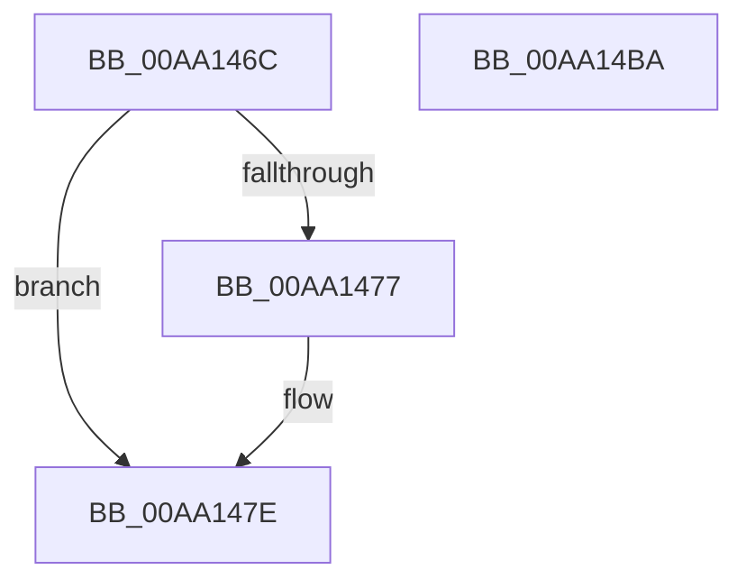

# PnpCtxRegEnumKeyWithCallback

- RVA: `0x00AA146C`–`0x00AA14BB` (길이 `79` bytes)
- VA: `0x0000000140AA146C`
- 실행 섹션: `PAGE`
- PDB 이름 있음: `예`; PDB Function 태그: `아니요`
- unwind 정보 RVA: `0x0006C2A4`
- 디코드: `19`개 명령, `79/79` bytes 표시
- 미해석 바이트: `0` (있으면 어셈블리에 `.byte`로 보존)

> 이 문서는 커널 이미지의 기계어와 PDB 기호를 분석해 생성했습니다. 4번과 5번은 함수 원형과 자료형을 바이너리 사용 방식에서 추정한 C 해석이며 원본 소스 복구 결과는 아닙니다.

## 1. Dependencies

- 직접 호출 지점: **1**; 고유 호출 대상: **1**
- 직접 호출자로 확인된 함수: **13**
- RIP 상대 이미지 참조: **1**

### Outgoing calls
- `0x00AA14B0` → [_RegRtlEnumKeyWithCallback](../99/_RegRtlEnumKeyWithCallback_function_009929EC.md) (function, `0x009929EC`)

### Direct callers
- [PipHardwareConfigClearStartOverrides](../72/PipHardwareConfigClearStartOverrides_function_007234A4.md) at `0x0072356C`
- [CmDeviceClassesSubkeyCallback](../82/CmDeviceClassesSubkeyCallback_function_0082C940.md) at `0x0082CCE0`
- [CmEnumSubkeyCallback](../82/CmEnumSubkeyCallback_function_0082CE50.md) at `0x0082CFF4`
- [CmGetMatchingCommonClassListWorker](../82/CmGetMatchingCommonClassListWorker_function_0082D28C.md) at `0x0082D364`
- [CmGetMatchingCommonClassListWorker](../82/CmGetMatchingCommonClassListWorker_function_0082D28C.md) at `0x0082D3AE`
- [CmGetMatchingDeviceListForSubkey](../82/CmGetMatchingDeviceListForSubkey_function_0082D5A0.md) at `0x0082D72C`
- [CmDevicePanelEnumSubkeyCallback](../82/CmDevicePanelEnumSubkeyCallback_function_0082E9B0.md) at `0x0082EBDC`
- [CmGetMatchingDevicePanelListWorker](../82/CmGetMatchingDevicePanelListWorker_function_0082F090.md) at `0x0082F15D`
- [PnpGetGenericObjectList](../83/PnpGetGenericObjectList_function_008322EC.md) at `0x00832346`
- [PiCreateDriverSwDevices](../8F/PiCreateDriverSwDevices_function_008FCFA8.md) at `0x008FD084`
- [CmGetMatchingFilteredDeviceInterfaceListWorker](../A0/CmGetMatchingFilteredDeviceInterfaceListWorker_function_00A097EC.md) at `0x00A09994`
- [sub_00B23888](../B2/Unknown_function_00B23888.md) at `0x00B23B30`
- [sub_00B36C8C](../B3/Unknown_function_00B36C8C.md) at `0x00B36D20`
- [PipMigratePnpState](../../init/C3/PipMigratePnpState_function_00C317D4.md) at `0x00C31C21`

### Static image references
- `0x00AA1483` → RVA `0x004719E0` (`PnpCtxInternalEnumKeyCallback`; read)

## 2. Other-region calls and transfers

- 다른 실행 섹션으로 향하는 call: **0**
- 별도 외부 분기/꼬리 이동을 확인하지 못했습니다.

## 3. Assembly (complete function range)

```asm
00AA146C  48 83 EC 58                     sub rsp, 0x58
00AA1470  33 C0                           xor eax, eax
00AA1472  48 85 C9                        test rcx, rcx
00AA1475  74 07                           je 0x140aa147e
00AA1477  48 8B 81 E0 00 00 00            mov rax, qword ptr [rcx + 0xe0]
00AA147E  48 89 44 24 38                  mov qword ptr [rsp + 0x38], rax
00AA1483  48 8D 05 56 05 9D FF            lea rax, [rip - 0x62faaa]
00AA148A  48 89 44 24 40                  mov qword ptr [rsp + 0x40], rax
00AA148F  48 8D 44 24 20                  lea rax, [rsp + 0x20]
00AA1494  48 89 4C 24 20                  mov qword ptr [rsp + 0x20], rcx
00AA1499  48 8B CA                        mov rcx, rdx
00AA149C  4C 89 44 24 28                  mov qword ptr [rsp + 0x28], r8
00AA14A1  4C 8D 44 24 38                  lea r8, [rsp + 0x38]
00AA14A6  48 89 44 24 48                  mov qword ptr [rsp + 0x48], rax
00AA14AB  4C 89 4C 24 30                  mov qword ptr [rsp + 0x30], r9
00AA14B0  E8 37 15 EF FF                  call 0x1409929ec
00AA14B5  48 83 C4 58                     add rsp, 0x58
00AA14B9  C3                              ret
00AA14BA  CC                              int3
```

## 4. C-style interpretation (structured pseudocode)

```c
__int64 __fastcall PnpCtxRegEnumKeyWithCallback(__int64 a1, __int64 a2, __int64 a3, __int64 a4)
{
    __int64 result;
    __int64 v_rsp;
    unsigned __int64 v_stack_m10;
    unsigned __int64 v_stack_m18;
    unsigned __int64 v_stack_m20;
    unsigned __int64 v_stack_m28;
    unsigned __int64 v_stack_m30;
    unsigned __int64 v_stack_m38;

    v_rsp = (v_rsp) - (88);
    result = 0;
    if (a1 != 0) {
        result = *(unsigned __int64 *)(a1 + 224);
    }
    v_stack_m20 = result;
    v_stack_m18 = v_rip - 6486698;
    v_stack_m38 = a1;
    v_stack_m30 = a3;
    v_stack_m10 = v_stack_m38;
    v_stack_m28 = a4;
    result = _RegRtlEnumKeyWithCallback(a2, a2, v_stack_m20, a4);
    v_rsp = (v_rsp) + (88);
    return result;
}
```

## 5. (Beta) C Style

```c
int64_t PnpCtxRegEnumKeyWithCallback(int64_t Arg1, int64_t Arg2, int64_t Arg3, int64_t Arg4)
{
    int64_t result;
    int64_t local_rsp;
    uint64_t v_stack_m10;
    uint64_t v_stack_m18;
    uint64_t v_stack_m20;
    uint64_t v_stack_m28;
    uint64_t v_stack_m30;
    uint64_t v_stack_m38;

    local_rsp = (local_rsp) - (88);
    result = 0;
    if (Arg1 != 0) {
        result = *(uint64_t *)(Arg1 + 0xE0);
    }
    v_stack_m20 = result;
    v_stack_m18 = v_rip - 6486698;
    v_stack_m38 = Arg1;
    v_stack_m30 = Arg3;
    v_stack_m10 = v_stack_m38;
    v_stack_m28 = Arg4;
    result = _RegRtlEnumKeyWithCallback(Arg2, Arg2, v_stack_m20, Arg4);
    local_rsp = (local_rsp) + (88);
    return result;
}
```

## 6. Execution-region graph

[열기: 2D/3D 그래프와 함수 탐색 컨트롤 패널](../../../control-panel.html?section=page&rva=0x00AA146C&view=graph)

- 2D 그래프는 위에서 아래로 흐르고, 3D 그래프는 빈 공간을 드래그해 회전합니다. Shift+드래그는 이동, 휠은 확대·축소, 함수 노드 선택은 대상 보고서 이동입니다.

### Static fallback


