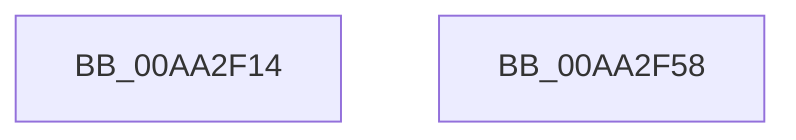

# PnpDriverObjectDereferenceComplete

- RVA: `0x00AA2F14`–`0x00AA2F59` (길이 `69` bytes)
- VA: `0x0000000140AA2F14`
- 실행 섹션: `PAGE`
- PDB 이름 있음: `예`; PDB Function 태그: `아니요`
- unwind 정보 RVA: `0x0005CC98`
- 디코드: `18`개 명령, `69/69` bytes 표시
- 미해석 바이트: `0` (있으면 어셈블리에 `.byte`로 보존)

> 이 문서는 커널 이미지의 기계어와 PDB 기호를 분석해 생성했습니다. 4번과 5번은 함수 원형과 자료형을 바이너리 사용 방식에서 추정한 C 해석이며 원본 소스 복구 결과는 아닙니다.

## 1. Dependencies

- 직접 호출 지점: **1**; 고유 호출 대상: **1**
- 직접 호출자로 확인된 함수: **1**
- RIP 상대 이미지 참조: **1**

### Outgoing calls
- `0x00AA2F4E` → [PnpRequestDeviceAction](../../text/47/PnpRequestDeviceAction_function_00477FF8.md) (function, `0x00477FF8`)

### Direct callers
- [IopDeleteDriver](IopDeleteDriver_function_00AA2E50.md) at `0x00AA2ECB`

### Static image references
- `0x00AA2F1B` → RVA `0x00F8C438` (`.data`; read)

## 2. Other-region calls and transfers

- 다른 실행 섹션으로 향하는 call: **1**
  - `0x00AA2F4E` → [PnpRequestDeviceAction](../../text/47/PnpRequestDeviceAction_function_00477FF8.md) (`PAGE` → `.text`)
- 별도 외부 분기/꼬리 이동을 확인하지 못했습니다.

## 3. Assembly (complete function range)

```asm
00AA2F14  4C 8B DC                        mov r11, rsp
00AA2F17  48 83 EC 58                     sub rsp, 0x58
00AA2F1B  48 8B 0D 16 95 4E 00            mov rcx, qword ptr [rip + 0x4e9516]
00AA2F22  4D 8D 4B E8                     lea r9, [r11 - 0x18]
00AA2F26  33 C0                           xor eax, eax
00AA2F28  0F 57 C0                        xorps xmm0, xmm0
00AA2F2B  49 89 43 D8                     mov qword ptr [r11 - 0x28], rax
00AA2F2F  45 33 C0                        xor r8d, r8d
00AA2F32  0F 11 44 24 40                  movups xmmword ptr [rsp + 0x40], xmm0
00AA2F37  48 8B 49 20                     mov rcx, qword ptr [rcx + 0x20]
00AA2F3B  49 89 43 D0                     mov qword ptr [r11 - 0x30], rax
00AA2F3F  8D 50 02                        lea edx, [rax + 2]
00AA2F42  C7 44 24 48 26 00 00 00         mov dword ptr [rsp + 0x48], 0x26
00AA2F4A  49 89 43 C8                     mov qword ptr [r11 - 0x38], rax
00AA2F4E  E8 A5 50 9D FF                  call 0x140477ff8
00AA2F53  48 83 C4 58                     add rsp, 0x58
00AA2F57  C3                              ret
00AA2F58  CC                              int3
```

## 4. C-style interpretation (structured pseudocode)

```c
__int64 __fastcall PnpDriverObjectDereferenceComplete(__int64 a1, __int64 a2, int a3)
{
    __int64 result;
    __int64 v_rsp;
    unsigned int v_stack_m10;
    unsigned __int64 v_stack_m18;

    v_rsp = (v_rsp) - (88);
    result = 0;
    *(unsigned __int64 *)(v_rsp - 40) = 0;
    a3 = 0;
    v_stack_m18 = v_xmm0;
    *(unsigned __int64 *)(v_rsp - 48) = 0;
    v_stack_m10 = 38;
    *(unsigned __int64 *)(v_rsp - 56) = 0;
    result = PnpRequestDeviceAction(*(unsigned __int64 *)(*(unsigned __int64 *)(v_rip + 5149974) + 32), result + 2, a3, v_rsp - 24);
    v_rsp = (v_rsp) + (88);
    return result;
}
```

## 5. (Beta) C Style

```c
int64_t PnpDriverObjectDereferenceComplete(int64_t Arg1, int64_t Arg2, int32_t Arg3)
{
    int64_t result;
    int64_t local_rsp;
    uint32_t v_stack_m10;
    uint64_t v_stack_m18;

    local_rsp = (local_rsp) - (88);
    result = 0;
    *(uint64_t *)(local_rsp - 0x28) = 0;
    Arg3 = 0;
    v_stack_m18 = v_xmm0;
    *(uint64_t *)(local_rsp - 0x30) = 0;
    v_stack_m10 = 38;
    *(uint64_t *)(local_rsp - 0x38) = 0;
    result = PnpRequestDeviceAction(*(uint64_t *)(*(uint64_t *)(v_rip + 0x4E9516) + 0x20), result + 2, Arg3, local_rsp - 24);
    local_rsp = (local_rsp) + (88);
    return result;
}
```

## 6. Execution-region graph

[열기: 2D/3D 그래프와 함수 탐색 컨트롤 패널](../../../control-panel.html?section=page&rva=0x00AA2F14&view=graph)

- 2D 그래프는 위에서 아래로 흐르고, 3D 그래프는 빈 공간을 드래그해 회전합니다. Shift+드래그는 이동, 휠은 확대·축소, 함수 노드 선택은 대상 보고서 이동입니다.

### Static fallback


