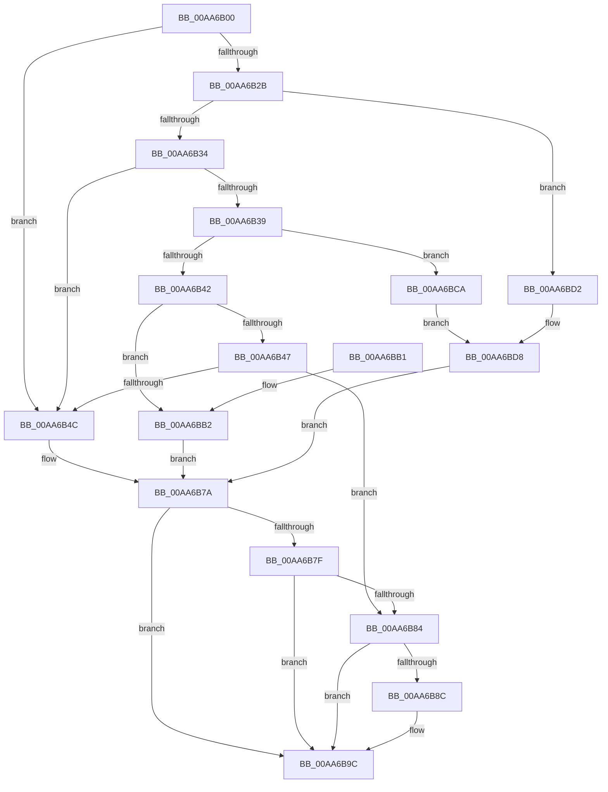

# PnpIsRangeWithin

- RVA: `0x00AA6B00`–`0x00AA6BE0` (길이 `224` bytes)
- VA: `0x0000000140AA6B00`
- 실행 섹션: `PAGE`
- PDB 이름 있음: `예`; PDB Function 태그: `아니요`
- unwind 정보 RVA: `0x000BB9A4`
- 디코드: `73`개 명령, `224/224` bytes 표시
- 미해석 바이트: `0` (있으면 어셈블리에 `.byte`로 보존)

> 이 문서는 커널 이미지의 기계어와 PDB 기호를 분석해 생성했습니다. 4번과 5번은 함수 원형과 자료형을 바이너리 사용 방식에서 추정한 C 해석이며 원본 소스 복구 결과는 아닙니다.

## 1. Dependencies

- 직접 호출 지점: **2**; 고유 호출 대상: **1**
- 직접 호출자로 확인된 함수: **1**
- RIP 상대 이미지 참조: **0**

### Outgoing calls
- `0x00AA6B51` → [RtlCmDecodeMemIoResource](../../text/4A/RtlCmDecodeMemIoResource_function_004A0120.md) (function, `0x004A0120`)
- `0x00AA6B6A` → [RtlCmDecodeMemIoResource](../../text/4A/RtlCmDecodeMemIoResource_function_004A0120.md) (function, `0x004A0120`)

### Direct callers
- [PnpNeedToReleaseBootResources](PnpNeedToReleaseBootResources_function_00AA69A8.md) at `0x00AA6A73`

### Static image references
- 디코드된 RIP-relative 메모리 참조가 없습니다.

## 2. Other-region calls and transfers

- 다른 실행 섹션으로 향하는 call: **2**
  - `0x00AA6B51` → [RtlCmDecodeMemIoResource](../../text/4A/RtlCmDecodeMemIoResource_function_004A0120.md) (`PAGE` → `.text`)
  - `0x00AA6B6A` → [RtlCmDecodeMemIoResource](../../text/4A/RtlCmDecodeMemIoResource_function_004A0120.md) (`PAGE` → `.text`)
- 별도 외부 분기/꼬리 이동을 확인하지 못했습니다.

## 3. Assembly (complete function range)

```asm
00AA6B00  48 8B C4                        mov rax, rsp
00AA6B03  48 89 58 10                     mov qword ptr [rax + 0x10], rbx
00AA6B07  48 89 68 20                     mov qword ptr [rax + 0x20], rbp
00AA6B0B  56                              push rsi
00AA6B0C  57                              push rdi
00AA6B0D  41 56                           push r14
00AA6B0F  48 83 EC 20                     sub rsp, 0x20
00AA6B13  33 DB                           xor ebx, ebx
00AA6B15  48 8B F2                        mov rsi, rdx
00AA6B18  48 89 58 08                     mov qword ptr [rax + 8], rbx
00AA6B1C  48 8B F9                        mov rdi, rcx
00AA6B1F  48 89 58 18                     mov qword ptr [rax + 0x18], rbx
00AA6B23  0F B6 01                        movzx eax, byte ptr [rcx]
00AA6B26  83 E8 01                        sub eax, 1
00AA6B29  74 21                           je 0x140aa6b4c
00AA6B2B  83 E8 01                        sub eax, 1
00AA6B2E  0F 84 9E 00 00 00               je 0x140aa6bd2
00AA6B34  83 E8 01                        sub eax, 1
00AA6B37  74 13                           je 0x140aa6b4c
00AA6B39  83 E8 01                        sub eax, 1
00AA6B3C  0F 84 88 00 00 00               je 0x140aa6bca
00AA6B42  83 E8 02                        sub eax, 2
00AA6B45  74 6B                           je 0x140aa6bb2
00AA6B47  83 F8 01                        cmp eax, 1
00AA6B4A  75 38                           jne 0x140aa6b84
00AA6B4C  48 8D 54 24 40                  lea rdx, [rsp + 0x40]
00AA6B51  E8 CA 95 9F FF                  call 0x1404a0120
00AA6B56  4C 8B 74 24 40                  mov r14, qword ptr [rsp + 0x40]
00AA6B5B  48 8D 54 24 50                  lea rdx, [rsp + 0x50]
00AA6B60  48 8B CE                        mov rcx, rsi
00AA6B63  49 8D 6E FF                     lea rbp, [r14 - 1]
00AA6B67  48 03 E8                        add rbp, rax
00AA6B6A  E8 B1 95 9F FF                  call 0x1404a0120
00AA6B6F  48 8B 54 24 50                  mov rdx, qword ptr [rsp + 0x50]
00AA6B74  48 FF C8                        dec rax
00AA6B77  48 03 C2                        add rax, rdx
00AA6B7A  4C 3B F2                        cmp r14, rdx
00AA6B7D  72 1D                           jb 0x140aa6b9c
00AA6B7F  48 3B E8                        cmp rbp, rax
00AA6B82  77 18                           ja 0x140aa6b9c
00AA6B84  8A 4E 01                        mov cl, byte ptr [rsi + 1]
00AA6B87  38 4F 01                        cmp byte ptr [rdi + 1], cl
00AA6B8A  75 10                           jne 0x140aa6b9c
00AA6B8C  0F B7 4E 02                     movzx ecx, word ptr [rsi + 2]
00AA6B90  B8 01 00 00 00                  mov eax, 1
00AA6B95  66 39 4F 02                     cmp word ptr [rdi + 2], cx
00AA6B99  0F 44 D8                        cmove ebx, eax
00AA6B9C  48 8B 6C 24 58                  mov rbp, qword ptr [rsp + 0x58]
00AA6BA1  8B C3                           mov eax, ebx
00AA6BA3  48 8B 5C 24 48                  mov rbx, qword ptr [rsp + 0x48]
00AA6BA8  48 83 C4 20                     add rsp, 0x20
00AA6BAC  41 5E                           pop r14
00AA6BAE  5F                              pop rdi
00AA6BAF  5E                              pop rsi
00AA6BB0  C3                              ret
00AA6BB1  CC                              int3
00AA6BB2  8B 69 08                        mov ebp, dword ptr [rcx + 8]
00AA6BB5  44 8B 71 04                     mov r14d, dword ptr [rcx + 4]
00AA6BB9  FF CD                           dec ebp
00AA6BBB  8B 46 08                        mov eax, dword ptr [rsi + 8]
00AA6BBE  41 03 EE                        add ebp, r14d
00AA6BC1  8B 52 04                        mov edx, dword ptr [rdx + 4]
00AA6BC4  FF C8                           dec eax
00AA6BC6  03 C2                           add eax, edx
00AA6BC8  EB B0                           jmp 0x140aa6b7a
00AA6BCA  8B 69 04                        mov ebp, dword ptr [rcx + 4]
00AA6BCD  8B 42 04                        mov eax, dword ptr [rdx + 4]
00AA6BD0  EB 06                           jmp 0x140aa6bd8
00AA6BD2  8B 69 08                        mov ebp, dword ptr [rcx + 8]
00AA6BD5  8B 42 08                        mov eax, dword ptr [rdx + 8]
00AA6BD8  4C 8B F5                        mov r14, rbp
00AA6BDB  48 8B D0                        mov rdx, rax
00AA6BDE  EB 9A                           jmp 0x140aa6b7a
```

## 4. C-style interpretation (structured pseudocode)

```c
__int64 __fastcall PnpIsRangeWithin(__int64 a1, __int64 a2)
{
    __int64 result;
    __int64 v_rbp;
    __int64 v_rbx;
    __int64 v_rsp;
    unsigned __int64 v_stack_p10;
    unsigned __int64 v_stack_p18;
    unsigned __int64 v_stack_p20;
    unsigned __int64 v_stack_p8;

    *(unsigned __int64 *)(v_rsp + 16) = v_rbx;
    *(unsigned __int64 *)(v_rsp + 32) = v_rbp;
    v_rsp = (v_rsp) - (32);
    v_rbx = 0;
    *(unsigned __int64 *)(v_rsp + 8) = 0;
    *(unsigned __int64 *)(v_rsp + 24) = 0;
    result = (unsigned int)((*(unsigned __int8 *)(a1)) - (1));
    if (condition_is_equal) goto loc_00AA6B4C;
    result = (unsigned int)((result) - (1));
    if (condition_is_equal) goto loc_00AA6BD2;
    result = (unsigned int)((result) - (1));
    if (condition_is_equal) goto loc_00AA6B4C;
    result = (unsigned int)((result) - (1));
    if (condition_is_equal) goto loc_00AA6BCA;
    result = (unsigned int)((result) - (2));
    if (condition_is_equal) goto loc_00AA6BB2;
    if (((unsigned int)(result)) != 1) goto loc_00AA6B84;
loc_00AA6B4C:
    result = RtlCmDecodeMemIoResource(a1, v_stack_p8, a3, a4);
    v_rbp = (v_stack_p8 - 1) + (result);
    result = RtlCmDecodeMemIoResource(a2, v_stack_p18, a3, a4);
    result = (result) - 1;
    result = (result) + (v_stack_p18);
loc_00AA6B7A:
    if (v_stack_p8 < v_stack_p18) goto loc_00AA6B9C;
    if (v_rbp > result) goto loc_00AA6B9C;
loc_00AA6B84:
    if ((*(unsigned __int8 *)(a1 + 1)) == ((unsigned __int8)(*(unsigned __int8 *)(a2 + 1)))) {
        a1 = *(unsigned __int16 *)(a2 + 2);
        result = 1;
        if ((*(unsigned __int16 *)(a1 + 2)) == ((unsigned __int16)(a1))) { v_rbx = (unsigned int)(result); }
    }
    v_rsp = (v_rsp) + (32);
    return (unsigned int)((unsigned int)(v_rbx));
loc_00AA6BB2:
    v_rbp = (unsigned int)(((unsigned int)(*(unsigned int *)(a1 + 8))) - 1);
    v_rbp = (unsigned int)((v_rbp) + ((unsigned int)((unsigned int)(*(unsigned int *)(a1 + 4)))));
    result = (unsigned int)(((unsigned int)(*(unsigned int *)(a2 + 8))) - 1);
    result = (unsigned int)((result) + ((unsigned int)((unsigned int)(*(unsigned int *)(v_stack_p18 + 4)))));
    goto loc_00AA6B7A;
loc_00AA6BCA:
    goto loc_00AA6BD8;
loc_00AA6BD2:
loc_00AA6BD8:
    goto loc_00AA6B7A;
}
```

## 5. (Beta) C Style

```c
int64_t PnpIsRangeWithin(void *Arg1, void *Arg2)
{
    uint8_t *arg1 = (uint8_t *)Arg1;
    uint8_t *arg2 = (uint8_t *)Arg2;

    int64_t result;
    int64_t local_rbp;
    int64_t local_rbx;
    int64_t local_rsp;
    uint64_t v_stack_p10;
    uint64_t v_stack_p18;
    uint64_t v_stack_p20;
    uint64_t v_stack_p8;

    *(uint64_t *)(local_rsp + 0x10) = local_rbx;
    *(uint64_t *)(local_rsp + 0x20) = local_rbp;
    local_rsp = (local_rsp) - (32);
    local_rbx = 0;
    *(uint64_t *)(local_rsp + 0x8) = 0;
    *(uint64_t *)(local_rsp + 0x18) = 0;
    result = (uint32_t)((*(uint8_t *)(arg1)) - (1));
    if (condition_is_equal) goto loc_00AA6B4C;
    result = (uint32_t)((result) - (1));
    if (condition_is_equal) goto loc_00AA6BD2;
    result = (uint32_t)((result) - (1));
    if (condition_is_equal) goto loc_00AA6B4C;
    result = (uint32_t)((result) - (1));
    if (condition_is_equal) goto loc_00AA6BCA;
    result = (uint32_t)((result) - (2));
    if (condition_is_equal) goto loc_00AA6BB2;
    if (((uint32_t)(result)) != 1) goto loc_00AA6B84;
loc_00AA6B4C:
    result = RtlCmDecodeMemIoResource(Arg1, v_stack_p8, a3, a4);
    local_rbp = (v_stack_p8 - 1) + (result);
    result = RtlCmDecodeMemIoResource(Arg2, v_stack_p18, a3, a4);
    result = (result) - 1;
    result = (result) + (v_stack_p18);
loc_00AA6B7A:
    if (v_stack_p8 < v_stack_p18) goto loc_00AA6B9C;
    if (local_rbp > result) goto loc_00AA6B9C;
loc_00AA6B84:
    if ((*(uint8_t *)(arg1 + 0x1)) == ((uint8_t)(*(uint8_t *)(arg2 + 0x1)))) {
        Arg1 = *(uint16_t *)(arg2 + 0x2);
        result = 1;
        if ((*(uint16_t *)(arg1 + 0x2)) == ((uint16_t)(Arg1))) { local_rbx = (uint32_t)(result); }
    }
    local_rsp = (local_rsp) + (32);
    return (uint32_t)((uint32_t)(local_rbx));
loc_00AA6BB2:
    local_rbp = (uint32_t)(((uint32_t)(*(uint32_t *)(arg1 + 0x8))) - 1);
    local_rbp = (uint32_t)((local_rbp) + ((uint32_t)((uint32_t)(*(uint32_t *)(arg1 + 0x4)))));
    result = (uint32_t)(((uint32_t)(*(uint32_t *)(arg2 + 0x8))) - 1);
    result = (uint32_t)((result) + ((uint32_t)((uint32_t)(*(uint32_t *)(v_stack_p18 + 0x4)))));
    goto loc_00AA6B7A;
loc_00AA6BCA:
    goto loc_00AA6BD8;
loc_00AA6BD2:
loc_00AA6BD8:
    goto loc_00AA6B7A;
}
```

### 관측된 메모리 오프셋

구조체 형식이 확인되지 않은 접근은 인자 기준의 오프셋으로만 기록했습니다.

| 기준 인자 | 오프셋 표현 | 폭 (bit) | 접근 |
|---|---:|---:|---|
| `Arg1` | `+ 0x0` | `8` | `R` |
| `Arg1` | `+ 0x1` | `8` | `R` |
| `Arg1` | `+ 0x2` | `16` | `R` |
| `Arg1` | `+ 0x4` | `32` | `R` |
| `Arg1` | `+ 0x8` | `32` | `R` |
| `Arg2` | `+ 0x1` | `8` | `R` |
| `Arg2` | `+ 0x2` | `16` | `R` |
| `Arg2` | `+ 0x4` | `32` | `R` |
| `Arg2` | `+ 0x8` | `32` | `R` |

## 6. Execution-region graph

[열기: 2D/3D 그래프와 함수 탐색 컨트롤 패널](../../../control-panel.html?section=page&rva=0x00AA6B00&view=graph)

- 2D 그래프는 위에서 아래로 흐르고, 3D 그래프는 빈 공간을 드래그해 회전합니다. Shift+드래그는 이동, 휠은 확대·축소, 함수 노드 선택은 대상 보고서 이동입니다.

### Static fallback


