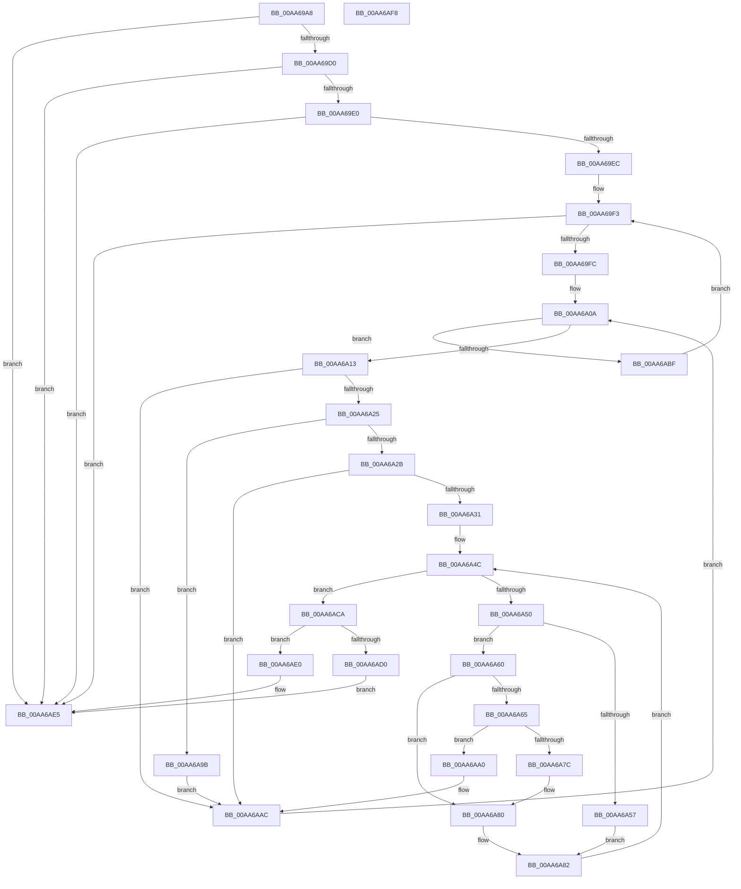

# PnpNeedToReleaseBootResources

- RVA: `0x00AA69A8`–`0x00AA6AF9` (길이 `337` bytes)
- VA: `0x0000000140AA69A8`
- 실행 섹션: `PAGE`
- PDB 이름 있음: `예`; PDB Function 태그: `아니요`
- unwind 정보 RVA: `0x000BB714`
- 디코드: `101`개 명령, `337/337` bytes 표시
- 미해석 바이트: `0` (있으면 어셈블리에 `.byte`로 보존)

> 이 문서는 커널 이미지의 기계어와 PDB 기호를 분석해 생성했습니다. 4번과 5번은 함수 원형과 자료형을 바이너리 사용 방식에서 추정한 C 해석이며 원본 소스 복구 결과는 아닙니다.

## 1. Dependencies

- 직접 호출 지점: **1**; 고유 호출 대상: **1**
- 직접 호출자로 확인된 함수: **1**
- RIP 상대 이미지 참조: **0**

### Outgoing calls
- `0x00AA6A73` → [PnpIsRangeWithin](PnpIsRangeWithin_function_00AA6B00.md) (function, `0x00AA6B00`)

### Direct callers
- [IopReleaseFilteredBootResources](../72/IopReleaseFilteredBootResources_function_0072EBF8.md) at `0x0072EC72`

### Static image references
- 디코드된 RIP-relative 메모리 참조가 없습니다.

## 2. Other-region calls and transfers

- 다른 실행 섹션으로 향하는 call: **0**
- 별도 외부 분기/꼬리 이동을 확인하지 못했습니다.

## 3. Assembly (complete function range)

```asm
00AA69A8  4C 89 44 24 18                  mov qword ptr [rsp + 0x18], r8
00AA69AD  48 89 54 24 10                  mov qword ptr [rsp + 0x10], rdx
00AA69B2  53                              push rbx
00AA69B3  55                              push rbp
00AA69B4  56                              push rsi
00AA69B5  57                              push rdi
00AA69B6  41 54                           push r12
00AA69B8  41 55                           push r13
00AA69BA  41 56                           push r14
00AA69BC  41 57                           push r15
00AA69BE  48 83 EC 38                     sub rsp, 0x38
00AA69C2  33 DB                           xor ebx, ebx
00AA69C4  83 3A 01                        cmp dword ptr [rdx], 1
00AA69C7  41 89 18                        mov dword ptr [r8], ebx
00AA69CA  0F 85 15 01 00 00               jne 0x140aa6ae5
00AA69D0  48 8B 81 20 02 00 00            mov rax, qword ptr [rcx + 0x220]
00AA69D7  48 85 C0                        test rax, rax
00AA69DA  0F 84 05 01 00 00               je 0x140aa6ae5
00AA69E0  44 8B 28                        mov r13d, dword ptr [rax]
00AA69E3  45 85 ED                        test r13d, r13d
00AA69E6  0F 84 F9 00 00 00               je 0x140aa6ae5
00AA69EC  48 83 C0 04                     add rax, 4
00AA69F0  44 8B F3                        mov r14d, ebx
00AA69F3  45 3B F5                        cmp r14d, r13d
00AA69F6  0F 83 E9 00 00 00               jae 0x140aa6ae5
00AA69FC  48 8D 78 10                     lea rdi, [rax + 0x10]
00AA6A00  44 8B E3                        mov r12d, ebx
00AA6A03  8B 40 0C                        mov eax, dword ptr [rax + 0xc]
00AA6A06  89 44 24 2C                     mov dword ptr [rsp + 0x2c], eax
00AA6A0A  44 3B E0                        cmp r12d, eax
00AA6A0D  0F 83 AC 00 00 00               jae 0x140aa6abf
00AA6A13  40 8A 37                        mov sil, byte ptr [rdi]
00AA6A16  8B C3                           mov eax, ebx
00AA6A18  89 44 24 28                     mov dword ptr [rsp + 0x28], eax
00AA6A1C  40 84 F6                        test sil, sil
00AA6A1F  0F 84 87 00 00 00               je 0x140aa6aac
00AA6A25  40 80 FE 05                     cmp sil, 5
00AA6A29  74 70                           je 0x140aa6a9b
00AA6A2B  40 80 FE 08                     cmp sil, 8
00AA6A2F  73 7B                           jae 0x140aa6aac
00AA6A31  8B 4A 10                        mov ecx, dword ptr [rdx + 0x10]
00AA6A34  4C 8D 7A 14                     lea r15, [rdx + 0x14]
00AA6A38  89 4C 24 24                     mov dword ptr [rsp + 0x24], ecx
00AA6A3C  8B C3                           mov eax, ebx
00AA6A3E  89 5C 24 20                     mov dword ptr [rsp + 0x20], ebx
00AA6A42  40 8A EE                        mov bpl, sil
00AA6A45  89 9C 24 98 00 00 00            mov dword ptr [rsp + 0x98], ebx
00AA6A4C  3B C1                           cmp eax, ecx
00AA6A4E  73 7A                           jae 0x140aa6aca
00AA6A50  41 8A 07                        mov al, byte ptr [r15]
00AA6A53  3C 05                           cmp al, 5
00AA6A55  75 09                           jne 0x140aa6a60
00AA6A57  41 8B 47 04                     mov eax, dword ptr [r15 + 4]
00AA6A5B  40 8A EE                        mov bpl, sil
00AA6A5E  EB 22                           jmp 0x140aa6a82
00AA6A60  40 3A E8                        cmp bpl, al
00AA6A63  75 1B                           jne 0x140aa6a80
00AA6A65  49 8B D7                        mov rdx, r15
00AA6A68  C7 44 24 20 01 00 00 00         mov dword ptr [rsp + 0x20], 1
00AA6A70  48 8B CF                        mov rcx, rdi
00AA6A73  E8 88 00 00 00                  call 0x140aa6b00
00AA6A78  85 C0                           test eax, eax
00AA6A7A  75 24                           jne 0x140aa6aa0
00AA6A7C  8B 4C 24 24                     mov ecx, dword ptr [rsp + 0x24]
00AA6A80  8B C3                           mov eax, ebx
00AA6A82  49 83 C7 14                     add r15, 0x14
00AA6A86  4C 03 F8                        add r15, rax
00AA6A89  8B 84 24 98 00 00 00            mov eax, dword ptr [rsp + 0x98]
00AA6A90  FF C0                           inc eax
00AA6A92  89 84 24 98 00 00 00            mov dword ptr [rsp + 0x98], eax
00AA6A99  EB B1                           jmp 0x140aa6a4c
00AA6A9B  8B 47 04                        mov eax, dword ptr [rdi + 4]
00AA6A9E  EB 0C                           jmp 0x140aa6aac
00AA6AA0  8B 44 24 28                     mov eax, dword ptr [rsp + 0x28]
00AA6AA4  48 8B 94 24 88 00 00 00         mov rdx, qword ptr [rsp + 0x88]
00AA6AAC  48 83 C7 14                     add rdi, 0x14
00AA6AB0  48 03 F8                        add rdi, rax
00AA6AB3  8B 44 24 2C                     mov eax, dword ptr [rsp + 0x2c]
00AA6AB7  41 FF C4                        inc r12d
00AA6ABA  E9 4B FF FF FF                  jmp 0x140aa6a0a
00AA6ABF  48 8B C7                        mov rax, rdi
00AA6AC2  41 FF C6                        inc r14d
00AA6AC5  E9 29 FF FF FF                  jmp 0x140aa69f3
00AA6ACA  39 5C 24 20                     cmp dword ptr [rsp + 0x20], ebx
00AA6ACE  74 10                           je 0x140aa6ae0
00AA6AD0  48 8B 84 24 90 00 00 00         mov rax, qword ptr [rsp + 0x90]
00AA6AD8  C7 00 01 00 00 00               mov dword ptr [rax], 1
00AA6ADE  EB 05                           jmp 0x140aa6ae5
00AA6AE0  BB 01 00 00 00                  mov ebx, 1
00AA6AE5  8B C3                           mov eax, ebx
00AA6AE7  48 83 C4 38                     add rsp, 0x38
00AA6AEB  41 5F                           pop r15
00AA6AED  41 5E                           pop r14
00AA6AEF  41 5D                           pop r13
00AA6AF1  41 5C                           pop r12
00AA6AF3  5F                              pop rdi
00AA6AF4  5E                              pop rsi
00AA6AF5  5D                              pop rbp
00AA6AF6  5B                              pop rbx
00AA6AF7  C3                              ret
00AA6AF8  CC                              int3
```

## 4. C-style interpretation (structured pseudocode)

```c
__int64 __fastcall PnpNeedToReleaseBootResources(__int64 a1, __int64 a2, __int64 a3)
{
    __int64 result;
    __int64 v_r12;
    __int64 v_r14;
    __int64 v_r15;
    __int64 v_rbx;
    __int64 v_rdi;
    __int64 v_rsp;
    unsigned int v_stack_m4C;
    unsigned int v_stack_m50;
    unsigned int v_stack_m54;
    unsigned int v_stack_m58;
    unsigned __int64 v_stack_p10;
    unsigned __int64 v_stack_p18;
    unsigned int v_stack_p20;

    v_stack_p18 = a3;
    v_stack_p10 = a2;
    v_rsp = (v_rsp) - (56);
    v_rbx = 0;
    *(unsigned int *)(a3) = 0;
    if ((*(unsigned int *)(a2)) != 1) goto loc_00AA6AE5;
    if (*(unsigned __int64 *)(a1 + 544) == 0) goto loc_00AA6AE5;
    if ((unsigned int)((unsigned int)(*(unsigned int *)(*(unsigned __int64 *)(a1 + 544)))) == 0) goto loc_00AA6AE5;
    result = (*(unsigned __int64 *)(a1 + 544)) + (4);
loc_00AA69F3:
    if (0 >= ((unsigned int)((unsigned int)(*(unsigned int *)(*(unsigned __int64 *)(a1 + 544)))))) goto loc_00AA6AE5;
    v_stack_m4C = (unsigned int)((unsigned int)(*(unsigned int *)(result + 12)));
loc_00AA6A0A:
    if (0 >= ((unsigned int)((unsigned int)(*(unsigned int *)(result + 12))))) goto loc_00AA6ABF;
    v_stack_m50 = 0;
    if ((unsigned __int8)(*(unsigned __int8 *)(result + 16)) == 0) goto loc_00AA6AAC;
    if (((unsigned __int8)(*(unsigned __int8 *)(result + 16))) == 5) goto loc_00AA6A9B;
    if (((unsigned __int8)(*(unsigned __int8 *)(result + 16))) >= 8) goto loc_00AA6AAC;
    v_stack_m54 = (unsigned int)((unsigned int)(*(unsigned int *)(a2 + 16)));
    v_stack_m58 = 0;
    v_stack_p20 = 0;
loc_00AA6A4C:
    if (0 >= ((unsigned int)((unsigned int)(*(unsigned int *)(a2 + 16))))) goto loc_00AA6ACA;
    if (((unsigned __int8)(*(unsigned __int8 *)(a2 + 20))) != 5) goto loc_00AA6A60;
    goto loc_00AA6A82;
loc_00AA6A60:
    if (((unsigned __int8)((unsigned __int8)(*(unsigned __int8 *)(result + 16)))) != ((unsigned __int8)((unsigned int)(*(unsigned int *)(a2 + 20 + 4))))) goto loc_00AA6A80;
    v_stack_m58 = 1;
    result = PnpIsRangeWithin(result + 16, a2 + 20, a3, a4);
    if ((unsigned int)(result) != 0) goto loc_00AA6AA0;
loc_00AA6A80:
loc_00AA6A82:
    v_r15 = (a2 + 20) + (20);
    v_r15 = (v_r15) + (0);
    result = (unsigned int)(((unsigned int)(v_stack_p20)) + 1);
    v_stack_p20 = (unsigned int)(result);
    goto loc_00AA6A4C;
loc_00AA6A9B:
    goto loc_00AA6AAC;
loc_00AA6AA0:
loc_00AA6AAC:
    v_rdi = (result + 16) + (20);
    v_rdi = (v_rdi) + ((unsigned int)(v_stack_m50));
    v_r12 = (unsigned int)((0) + 1);
    goto loc_00AA6A0A;
loc_00AA6ABF:
    v_r14 = (unsigned int)((0) + 1);
    goto loc_00AA69F3;
loc_00AA6ACA:
    if (v_stack_m58 == 0) goto loc_00AA6AE0;
    *(unsigned int *)(v_stack_p18) = 1;
    goto loc_00AA6AE5;
loc_00AA6AE0:
loc_00AA6AE5:
    v_rsp = (v_rsp) + (56);
    return 1;
}
```

## 5. (Beta) C Style

```c
int64_t PnpNeedToReleaseBootResources(void *Arg1, void *Arg2, void *Arg3)
{
    uint8_t *arg1 = (uint8_t *)Arg1;
    uint8_t *arg2 = (uint8_t *)Arg2;
    uint8_t *arg3 = (uint8_t *)Arg3;

    int64_t result;
    int64_t local_r12;
    int64_t local_r14;
    int64_t local_r15;
    int64_t local_rbx;
    int64_t local_rdi;
    int64_t local_rsp;
    uint32_t v_stack_m4C;
    uint32_t v_stack_m50;
    uint32_t v_stack_m54;
    uint32_t v_stack_m58;
    uint64_t v_stack_p10;
    uint64_t v_stack_p18;
    uint32_t v_stack_p20;

    v_stack_p18 = Arg3;
    v_stack_p10 = Arg2;
    local_rsp = (local_rsp) - (56);
    local_rbx = 0;
    *(uint32_t *)(arg3) = 0;
    if ((*(uint32_t *)(arg2)) != 1) goto loc_00AA6AE5;
    if (*(uint64_t *)(arg1 + 0x220) == 0) goto loc_00AA6AE5;
    if ((uint32_t)((uint32_t)(*(uint32_t *)(*(uint64_t *)(arg1 + 0x220)))) == 0) goto loc_00AA6AE5;
    result = (*(uint64_t *)(arg1 + 0x220)) + (4);
loc_00AA69F3:
    if (0 >= ((uint32_t)((uint32_t)(*(uint32_t *)(*(uint64_t *)(arg1 + 0x220)))))) goto loc_00AA6AE5;
    v_stack_m4C = (uint32_t)((uint32_t)(*(uint32_t *)(result + 0xC)));
loc_00AA6A0A:
    if (0 >= ((uint32_t)((uint32_t)(*(uint32_t *)(result + 0xC))))) goto loc_00AA6ABF;
    v_stack_m50 = 0;
    if ((uint8_t)(*(uint8_t *)(result + 0x10)) == 0) goto loc_00AA6AAC;
    if (((uint8_t)(*(uint8_t *)(result + 0x10))) == 5) goto loc_00AA6A9B;
    if (((uint8_t)(*(uint8_t *)(result + 0x10))) >= 8) goto loc_00AA6AAC;
    v_stack_m54 = (uint32_t)((uint32_t)(*(uint32_t *)(arg2 + 0x10)));
    v_stack_m58 = 0;
    v_stack_p20 = 0;
loc_00AA6A4C:
    if (0 >= ((uint32_t)((uint32_t)(*(uint32_t *)(arg2 + 0x10))))) goto loc_00AA6ACA;
    if (((uint8_t)(*(uint8_t *)(arg2 + 0x14))) != 5) goto loc_00AA6A60;
    goto loc_00AA6A82;
loc_00AA6A60:
    if (((uint8_t)((uint8_t)(*(uint8_t *)(result + 0x10)))) != ((uint8_t)((uint32_t)(*(uint32_t *)(arg2 + 0x14 + 0x4))))) goto loc_00AA6A80;
    v_stack_m58 = 1;
    result = PnpIsRangeWithin(result + 16, Arg2 + 20, Arg3, a4);
    if ((uint32_t)(result) != 0) goto loc_00AA6AA0;
loc_00AA6A80:
loc_00AA6A82:
    local_r15 = (Arg2 + 20) + (20);
    local_r15 = (local_r15) + (0);
    result = (uint32_t)(((uint32_t)(v_stack_p20)) + 1);
    v_stack_p20 = (uint32_t)(result);
    goto loc_00AA6A4C;
loc_00AA6A9B:
    goto loc_00AA6AAC;
loc_00AA6AA0:
loc_00AA6AAC:
    local_rdi = (result + 16) + (20);
    local_rdi = (local_rdi) + ((uint32_t)(v_stack_m50));
    local_r12 = (uint32_t)((0) + 1);
    goto loc_00AA6A0A;
loc_00AA6ABF:
    local_r14 = (uint32_t)((0) + 1);
    goto loc_00AA69F3;
loc_00AA6ACA:
    if (v_stack_m58 == 0) goto loc_00AA6AE0;
    *(uint32_t *)(v_stack_p18) = 1;
    goto loc_00AA6AE5;
loc_00AA6AE0:
loc_00AA6AE5:
    local_rsp = (local_rsp) + (56);
    return 1;
}
```

### 관측된 메모리 오프셋

구조체 형식이 확인되지 않은 접근은 인자 기준의 오프셋으로만 기록했습니다.

| 기준 인자 | 오프셋 표현 | 폭 (bit) | 접근 |
|---|---:|---:|---|
| `Arg1` | `+ 0x220` | `64` | `R` |
| `Arg2` | `+ 0x0` | `32` | `R` |
| `Arg3` | `+ 0x0` | `32` | `W` |

## 6. Execution-region graph

[열기: 2D/3D 그래프와 함수 탐색 컨트롤 패널](../../../control-panel.html?section=page&rva=0x00AA69A8&view=graph)

- 2D 그래프는 위에서 아래로 흐르고, 3D 그래프는 빈 공간을 드래그해 회전합니다. Shift+드래그는 이동, 휠은 확대·축소, 함수 노드 선택은 대상 보고서 이동입니다.

### Static fallback


