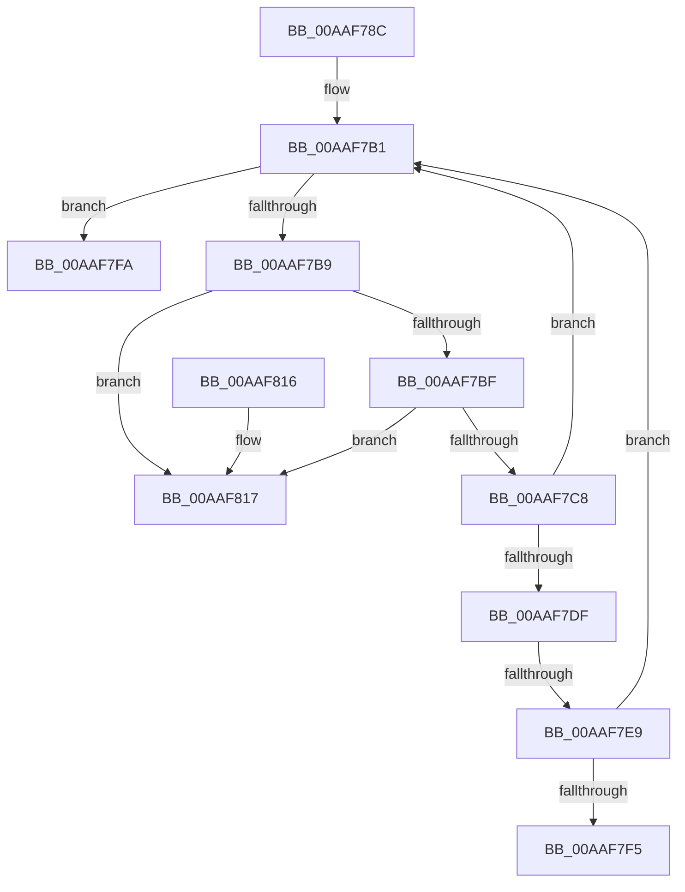

# PnpOrphanNotification

- RVA: `0x00AAF78C`–`0x00AAF81E` (길이 `146` bytes)
- VA: `0x0000000140AAF78C`
- 실행 섹션: `PAGE`
- PDB 이름 있음: `예`; PDB Function 태그: `예`
- unwind 정보 RVA: `0x0006383C`
- 디코드: `38`개 명령, `146/146` bytes 표시
- 미해석 바이트: `0` (있으면 어셈블리에 `.byte`로 보존)

> 이 문서는 커널 이미지의 기계어와 PDB 기호를 분석해 생성했습니다. 4번과 5번은 함수 원형과 자료형을 바이너리 사용 방식에서 추정한 C 해석이며 원본 소스 복구 결과는 아닙니다.

## 1. Dependencies

- 직접 호출 지점: **2**; 고유 호출 대상: **2**
- 직접 호출자로 확인된 함수: **1**
- RIP 상대 이미지 참조: **1**

### Outgoing calls
- `0x00AAF7A5` → [ExAcquireFastMutex](../../text/20/ExAcquireFastMutex_function_0020E5A0.md) (function, `0x0020E5A0`)
- `0x00AAF801` → [ExReleaseFastMutex](../../text/25/ExReleaseFastMutex_function_002519C0.md) (function, `0x002519C0`)

### Direct callers
- [PpDevNodeRemoveFromTree](../../text/4A/PpDevNodeRemoveFromTree_function_004AD5A0.md) at `0x004AD652`

### Static image references
- `0x00AAF79E` → RVA `0x00F8CDA0` (`.data`; read)

## 2. Other-region calls and transfers

- 다른 실행 섹션으로 향하는 call: **2**
  - `0x00AAF7A5` → [ExAcquireFastMutex](../../text/20/ExAcquireFastMutex_function_0020E5A0.md) (`PAGE` → `.text`)
  - `0x00AAF801` → [ExReleaseFastMutex](../../text/25/ExReleaseFastMutex_function_002519C0.md) (`PAGE` → `.text`)
- call이 아닌 외부 분기/꼬리 이동: **2**
  - `0x00AAF7E3` → [sub_00B4A88A](../B4/Unknown_function_00B4A88A.md) (`tail-transfer`)
  - `0x00AAF7F5` → [sub_00B4A88A](../B4/Unknown_function_00B4A88A.md) (`tail-transfer`)

## 3. Assembly (complete function range)

```asm
00AAF78C  48 89 5C 24 08                  mov qword ptr [rsp + 8], rbx
00AAF791  48 89 74 24 10                  mov qword ptr [rsp + 0x10], rsi
00AAF796  57                              push rdi
00AAF797  48 83 EC 20                     sub rsp, 0x20
00AAF79B  48 8B F1                        mov rsi, rcx
00AAF79E  48 8D 0D FB D5 4D 00            lea rcx, [rip + 0x4dd5fb]
00AAF7A5  E8 F6 ED 75 FF                  call 0x14020e5a0
00AAF7AA  48 8D BE D8 01 00 00            lea rdi, [rsi + 0x1d8]
00AAF7B1  48 8B 1F                        mov rbx, qword ptr [rdi]
00AAF7B4  48 3B DF                        cmp rbx, rdi
00AAF7B7  74 41                           je 0x140aaf7fa
00AAF7B9  48 39 7B 08                     cmp qword ptr [rbx + 8], rdi
00AAF7BD  75 58                           jne 0x140aaf817
00AAF7BF  48 8B 03                        mov rax, qword ptr [rbx]
00AAF7C2  48 39 58 08                     cmp qword ptr [rax + 8], rbx
00AAF7C6  75 4F                           jne 0x140aaf817
00AAF7C8  48 89 07                        mov qword ptr [rdi], rax
00AAF7CB  48 89 78 08                     mov qword ptr [rax + 8], rdi
00AAF7CF  48 8B 4B 58                     mov rcx, qword ptr [rbx + 0x58]
00AAF7D3  48 89 5B 08                     mov qword ptr [rbx + 8], rbx
00AAF7D7  48 89 1B                        mov qword ptr [rbx], rbx
00AAF7DA  48 85 C9                        test rcx, rcx
00AAF7DD  74 D2                           je 0x140aaf7b1
00AAF7DF  80 7B 3A 00                     cmp byte ptr [rbx + 0x3a], 0
00AAF7E3  0F 84 A1 B0 09 00               je 0x140b4a88a
00AAF7E9  F7 86 C0 02 00 00 00 40 00 00   test dword ptr [rsi + 0x2c0], 0x4000
00AAF7F3  75 BC                           jne 0x140aaf7b1
00AAF7F5  E9 90 B0 09 00                  jmp 0x140b4a88a
00AAF7FA  48 8D 0D 9F D5 4D 00            lea rcx, [rip + 0x4dd59f]
00AAF801  E8 BA 21 7A FF                  call 0x1402519c0
00AAF806  48 8B 5C 24 30                  mov rbx, qword ptr [rsp + 0x30]
00AAF80B  48 8B 74 24 38                  mov rsi, qword ptr [rsp + 0x38]
00AAF810  48 83 C4 20                     add rsp, 0x20
00AAF814  5F                              pop rdi
00AAF815  C3                              ret
00AAF816  CC                              int3
00AAF817  B9 03 00 00 00                  mov ecx, 3
00AAF81C  CD 29                           int 0x29
```

## 4. C-style interpretation (structured pseudocode)

```c
__int64 __fastcall PnpOrphanNotification(__int64 a1)
{
    __int64 result;
    __int64 v_rsp;
    unsigned __int64 v_stack_p10;
    unsigned __int64 v_stack_p8;

    v_stack_p8 = v_rbx;
    v_stack_p10 = v_rsi;
    v_rsp = (v_rsp) - (32);
    result = ExAcquireFastMutex(v_rip + 5101051, a2, a3, a4);
loc_00AAF7B1:
    if ((*(unsigned __int64 *)(a1 + 472)) == (a1 + 472)) goto loc_00AAF7FA;
    if ((*(unsigned __int64 *)(*(unsigned __int64 *)(a1 + 472) + 8)) != (a1 + 472)) goto loc_00AAF817;
    if ((*(unsigned __int64 *)(*(unsigned __int64 *)(*(unsigned __int64 *)(a1 + 472)) + 8)) != (*(unsigned __int64 *)(a1 + 472))) goto loc_00AAF817;
    *(unsigned __int64 *)(a1 + 472) = *(unsigned __int64 *)(*(unsigned __int64 *)(a1 + 472));
    *(unsigned __int64 *)(*(unsigned __int64 *)(*(unsigned __int64 *)(a1 + 472)) + 8) = a1 + 472;
    *(unsigned __int64 *)(*(unsigned __int64 *)(a1 + 472) + 8) = *(unsigned __int64 *)(a1 + 472);
    *(unsigned __int64 *)(*(unsigned __int64 *)(a1 + 472)) = *(unsigned __int64 *)(a1 + 472);
    if (*(unsigned __int64 *)(*(unsigned __int64 *)(a1 + 472) + 88) == 0) goto loc_00AAF7B1;
    if (((*(unsigned int *)(a1 + 704)) & (0x4000ULL)) != 0) goto loc_00AAF7B1;
loc_00AAF7FA:
    result = ExReleaseFastMutex(v_rip + 5100959, a2, a3, a4);
    v_rsp = (v_rsp) + (32);
    return result;
loc_00AAF817:
    return result;
}
```

## 5. (Beta) C Style

```c
int64_t PnpOrphanNotification(void *Arg1)
{
    uint8_t *arg1 = (uint8_t *)Arg1;

    int64_t result;
    int64_t local_rsp;
    uint64_t v_stack_p10;
    uint64_t v_stack_p8;

    v_stack_p8 = local_rbx;
    v_stack_p10 = local_rsi;
    local_rsp = (local_rsp) - (32);
    result = ExAcquireFastMutex(v_rip + 5101051, a2, a3, a4);
loc_00AAF7B1:
    if ((*(uint64_t *)(arg1 + 0x1D8)) == (Arg1 + 472)) goto loc_00AAF7FA;
    if ((*(uint64_t *)(*(uint64_t *)(arg1 + 0x1D8) + 0x8)) != (Arg1 + 472)) goto loc_00AAF817;
    if ((*(uint64_t *)(*(uint64_t *)(*(uint64_t *)(arg1 + 0x1D8)) + 0x8)) != (*(uint64_t *)(arg1 + 0x1D8))) goto loc_00AAF817;
    *(uint64_t *)(arg1 + 0x1D8) = *(uint64_t *)(*(uint64_t *)(arg1 + 0x1D8));
    *(void **)(*(uint64_t *)(*(uint64_t *)(arg1 + 0x1D8)) + 0x8) = Arg1 + 472;
    *(uint64_t *)(*(uint64_t *)(arg1 + 0x1D8) + 0x8) = *(uint64_t *)(arg1 + 0x1D8);
    *(uint64_t *)(*(uint64_t *)(arg1 + 0x1D8)) = *(uint64_t *)(arg1 + 0x1D8);
    if (*(uint64_t *)(*(uint64_t *)(arg1 + 0x1D8) + 0x58) == 0) goto loc_00AAF7B1;
    if (((*(uint32_t *)(arg1 + 0x2C0)) & (0x4000ULL)) != 0) goto loc_00AAF7B1;
loc_00AAF7FA:
    result = ExReleaseFastMutex(v_rip + 5100959, a2, a3, a4);
    local_rsp = (local_rsp) + (32);
    return result;
loc_00AAF817:
    return result;
}
```

### 관측된 메모리 오프셋

구조체 형식이 확인되지 않은 접근은 인자 기준의 오프셋으로만 기록했습니다.

| 기준 인자 | 오프셋 표현 | 폭 (bit) | 접근 |
|---|---:|---:|---|
| `Arg1` | `+ 0x0` | `64` | `R` |
| `Arg1` | `+ 0x0` | `64` | `W` |
| `Arg1` | `+ 0x1D8` | `64` | `R` |
| `Arg1` | `+ 0x2C0` | `32` | `R` |

## 6. Execution-region graph

[열기: 2D/3D 그래프와 함수 탐색 컨트롤 패널](../../../control-panel.html?section=page&rva=0x00AAF78C&view=graph)

- 2D 그래프는 위에서 아래로 흐르고, 3D 그래프는 빈 공간을 드래그해 회전합니다. Shift+드래그는 이동, 휠은 확대·축소, 함수 노드 선택은 대상 보고서 이동입니다.

### Static fallback


