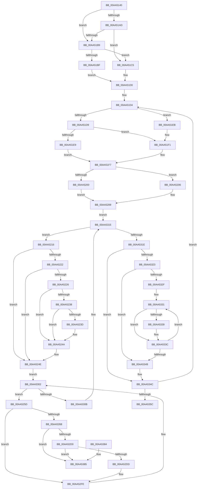

# PnpReleaseResourcesInternal

- RVA: `0x00AA5140`–`0x00AA538C` (길이 `588` bytes)
- VA: `0x0000000140AA5140`
- 실행 섹션: `PAGE`
- PDB 이름 있음: `예`; PDB Function 태그: `아니요`
- unwind 정보 RVA: `0x000BB654`
- 디코드: `167`개 명령, `588/588` bytes 표시
- 미해석 바이트: `0` (있으면 어셈블리에 `.byte`로 보존)

> 이 문서는 커널 이미지의 기계어와 PDB 기호를 분석해 생성했습니다. 4번과 5번은 함수 원형과 자료형을 바이너리 사용 방식에서 추정한 C 해석이며 원본 소스 복구 결과는 아닙니다.

## 1. Dependencies

- 직접 호출 지점: **6**; 고유 호출 대상: **5**
- 직접 호출자로 확인된 함수: **2**
- RIP 상대 이미지 참조: **1**

### Outgoing calls
- `0x00AA5169` → [memset](../../text/6C/memset_function_006C6C40.md) (function, `0x006C6C40`)
- `0x00AA522B` → [IopFindLegacyBusDeviceNode](IopFindLegacyBusDeviceNode_function_00AAB698.md) (function, `0x00AAB698`)
- `0x00AA5242` → [IopFindLegacyBusDeviceNode](IopFindLegacyBusDeviceNode_function_00AAB698.md) (function, `0x00AAB698`)
- `0x00AA528D` → [IopCallArbiter](IopCallArbiter_function_00AA5394.md) (function, `0x00AA5394`)
- `0x00AA52B5` → [guard_dispatch_icall](../../text/6B/guard_dispatch_icall_function_006BAAD0.md) (function, `0x006BAAD0`)
- `0x00AA5364` → [IopWriteAllocatedResourcesToRegistry](IopWriteAllocatedResourcesToRegistry_function_00AA54E4.md) (function, `0x00AA54E4`)

### Direct callers
- [IopReleaseResources](../72/IopReleaseResources_function_0072D964.md) at `0x0072D96D`
- [PnpReallocateResources](../73/PnpReallocateResources_function_0073E924.md) at `0x0073EA00`

### Static image references
- `0x00AA51F7` → RVA `0x00F8C438` (`.data`; read)

## 2. Other-region calls and transfers

- 다른 실행 섹션으로 향하는 call: **2**
  - `0x00AA5169` → [memset](../../text/6C/memset_function_006C6C40.md) (`PAGE` → `.text`)
  - `0x00AA52B5` → [guard_dispatch_icall](../../text/6B/guard_dispatch_icall_function_006BAAD0.md) (`PAGE` → `.text`)
- 별도 외부 분기/꼬리 이동을 확인하지 못했습니다.

## 3. Assembly (complete function range)

```asm
00AA5140  48 89 5C 24 20                  mov qword ptr [rsp + 0x20], rbx
00AA5145  55                              push rbp
00AA5146  56                              push rsi
00AA5147  57                              push rdi
00AA5148  41 54                           push r12
00AA514A  41 55                           push r13
00AA514C  41 56                           push r14
00AA514E  41 57                           push r15
00AA5150  48 8D 6C 24 D9                  lea rbp, [rsp - 0x27]
00AA5155  48 81 EC C0 00 00 00            sub rsp, 0xc0
00AA515C  33 D2                           xor edx, edx
00AA515E  4C 8B F1                        mov r14, rcx
00AA5161  48 8D 4D 97                     lea rcx, [rbp - 0x69]
00AA5165  44 8D 42 60                     lea r8d, [rdx + 0x60]
00AA5169  E8 D2 1A C2 FF                  call 0x1406c6c40
00AA516E  49 8B 9E A0 01 00 00            mov rbx, qword ptr [r14 + 0x1a0]
00AA5175  48 8D 45 97                     lea rax, [rbp - 0x69]
00AA5179  45 33 DB                        xor r11d, r11d
00AA517C  48 89 45 9F                     mov qword ptr [rbp - 0x61], rax
00AA5180  44 89 5D A7                     mov dword ptr [rbp - 0x59], r11d
00AA5184  48 8D 45 97                     lea rax, [rbp - 0x69]
00AA5188  48 89 45 97                     mov qword ptr [rbp - 0x69], rax
00AA518C  49 8B 46 20                     mov rax, qword ptr [r14 + 0x20]
00AA5190  48 89 45 B7                     mov qword ptr [rbp - 0x49], rax
00AA5194  4C 89 5D AF                     mov qword ptr [rbp - 0x51], r11
00AA5198  48 C7 45 BF 04 00 00 00         mov qword ptr [rbp - 0x41], 4
00AA51A0  4C 89 5D C7                     mov qword ptr [rbp - 0x39], r11
00AA51A4  4C 89 5D DF                     mov qword ptr [rbp - 0x21], r11
00AA51A8  48 85 DB                        test rbx, rbx
00AA51AB  75 0C                           jne 0x140aa51b9
00AA51AD  49 8B 9E 20 02 00 00            mov rbx, qword ptr [r14 + 0x220]
00AA51B4  48 85 DB                        test rbx, rbx
00AA51B7  74 0C                           je 0x140aa51c5
00AA51B9  8B 33                           mov esi, dword ptr [rbx]
00AA51BB  85 F6                           test esi, esi
00AA51BD  74 06                           je 0x140aa51c5
00AA51BF  4C 8D 7B 04                     lea r15, [rbx + 4]
00AA51C3  EB 0B                           jmp 0x140aa51d0
00AA51C5  BE 01 00 00 00                  mov esi, 1
00AA51CA  49 8B DB                        mov rbx, r11
00AA51CD  4D 8B FB                        mov r15, r11
00AA51D0  44 89 5D 6F                     mov dword ptr [rbp + 0x6f], r11d
00AA51D4  48 85 DB                        test rbx, rbx
00AA51D7  74 12                           je 0x140aa51eb
00AA51D9  45 8B 2F                        mov r13d, dword ptr [r15]
00AA51DC  41 8B 47 04                     mov eax, dword ptr [r15 + 4]
00AA51E0  89 45 77                        mov dword ptr [rbp + 0x77], eax
00AA51E3  41 83 FD FF                     cmp r13d, -1
00AA51E7  74 08                           je 0x140aa51f1
00AA51E9  EB 0C                           jmp 0x140aa51f7
00AA51EB  41 8B C3                        mov eax, r11d
00AA51EE  89 45 77                        mov dword ptr [rbp + 0x77], eax
00AA51F1  41 BD 01 00 00 00               mov r13d, 1
00AA51F7  4C 3B 35 3A 72 4E 00            cmp r14, qword ptr [rip + 0x4e723a]
00AA51FE  74 06                           je 0x140aa5206
00AA5200  49 8B 7E 10                     mov rdi, qword ptr [r14 + 0x10]
00AA5204  EB 03                           jmp 0x140aa5209
00AA5206  49 8B FE                        mov rdi, r14
00AA5209  B9 01 00 00 00                  mov ecx, 1
00AA520E  89 4D 67                        mov dword ptr [rbp + 0x67], ecx
00AA5211  E9 FF 00 00 00                  jmp 0x140aa5315
00AA5216  4C 8B 0D 1B 72 4E 00            mov r9, qword ptr [rip + 0x4e721b]
00AA521D  49 3B F9                        cmp rdi, r9
00AA5220  75 2C                           jne 0x140aa524e
00AA5222  85 C9                           test ecx, ecx
00AA5224  74 28                           je 0x140aa524e
00AA5226  8B D0                           mov edx, eax
00AA5228  41 8B CD                        mov ecx, r13d
00AA522B  E8 68 64 00 00                  call 0x140aab698
00AA5230  48 8B F8                        mov rdi, rax
00AA5233  49 3B C1                        cmp rax, r9
00AA5236  75 12                           jne 0x140aa524a
00AA5238  45 85 ED                        test r13d, r13d
00AA523B  75 0D                           jne 0x140aa524a
00AA523D  33 D2                           xor edx, edx
00AA523F  8D 4A 01                        lea ecx, [rdx + 1]
00AA5242  E8 51 64 00 00                  call 0x140aab698
00AA5247  48 8B F8                        mov rdi, rax
00AA524A  44 89 5D 67                     mov dword ptr [rbp + 0x67], r11d
00AA524E  48 8D 87 E8 01 00 00            lea rax, [rdi + 0x1e8]
00AA5255  4C 8B 20                        mov r12, qword ptr [rax]
00AA5258  E9 A5 00 00 00                  jmp 0x140aa5302
00AA525D  4D 39 5C 24 18                  cmp qword ptr [r12 + 0x18], r11
00AA5262  0F 84 96 00 00 00               je 0x140aa52fe
00AA5268  4D 8D 44 24 28                  lea r8, [r12 + 0x28]
00AA526D  44 89 5D 67                     mov dword ptr [rbp + 0x67], r11d
00AA5271  4C 89 45 97                     mov qword ptr [rbp - 0x69], r8
00AA5275  48 8D 45 97                     lea rax, [rbp - 0x69]
00AA5279  4C 89 45 9F                     mov qword ptr [rbp - 0x61], r8
00AA527D  33 D2                           xor edx, edx
00AA527F  49 89 00                        mov qword ptr [r8], rax
00AA5282  49 8B CC                        mov rcx, r12
00AA5285  48 8D 45 97                     lea rax, [rbp - 0x69]
00AA5289  49 89 40 08                     mov qword ptr [r8 + 8], rax
00AA528D  E8 02 01 00 00                  call 0x140aa5394
00AA5292  49 8B 4C 24 18                  mov rcx, qword ptr [r12 + 0x18]
00AA5297  0F 57 C0                        xorps xmm0, xmm0
00AA529A  0F 11 45 07                     movups xmmword ptr [rbp + 7], xmm0
00AA529E  45 33 C0                        xor r8d, r8d
00AA52A1  0F 11 45 17                     movups xmmword ptr [rbp + 0x17], xmm0
00AA52A5  0F 11 45 F7                     movups xmmword ptr [rbp - 9], xmm0
00AA52A9  48 8B 41 20                     mov rax, qword ptr [rcx + 0x20]
00AA52AD  41 8D 50 02                     lea edx, [r8 + 2]
00AA52B1  48 8B 49 08                     mov rcx, qword ptr [rcx + 8]
00AA52B5  E8 16 58 C1 FF                  call 0x1406baad0
00AA52BA  48 8B 4D 97                     mov rcx, qword ptr [rbp - 0x69]
00AA52BE  48 8D 55 97                     lea rdx, [rbp - 0x69]
00AA52C2  48 8B 45 9F                     mov rax, qword ptr [rbp - 0x61]
00AA52C6  48 39 51 08                     cmp qword ptr [rcx + 8], rdx
00AA52CA  0F 85 B5 00 00 00               jne 0x140aa5385
00AA52D0  48 8D 55 97                     lea rdx, [rbp - 0x69]
00AA52D4  48 39 10                        cmp qword ptr [rax], rdx
00AA52D7  0F 85 A8 00 00 00               jne 0x140aa5385
00AA52DD  48 89 08                        mov qword ptr [rax], rcx
00AA52E0  45 33 DB                        xor r11d, r11d
00AA52E3  48 89 41 08                     mov qword ptr [rcx + 8], rax
00AA52E7  48 8D 45 97                     lea rax, [rbp - 0x69]
00AA52EB  48 89 45 9F                     mov qword ptr [rbp - 0x61], rax
00AA52EF  48 8D 45 97                     lea rax, [rbp - 0x69]
00AA52F3  48 89 45 97                     mov qword ptr [rbp - 0x69], rax
00AA52F7  48 8D 87 E8 01 00 00            lea rax, [rdi + 0x1e8]
00AA52FE  4D 8B 24 24                     mov r12, qword ptr [r12]
00AA5302  4C 3B E0                        cmp r12, rax
00AA5305  0F 85 52 FF FF FF               jne 0x140aa525d
00AA530B  48 8B 7F 10                     mov rdi, qword ptr [rdi + 0x10]
00AA530F  8B 4D 67                        mov ecx, dword ptr [rbp + 0x67]
00AA5312  8B 45 77                        mov eax, dword ptr [rbp + 0x77]
00AA5315  48 85 FF                        test rdi, rdi
00AA5318  0F 85 F8 FE FF FF               jne 0x140aa5216
00AA531E  83 FE 01                        cmp esi, 1
00AA5321  76 29                           jbe 0x140aa534c
00AA5323  41 8B 47 0C                     mov eax, dword ptr [r15 + 0xc]
00AA5327  49 8D 4F 10                     lea rcx, [r15 + 0x10]
00AA532B  85 C0                           test eax, eax
00AA532D  74 1A                           je 0x140aa5349
00AA532F  8B D0                           mov edx, eax
00AA5331  80 39 05                        cmp byte ptr [rcx], 5
00AA5334  41 8B C3                        mov eax, r11d
00AA5337  75 03                           jne 0x140aa533c
00AA5339  8B 41 04                        mov eax, dword ptr [rcx + 4]
00AA533C  48 83 C1 14                     add rcx, 0x14
00AA5340  48 03 C8                        add rcx, rax
00AA5343  48 83 EA 01                     sub rdx, 1
00AA5347  75 E8                           jne 0x140aa5331
00AA5349  4C 8B F9                        mov r15, rcx
00AA534C  8B 45 6F                        mov eax, dword ptr [rbp + 0x6f]
00AA534F  FF C0                           inc eax
00AA5351  89 45 6F                        mov dword ptr [rbp + 0x6f], eax
00AA5354  3B C6                           cmp eax, esi
00AA5356  0F 82 78 FE FF FF               jb 0x140aa51d4
00AA535C  45 33 C0                        xor r8d, r8d
00AA535F  33 D2                           xor edx, edx
00AA5361  49 8B CE                        mov rcx, r14
00AA5364  E8 7B 01 00 00                  call 0x140aa54e4
00AA5369  48 8B 9C 24 18 01 00 00         mov rbx, qword ptr [rsp + 0x118]
00AA5371  48 81 C4 C0 00 00 00            add rsp, 0xc0
00AA5378  41 5F                           pop r15
00AA537A  41 5E                           pop r14
00AA537C  41 5D                           pop r13
00AA537E  41 5C                           pop r12
00AA5380  5F                              pop rdi
00AA5381  5E                              pop rsi
00AA5382  5D                              pop rbp
00AA5383  C3                              ret
00AA5384  CC                              int3
00AA5385  B9 03 00 00 00                  mov ecx, 3
00AA538A  CD 29                           int 0x29
```

## 4. C-style interpretation (structured pseudocode)

```c
__int64 __fastcall PnpReleaseResourcesInternal(__int64 a1, int a2)
{
    __int64 result;
    __int64 v_r11;
    __int64 v_rdi;
    __int64 v_rsp;
    unsigned __int64 v_stack_m48;
    unsigned __int64 v_stack_m58;
    unsigned __int64 v_stack_m5F;
    unsigned __int64 v_stack_m68;
    unsigned __int64 v_stack_m80;
    unsigned __int64 v_stack_m98;
    unsigned __int64 v_stack_mA0;
    unsigned __int64 v_stack_mA8;
    unsigned __int64 v_stack_mB0;
    unsigned int v_stack_mB8;
    unsigned __int64 v_stack_mC0;
    unsigned __int64 v_stack_mC8;
    unsigned int v_stack_p10;
    unsigned int v_stack_p18;
    unsigned __int64 v_stack_p20;
    unsigned int v_stack_p8;

    v_stack_p20 = v_rbx;
    v_rsp = (v_rsp) - (192);
    a2 = 0;
    result = memset(v_stack_mC8, a2, a2 + 96, a4);
    v_r11 = 0;
    v_stack_mC0 = v_stack_mC8;
    v_stack_mB8 = 0;
    v_stack_mC8 = v_stack_mC8;
    v_stack_mA8 = *(unsigned __int64 *)(a1 + 32);
    v_stack_mB0 = 0;
    v_stack_mA0 = 4;
    v_stack_m98 = 0;
    v_stack_m80 = 0;
    if (*(unsigned __int64 *)(a1 + 416) != 0) goto loc_00AA51B9;
    if (*(unsigned __int64 *)(a1 + 544) == 0) goto loc_00AA51C5;
loc_00AA51B9:
    if ((unsigned int)((unsigned int)(*(unsigned int *)(*(unsigned __int64 *)(a1 + 544)))) == 0) goto loc_00AA51C5;
    goto loc_00AA51D0;
loc_00AA51C5:
loc_00AA51D0:
    v_stack_p10 = 0;
loc_00AA51D4:
    if (0 == 0) goto loc_00AA51EB;
    v_stack_p18 = (unsigned int)((unsigned int)(*(unsigned int *)(0 + 4)));
    if (((unsigned int)((unsigned int)(*(unsigned int *)(0)))) == -1) goto loc_00AA51F1;
    goto loc_00AA51F7;
loc_00AA51EB:
    v_stack_p18 = 0;
loc_00AA51F1:
loc_00AA51F7:
    if (a1 == (*(unsigned __int64 *)(v_rip + 5141050))) goto loc_00AA5206;
    goto loc_00AA5209;
loc_00AA5206:
loc_00AA5209:
    v_stack_p8 = 1;
    goto loc_00AA5315;
loc_00AA5216:
    if (a1 != (*(unsigned __int64 *)(v_rip + 5141019))) goto loc_00AA524E;
    if (1 == 0) goto loc_00AA524E;
    result = IopFindLegacyBusDeviceNode(1, 0, a2 + 96, *(unsigned __int64 *)(v_rip + 5141019));
    if (result != (*(unsigned __int64 *)(v_rip + 5141019))) goto loc_00AA524A;
    v_rdi = result;
    if (1 == 0) {
        a2 = 0;
        a1 = a2 + 1;
        result = IopFindLegacyBusDeviceNode(a1, a2, a2 + 96, *(unsigned __int64 *)(v_rip + 5141019));
        v_rdi = result;
    }
    v_stack_p8 = 0;
loc_00AA524E:
    goto loc_00AA5302;
loc_00AA525D:
    if ((*(unsigned __int64 *)(*(unsigned __int64 *)(v_rdi + 488) + 24)) == 0) goto loc_00AA52FE;
    v_stack_p8 = 0;
    v_stack_mC8 = *(unsigned __int64 *)(v_rdi + 488) + 40;
    v_stack_mC0 = *(unsigned __int64 *)(v_rdi + 488) + 40;
    a2 = 0;
    *(unsigned __int64 *)(*(unsigned __int64 *)(v_rdi + 488) + 40) = v_stack_mC8;
    *(unsigned __int64 *)(*(unsigned __int64 *)(v_rdi + 488) + 40 + 8) = v_stack_mC8;
    result = IopCallArbiter(*(unsigned __int64 *)(v_rdi + 488), a2, *(unsigned __int64 *)(v_rdi + 488) + 40, *(unsigned __int64 *)(v_rip + 5141019));
    v_stack_m58 = v_xmm0;
    a3 = 0;
    v_stack_m48 = v_xmm0;
    v_stack_m68 = v_xmm0;
    result = guard_dispatch_icall(*(unsigned __int64 *)(*(unsigned __int64 *)(*(unsigned __int64 *)(v_rdi + 488) + 24) + 8), a3 + 2, a3, *(unsigned __int64 *)(v_rip + 5141019));
    if ((*(unsigned __int64 *)(v_stack_mC8 + 8)) != v_stack_mC8) goto loc_00AA5385;
    if ((*(unsigned __int64 *)(v_stack_mC0)) != v_stack_mC8) goto loc_00AA5385;
    *(unsigned __int64 *)(v_stack_mC0) = v_stack_mC8;
    v_r11 = 0;
    *(unsigned __int64 *)(v_stack_mC8 + 8) = v_stack_mC0;
    v_stack_mC0 = v_stack_mC8;
    v_stack_mC8 = v_stack_mC8;
loc_00AA52FE:
loc_00AA5302:
    if ((*(unsigned __int64 *)(*(unsigned __int64 *)(v_rdi + 488))) != (v_rdi + 488)) goto loc_00AA525D;
loc_00AA5315:
    if (*(unsigned __int64 *)(v_rdi + 16) != 0) goto loc_00AA5216;
    if (1 <= 1) goto loc_00AA534C;
    if ((unsigned int)((unsigned int)(*(unsigned int *)(0 + 12))) == 0) goto loc_00AA5349;
loc_00AA5331:
    result = 0;
    if ((*(unsigned __int8 *)(0 + 16)) == 5) {
        result = *(unsigned int *)(0 + 16 + 4);
    }
    a1 = (0 + 16) + (20);
    a1 = (a1) + (result);
    a2 = ((unsigned int)((unsigned int)((unsigned int)(*(unsigned int *)(0 + 12))))) - (1);
    if (condition_is_not_equal) goto loc_00AA5331;
loc_00AA5349:
loc_00AA534C:
    result = (unsigned int)(((unsigned int)(v_stack_p10)) + 1);
    v_stack_p10 = (unsigned int)(result);
    if (((unsigned int)(result)) < 1) goto loc_00AA51D4;
    a3 = 0;
    a2 = 0;
    result = IopWriteAllocatedResourcesToRegistry(a1, a2, a3, *(unsigned __int64 *)(v_rip + 5141019));
    v_rsp = (v_rsp) + (192);
    return result;
loc_00AA5385:
    return result;
}
```

## 5. (Beta) C Style

```c
int64_t PnpReleaseResourcesInternal(void *Arg1, int32_t Arg2)
{
    uint8_t *arg1 = (uint8_t *)Arg1;

    int64_t result;
    int64_t local_r11;
    int64_t local_rdi;
    int64_t local_rsp;
    uint64_t v_stack_m48;
    uint64_t v_stack_m58;
    uint64_t v_stack_m5F;
    uint64_t v_stack_m68;
    uint64_t v_stack_m80;
    uint64_t v_stack_m98;
    uint64_t v_stack_mA0;
    uint64_t v_stack_mA8;
    uint64_t v_stack_mB0;
    uint32_t v_stack_mB8;
    uint64_t v_stack_mC0;
    uint64_t v_stack_mC8;
    uint32_t v_stack_p10;
    uint32_t v_stack_p18;
    uint64_t v_stack_p20;
    uint32_t v_stack_p8;

    v_stack_p20 = local_rbx;
    local_rsp = (local_rsp) - (192);
    Arg2 = 0;
    result = memset(v_stack_mC8, Arg2, Arg2 + 96, a4);
    local_r11 = 0;
    v_stack_mC0 = v_stack_mC8;
    v_stack_mB8 = 0;
    v_stack_mC8 = v_stack_mC8;
    v_stack_mA8 = *(uint64_t *)(arg1 + 0x20);
    v_stack_mB0 = 0;
    v_stack_mA0 = 4;
    v_stack_m98 = 0;
    v_stack_m80 = 0;
    if (*(uint64_t *)(arg1 + 0x1A0) != 0) goto loc_00AA51B9;
    if (*(uint64_t *)(arg1 + 0x220) == 0) goto loc_00AA51C5;
loc_00AA51B9:
    if ((uint32_t)((uint32_t)(*(uint32_t *)(*(uint64_t *)(arg1 + 0x220)))) == 0) goto loc_00AA51C5;
    goto loc_00AA51D0;
loc_00AA51C5:
loc_00AA51D0:
    v_stack_p10 = 0;
loc_00AA51D4:
    if (0 == 0) goto loc_00AA51EB;
    v_stack_p18 = (uint32_t)((uint32_t)(*(uint32_t *)(0 + 0x4)));
    if (((uint32_t)((uint32_t)(*(uint32_t *)(0)))) == -1) goto loc_00AA51F1;
    goto loc_00AA51F7;
loc_00AA51EB:
    v_stack_p18 = 0;
loc_00AA51F1:
loc_00AA51F7:
    if (Arg1 == (*(uint64_t *)(v_rip + 0x4E723A))) goto loc_00AA5206;
    goto loc_00AA5209;
loc_00AA5206:
loc_00AA5209:
    v_stack_p8 = 1;
    goto loc_00AA5315;
loc_00AA5216:
    if (Arg1 != (*(uint64_t *)(v_rip + 0x4E721B))) goto loc_00AA524E;
    if (1 == 0) goto loc_00AA524E;
    result = IopFindLegacyBusDeviceNode(1, 0, Arg2 + 96, *(uint64_t *)(v_rip + 0x4E721B));
    if (result != (*(uint64_t *)(v_rip + 0x4E721B))) goto loc_00AA524A;
    local_rdi = result;
    if (1 == 0) {
        Arg2 = 0;
        Arg1 = Arg2 + 1;
        result = IopFindLegacyBusDeviceNode(Arg1, Arg2, Arg2 + 96, *(uint64_t *)(v_rip + 0x4E721B));
        local_rdi = result;
    }
    v_stack_p8 = 0;
loc_00AA524E:
    goto loc_00AA5302;
loc_00AA525D:
    if ((*(uint64_t *)(*(uint64_t *)(local_rdi + 0x1E8) + 0x18)) == 0) goto loc_00AA52FE;
    v_stack_p8 = 0;
    v_stack_mC8 = *(uint64_t *)(local_rdi + 0x1E8) + 40;
    v_stack_mC0 = *(uint64_t *)(local_rdi + 0x1E8) + 40;
    Arg2 = 0;
    *(uint64_t *)(*(uint64_t *)(local_rdi + 0x1E8) + 0x28) = v_stack_mC8;
    *(uint64_t *)(*(uint64_t *)(local_rdi + 0x1E8) + 0x28 + 0x8) = v_stack_mC8;
    result = IopCallArbiter(*(uint64_t *)(local_rdi + 0x1E8), Arg2, *(uint64_t *)(local_rdi + 0x1E8) + 40, *(uint64_t *)(v_rip + 0x4E721B));
    v_stack_m58 = v_xmm0;
    a3 = 0;
    v_stack_m48 = v_xmm0;
    v_stack_m68 = v_xmm0;
    result = guard_dispatch_icall(*(uint64_t *)(*(uint64_t *)(*(uint64_t *)(local_rdi + 0x1E8) + 0x18) + 0x8), a3 + 2, a3, *(uint64_t *)(v_rip + 0x4E721B));
    if ((*(uint64_t *)(v_stack_mC8 + 0x8)) != v_stack_mC8) goto loc_00AA5385;
    if ((*(uint64_t *)(v_stack_mC0)) != v_stack_mC8) goto loc_00AA5385;
    *(uint64_t *)(v_stack_mC0) = v_stack_mC8;
    local_r11 = 0;
    *(uint64_t *)(v_stack_mC8 + 0x8) = v_stack_mC0;
    v_stack_mC0 = v_stack_mC8;
    v_stack_mC8 = v_stack_mC8;
loc_00AA52FE:
loc_00AA5302:
    if ((*(uint64_t *)(*(uint64_t *)(local_rdi + 0x1E8))) != (local_rdi + 488)) goto loc_00AA525D;
loc_00AA5315:
    if (*(uint64_t *)(local_rdi + 0x10) != 0) goto loc_00AA5216;
    if (1 <= 1) goto loc_00AA534C;
    if ((uint32_t)((uint32_t)(*(uint32_t *)(0 + 0xC))) == 0) goto loc_00AA5349;
loc_00AA5331:
    result = 0;
    if ((*(uint8_t *)(0 + 0x10)) == 5) {
        result = *(uint32_t *)(0 + 0x10 + 0x4);
    }
    Arg1 = (0 + 16) + (20);
    Arg1 = (Arg1) + (result);
    Arg2 = ((uint32_t)((uint32_t)((uint32_t)(*(uint32_t *)(0 + 0xC))))) - (1);
    if (condition_is_not_equal) goto loc_00AA5331;
loc_00AA5349:
loc_00AA534C:
    result = (uint32_t)(((uint32_t)(v_stack_p10)) + 1);
    v_stack_p10 = (uint32_t)(result);
    if (((uint32_t)(result)) < 1) goto loc_00AA51D4;
    a3 = 0;
    Arg2 = 0;
    result = IopWriteAllocatedResourcesToRegistry(Arg1, Arg2, a3, *(uint64_t *)(v_rip + 0x4E721B));
    local_rsp = (local_rsp) + (192);
    return result;
loc_00AA5385:
    return result;
}
```

### 관측된 메모리 오프셋

구조체 형식이 확인되지 않은 접근은 인자 기준의 오프셋으로만 기록했습니다.

| 기준 인자 | 오프셋 표현 | 폭 (bit) | 접근 |
|---|---:|---:|---|
| `Arg1` | `+ 0x20` | `64` | `R` |
| `Arg1` | `+ 0x1A0` | `64` | `R` |
| `Arg1` | `+ 0x220` | `64` | `R` |

## 6. Execution-region graph

[열기: 2D/3D 그래프와 함수 탐색 컨트롤 패널](../../../control-panel.html?section=page&rva=0x00AA5140&view=graph)

- 2D 그래프는 위에서 아래로 흐르고, 3D 그래프는 빈 공간을 드래그해 회전합니다. Shift+드래그는 이동, 휠은 확대·축소, 함수 노드 선택은 대상 보고서 이동입니다.

### Static fallback


