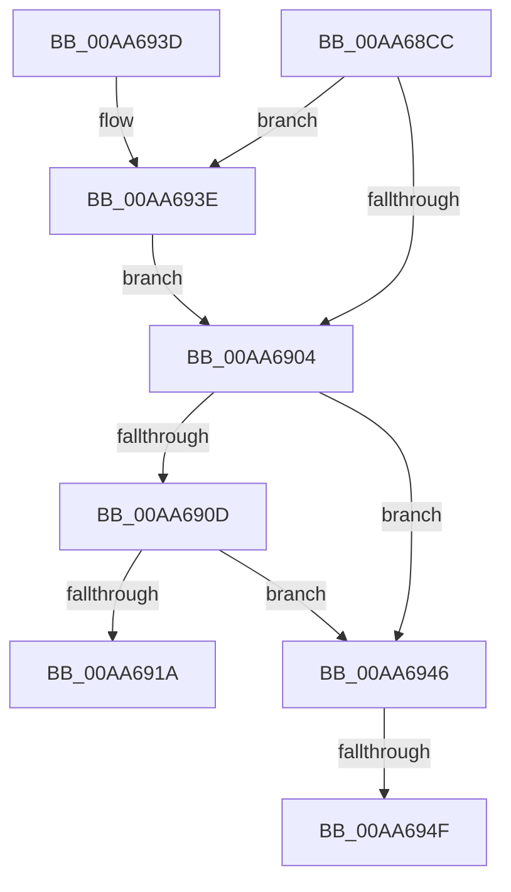

# PnpSetTargetDeviceRemove

- RVA: `0x00AA68CC`–`0x00AA695F` (길이 `147` bytes)
- VA: `0x0000000140AA68CC`
- 실행 섹션: `PAGE`
- PDB 이름 있음: `예`; PDB Function 태그: `예`
- unwind 정보 RVA: `0x000BB974`
- 디코드: `42`개 명령, `147/147` bytes 표시
- 미해석 바이트: `0` (있으면 어셈블리에 `.byte`로 보존)

> 이 문서는 커널 이미지의 기계어와 PDB 기호를 분석해 생성했습니다. 4번과 5번은 함수 원형과 자료형을 바이너리 사용 방식에서 추정한 C 해석이며 원본 소스 복구 결과는 아닙니다.

## 1. Dependencies

- 직접 호출 지점: **0**; 고유 호출 대상: **0**
- 직접 호출자로 확인된 함수: **1**
- RIP 상대 이미지 참조: **2**

### Outgoing calls
- 직접 디코드된 call 명령이 없습니다.

### Direct callers
- [PiDevCfgProcessDeviceCallback](../73/PiDevCfgProcessDeviceCallback_function_00734080.md) at `0x00734324`

### Static image references
- `0x00AA6904` → RVA `0x00F8C5E4` (`.data`; read)
- `0x00AA690F` → RVA `0x00E663B0` (`.data`; read)

## 2. Other-region calls and transfers

- 다른 실행 섹션으로 향하는 call: **0**
- call이 아닌 외부 분기/꼬리 이동: **2**
  - `0x00AA6949` → [sub_00B49E1C](../B4/Unknown_function_00B49E1C.md) (`tail-transfer`)
  - `0x00AA695A` → [sub_00B49E1C + 0x3](../B4/Unknown_function_00B49E1C.md) (`tail-transfer`)

## 3. Assembly (complete function range)

```asm
00AA68CC  48 89 5C 24 08                  mov qword ptr [rsp + 8], rbx
00AA68D1  48 89 6C 24 10                  mov qword ptr [rsp + 0x10], rbp
00AA68D6  48 89 74 24 18                  mov qword ptr [rsp + 0x18], rsi
00AA68DB  57                              push rdi
00AA68DC  41 54                           push r12
00AA68DE  41 55                           push r13
00AA68E0  41 56                           push r14
00AA68E2  41 57                           push r15
00AA68E4  48 83 EC 70                     sub rsp, 0x70
00AA68E8  48 8B B4 24 F0 00 00 00         mov rsi, qword ptr [rsp + 0xf0]
00AA68F0  45 33 ED                        xor r13d, r13d
00AA68F3  45 8B F9                        mov r15d, r9d
00AA68F6  45 8B E0                        mov r12d, r8d
00AA68F9  44 8B F2                        mov r14d, edx
00AA68FC  48 8B F9                        mov rdi, rcx
00AA68FF  48 85 F6                        test rsi, rsi
00AA6902  75 3A                           jne 0x140aa693e
00AA6904  44 39 2D D9 5C 4E 00            cmp dword ptr [rip + 0x4e5cd9], r13d
00AA690B  74 39                           je 0x140aa6946
00AA690D  33 C0                           xor eax, eax
00AA690F  F0 4C 0F B1 2D 98 FA 3B 00      lock cmpxchg qword ptr [rip + 0x3bfa98], r13
00AA6918  75 2C                           jne 0x140aa6946
00AA691A  B8 89 01 00 C0                  mov eax, 0xc0000189
00AA691F  4C 8D 5C 24 70                  lea r11, [rsp + 0x70]
00AA6924  49 8B 5B 30                     mov rbx, qword ptr [r11 + 0x30]
00AA6928  49 8B 6B 38                     mov rbp, qword ptr [r11 + 0x38]
00AA692C  49 8B 73 40                     mov rsi, qword ptr [r11 + 0x40]
00AA6930  49 8B E3                        mov rsp, r11
00AA6933  41 5F                           pop r15
00AA6935  41 5E                           pop r14
00AA6937  41 5D                           pop r13
00AA6939  41 5C                           pop r12
00AA693B  5F                              pop rdi
00AA693C  C3                              ret
00AA693D  CC                              int3
00AA693E  C7 06 03 01 00 00               mov dword ptr [rsi], 0x103
00AA6944  EB BE                           jmp 0x140aa6904
00AA6946  48 85 FF                        test rdi, rdi
00AA6949  0F 84 CD 34 0A 00               je 0x140b49e1c
00AA694F  48 8B 81 38 01 00 00            mov rax, qword ptr [rcx + 0x138]
00AA6956  48 8B 48 28                     mov rcx, qword ptr [rax + 0x28]
00AA695A  E9 C0 34 0A 00                  jmp 0x140b49e1f
```

## 4. C-style interpretation (structured pseudocode)

```c
__int64 __fastcall PnpSetTargetDeviceRemove(__int64 a1, int a2, int a3, int a4, __int64 a5, __int64 a6, __int64 a7, __int64 a8, __int64 a9, __int64 a10, __int64 a11)
{
    __int64 result;
    __int64 v_r13;
    __int64 v_rsp;
    unsigned __int64 v_stack_m28;
    unsigned __int64 v_stack_p10;
    unsigned __int64 v_stack_p18;
    unsigned __int64 v_stack_p8;

    v_stack_p8 = v_rbx;
    v_stack_p10 = v_rbp;
    v_stack_p18 = v_rsi;
    v_rsp = (v_rsp) - (112);
    v_r13 = 0;
    if (a11 != 0) goto loc_00AA693E;
loc_00AA6904:
    if ((*(unsigned int *)(v_rip + 5135577)) == 0) goto loc_00AA6946;
    result = 0;
    if (condition_is_not_equal) goto loc_00AA6946;
    return (unsigned int)(0xC0000189ULL);
loc_00AA693E:
    *(unsigned int *)(*(unsigned __int64 *)(v_stack_m28 + 64)) = 259;
    goto loc_00AA6904;
loc_00AA6946:
}
```

## 5. (Beta) C Style

```c
int64_t PnpSetTargetDeviceRemove(void *Arg1, int32_t Arg2, int32_t Arg3, int32_t Arg4, uint64_t Arg5, uint64_t Arg6, uint64_t Arg7, uint64_t Arg8, uint64_t Arg9, uint64_t Arg10, int64_t Arg11)
{
    uint8_t *arg1 = (uint8_t *)Arg1;

    int64_t result;
    int64_t local_r13;
    int64_t local_rsp;
    uint64_t v_stack_m28;
    uint64_t v_stack_p10;
    uint64_t v_stack_p18;
    uint64_t v_stack_p8;

    v_stack_p8 = local_rbx;
    v_stack_p10 = local_rbp;
    v_stack_p18 = local_rsi;
    local_rsp = (local_rsp) - (112);
    local_r13 = 0;
    if (Arg11 != 0) goto loc_00AA693E;
loc_00AA6904:
    if ((*(uint32_t *)(v_rip + 0x4E5CD9)) == 0) goto loc_00AA6946;
    result = 0;
    if (condition_is_not_equal) goto loc_00AA6946;
    return (uint32_t)(0xC0000189ULL);
loc_00AA693E:
    *(uint32_t *)(*(uint64_t *)(v_stack_m28 + 0x40)) = 259;
    goto loc_00AA6904;
loc_00AA6946:
}
```

### 관측된 메모리 오프셋

구조체 형식이 확인되지 않은 접근은 인자 기준의 오프셋으로만 기록했습니다.

| 기준 인자 | 오프셋 표현 | 폭 (bit) | 접근 |
|---|---:|---:|---|
| `Arg1` | `+ 0x138` | `64` | `R` |

## 6. Execution-region graph

[열기: 2D/3D 그래프와 함수 탐색 컨트롤 패널](../../../control-panel.html?section=page&rva=0x00AA68CC&view=graph)

- 2D 그래프는 위에서 아래로 흐르고, 3D 그래프는 빈 공간을 드래그해 회전합니다. Shift+드래그는 이동, 휠은 확대·축소, 함수 노드 선택은 대상 보고서 이동입니다.

### Static fallback


