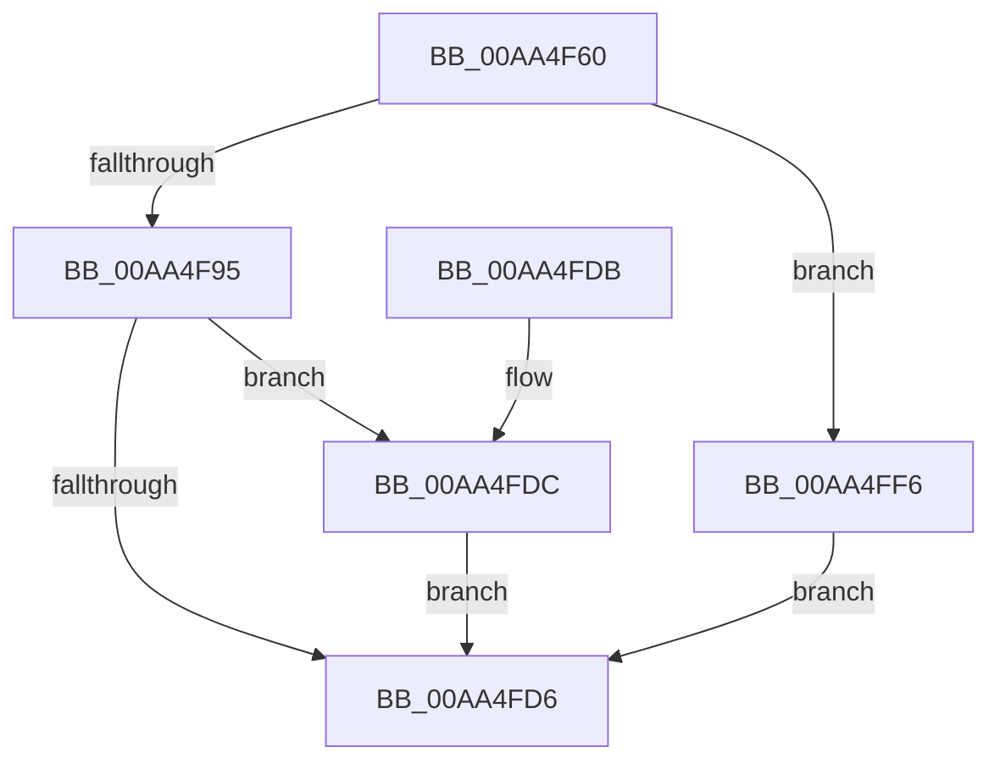

# PnpSynchronizeDeviceEventQueue

- RVA: `0x00AA4F60`–`0x00AA4FFD` (길이 `157` bytes)
- VA: `0x0000000140AA4F60`
- 실행 섹션: `PAGE`
- PDB 이름 있음: `예`; PDB Function 태그: `아니요`
- unwind 정보 RVA: `0x000BB5CC`
- 디코드: `38`개 명령, `157/157` bytes 표시
- 미해석 바이트: `0` (있으면 어셈블리에 `.byte`로 보존)

> 이 문서는 커널 이미지의 기계어와 PDB 기호를 분석해 생성했습니다. 4번과 5번은 함수 원형과 자료형을 바이너리 사용 방식에서 추정한 C 해석이며 원본 소스 복구 결과는 아닙니다.

## 1. Dependencies

- 직접 호출 지점: **4**; 고유 호출 대상: **4**
- 직접 호출자로 확인된 함수: **2**
- RIP 상대 이미지 참조: **1**

### Outgoing calls
- `0x00AA4F81` → [KeInitializeEvent](../../text/40/KeInitializeEvent_function_0040DD10.md) (function, `0x0040DD10`)
- `0x00AA4F8B` → [PnpCreateDeviceEventEntry](../95/PnpCreateDeviceEventEntry_function_00951B48.md) (function, `0x00951B48`)
- `0x00AA4FCD` → [PnpInsertEventInQueue](../95/PnpInsertEventInQueue_function_00951B78.md) (function, `0x00951B78`)
- `0x00AA4FEF` → [KeWaitForSingleObject](../../text/20/KeWaitForSingleObject_function_0020E6B0.md) (function, `0x0020E6B0`)

### Direct callers
- [PipProcessDevNodeTree](../8F/PipProcessDevNodeTree_function_008F9068.md) at `0x008F9480`
- [PnpSurpriseFailUnsafeDmaDevices](../A9/PnpSurpriseFailUnsafeDmaDevices_function_00A95B90.md) at `0x00A95C85`

### Static image references
- `0x00AA4FA3` → RVA `0x00014D68` (`.rdata`; read)

## 2. Other-region calls and transfers

- 다른 실행 섹션으로 향하는 call: **2**
  - `0x00AA4F81` → [KeInitializeEvent](../../text/40/KeInitializeEvent_function_0040DD10.md) (`PAGE` → `.text`)
  - `0x00AA4FEF` → [KeWaitForSingleObject](../../text/20/KeWaitForSingleObject_function_0020E6B0.md) (`PAGE` → `.text`)
- 별도 외부 분기/꼬리 이동을 확인하지 못했습니다.

## 3. Assembly (complete function range)

```asm
00AA4F60  48 83 EC 58                     sub rsp, 0x58
00AA4F64  33 C0                           xor eax, eax
00AA4F66  48 8D 4C 24 30                  lea rcx, [rsp + 0x30]
00AA4F6B  21 44 24 60                     and dword ptr [rsp + 0x60], eax
00AA4F6F  0F 57 C0                        xorps xmm0, xmm0
00AA4F72  45 33 C0                        xor r8d, r8d
00AA4F75  48 89 44 24 40                  mov qword ptr [rsp + 0x40], rax
00AA4F7A  33 D2                           xor edx, edx
00AA4F7C  0F 11 44 24 30                  movups xmmword ptr [rsp + 0x30], xmm0
00AA4F81  E8 8A 8D 96 FF                  call 0x14040dd10
00AA4F86  B9 C8 00 00 00                  mov ecx, 0xc8
00AA4F8B  E8 B8 CB EA FF                  call 0x140951b48
00AA4F90  48 85 C0                        test rax, rax
00AA4F93  74 61                           je 0x140aa4ff6
00AA4F95  48 8D 4C 24 30                  lea rcx, [rsp + 0x30]
00AA4F9A  48 89 48 18                     mov qword ptr [rax + 0x18], rcx
00AA4F9E  48 8D 4C 24 60                  lea rcx, [rsp + 0x60]
00AA4FA3  0F 10 05 BE FD 56 FF            movups xmm0, xmmword ptr [rip - 0xa90242]
00AA4FAA  48 89 88 90 00 00 00            mov qword ptr [rax + 0x90], rcx
00AA4FB1  48 8B C8                        mov rcx, rax
00AA4FB4  C7 80 88 00 00 00 01 00 00 00   mov dword ptr [rax + 0x88], 1
00AA4FBE  F3 0F 7F 40 78                  movdqu xmmword ptr [rax + 0x78], xmm0
00AA4FC3  C7 80 9C 00 00 00 50 00 00 00   mov dword ptr [rax + 0x9c], 0x50
00AA4FCD  E8 A6 CB EA FF                  call 0x140951b78
00AA4FD2  85 C0                           test eax, eax
00AA4FD4  79 06                           jns 0x140aa4fdc
00AA4FD6  48 83 C4 58                     add rsp, 0x58
00AA4FDA  C3                              ret
00AA4FDB  CC                              int3
00AA4FDC  48 83 64 24 20 00               and qword ptr [rsp + 0x20], 0
00AA4FE2  48 8D 4C 24 30                  lea rcx, [rsp + 0x30]
00AA4FE7  45 33 C9                        xor r9d, r9d
00AA4FEA  45 33 C0                        xor r8d, r8d
00AA4FED  33 D2                           xor edx, edx
00AA4FEF  E8 BC 96 76 FF                  call 0x14020e6b0
00AA4FF4  EB E0                           jmp 0x140aa4fd6
00AA4FF6  B8 9A 00 00 C0                  mov eax, 0xc000009a
00AA4FFB  EB D9                           jmp 0x140aa4fd6
```

## 4. C-style interpretation (structured pseudocode)

```c
__int64 __fastcall PnpSynchronizeDeviceEventQueue(__int64 a1, int a2, int a3, int a4)
{
    __int64 result;
    __int64 v_rsp;
    unsigned __int64 v_stack_m18;
    unsigned __int64 v_stack_m28;
    unsigned __int64 v_stack_p20;
    unsigned __int64 v_stack_p30;
    unsigned int v_stack_p8;

    v_rsp = (v_rsp) - (88);
    result = 0;
    a3 = 0;
    v_stack_m18 = 0;
    a2 = 0;
    v_stack_m28 = v_xmm0;
    result = KeInitializeEvent(v_stack_m28, a2, a3, a4);
    result = PnpCreateDeviceEventEntry(200, a2, a3, a4);
    if (result == 0) goto loc_00AA4FF6;
    *(unsigned __int64 *)(result + 24) = v_stack_m28;
    *(unsigned __int64 *)(result + 144) = v_stack_p8;
    *(unsigned int *)(result + 136) = 1;
    *(unsigned __int64 *)(result + 120) = v_xmm0;
    *(unsigned int *)(result + 156) = 80;
    result = PnpInsertEventInQueue(result, a2, a3, a4);
    if (!sign_flag) goto loc_00AA4FDC;
loc_00AA4FD6:
    v_rsp = (v_rsp) + (88);
    return result;
loc_00AA4FDC:
    a4 = 0;
    a3 = 0;
    a2 = 0;
    result = KeWaitForSingleObject(v_stack_p30, a2, a3, a4);
    goto loc_00AA4FD6;
loc_00AA4FF6:
    goto loc_00AA4FD6;
}
```

## 5. (Beta) C Style

```c
int64_t PnpSynchronizeDeviceEventQueue(int64_t Arg1, int32_t Arg2, int32_t Arg3, int32_t Arg4)
{
    int64_t result;
    int64_t local_rsp;
    uint64_t v_stack_m18;
    uint64_t v_stack_m28;
    uint64_t v_stack_p20;
    uint64_t v_stack_p30;
    uint32_t v_stack_p8;

    local_rsp = (local_rsp) - (88);
    result = 0;
    Arg3 = 0;
    v_stack_m18 = 0;
    Arg2 = 0;
    v_stack_m28 = v_xmm0;
    result = KeInitializeEvent(v_stack_m28, Arg2, Arg3, Arg4);
    result = PnpCreateDeviceEventEntry(200, Arg2, Arg3, Arg4);
    if (result == 0) goto loc_00AA4FF6;
    *(uint64_t *)(result + 0x18) = v_stack_m28;
    *(uint64_t *)(result + 0x90) = v_stack_p8;
    *(uint32_t *)(result + 0x88) = 1;
    *(uint64_t *)(result + 0x78) = v_xmm0;
    *(uint32_t *)(result + 0x9C) = 80;
    result = PnpInsertEventInQueue(result, Arg2, Arg3, Arg4);
    if (!sign_flag) goto loc_00AA4FDC;
loc_00AA4FD6:
    local_rsp = (local_rsp) + (88);
    return result;
loc_00AA4FDC:
    Arg4 = 0;
    Arg3 = 0;
    Arg2 = 0;
    result = KeWaitForSingleObject(v_stack_p30, Arg2, Arg3, Arg4);
    goto loc_00AA4FD6;
loc_00AA4FF6:
    goto loc_00AA4FD6;
}
```

## 6. Execution-region graph

[열기: 2D/3D 그래프와 함수 탐색 컨트롤 패널](../../../control-panel.html?section=page&rva=0x00AA4F60&view=graph)

- 2D 그래프는 위에서 아래로 흐르고, 3D 그래프는 빈 공간을 드래그해 회전합니다. Shift+드래그는 이동, 휠은 확대·축소, 함수 노드 선택은 대상 보고서 이동입니다.

### Static fallback


