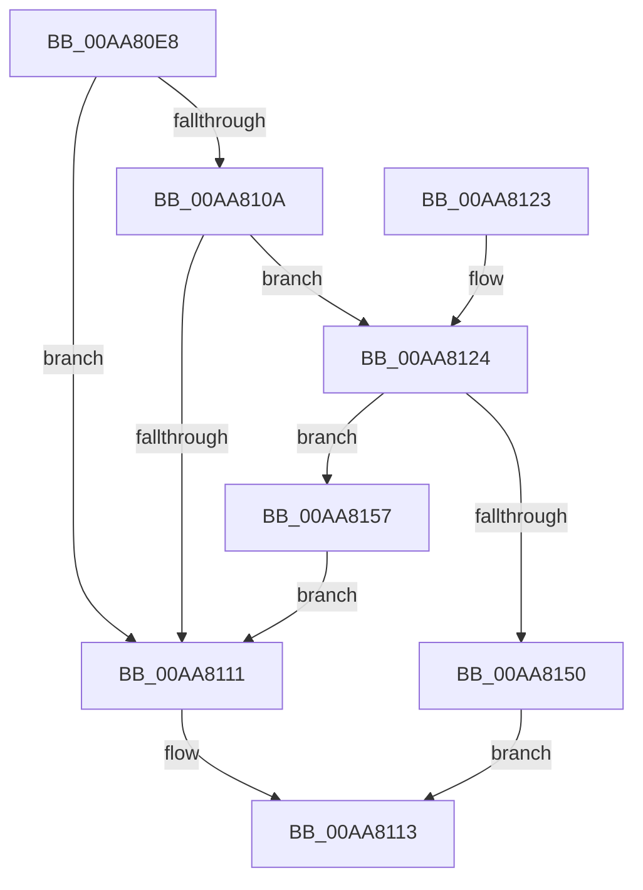

# PnpUnloadAttachedDriver

- RVA: `0x00AA80E8`–`0x00AA81A3` (길이 `187` bytes)
- VA: `0x0000000140AA80E8`
- 실행 섹션: `PAGE`
- PDB 이름 있음: `예`; PDB Function 태그: `아니요`
- unwind 정보 RVA: `0x000BBB5C`
- 디코드: `49`개 명령, `187/187` bytes 표시
- 미해석 바이트: `0` (있으면 어셈블리에 `.byte`로 보존)

> 이 문서는 커널 이미지의 기계어와 PDB 기호를 분석해 생성했습니다. 4번과 5번은 함수 원형과 자료형을 바이너리 사용 방식에서 추정한 C 해석이며 원본 소스 복구 결과는 아닙니다.

## 1. Dependencies

- 직접 호출 지점: **5**; 고유 호출 대상: **5**
- 직접 호출자로 확인된 함수: **2**
- RIP 상대 이미지 참조: **3**

### Outgoing calls
- `0x00AA8143` → [ExAllocatePool2](../../poolcode/B8/ExAllocatePool2_function_00B820F0.md) (function, `0x00B820F0`)
- `0x00AA8174` → [RtlStringCbPrintfW](../../text/40/RtlStringCbPrintfW_function_0040FB40.md) (function, `0x0040FB40`)
- `0x00AA8181` → [RtlInitUnicodeString](../../text/42/RtlInitUnicodeString_function_0042A780.md) (function, `0x0042A780`)
- `0x00AA818D` → [IopUnloadDriver](../AB/IopUnloadDriver_function_00ABF868.md) (function, `0x00ABF868`)
- `0x00AA8199` → [ExFreePoolWithTag](../../poolcode/B8/ExFreePoolWithTag_function_00B82870.md) (function, `0x00B82870`)

### Direct callers
- [PnpRemoveLockedDeviceNode](../../text/47/PnpRemoveLockedDeviceNode_function_004702AC.md) at `0x00470614`
- [sub_00B3807C](../B3/Unknown_function_00B3807C.md) at `0x00B38729`

### Static image references
- `0x00AA812E` → RVA `0x00FD9D28` (`PAGEDATA`; read)
- `0x00AA815B` → RVA `0x00AFD430` (` ?? ::NNGAKEGL::`string'`; read)
- `0x00AA8162` → RVA `0x00FD9D30` (`PAGEDATA`; read)

## 2. Other-region calls and transfers

- 다른 실행 섹션으로 향하는 call: **4**
  - `0x00AA8143` → [ExAllocatePool2](../../poolcode/B8/ExAllocatePool2_function_00B820F0.md) (`PAGE` → `POOLCODE`)
  - `0x00AA8174` → [RtlStringCbPrintfW](../../text/40/RtlStringCbPrintfW_function_0040FB40.md) (`PAGE` → `.text`)
  - `0x00AA8181` → [RtlInitUnicodeString](../../text/42/RtlInitUnicodeString_function_0042A780.md) (`PAGE` → `.text`)
  - `0x00AA8199` → [ExFreePoolWithTag](../../poolcode/B8/ExFreePoolWithTag_function_00B82870.md) (`PAGE` → `POOLCODE`)
- 별도 외부 분기/꼬리 이동을 확인하지 못했습니다.

## 3. Assembly (complete function range)

```asm
00AA80E8  48 89 5C 24 08                  mov qword ptr [rsp + 8], rbx
00AA80ED  48 89 74 24 10                  mov qword ptr [rsp + 0x10], rsi
00AA80F2  57                              push rdi
00AA80F3  48 83 EC 40                     sub rsp, 0x40
00AA80F7  48 83 79 28 00                  cmp qword ptr [rcx + 0x28], 0
00AA80FC  0F 57 C0                        xorps xmm0, xmm0
00AA80FF  48 8B 59 30                     mov rbx, qword ptr [rcx + 0x30]
00AA8103  0F 11 44 24 30                  movups xmmword ptr [rsp + 0x30], xmm0
00AA8108  74 07                           je 0x140aa8111
00AA810A  48 83 79 08 00                  cmp qword ptr [rcx + 8], 0
00AA810F  74 13                           je 0x140aa8124
00AA8111  33 C0                           xor eax, eax
00AA8113  48 8B 5C 24 50                  mov rbx, qword ptr [rsp + 0x50]
00AA8118  48 8B 74 24 58                  mov rsi, qword ptr [rsp + 0x58]
00AA811D  48 83 C4 40                     add rsp, 0x40
00AA8121  5F                              pop rdi
00AA8122  C3                              ret
00AA8123  CC                              int3
00AA8124  0F B7 4B 18                     movzx ecx, word ptr [rbx + 0x18]
00AA8128  41 B8 50 70 64 65               mov r8d, 0x65647050
00AA812E  0F B7 05 F3 1B 53 00            movzx eax, word ptr [rip + 0x531bf3]
00AA8135  83 C0 06                        add eax, 6
00AA8138  03 C8                           add ecx, eax
00AA813A  8B F1                           mov esi, ecx
00AA813C  8B D1                           mov edx, ecx
00AA813E  B9 00 01 00 00                  mov ecx, 0x100
00AA8143  E8 A8 9F 0D 00                  call 0x140b820f0
00AA8148  48 8B F8                        mov rdi, rax
00AA814B  48 85 C0                        test rax, rax
00AA814E  75 07                           jne 0x140aa8157
00AA8150  B8 9A 00 00 C0                  mov eax, 0xc000009a
00AA8155  EB BC                           jmp 0x140aa8113
00AA8157  48 8B 43 20                     mov rax, qword ptr [rbx + 0x20]
00AA815B  4C 8D 05 CE 52 05 00            lea r8, [rip + 0x552ce]
00AA8162  4C 8B 0D C7 1B 53 00            mov r9, qword ptr [rip + 0x531bc7]
00AA8169  48 8B D6                        mov rdx, rsi
00AA816C  48 8B CF                        mov rcx, rdi
00AA816F  48 89 44 24 20                  mov qword ptr [rsp + 0x20], rax
00AA8174  E8 C7 79 96 FF                  call 0x14040fb40
00AA8179  48 8B D7                        mov rdx, rdi
00AA817C  48 8D 4C 24 30                  lea rcx, [rsp + 0x30]
00AA8181  E8 FA 25 98 FF                  call 0x14042a780
00AA8186  B2 01                           mov dl, 1
00AA8188  48 8D 4C 24 30                  lea rcx, [rsp + 0x30]
00AA818D  E8 D6 76 01 00                  call 0x140abf868
00AA8192  48 8B 4C 24 38                  mov rcx, qword ptr [rsp + 0x38]
00AA8197  33 D2                           xor edx, edx
00AA8199  E8 D2 A6 0D 00                  call 0x140b82870
00AA819E  E9 6E FF FF FF                  jmp 0x140aa8111
```

## 4. C-style interpretation (structured pseudocode)

```c
__int64 __fastcall PnpUnloadAttachedDriver(__int64 a1)
{
    __int64 result;
    __int64 v_rsp;
    unsigned __int64 v_stack_m18;
    unsigned __int64 v_stack_p10;
    unsigned __int64 v_stack_p20;
    unsigned __int64 v_stack_p30;
    unsigned __int64 v_stack_p38;
    unsigned __int64 v_stack_p8;

    v_stack_p8 = v_rbx;
    v_stack_p10 = v_rsi;
    v_rsp = (v_rsp) - (64);
    v_stack_m18 = v_xmm0;
    if ((*(unsigned __int64 *)(a1 + 40)) == 0) goto loc_00AA8111;
    if ((*(unsigned __int64 *)(a1 + 8)) == 0) goto loc_00AA8124;
loc_00AA8111:
    result = 0;
loc_00AA8113:
    v_rsp = (v_rsp) + (64);
    return result;
loc_00AA8124:
    result = (unsigned int)((*(unsigned __int16 *)(v_rip + 5446643)) + (6));
    a1 = (unsigned int)((*(unsigned __int16 *)(v_stack_p8 + 24)) + ((unsigned int)(result)));
    result = ExAllocatePool2(256, (unsigned int)((unsigned int)(a1)), (unsigned int)(0x65647050ULL), a4);
    if (result != 0) goto loc_00AA8157;
    goto loc_00AA8113;
loc_00AA8157:
    v_stack_p20 = *(unsigned __int64 *)(v_stack_p8 + 32);
    result = RtlStringCbPrintfW(result, (unsigned int)((unsigned int)(a1)), v_rip + 348878, *(unsigned __int64 *)(v_rip + 5446599));
    result = RtlInitUnicodeString(v_stack_p30, result, v_rip + 348878, *(unsigned __int64 *)(v_rip + 5446599));
    result = IopUnloadDriver(v_stack_p30, 1, v_rip + 348878, *(unsigned __int64 *)(v_rip + 5446599));
    a2 = 0;
    result = ExFreePoolWithTag(v_stack_p38, a2, v_rip + 348878, *(unsigned __int64 *)(v_rip + 5446599));
    goto loc_00AA8111;
}
```

## 5. (Beta) C Style

```c
int64_t PnpUnloadAttachedDriver(void *Arg1)
{
    uint8_t *arg1 = (uint8_t *)Arg1;

    int64_t result;
    int64_t local_rsp;
    uint64_t v_stack_m18;
    uint64_t v_stack_p10;
    uint64_t v_stack_p20;
    uint64_t v_stack_p30;
    uint64_t v_stack_p38;
    uint64_t v_stack_p8;

    v_stack_p8 = local_rbx;
    v_stack_p10 = local_rsi;
    local_rsp = (local_rsp) - (64);
    v_stack_m18 = v_xmm0;
    if ((*(uint64_t *)(arg1 + 0x28)) == 0) goto loc_00AA8111;
    if ((*(uint64_t *)(arg1 + 0x8)) == 0) goto loc_00AA8124;
loc_00AA8111:
    result = 0;
loc_00AA8113:
    local_rsp = (local_rsp) + (64);
    return result;
loc_00AA8124:
    result = (uint32_t)((*(uint16_t *)(v_rip + 0x531BF3)) + (6));
    Arg1 = (uint32_t)((*(uint16_t *)(v_stack_p8 + 0x18)) + ((uint32_t)(result)));
    result = ExAllocatePool2(256, (uint32_t)((uint32_t)(Arg1)), (uint32_t)(0x65647050ULL), a4);
    if (result != 0) goto loc_00AA8157;
    goto loc_00AA8113;
loc_00AA8157:
    v_stack_p20 = *(uint64_t *)(v_stack_p8 + 0x20);
    result = RtlStringCbPrintfW(result, (uint32_t)((uint32_t)(Arg1)), v_rip + 348878, *(uint64_t *)(v_rip + 0x531BC7));
    result = RtlInitUnicodeString(v_stack_p30, result, v_rip + 348878, *(uint64_t *)(v_rip + 0x531BC7));
    result = IopUnloadDriver(v_stack_p30, 1, v_rip + 348878, *(uint64_t *)(v_rip + 0x531BC7));
    a2 = 0;
    result = ExFreePoolWithTag(v_stack_p38, a2, v_rip + 348878, *(uint64_t *)(v_rip + 0x531BC7));
    goto loc_00AA8111;
}
```

### 관측된 메모리 오프셋

구조체 형식이 확인되지 않은 접근은 인자 기준의 오프셋으로만 기록했습니다.

| 기준 인자 | 오프셋 표현 | 폭 (bit) | 접근 |
|---|---:|---:|---|
| `Arg1` | `+ 0x8` | `64` | `R` |
| `Arg1` | `+ 0x28` | `64` | `R` |
| `Arg1` | `+ 0x30` | `64` | `R` |

## 6. Execution-region graph

[열기: 2D/3D 그래프와 함수 탐색 컨트롤 패널](../../../control-panel.html?section=page&rva=0x00AA80E8&view=graph)

- 2D 그래프는 위에서 아래로 흐르고, 3D 그래프는 빈 공간을 드래그해 회전합니다. Shift+드래그는 이동, 휠은 확대·축소, 함수 노드 선택은 대상 보고서 이동입니다.

### Static fallback


