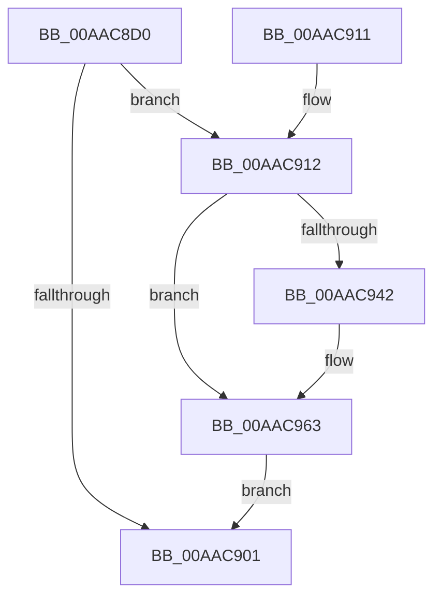

# PoQueryProcessEnergyTrackingState

- RVA: `0x00AAC8D0`–`0x00AAC96D` (길이 `157` bytes)
- VA: `0x0000000140AAC8D0`
- 실행 섹션: `PAGE`
- PDB 이름 있음: `예`; PDB Function 태그: `아니요`
- unwind 정보 RVA: `0x0005CAF4`
- 디코드: `40`개 명령, `157/157` bytes 표시
- 미해석 바이트: `0` (있으면 어셈블리에 `.byte`로 보존)

> 이 문서는 커널 이미지의 기계어와 PDB 기호를 분석해 생성했습니다. 4번과 5번은 함수 원형과 자료형을 바이너리 사용 방식에서 추정한 C 해석이며 원본 소스 복구 결과는 아닙니다.

## 1. Dependencies

- 직접 호출 지점: **4**; 고유 호출 대상: **4**
- 직접 호출자로 확인된 함수: **1**
- RIP 상대 이미지 참조: **0**

### Outgoing calls
- `0x00AAC8F0` → [memset](../../text/6C/memset_function_006C6C40.md) (function, `0x006C6C40`)
- `0x00AAC91C` → [PopAcquireRwLockShared](../../text/2D/PopAcquireRwLockShared_function_002D9A40.md) (function, `0x002D9A40`)
- `0x00AAC95E` → [RtlStringCchCopyNW](../../text/47/RtlStringCchCopyNW_function_0047169C.md) (function, `0x0047169C`)
- `0x00AAC966` → [PopReleaseRwLock](../../text/2D/PopReleaseRwLock_function_002DFBBC.md) (function, `0x002DFBBC`)

### Direct callers
- [NtQueryInformationProcess](../9A/NtQueryInformationProcess_function_009AA250.md) at `0x009ADD3E`

### Static image references
- 디코드된 RIP-relative 메모리 참조가 없습니다.

## 2. Other-region calls and transfers

- 다른 실행 섹션으로 향하는 call: **4**
  - `0x00AAC8F0` → [memset](../../text/6C/memset_function_006C6C40.md) (`PAGE` → `.text`)
  - `0x00AAC91C` → [PopAcquireRwLockShared](../../text/2D/PopAcquireRwLockShared_function_002D9A40.md) (`PAGE` → `.text`)
  - `0x00AAC95E` → [RtlStringCchCopyNW](../../text/47/RtlStringCchCopyNW_function_0047169C.md) (`PAGE` → `.text`)
  - `0x00AAC966` → [PopReleaseRwLock](../../text/2D/PopReleaseRwLock_function_002DFBBC.md) (`PAGE` → `.text`)
- 별도 외부 분기/꼬리 이동을 확인하지 못했습니다.

## 3. Assembly (complete function range)

```asm
00AAC8D0  48 89 5C 24 08                  mov qword ptr [rsp + 8], rbx
00AAC8D5  48 89 74 24 10                  mov qword ptr [rsp + 0x10], rsi
00AAC8DA  57                              push rdi
00AAC8DB  48 83 EC 20                     sub rsp, 0x20
00AAC8DF  48 8B FA                        mov rdi, rdx
00AAC8E2  48 8B D9                        mov rbx, rcx
00AAC8E5  48 8B CF                        mov rcx, rdi
00AAC8E8  33 D2                           xor edx, edx
00AAC8EA  41 B8 90 00 00 00               mov r8d, 0x90
00AAC8F0  E8 4B A3 C1 FF                  call 0x1406c6c40
00AAC8F5  48 8B 9B 68 06 00 00            mov rbx, qword ptr [rbx + 0x668]
00AAC8FC  48 85 DB                        test rbx, rbx
00AAC8FF  75 11                           jne 0x140aac912
00AAC901  48 8B 5C 24 30                  mov rbx, qword ptr [rsp + 0x30]
00AAC906  48 8B 74 24 38                  mov rsi, qword ptr [rsp + 0x38]
00AAC90B  48 83 C4 20                     add rsp, 0x20
00AAC90F  5F                              pop rdi
00AAC910  C3                              ret
00AAC911  CC                              int3
00AAC912  48 8D B3 B8 01 00 00            lea rsi, [rbx + 0x1b8]
00AAC919  48 8B CE                        mov rcx, rsi
00AAC91C  E8 1F D1 82 FF                  call 0x1402d9a40
00AAC921  8B 83 D8 01 00 00               mov eax, dword ptr [rbx + 0x1d8]
00AAC927  0F B7 C8                        movzx ecx, ax
00AAC92A  89 4F 04                        mov dword ptr [rdi + 4], ecx
00AAC92D  8B 83 DC 01 00 00               mov eax, dword ptr [rbx + 0x1dc]
00AAC933  89 47 08                        mov dword ptr [rdi + 8], eax
00AAC936  4C 8B 83 D0 01 00 00            mov r8, qword ptr [rbx + 0x1d0]
00AAC93D  4D 85 C0                        test r8, r8
00AAC940  74 21                           je 0x140aac963
00AAC942  4D 8B 48 18                     mov r9, qword ptr [r8 + 0x18]
00AAC946  48 8D 4F 10                     lea rcx, [rdi + 0x10]
00AAC94A  49 C1 E9 11                     shr r9, 0x11
00AAC94E  49 83 C0 20                     add r8, 0x20
00AAC952  41 81 E1 FF FF FF 1F            and r9d, 0x1fffffff
00AAC959  BA 40 00 00 00                  mov edx, 0x40
00AAC95E  E8 39 4D 9C FF                  call 0x14047169c
00AAC963  48 8B CE                        mov rcx, rsi
00AAC966  E8 51 32 83 FF                  call 0x1402dfbbc
00AAC96B  EB 94                           jmp 0x140aac901
```

## 4. C-style interpretation (structured pseudocode)

```c
__int64 __fastcall PoQueryProcessEnergyTrackingState(__int64 a1, __int64 a2)
{
    __int64 result;
    __int64 v_rsp;
    unsigned __int64 v_stack_p10;
    unsigned __int64 v_stack_p8;

    v_stack_p8 = v_rbx;
    v_stack_p10 = v_rsi;
    v_rsp = (v_rsp) - (32);
    a2 = 0;
    result = memset(a2, a2, 144, a4);
    if (*(unsigned __int64 *)(a1 + 1640) != 0) goto loc_00AAC912;
loc_00AAC901:
    v_rsp = (v_rsp) + (32);
    return result;
loc_00AAC912:
    result = PopAcquireRwLockShared(v_stack_p8 + 440, a2, 144, a4);
    *(unsigned int *)(a2 + 4) = (unsigned int)((unsigned __int16)((unsigned int)(*(unsigned int *)(v_stack_p8 + 472))));
    *(unsigned int *)(a2 + 8) = (unsigned int)((unsigned int)(*(unsigned int *)(v_stack_p8 + 476)));
    result = (unsigned int)(*(unsigned int *)(v_stack_p8 + 476));
    if (*(unsigned __int64 *)(v_stack_p8 + 464) != 0) {
        a4 = *(unsigned __int64 *)(*(unsigned __int64 *)(v_stack_p8 + 464) + 24);
        a1 = a2 + 16;
        a4 = (a4) >> (17);
        a3 = (*(unsigned __int64 *)(v_stack_p8 + 464)) + (32);
        a4 = (unsigned int)((a4) & (0x1FFFFFFFULL));
        a2 = 64;
        result = RtlStringCchCopyNW(a1, a2, a3, a4);
    }
    result = PopReleaseRwLock(v_stack_p8 + 440, a2, a3, a4);
    goto loc_00AAC901;
}
```

## 5. (Beta) C Style

```c
int64_t PoQueryProcessEnergyTrackingState(void *Arg1, void *Arg2)
{
    uint8_t *arg1 = (uint8_t *)Arg1;
    uint8_t *arg2 = (uint8_t *)Arg2;

    int64_t result;
    int64_t local_rsp;
    uint64_t v_stack_p10;
    uint64_t v_stack_p8;

    v_stack_p8 = local_rbx;
    v_stack_p10 = local_rsi;
    local_rsp = (local_rsp) - (32);
    Arg2 = 0;
    result = memset(Arg2, Arg2, 144, a4);
    if (*(uint64_t *)(arg1 + 0x668) != 0) goto loc_00AAC912;
loc_00AAC901:
    local_rsp = (local_rsp) + (32);
    return result;
loc_00AAC912:
    result = PopAcquireRwLockShared(v_stack_p8 + 440, Arg2, 144, a4);
    *(uint32_t *)(arg2 + 0x4) = (uint32_t)((uint16_t)((uint32_t)(*(uint32_t *)(v_stack_p8 + 0x1D8))));
    *(uint32_t *)(arg2 + 0x8) = (uint32_t)((uint32_t)(*(uint32_t *)(v_stack_p8 + 0x1DC)));
    result = (uint32_t)(*(uint32_t *)(v_stack_p8 + 0x1DC));
    if (*(uint64_t *)(v_stack_p8 + 0x1D0) != 0) {
        a4 = *(uint64_t *)(*(uint64_t *)(v_stack_p8 + 0x1D0) + 0x18);
        Arg1 = Arg2 + 16;
        a4 = (a4) >> (17);
        a3 = (*(uint64_t *)(v_stack_p8 + 0x1D0)) + (32);
        a4 = (uint32_t)((a4) & (0x1FFFFFFFULL));
        Arg2 = 64;
        result = RtlStringCchCopyNW(Arg1, Arg2, a3, a4);
    }
    result = PopReleaseRwLock(v_stack_p8 + 440, Arg2, a3, a4);
    goto loc_00AAC901;
}
```

### 관측된 메모리 오프셋

구조체 형식이 확인되지 않은 접근은 인자 기준의 오프셋으로만 기록했습니다.

| 기준 인자 | 오프셋 표현 | 폭 (bit) | 접근 |
|---|---:|---:|---|
| `Arg1` | `+ 0x668` | `64` | `R` |
| `Arg2` | `+ 0x4` | `32` | `W` |
| `Arg2` | `+ 0x8` | `32` | `W` |
| `Arg2` | `+ 0x10` | `64` | `R` |

## 6. Execution-region graph

[열기: 2D/3D 그래프와 함수 탐색 컨트롤 패널](../../../control-panel.html?section=page&rva=0x00AAC8D0&view=graph)

- 2D 그래프는 위에서 아래로 흐르고, 3D 그래프는 빈 공간을 드래그해 회전합니다. Shift+드래그는 이동, 휠은 확대·축소, 함수 노드 선택은 대상 보고서 이동입니다.

### Static fallback


