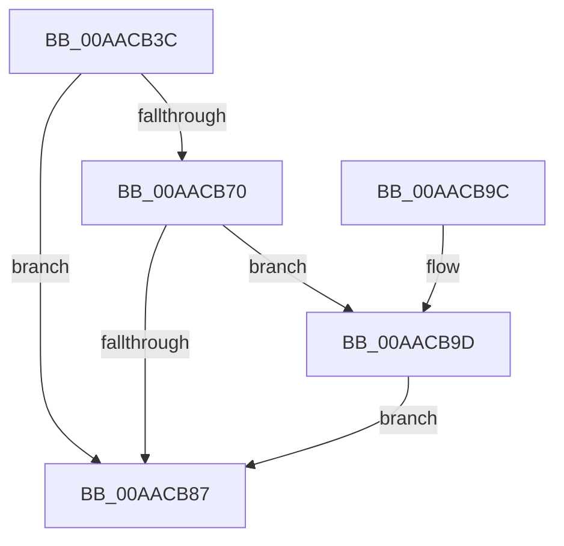

# PoRundownSystemTimer

- RVA: `0x00AACB3C`–`0x00AACC24` (길이 `232` bytes)
- VA: `0x0000000140AACB3C`
- 실행 섹션: `PAGE`
- PDB 이름 있음: `예`; PDB Function 태그: `아니요`
- unwind 정보 RVA: `0x000BBFB8`
- 디코드: `58`개 명령, `232/232` bytes 표시
- 미해석 바이트: `0` (있으면 어셈블리에 `.byte`로 보존)

> 이 문서는 커널 이미지의 기계어와 PDB 기호를 분석해 생성했습니다. 4번과 5번은 함수 원형과 자료형을 바이너리 사용 방식에서 추정한 C 해석이며 원본 소스 복구 결과는 아닙니다.

## 1. Dependencies

- 직접 호출 지점: **3**; 고유 호출 대상: **3**
- 직접 호출자로 확인된 함수: **1**
- RIP 상대 이미지 참조: **4**

### Outgoing calls
- `0x00AACB7E` → [EtwEventEnabled](../../text/39/EtwEventEnabled_function_00392450.md) (function, `0x00392450`)
- `0x00AACB8E` → [_security_check_cookie](../../text/6A/_security_check_cookie_function_006AC640.md) (function, `0x006AC640`)
- `0x00AACC1A` → [EtwWrite](../../text/41/EtwWrite_function_0041C720.md) (function, `0x0041C720`)

### Direct callers
- [ExTraceTimerResolution](../../text/4B/ExTraceTimerResolution_function_004B348C.md) at `0x004B34FD`

### Static image references
- `0x00AACB59` → RVA `0x00E0A740` (`.data`; read)
- `0x00AACB67` → RVA `0x00E67858` (`.data`; read)
- `0x00AACB70` → RVA `0x00F0B408` (`.data`; read)
- `0x00AACB77` → RVA `0x0001E0B8` (`.rdata`; read)

## 2. Other-region calls and transfers

- 다른 실행 섹션으로 향하는 call: **3**
  - `0x00AACB7E` → [EtwEventEnabled](../../text/39/EtwEventEnabled_function_00392450.md) (`PAGE` → `.text`)
  - `0x00AACB8E` → [_security_check_cookie](../../text/6A/_security_check_cookie_function_006AC640.md) (`PAGE` → `.text`)
  - `0x00AACC1A` → [EtwWrite](../../text/41/EtwWrite_function_0041C720.md) (`PAGE` → `.text`)
- 별도 외부 분기/꼬리 이동을 확인하지 못했습니다.

## 3. Assembly (complete function range)

```asm
00AACB3C  48 8B C4                        mov rax, rsp
00AACB3F  44 89 48 20                     mov dword ptr [rax + 0x20], r9d
00AACB43  44 89 40 18                     mov dword ptr [rax + 0x18], r8d
00AACB47  89 50 10                        mov dword ptr [rax + 0x10], edx
00AACB4A  89 48 08                        mov dword ptr [rax + 8], ecx
00AACB4D  55                              push rbp
00AACB4E  48 8D 68 B1                     lea rbp, [rax - 0x4f]
00AACB52  48 81 EC A0 00 00 00            sub rsp, 0xa0
00AACB59  48 8B 05 E0 DB 35 00            mov rax, qword ptr [rip + 0x35dbe0]
00AACB60  48 33 C4                        xor rax, rsp
00AACB63  48 89 45 37                     mov qword ptr [rbp + 0x37], rax
00AACB67  80 3D EA AC 3B 00 00            cmp byte ptr [rip + 0x3bacea], 0
00AACB6E  74 17                           je 0x140aacb87
00AACB70  48 8B 0D 91 E8 45 00            mov rcx, qword ptr [rip + 0x45e891]
00AACB77  48 8D 15 3A 15 57 FF            lea rdx, [rip - 0xa8eac6]
00AACB7E  E8 CD 58 8E FF                  call 0x140392450
00AACB83  84 C0                           test al, al
00AACB85  75 16                           jne 0x140aacb9d
00AACB87  48 8B 4D 37                     mov rcx, qword ptr [rbp + 0x37]
00AACB8B  48 33 CC                        xor rcx, rsp
00AACB8E  E8 AD FA BF FF                  call 0x1406ac640
00AACB93  48 81 C4 A0 00 00 00            add rsp, 0xa0
00AACB9A  5D                              pop rbp
00AACB9B  C3                              ret
00AACB9C  CC                              int3
00AACB9D  83 65 E3 00                     and dword ptr [rbp - 0x1d], 0
00AACBA1  48 8D 45 57                     lea rax, [rbp + 0x57]
00AACBA5  83 65 F3 00                     and dword ptr [rbp - 0xd], 0
00AACBA9  48 8D 15 08 15 57 FF            lea rdx, [rip - 0xa8eaf8]
00AACBB0  83 65 03 00                     and dword ptr [rbp + 3], 0
00AACBB4  B9 04 00 00 00                  mov ecx, 4
00AACBB9  83 65 13 00                     and dword ptr [rbp + 0x13], 0
00AACBBD  45 33 C0                        xor r8d, r8d
00AACBC0  83 65 23 00                     and dword ptr [rbp + 0x23], 0
00AACBC4  83 65 33 00                     and dword ptr [rbp + 0x33], 0
00AACBC8  48 89 45 D7                     mov qword ptr [rbp - 0x29], rax
00AACBCC  44 8D 49 02                     lea r9d, [rcx + 2]
00AACBD0  48 8D 45 5F                     lea rax, [rbp + 0x5f]
00AACBD4  89 4D DF                        mov dword ptr [rbp - 0x21], ecx
00AACBD7  48 89 45 E7                     mov qword ptr [rbp - 0x19], rax
00AACBDB  48 8D 45 67                     lea rax, [rbp + 0x67]
00AACBDF  48 89 45 F7                     mov qword ptr [rbp - 9], rax
00AACBE3  48 8D 45 6F                     lea rax, [rbp + 0x6f]
00AACBE7  48 89 45 07                     mov qword ptr [rbp + 7], rax
00AACBEB  48 8D 45 77                     lea rax, [rbp + 0x77]
00AACBEF  48 89 45 17                     mov qword ptr [rbp + 0x17], rax
00AACBF3  48 8D 45 7F                     lea rax, [rbp + 0x7f]
00AACBF7  48 89 45 27                     mov qword ptr [rbp + 0x27], rax
00AACBFB  48 8D 45 D7                     lea rax, [rbp - 0x29]
00AACBFF  89 4D EF                        mov dword ptr [rbp - 0x11], ecx
00AACC02  89 4D FF                        mov dword ptr [rbp - 1], ecx
00AACC05  89 4D 0F                        mov dword ptr [rbp + 0xf], ecx
00AACC08  89 4D 1F                        mov dword ptr [rbp + 0x1f], ecx
00AACC0B  89 4D 2F                        mov dword ptr [rbp + 0x2f], ecx
00AACC0E  48 8B 0D F3 E7 45 00            mov rcx, qword ptr [rip + 0x45e7f3]
00AACC15  48 89 44 24 20                  mov qword ptr [rsp + 0x20], rax
00AACC1A  E8 01 FB 96 FF                  call 0x14041c720
00AACC1F  E9 63 FF FF FF                  jmp 0x140aacb87
```

## 4. C-style interpretation (structured pseudocode)

```c
__int64 __fastcall PoRundownSystemTimer(int a1, int a2, int a3, int a4)
{
    __int64 result;
    __int64 v_rsp;
    unsigned __int64 v_stack_p20;

    *(unsigned int *)(v_rsp + 32) = a4;
    *(unsigned int *)(v_rsp + 24) = a3;
    *(unsigned int *)(v_rsp + 16) = a2;
    *(unsigned int *)(v_rsp + 8) = a1;
    v_rsp = (v_rsp) - (160);
    result = (*(unsigned __int64 *)(v_rip + 3529696)) ^ (v_rsp);
    *(unsigned __int64 *)(v_rsp - 79 + 55) = result;
    if ((*(unsigned __int8 *)(v_rip + 3910890)) == 0) goto loc_00AACB87;
    result = EtwEventEnabled(*(unsigned __int64 *)(v_rip + 4581521), v_rip - 11070150, a3, a4);
    if ((unsigned __int8)(result) != 0) goto loc_00AACB9D;
loc_00AACB87:
    a1 = (*(unsigned __int64 *)(v_rsp - 79 + 55)) ^ (v_rsp);
    result = _security_check_cookie(a1, v_rip - 11070150, a3, a4);
    v_rsp = (v_rsp) + (160);
    return result;
loc_00AACB9D:
    a3 = 0;
    *(unsigned __int64 *)(v_rsp - 79 - 41) = v_rsp - 79 + 87;
    *(unsigned int *)(v_rsp - 79 - 33) = 4;
    *(unsigned __int64 *)(v_rsp - 79 - 25) = v_rsp - 79 + 95;
    *(unsigned __int64 *)(v_rsp - 79 - 9) = v_rsp - 79 + 103;
    *(unsigned __int64 *)(v_rsp - 79 + 7) = v_rsp - 79 + 111;
    *(unsigned __int64 *)(v_rsp - 79 + 23) = v_rsp - 79 + 119;
    *(unsigned __int64 *)(v_rsp - 79 + 39) = v_rsp - 79 + 127;
    *(unsigned int *)(v_rsp - 79 - 17) = 4;
    *(unsigned int *)(v_rsp - 79 - 1) = 4;
    *(unsigned int *)(v_rsp - 79 + 15) = 4;
    *(unsigned int *)(v_rsp - 79 + 31) = 4;
    *(unsigned int *)(v_rsp - 79 + 47) = 4;
    v_stack_p20 = v_rsp - 79 - 41;
    result = EtwWrite(*(unsigned __int64 *)(v_rip + 4581363), v_rip - 11070200, a3, 4 + 2);
    goto loc_00AACB87;
}
```

## 5. (Beta) C Style

```c
int64_t PoRundownSystemTimer(int32_t Arg1, int32_t Arg2, int32_t Arg3, int32_t Arg4)
{
    int64_t result;
    int64_t local_rsp;
    uint64_t v_stack_p20;

    *(uint32_t *)(local_rsp + 0x20) = Arg4;
    *(uint32_t *)(local_rsp + 0x18) = Arg3;
    *(uint32_t *)(local_rsp + 0x10) = Arg2;
    *(uint32_t *)(local_rsp + 0x8) = Arg1;
    local_rsp = (local_rsp) - (160);
    result = (*(uint64_t *)(v_rip + 0x35DBE0)) ^ (local_rsp);
    *(uint64_t *)(local_rsp - 0x4F + 0x37) = result;
    if ((*(uint8_t *)(v_rip + 0x3BACEA)) == 0) goto loc_00AACB87;
    result = EtwEventEnabled(*(uint64_t *)(v_rip + 0x45E891), v_rip - 11070150, Arg3, Arg4);
    if ((uint8_t)(result) != 0) goto loc_00AACB9D;
loc_00AACB87:
    Arg1 = (*(uint64_t *)(local_rsp - 0x4F + 0x37)) ^ (local_rsp);
    result = _security_check_cookie(Arg1, v_rip - 11070150, Arg3, Arg4);
    local_rsp = (local_rsp) + (160);
    return result;
loc_00AACB9D:
    Arg3 = 0;
    *(uint64_t *)(local_rsp - 0x4F - 0x29) = local_rsp - 79 + 87;
    *(uint32_t *)(local_rsp - 0x4F - 0x21) = 4;
    *(uint64_t *)(local_rsp - 0x4F - 0x19) = local_rsp - 79 + 95;
    *(uint64_t *)(local_rsp - 0x4F - 0x9) = local_rsp - 79 + 103;
    *(uint64_t *)(local_rsp - 0x4F + 0x7) = local_rsp - 79 + 111;
    *(uint64_t *)(local_rsp - 0x4F + 0x17) = local_rsp - 79 + 119;
    *(uint64_t *)(local_rsp - 0x4F + 0x27) = local_rsp - 79 + 127;
    *(uint32_t *)(local_rsp - 0x4F - 0x11) = 4;
    *(uint32_t *)(local_rsp - 0x4F - 0x1) = 4;
    *(uint32_t *)(local_rsp - 0x4F + 0xF) = 4;
    *(uint32_t *)(local_rsp - 0x4F + 0x1F) = 4;
    *(uint32_t *)(local_rsp - 0x4F + 0x2F) = 4;
    v_stack_p20 = local_rsp - 79 - 41;
    result = EtwWrite(*(uint64_t *)(v_rip + 0x45E7F3), v_rip - 11070200, Arg3, 4 + 2);
    goto loc_00AACB87;
}
```

## 6. Execution-region graph

[열기: 2D/3D 그래프와 함수 탐색 컨트롤 패널](../../../control-panel.html?section=page&rva=0x00AACB3C&view=graph)

- 2D 그래프는 위에서 아래로 흐르고, 3D 그래프는 빈 공간을 드래그해 회전합니다. Shift+드래그는 이동, 휠은 확대·축소, 함수 노드 선택은 대상 보고서 이동입니다.

### Static fallback


