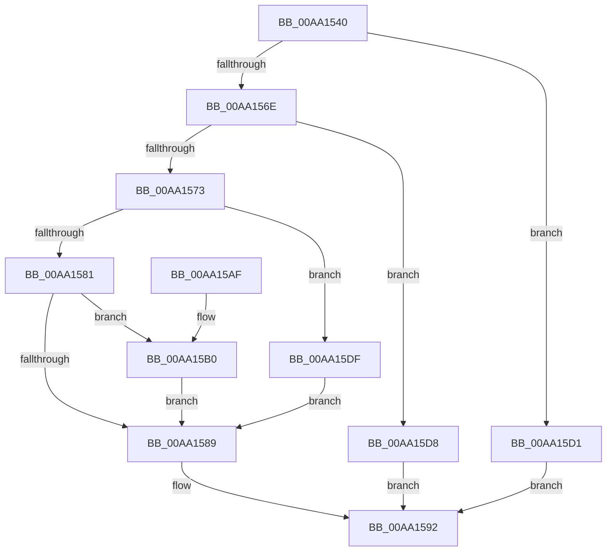

# PoSetThermalPassiveCooling

- RVA: `0x00AA1540`–`0x00AA15E6` (길이 `166` bytes)
- VA: `0x0000000140AA1540`
- 실행 섹션: `PAGE`
- PDB 이름 있음: `예`; PDB Function 태그: `아니요`
- unwind 정보 RVA: `0x00065004`
- 디코드: `48`개 명령, `166/166` bytes 표시
- 미해석 바이트: `0` (있으면 어셈블리에 `.byte`로 보존)

> 이 문서는 커널 이미지의 기계어와 PDB 기호를 분석해 생성했습니다. 4번과 5번은 함수 원형과 자료형을 바이너리 사용 방식에서 추정한 C 해석이며 원본 소스 복구 결과는 아닙니다.

## 1. Dependencies

- 직접 호출 지점: **5**; 고유 호출 대상: **5**
- 직접 호출자로 확인된 함수: **0**
- RIP 상대 이미지 참조: **0**

### Outgoing calls
- `0x00AA1577` → [PopAcquireRwLockExclusive](../../text/43/PopAcquireRwLockExclusive_function_00430B44.md) (function, `0x00430B44`)
- `0x00AA158D` → [PopReleaseRwLock](../../text/2D/PopReleaseRwLock_function_002DFBBC.md) (function, `0x002DFBBC`)
- `0x00AA15B4` → [PopThermalUpdatePassiveTimeTracking](PopThermalUpdatePassiveTimeTracking_function_00AA15EC.md) (function, `0x00AA15EC`)
- `0x00AA15C0` → [PopDiagTraceThermalRequestPassiveUpdate](PopDiagTraceThermalRequestPassiveUpdate_function_00AA1640.md) (function, `0x00AA1640`)
- `0x00AA15CA` → [PopPropogateCoolingChange](../../text/4E/PopPropogateCoolingChange_function_004E8FA0.md) (function, `0x004E8FA0`)

### Direct callers
- 이 함수 시작 RVA로 연결되는 직접 call은 확인되지 않았습니다. 간접 호출은 완전히 역산할 수 없습니다.

### Static image references
- 디코드된 RIP-relative 메모리 참조가 없습니다.

## 2. Other-region calls and transfers

- 다른 실행 섹션으로 향하는 call: **3**
  - `0x00AA1577` → [PopAcquireRwLockExclusive](../../text/43/PopAcquireRwLockExclusive_function_00430B44.md) (`PAGE` → `.text`)
  - `0x00AA158D` → [PopReleaseRwLock](../../text/2D/PopReleaseRwLock_function_002DFBBC.md) (`PAGE` → `.text`)
  - `0x00AA15CA` → [PopPropogateCoolingChange](../../text/4E/PopPropogateCoolingChange_function_004E8FA0.md) (`PAGE` → `.text`)
- 별도 외부 분기/꼬리 이동을 확인하지 못했습니다.

## 3. Assembly (complete function range)

```asm
00AA1540  48 8B C4                        mov rax, rsp
00AA1543  48 89 58 08                     mov qword ptr [rax + 8], rbx
00AA1547  48 89 68 10                     mov qword ptr [rax + 0x10], rbp
00AA154B  48 89 70 18                     mov qword ptr [rax + 0x18], rsi
00AA154F  48 89 78 20                     mov qword ptr [rax + 0x20], rdi
00AA1553  41 56                           push r14
00AA1555  48 83 EC 20                     sub rsp, 0x20
00AA1559  48 8B 69 20                     mov rbp, qword ptr [rcx + 0x20]
00AA155D  33 DB                           xor ebx, ebx
00AA155F  40 8A F2                        mov sil, dl
00AA1562  48 8B F9                        mov rdi, rcx
00AA1565  48 39 9D 98 00 00 00            cmp qword ptr [rbp + 0x98], rbx
00AA156C  74 63                           je 0x140aa15d1
00AA156E  80 FA 64                        cmp dl, 0x64
00AA1571  77 65                           ja 0x140aa15d8
00AA1573  48 8D 4D 20                     lea rcx, [rbp + 0x20]
00AA1577  E8 C8 F5 98 FF                  call 0x140430b44
00AA157C  38 5F 12                        cmp byte ptr [rdi + 0x12], bl
00AA157F  74 5E                           je 0x140aa15df
00AA1581  8A 57 10                        mov dl, byte ptr [rdi + 0x10]
00AA1584  40 3A D6                        cmp dl, sil
00AA1587  75 27                           jne 0x140aa15b0
00AA1589  48 8D 4D 20                     lea rcx, [rbp + 0x20]
00AA158D  E8 2A E6 83 FF                  call 0x1402dfbbc
00AA1592  48 8B 6C 24 38                  mov rbp, qword ptr [rsp + 0x38]
00AA1597  8B C3                           mov eax, ebx
00AA1599  48 8B 5C 24 30                  mov rbx, qword ptr [rsp + 0x30]
00AA159E  48 8B 74 24 40                  mov rsi, qword ptr [rsp + 0x40]
00AA15A3  48 8B 7C 24 48                  mov rdi, qword ptr [rsp + 0x48]
00AA15A8  48 83 C4 20                     add rsp, 0x20
00AA15AC  41 5E                           pop r14
00AA15AE  C3                              ret
00AA15AF  CC                              int3
00AA15B0  48 8D 4F 28                     lea rcx, [rdi + 0x28]
00AA15B4  E8 33 00 00 00                  call 0x140aa15ec
00AA15B9  48 8B CF                        mov rcx, rdi
00AA15BC  40 88 77 10                     mov byte ptr [rdi + 0x10], sil
00AA15C0  E8 7B 00 00 00                  call 0x140aa1640
00AA15C5  33 D2                           xor edx, edx
00AA15C7  48 8B CD                        mov rcx, rbp
00AA15CA  E8 D1 79 A4 FF                  call 0x1404e8fa0
00AA15CF  EB B8                           jmp 0x140aa1589
00AA15D1  BB BB 00 00 C0                  mov ebx, 0xc00000bb
00AA15D6  EB BA                           jmp 0x140aa1592
00AA15D8  BB 0D 00 00 C0                  mov ebx, 0xc000000d
00AA15DD  EB B3                           jmp 0x140aa1592
00AA15DF  BB 89 01 00 C0                  mov ebx, 0xc0000189
00AA15E4  EB A3                           jmp 0x140aa1589
```

## 4. C-style interpretation (structured pseudocode)

```c
__int64 __fastcall PoSetThermalPassiveCooling(__int64 a1, unsigned __int8 a2)
{
    __int64 result;
    __int64 v_rbx;
    __int64 v_rsp;
    unsigned __int64 v_stack_p10;
    unsigned __int64 v_stack_p18;
    unsigned __int64 v_stack_p20;
    unsigned __int64 v_stack_p8;

    *(unsigned __int64 *)(v_rsp + 8) = v_rbx;
    *(unsigned __int64 *)(v_rsp + 16) = v_rbp;
    *(unsigned __int64 *)(v_rsp + 24) = v_rsi;
    *(unsigned __int64 *)(v_rsp + 32) = v_rdi;
    v_rsp = (v_rsp) - (32);
    v_rbx = 0;
    if ((*(unsigned __int64 *)(*(unsigned __int64 *)(a1 + 32) + 152)) == 0) goto loc_00AA15D1;
    if (a2 > 100) goto loc_00AA15D8;
    result = PopAcquireRwLockExclusive(*(unsigned __int64 *)(a1 + 32) + 32, a2, a3, a4);
    if ((*(unsigned __int8 *)(a1 + 18)) == 0) goto loc_00AA15DF;
    if (((unsigned __int8)(*(unsigned __int8 *)(a1 + 16))) != a2) goto loc_00AA15B0;
loc_00AA1589:
    result = PopReleaseRwLock(*(unsigned __int64 *)(a1 + 32) + 32, *(unsigned __int8 *)(a1 + 16), a3, a4);
loc_00AA1592:
    v_rsp = (v_rsp) + (32);
    return 0;
loc_00AA15B0:
    result = PopThermalUpdatePassiveTimeTracking(v_stack_p20 + 40, *(unsigned __int8 *)(a1 + 16), a3, a4);
    *(unsigned __int8 *)(v_stack_p20 + 16) = (unsigned __int8)(v_stack_p18);
    result = PopDiagTraceThermalRequestPassiveUpdate(v_stack_p20, *(unsigned __int8 *)(a1 + 16), a3, a4);
    a2 = 0;
    result = PopPropogateCoolingChange(v_stack_p10, a2, a3, a4);
    goto loc_00AA1589;
loc_00AA15D1:
    goto loc_00AA1592;
loc_00AA15D8:
    goto loc_00AA1592;
loc_00AA15DF:
    goto loc_00AA1589;
}
```

## 5. (Beta) C Style

```c
int64_t PoSetThermalPassiveCooling(void *Arg1, uint8_t Arg2)
{
    uint8_t *arg1 = (uint8_t *)Arg1;

    int64_t result;
    int64_t local_rbx;
    int64_t local_rsp;
    uint64_t v_stack_p10;
    uint64_t v_stack_p18;
    uint64_t v_stack_p20;
    uint64_t v_stack_p8;

    *(uint64_t *)(local_rsp + 0x8) = local_rbx;
    *(uint64_t *)(local_rsp + 0x10) = local_rbp;
    *(uint64_t *)(local_rsp + 0x18) = local_rsi;
    *(uint64_t *)(local_rsp + 0x20) = local_rdi;
    local_rsp = (local_rsp) - (32);
    local_rbx = 0;
    if ((*(uint64_t *)(*(uint64_t *)(arg1 + 0x20) + 0x98)) == 0) goto loc_00AA15D1;
    if (Arg2 > 100) goto loc_00AA15D8;
    result = PopAcquireRwLockExclusive(*(uint64_t *)(arg1 + 0x20) + 32, Arg2, a3, a4);
    if ((*(uint8_t *)(arg1 + 0x12)) == 0) goto loc_00AA15DF;
    if (((uint8_t)(*(uint8_t *)(arg1 + 0x10))) != Arg2) goto loc_00AA15B0;
loc_00AA1589:
    result = PopReleaseRwLock(*(uint64_t *)(arg1 + 0x20) + 32, *(uint8_t *)(arg1 + 0x10), a3, a4);
loc_00AA1592:
    local_rsp = (local_rsp) + (32);
    return 0;
loc_00AA15B0:
    result = PopThermalUpdatePassiveTimeTracking(v_stack_p20 + 40, *(uint8_t *)(arg1 + 0x10), a3, a4);
    *(uint8_t *)(v_stack_p20 + 0x10) = (uint8_t)(v_stack_p18);
    result = PopDiagTraceThermalRequestPassiveUpdate(v_stack_p20, *(uint8_t *)(arg1 + 0x10), a3, a4);
    Arg2 = 0;
    result = PopPropogateCoolingChange(v_stack_p10, Arg2, a3, a4);
    goto loc_00AA1589;
loc_00AA15D1:
    goto loc_00AA1592;
loc_00AA15D8:
    goto loc_00AA1592;
loc_00AA15DF:
    goto loc_00AA1589;
}
```

### 관측된 메모리 오프셋

구조체 형식이 확인되지 않은 접근은 인자 기준의 오프셋으로만 기록했습니다.

| 기준 인자 | 오프셋 표현 | 폭 (bit) | 접근 |
|---|---:|---:|---|
| `Arg1` | `+ 0x10` | `8` | `R` |
| `Arg1` | `+ 0x10` | `8` | `W` |
| `Arg1` | `+ 0x12` | `8` | `R` |
| `Arg1` | `+ 0x20` | `64` | `R` |
| `Arg1` | `+ 0x28` | `64` | `R` |

## 6. Execution-region graph

[열기: 2D/3D 그래프와 함수 탐색 컨트롤 패널](../../../control-panel.html?section=page&rva=0x00AA1540&view=graph)

- 2D 그래프는 위에서 아래로 흐르고, 3D 그래프는 빈 공간을 드래그해 회전합니다. Shift+드래그는 이동, 휠은 확대·축소, 함수 노드 선택은 대상 보고서 이동입니다.

### Static fallback


