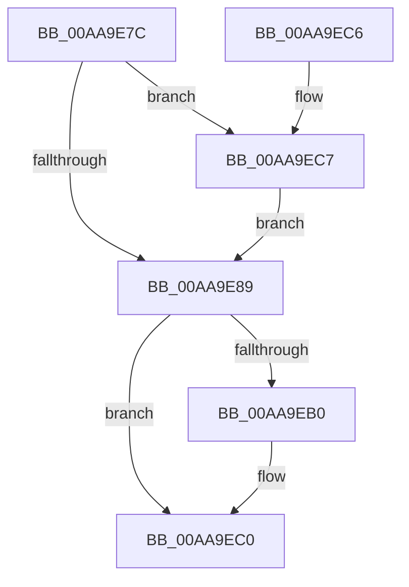

# PopAcquireTransitionLock

- RVA: `0x00AA9E7C`–`0x00AA9ED3` (길이 `87` bytes)
- VA: `0x0000000140AA9E7C`
- 실행 섹션: `PAGE`
- PDB 이름 있음: `예`; PDB Function 태그: `아니요`
- unwind 정보 RVA: `0x000B72DC`
- 디코드: `24`개 명령, `87/87` bytes 표시
- 미해석 바이트: `0` (있으면 어셈블리에 `.byte`로 보존)

> 이 문서는 커널 이미지의 기계어와 PDB 기호를 분석해 생성했습니다. 4번과 5번은 함수 원형과 자료형을 바이너리 사용 방식에서 추정한 C 해석이며 원본 소스 복구 결과는 아닙니다.

## 1. Dependencies

- 직접 호출 지점: **2**; 고유 호출 대상: **2**
- 직접 호출자로 확인된 함수: **6**
- RIP 상대 이미지 참조: **3**

### Outgoing calls
- `0x00AA9EA0` → [KeWaitForSingleObject](../../text/20/KeWaitForSingleObject_function_0020E6B0.md) (function, `0x0020E6B0`)
- `0x00AA9ECC` → [PopDirectedDripsNotify](../A8/PopDirectedDripsNotify_function_00A80850.md) (function, `0x00A80850`)

### Direct callers
- [PoInitHiberServices](../75/PoInitHiberServices_function_007537C4.md) at `0x00753812`
- [PopWnfHibernatePolicyCallback](../75/PopWnfHibernatePolicyCallback_function_0075E3C0.md) at `0x0075E3ED`
- [PopNotifyPolicyDevice](../76/PopNotifyPolicyDevice_function_00765FF0.md) at `0x00766036`
- [NtPowerInformation](../95/NtPowerInformation_function_00955D80.md) at `0x009565F0`
- [NtPowerInformation](../95/NtPowerInformation_function_00955D80.md) at `0x00957311`
- [NtPowerInformation](../95/NtPowerInformation_function_00955D80.md) at `0x00957CAD`
- [PopPowerInformationInternal](../A8/PopPowerInformationInternal_function_00A8B7C0.md) at `0x00A8B95E`
- [PopPowerInformationInternal](../A8/PopPowerInformationInternal_function_00A8B7C0.md) at `0x00A8C8AB`
- [PopAcquireTransitionLockAfterSleep](../../pagelk/B7/PopAcquireTransitionLockAfterSleep_function_00B7C61C.md) at `0x00B7C64E`

### Static image references
- `0x00AA9E8F` → RVA `0x00F0B900` (`.data`; read)
- `0x00AA9EA5` → RVA `0x00F0B7D0` (`.data`; write)
- `0x00AA9EB9` → RVA `0x00F0B7D8` (`.data`; write)

## 2. Other-region calls and transfers

- 다른 실행 섹션으로 향하는 call: **1**
  - `0x00AA9EA0` → [KeWaitForSingleObject](../../text/20/KeWaitForSingleObject_function_0020E6B0.md) (`PAGE` → `.text`)
- 별도 외부 분기/꼬리 이동을 확인하지 못했습니다.

## 3. Assembly (complete function range)

```asm
00AA9E7C  40 53                           push rbx
00AA9E7E  48 83 EC 30                     sub rsp, 0x30
00AA9E82  8B D9                           mov ebx, ecx
00AA9E84  83 F9 07                        cmp ecx, 7
00AA9E87  75 3E                           jne 0x140aa9ec7
00AA9E89  48 83 64 24 20 00               and qword ptr [rsp + 0x20], 0
00AA9E8F  48 8D 0D 6A 1A 46 00            lea rcx, [rip + 0x461a6a]
00AA9E96  45 33 C9                        xor r9d, r9d
00AA9E99  45 33 C0                        xor r8d, r8d
00AA9E9C  41 8D 51 07                     lea edx, [r9 + 7]
00AA9EA0  E8 0B 48 76 FF                  call 0x14020e6b0
00AA9EA5  89 1D 25 19 46 00               mov dword ptr [rip + 0x461925], ebx
00AA9EAB  83 FB 01                        cmp ebx, 1
00AA9EAE  74 10                           je 0x140aa9ec0
00AA9EB0  65 48 8B 04 25 88 01 00 00      mov rax, qword ptr gs:[0x188]
00AA9EB9  48 89 05 18 19 46 00            mov qword ptr [rip + 0x461918], rax
00AA9EC0  48 83 C4 30                     add rsp, 0x30
00AA9EC4  5B                              pop rbx
00AA9EC5  C3                              ret
00AA9EC6  CC                              int3
00AA9EC7  33 D2                           xor edx, edx
00AA9EC9  8D 4A 08                        lea ecx, [rdx + 8]
00AA9ECC  E8 7F 69 FD FF                  call 0x140a80850
00AA9ED1  EB B6                           jmp 0x140aa9e89
```

## 4. C-style interpretation (structured pseudocode)

```c
__int64 __fastcall PopAcquireTransitionLock(int a1, __int64 a2, int a3, int a4)
{
    __int64 result;
    __int64 v_rsp;
    unsigned __int64 v_stack_m18;

    v_rsp = (v_rsp) - (48);
    if (a1 != 7) goto loc_00AA9EC7;
loc_00AA9E89:
    a4 = 0;
    a3 = 0;
    result = KeWaitForSingleObject(v_rip + 4594282, a4 + 7, a3, a4);
    *(unsigned int *)(v_rip + 4593957) = (unsigned int)((unsigned int)(a1));
    if (((unsigned int)((unsigned int)(a1))) != 1) {
        result = *(unsigned __int64 *)(gs_base + (0 + 392));
        *(unsigned __int64 *)(v_rip + 4593944) = result;
    }
    v_rsp = (v_rsp) + (48);
    return result;
loc_00AA9EC7:
    a2 = 0;
    result = PopDirectedDripsNotify(a2 + 8, a2, a3, a4);
    goto loc_00AA9E89;
}
```

## 5. (Beta) C Style

```c
int64_t PopAcquireTransitionLock(int32_t Arg1, int64_t Arg2, int32_t Arg3, int32_t Arg4)
{
    int64_t result;
    int64_t local_rsp;
    uint64_t v_stack_m18;

    local_rsp = (local_rsp) - (48);
    if (Arg1 != 7) goto loc_00AA9EC7;
loc_00AA9E89:
    Arg4 = 0;
    Arg3 = 0;
    result = KeWaitForSingleObject(v_rip + 4594282, Arg4 + 7, Arg3, Arg4);
    *(uint32_t *)(v_rip + 0x461925) = (uint32_t)((uint32_t)(Arg1));
    if (((uint32_t)((uint32_t)(Arg1))) != 1) {
        result = *(uint64_t *)(gs_base + (0 + 0x188));
        *(uint64_t *)(v_rip + 0x461918) = result;
    }
    local_rsp = (local_rsp) + (48);
    return result;
loc_00AA9EC7:
    Arg2 = 0;
    result = PopDirectedDripsNotify(Arg2 + 8, Arg2, Arg3, Arg4);
    goto loc_00AA9E89;
}
```

## 6. Execution-region graph

[열기: 2D/3D 그래프와 함수 탐색 컨트롤 패널](../../../control-panel.html?section=page&rva=0x00AA9E7C&view=graph)

- 2D 그래프는 위에서 아래로 흐르고, 3D 그래프는 빈 공간을 드래그해 회전합니다. Shift+드래그는 이동, 휠은 확대·축소, 함수 노드 선택은 대상 보고서 이동입니다.

### Static fallback


