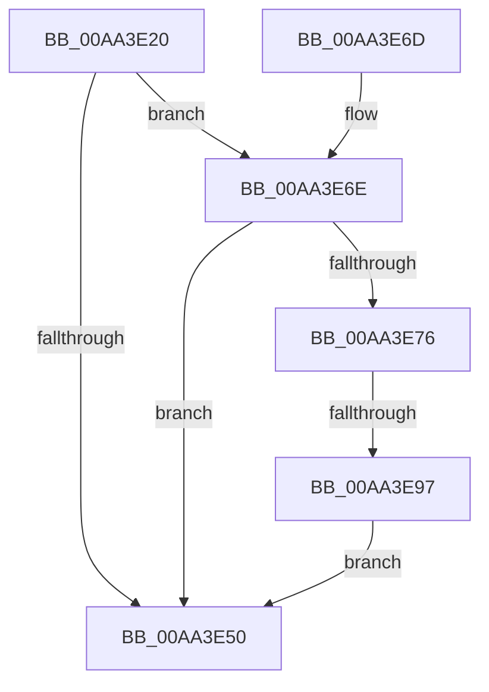

# PopCloneUnicodeString

- RVA: `0x00AA3E20`–`0x00AA3E9E` (길이 `126` bytes)
- VA: `0x0000000140AA3E20`
- 실행 섹션: `PAGE`
- PDB 이름 있음: `예`; PDB Function 태그: `예`
- unwind 정보 RVA: `0x0005CA74`
- 디코드: `37`개 명령, `126/126` bytes 표시
- 미해석 바이트: `0` (있으면 어셈블리에 `.byte`로 보존)

> 이 문서는 커널 이미지의 기계어와 PDB 기호를 분석해 생성했습니다. 4번과 5번은 함수 원형과 자료형을 바이너리 사용 방식에서 추정한 C 해석이며 원본 소스 복구 결과는 아닙니다.

## 1. Dependencies

- 직접 호출 지점: **0**; 고유 호출 대상: **0**
- 직접 호출자로 확인된 함수: **2**
- RIP 상대 이미지 참조: **0**

### Outgoing calls
- 직접 디코드된 call 명령이 없습니다.

### Direct callers
- [PopQueryMostRecentWakeSourceInfo](../75/PopQueryMostRecentWakeSourceInfo_function_0075C630.md) at `0x0075C9BA`
- [PopQueryMostRecentWakeSourceInfo](../75/PopQueryMostRecentWakeSourceInfo_function_0075C630.md) at `0x0075C9D8`
- [PopDirectedDripsDiagCreateDeviceDescription](../77/PopDirectedDripsDiagCreateDeviceDescription_function_00770FB4.md) at `0x00771090`
- [PopDirectedDripsDiagCreateDeviceDescription](../77/PopDirectedDripsDiagCreateDeviceDescription_function_00770FB4.md) at `0x007710A7`

### Static image references
- 디코드된 RIP-relative 메모리 참조가 없습니다.

## 2. Other-region calls and transfers

- 다른 실행 섹션으로 향하는 call: **0**
- call이 아닌 외부 분기/꼬리 이동: **1**
  - `0x00AA3E91` → [sub_00B49CA4](../B4/Unknown_function_00B49CA4.md) (`tail-transfer`)

## 3. Assembly (complete function range)

```asm
00AA3E20  48 8B C4                        mov rax, rsp
00AA3E23  48 89 58 08                     mov qword ptr [rax + 8], rbx
00AA3E27  48 89 68 10                     mov qword ptr [rax + 0x10], rbp
00AA3E2B  48 89 70 18                     mov qword ptr [rax + 0x18], rsi
00AA3E2F  48 89 78 20                     mov qword ptr [rax + 0x20], rdi
00AA3E33  41 56                           push r14
00AA3E35  48 83 EC 20                     sub rsp, 0x20
00AA3E39  0F 57 C0                        xorps xmm0, xmm0
00AA3E3C  33 DB                           xor ebx, ebx
00AA3E3E  0F 11 02                        movups xmmword ptr [rdx], xmm0
00AA3E41  4C 8B 41 08                     mov r8, qword ptr [rcx + 8]
00AA3E45  48 8B FA                        mov rdi, rdx
00AA3E48  48 8B F1                        mov rsi, rcx
00AA3E4B  4D 85 C0                        test r8, r8
00AA3E4E  75 1E                           jne 0x140aa3e6e
00AA3E50  48 8B 6C 24 38                  mov rbp, qword ptr [rsp + 0x38]
00AA3E55  8B C3                           mov eax, ebx
00AA3E57  48 8B 5C 24 30                  mov rbx, qword ptr [rsp + 0x30]
00AA3E5C  48 8B 74 24 40                  mov rsi, qword ptr [rsp + 0x40]
00AA3E61  48 8B 7C 24 48                  mov rdi, qword ptr [rsp + 0x48]
00AA3E66  48 83 C4 20                     add rsp, 0x20
00AA3E6A  41 5E                           pop r14
00AA3E6C  C3                              ret
00AA3E6D  CC                              int3
00AA3E6E  0F B7 01                        movzx eax, word ptr [rcx]
00AA3E71  83 F8 02                        cmp eax, 2
00AA3E74  72 DA                           jb 0x140aa3e50
00AA3E76  D1 E8                           shr eax, 1
00AA3E78  8D 14 00                        lea edx, [rax + rax]
00AA3E7B  FF C8                           dec eax
00AA3E7D  44 8D 72 02                     lea r14d, [rdx + 2]
00AA3E81  66 41 39 1C 40                  cmp word ptr [r8 + rax*2], bx
00AA3E86  44 0F 44 F2                     cmove r14d, edx
00AA3E8A  41 81 FE FF FF 00 00            cmp r14d, 0xffff
00AA3E91  0F 82 0D 5E 0A 00               jb 0x140b49ca4
00AA3E97  BB 05 00 00 80                  mov ebx, 0x80000005
00AA3E9C  EB B2                           jmp 0x140aa3e50
```

## 4. C-style interpretation (structured pseudocode)

```c
__int64 __fastcall PopCloneUnicodeString(__int64 a1, __int64 a2)
{
    __int64 result;
    __int64 v_r14;
    __int64 v_rbx;
    __int64 v_rsp;
    unsigned __int64 v_stack_p10;
    unsigned __int64 v_stack_p18;
    unsigned __int64 v_stack_p20;
    unsigned __int64 v_stack_p8;

    *(unsigned __int64 *)(v_rsp + 8) = v_rbx;
    *(unsigned __int64 *)(v_rsp + 16) = v_rbp;
    *(unsigned __int64 *)(v_rsp + 24) = v_rsi;
    *(unsigned __int64 *)(v_rsp + 32) = v_rdi;
    v_rsp = (v_rsp) - (32);
    v_rbx = 0;
    *(unsigned __int64 *)(a2) = v_xmm0;
    if (*(unsigned __int64 *)(a1 + 8) != 0) goto loc_00AA3E6E;
loc_00AA3E50:
    v_rsp = (v_rsp) + (32);
    return 0;
loc_00AA3E6E:
    if (((unsigned int)(*(unsigned __int16 *)(a1))) < 2) goto loc_00AA3E50;
    result = (unsigned int)((*(unsigned __int16 *)(a1)) >> (1));
    result = (unsigned int)((result) - 1);
    v_r14 = result + result * 1 + 2;
    if ((*(unsigned __int16 *)(*(unsigned __int64 *)(a1 + 8) + result * 2)) == ((unsigned __int16)(v_stack_p8))) { v_r14 = (unsigned int)(result + result * 1); }
    goto loc_00AA3E50;
}
```

## 5. (Beta) C Style

```c
int64_t PopCloneUnicodeString(void *Arg1, void *Arg2)
{
    uint8_t *arg1 = (uint8_t *)Arg1;
    uint8_t *arg2 = (uint8_t *)Arg2;

    int64_t result;
    int64_t local_r14;
    int64_t local_rbx;
    int64_t local_rsp;
    uint64_t v_stack_p10;
    uint64_t v_stack_p18;
    uint64_t v_stack_p20;
    uint64_t v_stack_p8;

    *(uint64_t *)(local_rsp + 0x8) = local_rbx;
    *(uint64_t *)(local_rsp + 0x10) = local_rbp;
    *(uint64_t *)(local_rsp + 0x18) = local_rsi;
    *(uint64_t *)(local_rsp + 0x20) = local_rdi;
    local_rsp = (local_rsp) - (32);
    local_rbx = 0;
    *(uint64_t *)(arg2) = v_xmm0;
    if (*(uint64_t *)(arg1 + 0x8) != 0) goto loc_00AA3E6E;
loc_00AA3E50:
    local_rsp = (local_rsp) + (32);
    return 0;
loc_00AA3E6E:
    if (((uint32_t)(*(uint16_t *)(arg1))) < 2) goto loc_00AA3E50;
    result = (uint32_t)((*(uint16_t *)(arg1)) >> (1));
    result = (uint32_t)((result) - 1);
    local_r14 = result + result * 1 + 2;
    if ((*(uint16_t *)(*(uint64_t *)(arg1 + 0x8) + result * 2)) == ((uint16_t)(v_stack_p8))) { local_r14 = (uint32_t)(result + result * 1); }
    goto loc_00AA3E50;
}
```

### 관측된 메모리 오프셋

구조체 형식이 확인되지 않은 접근은 인자 기준의 오프셋으로만 기록했습니다.

| 기준 인자 | 오프셋 표현 | 폭 (bit) | 접근 |
|---|---:|---:|---|
| `Arg1` | `+ 0x0` | `16` | `R` |
| `Arg1` | `+ 0x8` | `64` | `R` |
| `Arg2` | `+ 0x0` | `128` | `R` |

## 6. Execution-region graph

[열기: 2D/3D 그래프와 함수 탐색 컨트롤 패널](../../../control-panel.html?section=page&rva=0x00AA3E20&view=graph)

- 2D 그래프는 위에서 아래로 흐르고, 3D 그래프는 빈 공간을 드래그해 회전합니다. Shift+드래그는 이동, 휠은 확대·축소, 함수 노드 선택은 대상 보고서 이동입니다.

### Static fallback


