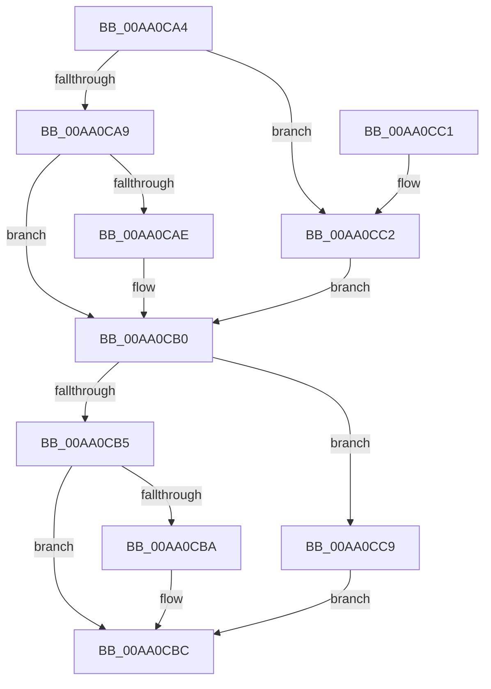

# PopCompareActions

- RVA: `0x00AA0CA4`–`0x00AA0CD0` (길이 `44` bytes)
- VA: `0x0000000140AA0CA4`
- 실행 섹션: `PAGE`
- PDB 이름 있음: `예`; PDB Function 태그: `아니요`
- unwind 정보 RVA: `0x000DB714`
- 디코드: `18`개 명령, `44/44` bytes 표시
- 미해석 바이트: `0` (있으면 어셈블리에 `.byte`로 보존)

> 이 문서는 커널 이미지의 기계어와 PDB 기호를 분석해 생성했습니다. 4번과 5번은 함수 원형과 자료형을 바이너리 사용 방식에서 추정한 C 해석이며 원본 소스 복구 결과는 아닙니다.

## 1. Dependencies

- 직접 호출 지점: **0**; 고유 호출 대상: **0**
- 직접 호출자로 확인된 함수: **1**
- RIP 상대 이미지 참조: **0**

### Outgoing calls
- 직접 디코드된 call 명령이 없습니다.

### Direct callers
- [PopExecutePowerAction](../75/PopExecutePowerAction_function_0075E6B4.md) at `0x0075E89A`
- [PopExecutePowerAction](../75/PopExecutePowerAction_function_0075E6B4.md) at `0x0075E999`
- [PopExecutePowerAction](../75/PopExecutePowerAction_function_0075E6B4.md) at `0x0075E9AD`
- [PopExecutePowerAction](../75/PopExecutePowerAction_function_0075E6B4.md) at `0x0075E9C6`

### Static image references
- 디코드된 RIP-relative 메모리 참조가 없습니다.

## 2. Other-region calls and transfers

- 다른 실행 섹션으로 향하는 call: **0**
- 별도 외부 분기/꼬리 이동을 확인하지 못했습니다.

## 3. Assembly (complete function range)

```asm
00AA0CA4  83 F9 07                        cmp ecx, 7
00AA0CA7  74 19                           je 0x140aa0cc2
00AA0CA9  83 F9 02                        cmp ecx, 2
00AA0CAC  7C 02                           jl 0x140aa0cb0
00AA0CAE  FF C1                           inc ecx
00AA0CB0  83 FA 07                        cmp edx, 7
00AA0CB3  74 14                           je 0x140aa0cc9
00AA0CB5  83 FA 02                        cmp edx, 2
00AA0CB8  7C 02                           jl 0x140aa0cbc
00AA0CBA  FF C2                           inc edx
00AA0CBC  2B CA                           sub ecx, edx
00AA0CBE  8B C1                           mov eax, ecx
00AA0CC0  C3                              ret
00AA0CC1  CC                              int3
00AA0CC2  B9 02 00 00 00                  mov ecx, 2
00AA0CC7  EB E7                           jmp 0x140aa0cb0
00AA0CC9  BA 02 00 00 00                  mov edx, 2
00AA0CCE  EB EC                           jmp 0x140aa0cbc
```

## 4. C-style interpretation (structured pseudocode)

```c
__int64 __fastcall PopCompareActions(int a1, int a2)
{
    if (a1 == 7) goto loc_00AA0CC2;
    if (a1 >= 2) {
        a1 = (unsigned int)((a1) + 1);
    }
    if (a2 == 7) goto loc_00AA0CC9;
    if (a2 >= 2) {
        a2 = (unsigned int)((a2) + 1);
    }
    a1 = (unsigned int)((a1) - (a2));
    return (unsigned int)(a1);
loc_00AA0CC2:
    goto loc_00AA0CB0;
loc_00AA0CC9:
    goto loc_00AA0CBC;
}
```

## 5. (Beta) C Style

```c
int64_t PopCompareActions(int32_t Arg1, int32_t Arg2)
{
    if (Arg1 == 7) goto loc_00AA0CC2;
    if (Arg1 >= 2) {
        Arg1 = (uint32_t)((Arg1) + 1);
    }
    if (Arg2 == 7) goto loc_00AA0CC9;
    if (Arg2 >= 2) {
        Arg2 = (uint32_t)((Arg2) + 1);
    }
    Arg1 = (uint32_t)((Arg1) - (Arg2));
    return (uint32_t)(Arg1);
loc_00AA0CC2:
    goto loc_00AA0CB0;
loc_00AA0CC9:
    goto loc_00AA0CBC;
}
```

## 6. Execution-region graph

[열기: 2D/3D 그래프와 함수 탐색 컨트롤 패널](../../../control-panel.html?section=page&rva=0x00AA0CA4&view=graph)

- 2D 그래프는 위에서 아래로 흐르고, 3D 그래프는 빈 공간을 드래그해 회전합니다. Shift+드래그는 이동, 휠은 확대·축소, 함수 노드 선택은 대상 보고서 이동입니다.

### Static fallback


