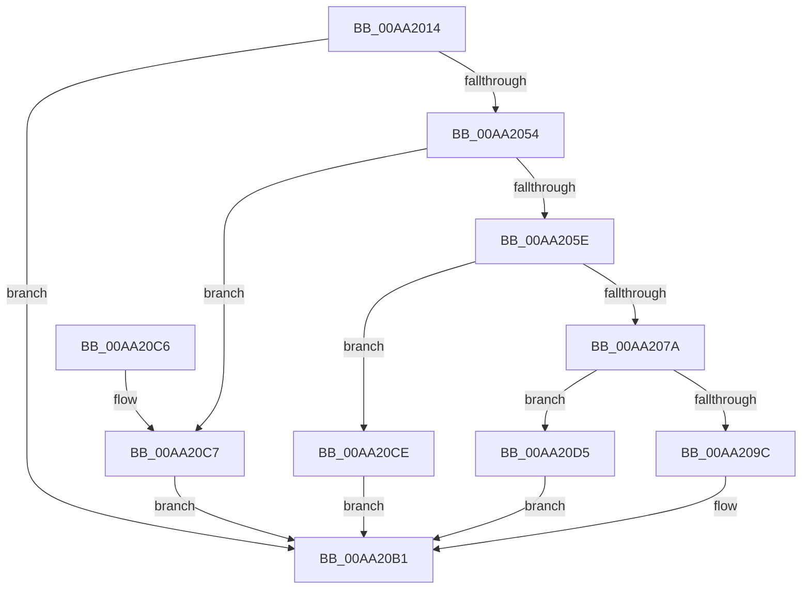

# PopDiagQueryDevicePropertyString

- RVA: `0x00AA2014`–`0x00AA20E4` (길이 `208` bytes)
- VA: `0x0000000140AA2014`
- 실행 섹션: `PAGE`
- PDB 이름 있음: `예`; PDB Function 태그: `아니요`
- unwind 정보 RVA: `0x000BAE3C`
- 디코드: `61`개 명령, `208/208` bytes 표시
- 미해석 바이트: `0` (있으면 어셈블리에 `.byte`로 보존)

> 이 문서는 커널 이미지의 기계어와 PDB 기호를 분석해 생성했습니다. 4번과 5번은 함수 원형과 자료형을 바이너리 사용 방식에서 추정한 C 해석이며 원본 소스 복구 결과는 아닙니다.

## 1. Dependencies

- 직접 호출 지점: **4**; 고유 호출 대상: **3**
- 직접 호출자로 확인된 함수: **3**
- RIP 상대 이미지 참조: **0**

### Outgoing calls
- `0x00AA2046` → [IoGetDeviceProperty](../8F/IoGetDeviceProperty_function_008FA720.md) (function, `0x008FA720`)
- `0x00AA206D` → [ExAllocatePool2](../../poolcode/B8/ExAllocatePool2_function_00B820F0.md) (function, `0x00B820F0`)
- `0x00AA2091` → [IoGetDeviceProperty](../8F/IoGetDeviceProperty_function_008FA720.md) (function, `0x008FA720`)
- `0x00AA20DD` → [ExFreePoolWithTag](../../poolcode/B8/ExFreePoolWithTag_function_00B82870.md) (function, `0x00B82870`)

### Direct callers
- [PopDiagTraceFxDeviceAccounting](../../text/42/PopDiagTraceFxDeviceAccounting_function_00426614.md) at `0x00426775`
- [PopDiagTraceFxDeviceAccounting](../../text/42/PopDiagTraceFxDeviceAccounting_function_00426614.md) at `0x0042678A`
- [PopDirectedDripsDiagCreateDeviceDescription](../77/PopDirectedDripsDiagCreateDeviceDescription_function_00770FB4.md) at `0x00770FFC`
- [PopDirectedDripsDiagCreateDeviceDescription](../77/PopDirectedDripsDiagCreateDeviceDescription_function_00770FB4.md) at `0x00771048`
- [PopDirectedDripsDiagCreateDeviceDescription](../77/PopDirectedDripsDiagCreateDeviceDescription_function_00770FB4.md) at `0x00771071`
- [sub_00B41088](../B4/Unknown_function_00B41088.md) at `0x00B410A8`
- [sub_00B41088](../B4/Unknown_function_00B41088.md) at `0x00B410BF`

### Static image references
- 디코드된 RIP-relative 메모리 참조가 없습니다.

## 2. Other-region calls and transfers

- 다른 실행 섹션으로 향하는 call: **2**
  - `0x00AA206D` → [ExAllocatePool2](../../poolcode/B8/ExAllocatePool2_function_00B820F0.md) (`PAGE` → `POOLCODE`)
  - `0x00AA20DD` → [ExFreePoolWithTag](../../poolcode/B8/ExFreePoolWithTag_function_00B82870.md) (`PAGE` → `POOLCODE`)
- 별도 외부 분기/꼬리 이동을 확인하지 못했습니다.

## 3. Assembly (complete function range)

```asm
00AA2014  48 8B C4                        mov rax, rsp
00AA2017  48 89 58 08                     mov qword ptr [rax + 8], rbx
00AA201B  48 89 68 10                     mov qword ptr [rax + 0x10], rbp
00AA201F  56                              push rsi
00AA2020  57                              push rdi
00AA2021  41 56                           push r14
00AA2023  48 83 EC 40                     sub rsp, 0x40
00AA2027  83 60 20 00                     and dword ptr [rax + 0x20], 0
00AA202B  49 8B F0                        mov rsi, r8
00AA202E  83 60 D8 00                     and dword ptr [rax - 0x28], 0
00AA2032  48 8D 40 20                     lea rax, [rax + 0x20]
00AA2036  45 33 C9                        xor r9d, r9d
00AA2039  48 89 44 24 20                  mov qword ptr [rsp + 0x20], rax
00AA203E  45 33 C0                        xor r8d, r8d
00AA2041  8B EA                           mov ebp, edx
00AA2043  4C 8B F1                        mov r14, rcx
00AA2046  E8 D5 86 E5 FF                  call 0x1408fa720
00AA204B  8B D8                           mov ebx, eax
00AA204D  3D 23 00 00 C0                  cmp eax, 0xc0000023
00AA2052  75 5D                           jne 0x140aa20b1
00AA2054  81 7C 24 78 FF FF 00 00         cmp dword ptr [rsp + 0x78], 0xffff
00AA205C  77 69                           ja 0x140aa20c7
00AA205E  8B 54 24 78                     mov edx, dword ptr [rsp + 0x78]
00AA2062  B9 00 01 00 00                  mov ecx, 0x100
00AA2067  41 B8 50 64 69 67               mov r8d, 0x67696450
00AA206D  E8 7E 00 0E 00                  call 0x140b820f0
00AA2072  48 8B F8                        mov rdi, rax
00AA2075  48 85 C0                        test rax, rax
00AA2078  74 54                           je 0x140aa20ce
00AA207A  44 8B 44 24 78                  mov r8d, dword ptr [rsp + 0x78]
00AA207F  48 8D 44 24 30                  lea rax, [rsp + 0x30]
00AA2084  4C 8B CF                        mov r9, rdi
00AA2087  48 89 44 24 20                  mov qword ptr [rsp + 0x20], rax
00AA208C  8B D5                           mov edx, ebp
00AA208E  49 8B CE                        mov rcx, r14
00AA2091  E8 8A 86 E5 FF                  call 0x1408fa720
00AA2096  8B D8                           mov ebx, eax
00AA2098  85 C0                           test eax, eax
00AA209A  78 39                           js 0x140aa20d5
00AA209C  0F B7 44 24 30                  movzx eax, word ptr [rsp + 0x30]
00AA20A1  66 89 06                        mov word ptr [rsi], ax
00AA20A4  0F B7 44 24 78                  movzx eax, word ptr [rsp + 0x78]
00AA20A9  66 89 46 02                     mov word ptr [rsi + 2], ax
00AA20AD  48 89 7E 08                     mov qword ptr [rsi + 8], rdi
00AA20B1  48 8B 6C 24 68                  mov rbp, qword ptr [rsp + 0x68]
00AA20B6  8B C3                           mov eax, ebx
00AA20B8  48 8B 5C 24 60                  mov rbx, qword ptr [rsp + 0x60]
00AA20BD  48 83 C4 40                     add rsp, 0x40
00AA20C1  41 5E                           pop r14
00AA20C3  5F                              pop rdi
00AA20C4  5E                              pop rsi
00AA20C5  C3                              ret
00AA20C6  CC                              int3
00AA20C7  BB 05 00 00 80                  mov ebx, 0x80000005
00AA20CC  EB E3                           jmp 0x140aa20b1
00AA20CE  BB 9A 00 00 C0                  mov ebx, 0xc000009a
00AA20D3  EB DC                           jmp 0x140aa20b1
00AA20D5  BA 50 64 69 67                  mov edx, 0x67696450
00AA20DA  48 8B CF                        mov rcx, rdi
00AA20DD  E8 8E 07 0E 00                  call 0x140b82870
00AA20E2  EB CD                           jmp 0x140aa20b1
```

## 4. C-style interpretation (structured pseudocode)

```c
__int64 __fastcall PopDiagQueryDevicePropertyString(__int64 a1, int a2, __int64 a3, int a4)
{
    __int64 result;
    __int64 v_rsp;
    unsigned __int64 v_stack_m28;
    unsigned __int64 v_stack_m38;
    unsigned __int64 v_stack_p10;
    unsigned int v_stack_p20;
    unsigned __int64 v_stack_p8;

    *(unsigned __int64 *)(v_rsp + 8) = v_rbx;
    *(unsigned __int64 *)(v_rsp + 16) = v_rbp;
    v_rsp = (v_rsp) - (64);
    a4 = 0;
    v_stack_m38 = v_rsp + 32;
    a3 = 0;
    result = IoGetDeviceProperty(a1, a2, a3, a4);
    if (((unsigned int)(result)) != 0xC0000023ULL) goto loc_00AA20B1;
    if (v_stack_p20 > 0xFFFFULL) goto loc_00AA20C7;
    result = ExAllocatePool2(256, (unsigned int)(v_stack_p20), (unsigned int)(0x67696450ULL), a4);
    if (result == 0) goto loc_00AA20CE;
    v_stack_m38 = v_stack_m28;
    result = IoGetDeviceProperty(a1, (unsigned int)((unsigned int)((unsigned int)(a2))), (unsigned int)(v_stack_p20), result);
    if (sign_flag) goto loc_00AA20D5;
    *(unsigned __int16 *)(a3) = (unsigned __int16)(v_stack_m28);
    *(unsigned __int16 *)(a3 + 2) = (unsigned __int16)(v_stack_p20);
    *(unsigned __int64 *)(a3 + 8) = result;
loc_00AA20B1:
    v_rsp = (v_rsp) + (64);
    return (unsigned int)((unsigned int)((unsigned int)((unsigned int)(result))));
loc_00AA20C7:
    goto loc_00AA20B1;
loc_00AA20CE:
    goto loc_00AA20B1;
loc_00AA20D5:
    result = ExFreePoolWithTag(result, (unsigned int)(0x67696450ULL), (unsigned int)(v_stack_p20), result);
    goto loc_00AA20B1;
}
```

## 5. (Beta) C Style

```c
int64_t PopDiagQueryDevicePropertyString(int64_t Arg1, int32_t Arg2, void *Arg3, int32_t Arg4)
{
    uint8_t *arg3 = (uint8_t *)Arg3;

    int64_t result;
    int64_t local_rsp;
    uint64_t v_stack_m28;
    uint64_t v_stack_m38;
    uint64_t v_stack_p10;
    uint32_t v_stack_p20;
    uint64_t v_stack_p8;

    *(uint64_t *)(local_rsp + 0x8) = local_rbx;
    *(uint64_t *)(local_rsp + 0x10) = local_rbp;
    local_rsp = (local_rsp) - (64);
    Arg4 = 0;
    v_stack_m38 = local_rsp + 32;
    Arg3 = 0;
    result = IoGetDeviceProperty(Arg1, Arg2, Arg3, Arg4);
    if (((uint32_t)(result)) != 0xC0000023ULL) goto loc_00AA20B1;
    if (v_stack_p20 > 0xFFFFULL) goto loc_00AA20C7;
    result = ExAllocatePool2(256, (uint32_t)(v_stack_p20), (uint32_t)(0x67696450ULL), Arg4);
    if (result == 0) goto loc_00AA20CE;
    v_stack_m38 = v_stack_m28;
    result = IoGetDeviceProperty(Arg1, (uint32_t)((uint32_t)((uint32_t)(Arg2))), (uint32_t)(v_stack_p20), result);
    if (sign_flag) goto loc_00AA20D5;
    *(uint16_t *)(arg3) = (uint16_t)(v_stack_m28);
    *(uint16_t *)(arg3 + 0x2) = (uint16_t)(v_stack_p20);
    *(uint64_t *)(arg3 + 0x8) = result;
loc_00AA20B1:
    local_rsp = (local_rsp) + (64);
    return (uint32_t)((uint32_t)((uint32_t)((uint32_t)(result))));
loc_00AA20C7:
    goto loc_00AA20B1;
loc_00AA20CE:
    goto loc_00AA20B1;
loc_00AA20D5:
    result = ExFreePoolWithTag(result, (uint32_t)(0x67696450ULL), (uint32_t)(v_stack_p20), result);
    goto loc_00AA20B1;
}
```

### 관측된 메모리 오프셋

구조체 형식이 확인되지 않은 접근은 인자 기준의 오프셋으로만 기록했습니다.

| 기준 인자 | 오프셋 표현 | 폭 (bit) | 접근 |
|---|---:|---:|---|
| `Arg3` | `+ 0x0` | `16` | `W` |
| `Arg3` | `+ 0x2` | `16` | `W` |
| `Arg3` | `+ 0x8` | `64` | `W` |

## 6. Execution-region graph

[열기: 2D/3D 그래프와 함수 탐색 컨트롤 패널](../../../control-panel.html?section=page&rva=0x00AA2014&view=graph)

- 2D 그래프는 위에서 아래로 흐르고, 3D 그래프는 빈 공간을 드래그해 회전합니다. Shift+드래그는 이동, 휠은 확대·축소, 함수 노드 선택은 대상 보고서 이동입니다.

### Static fallback


