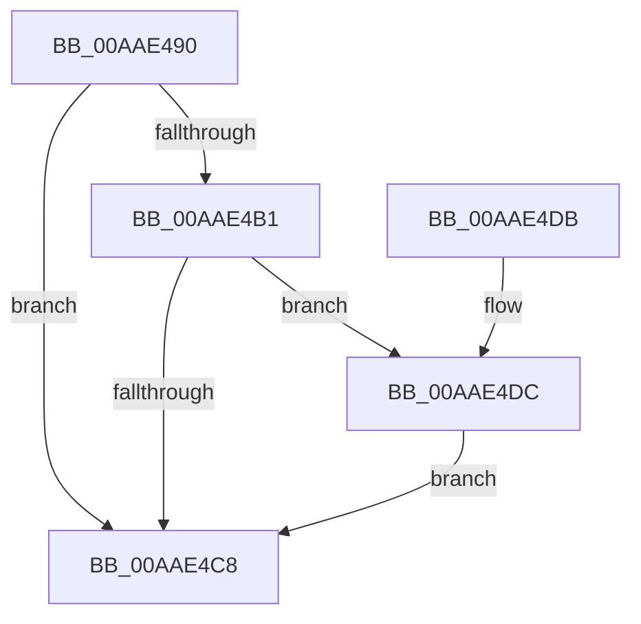

# PopDiagTraceCoolingExtensionPassiveUpdate

- RVA: `0x00AAE490`–`0x00AAE53E` (길이 `174` bytes)
- VA: `0x0000000140AAE490`
- 실행 섹션: `PAGE`
- PDB 이름 있음: `예`; PDB Function 태그: `아니요`
- unwind 정보 RVA: `0x000BC2D8`
- 디코드: `39`개 명령, `174/174` bytes 표시
- 미해석 바이트: `0` (있으면 어셈블리에 `.byte`로 보존)

> 이 문서는 커널 이미지의 기계어와 PDB 기호를 분석해 생성했습니다. 4번과 5번은 함수 원형과 자료형을 바이너리 사용 방식에서 추정한 C 해석이며 원본 소스 복구 결과는 아닙니다.

## 1. Dependencies

- 직접 호출 지점: **3**; 고유 호출 대상: **3**
- 직접 호출자로 확인된 함수: **2**
- RIP 상대 이미지 참조: **4**

### Outgoing calls
- `0x00AAE4BF` → [EtwEventEnabled](../../text/39/EtwEventEnabled_function_00392450.md) (function, `0x00392450`)
- `0x00AAE4D0` → [_security_check_cookie](../../text/6A/_security_check_cookie_function_006AC640.md) (function, `0x006AC640`)
- `0x00AAE537` → [EtwWrite](../../text/41/EtwWrite_function_0041C720.md) (function, `0x0041C720`)

### Direct callers
- [PopPropogateCoolingChange](../../text/4E/PopPropogateCoolingChange_function_004E8FA0.md) at `0x004E9031`
- [PopPropogateCoolingChangeV2](../../text/5D/PopPropogateCoolingChangeV2_function_005D1058.md) at `0x005D115A`

### Static image references
- `0x00AAE496` → RVA `0x00E0A740` (`.data`; read)
- `0x00AAE4A5` → RVA `0x00E67858` (`.data`; read)
- `0x00AAE4B1` → RVA `0x00F0B408` (`.data`; read)
- `0x00AAE4B8` → RVA `0x0001E100` (`.rdata`; read)

## 2. Other-region calls and transfers

- 다른 실행 섹션으로 향하는 call: **3**
  - `0x00AAE4BF` → [EtwEventEnabled](../../text/39/EtwEventEnabled_function_00392450.md) (`PAGE` → `.text`)
  - `0x00AAE4D0` → [_security_check_cookie](../../text/6A/_security_check_cookie_function_006AC640.md) (`PAGE` → `.text`)
  - `0x00AAE537` → [EtwWrite](../../text/41/EtwWrite_function_0041C720.md) (`PAGE` → `.text`)
- 별도 외부 분기/꼬리 이동을 확인하지 못했습니다.

## 3. Assembly (complete function range)

```asm
00AAE490  40 53                           push rbx
00AAE492  48 83 EC 70                     sub rsp, 0x70
00AAE496  48 8B 05 A3 C2 35 00            mov rax, qword ptr [rip + 0x35c2a3]
00AAE49D  48 33 C4                        xor rax, rsp
00AAE4A0  48 89 44 24 60                  mov qword ptr [rsp + 0x60], rax
00AAE4A5  80 3D AC 93 3B 00 00            cmp byte ptr [rip + 0x3b93ac], 0
00AAE4AC  48 8B D9                        mov rbx, rcx
00AAE4AF  74 17                           je 0x140aae4c8
00AAE4B1  48 8B 0D 50 CF 45 00            mov rcx, qword ptr [rip + 0x45cf50]
00AAE4B8  48 8D 15 41 FC 56 FF            lea rdx, [rip - 0xa903bf]
00AAE4BF  E8 8C 3F 8E FF                  call 0x140392450
00AAE4C4  84 C0                           test al, al
00AAE4C6  75 14                           jne 0x140aae4dc
00AAE4C8  48 8B 4C 24 60                  mov rcx, qword ptr [rsp + 0x60]
00AAE4CD  48 33 CC                        xor rcx, rsp
00AAE4D0  E8 6B E1 BF FF                  call 0x1406ac640
00AAE4D5  48 83 C4 70                     add rsp, 0x70
00AAE4D9  5B                              pop rbx
00AAE4DA  C3                              ret
00AAE4DB  CC                              int3
00AAE4DC  8A 43 52                        mov al, byte ptr [rbx + 0x52]
00AAE4DF  48 8D 15 1A FC 56 FF            lea rdx, [rip - 0xa903e6]
00AAE4E6  83 64 24 4C 00                  and dword ptr [rsp + 0x4c], 0
00AAE4EB  41 B9 02 00 00 00               mov r9d, 2
00AAE4F1  83 64 24 5C 00                  and dword ptr [rsp + 0x5c], 0
00AAE4F6  45 33 C0                        xor r8d, r8d
00AAE4F9  48 8B 0D 08 CF 45 00            mov rcx, qword ptr [rip + 0x45cf08]
00AAE500  88 44 24 30                     mov byte ptr [rsp + 0x30], al
00AAE504  48 8D 44 24 30                  lea rax, [rsp + 0x30]
00AAE509  48 89 44 24 40                  mov qword ptr [rsp + 0x40], rax
00AAE50E  48 8D 44 24 38                  lea rax, [rsp + 0x38]
00AAE513  48 89 44 24 50                  mov qword ptr [rsp + 0x50], rax
00AAE518  48 8D 44 24 40                  lea rax, [rsp + 0x40]
00AAE51D  48 89 44 24 20                  mov qword ptr [rsp + 0x20], rax
00AAE522  48 89 5C 24 38                  mov qword ptr [rsp + 0x38], rbx
00AAE527  C7 44 24 48 01 00 00 00         mov dword ptr [rsp + 0x48], 1
00AAE52F  C7 44 24 58 08 00 00 00         mov dword ptr [rsp + 0x58], 8
00AAE537  E8 E4 E1 96 FF                  call 0x14041c720
00AAE53C  EB 8A                           jmp 0x140aae4c8
```

## 4. C-style interpretation (structured pseudocode)

```c
__int64 __fastcall PopDiagTraceCoolingExtensionPassiveUpdate(__int64 a1, __int64 a2, int a3)
{
    __int64 result;
    __int64 v_rsp;
    unsigned __int64 v_stack_m18;
    unsigned __int64 v_stack_p20;
    unsigned __int8 v_stack_p30;
    unsigned __int64 v_stack_p38;
    unsigned __int64 v_stack_p40;
    unsigned int v_stack_p48;
    unsigned int v_stack_p4C;
    unsigned __int64 v_stack_p50;
    unsigned int v_stack_p58;
    unsigned int v_stack_p5C;

    v_rsp = (v_rsp) - (112);
    result = (*(unsigned __int64 *)(v_rip + 3523235)) ^ (v_rsp);
    v_stack_m18 = result;
    if ((*(unsigned __int8 *)(v_rip + 3904428)) == 0) goto loc_00AAE4C8;
    result = EtwEventEnabled(*(unsigned __int64 *)(v_rip + 4575056), v_rip - 11076543, a3, a4);
    if ((unsigned __int8)(result) != 0) goto loc_00AAE4DC;
loc_00AAE4C8:
    a1 = (v_stack_m18) ^ (v_rsp);
    result = _security_check_cookie(a1, v_rip - 11076543, a3, a4);
    v_rsp = (v_rsp) + (112);
    return result;
loc_00AAE4DC:
    a3 = 0;
    v_stack_p30 = (unsigned __int8)(*(unsigned __int8 *)(a1 + 82));
    v_stack_p40 = v_stack_p30;
    v_stack_p50 = v_stack_p38;
    v_stack_p20 = v_stack_p40;
    v_stack_p38 = a1;
    v_stack_p48 = 1;
    v_stack_p58 = 8;
    result = EtwWrite(*(unsigned __int64 *)(v_rip + 4574984), v_rip - 11076582, a3, 2);
    goto loc_00AAE4C8;
}
```

## 5. (Beta) C Style

```c
int64_t PopDiagTraceCoolingExtensionPassiveUpdate(void *Arg1, int64_t Arg2, int32_t Arg3)
{
    uint8_t *arg1 = (uint8_t *)Arg1;

    int64_t result;
    int64_t local_rsp;
    uint64_t v_stack_m18;
    uint64_t v_stack_p20;
    uint8_t v_stack_p30;
    uint64_t v_stack_p38;
    uint64_t v_stack_p40;
    uint32_t v_stack_p48;
    uint32_t v_stack_p4C;
    uint64_t v_stack_p50;
    uint32_t v_stack_p58;
    uint32_t v_stack_p5C;

    local_rsp = (local_rsp) - (112);
    result = (*(uint64_t *)(v_rip + 0x35C2A3)) ^ (local_rsp);
    v_stack_m18 = result;
    if ((*(uint8_t *)(v_rip + 0x3B93AC)) == 0) goto loc_00AAE4C8;
    result = EtwEventEnabled(*(uint64_t *)(v_rip + 0x45CF50), v_rip - 11076543, Arg3, a4);
    if ((uint8_t)(result) != 0) goto loc_00AAE4DC;
loc_00AAE4C8:
    Arg1 = (v_stack_m18) ^ (local_rsp);
    result = _security_check_cookie(Arg1, v_rip - 11076543, Arg3, a4);
    local_rsp = (local_rsp) + (112);
    return result;
loc_00AAE4DC:
    Arg3 = 0;
    v_stack_p30 = (uint8_t)(*(uint8_t *)(arg1 + 0x52));
    v_stack_p40 = v_stack_p30;
    v_stack_p50 = v_stack_p38;
    v_stack_p20 = v_stack_p40;
    v_stack_p38 = Arg1;
    v_stack_p48 = 1;
    v_stack_p58 = 8;
    result = EtwWrite(*(uint64_t *)(v_rip + 0x45CF08), v_rip - 11076582, Arg3, 2);
    goto loc_00AAE4C8;
}
```

### 관측된 메모리 오프셋

구조체 형식이 확인되지 않은 접근은 인자 기준의 오프셋으로만 기록했습니다.

| 기준 인자 | 오프셋 표현 | 폭 (bit) | 접근 |
|---|---:|---:|---|
| `Arg1` | `+ 0x52` | `8` | `R` |

## 6. Execution-region graph

[열기: 2D/3D 그래프와 함수 탐색 컨트롤 패널](../../../control-panel.html?section=page&rva=0x00AAE490&view=graph)

- 2D 그래프는 위에서 아래로 흐르고, 3D 그래프는 빈 공간을 드래그해 회전합니다. Shift+드래그는 이동, 휠은 확대·축소, 함수 노드 선택은 대상 보고서 이동입니다.

### Static fallback


